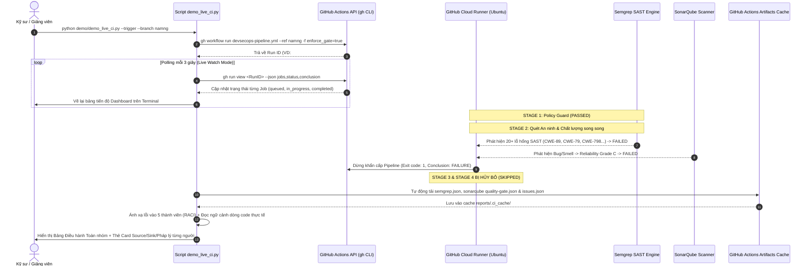

# HƯỚNG DẪN KỸ THUẬT & CƠ CHẾ HOẠT ĐỘNG CỦA SCRIPT DEMO CI THẬT (LIVE CI RUNNER)

> **Mã hiệu tài liệu:** `DOC-DEMO-LIVE-CI`  
> **Áp dụng cho:** Hệ thống DevSecOps CI/CD kiểm định an ninh & chất lượng mã nguồn tự động  
> **Vị trí script:** [`demo/demo_live_ci.py`](demo_live_ci.py)  
> **Dự án:** InlaneWeb Logistics Portal — Học viện Công nghệ Bưu chính Viễn thông (PTIT)

---

## 1. TỔNG QUAN VÀ MỤC ĐÍCH THIẾT KẾ

Khác với các kịch bản demo mô phỏng cục bộ (`sleep` và in dữ liệu tĩnh), **Live CI Runner** ([`demo_live_ci.py`](demo_live_ci.py)) là công cụ điều khiển và giám sát quy trình CI/CD **thực tế 100% trên nền tảng GitHub Actions Cloud**:

* **Kích hoạt luồng thật:** Gửi tín hiệu `workflow_dispatch` qua GitHub API để khởi chạy workflow `.github/workflows/devsecops-pipeline.yml`.
* **Giám sát trực tiếp thời gian thực (Live Dashboard):** Polling liên tục trạng thái thực thi của từng Job và Step, kết xuất giao diện bảng trực quan ngay trên terminal.
* **Chứng minh cơ chế Chặn đứng (Break-the-Build Gate):** Thể hiện rõ việc khi Stage 2 (Dev Gate: Semgrep SAST & SonarQube) phát hiện lỗi, tiến trình CI **lập tức bị ngắt khẩn cấp**, khóa hoàn toàn nút Merge trên Pull Request và **hủy bỏ triệt để (SKIPPED)** các giai đoạn đóng gói Docker (Stage 3) hay triển khai Production (Stage 4).
* **Phân tích chuyên sâu & Ánh xạ RACI theo 5 thành viên:** Tự động tải các tệp artifact thật (`semgrep.json`, `sonarqube-report.json`, GitHub Check Annotations) về máy, bóc tách và phân loại chính xác các vi phạm an ninh (SAST) và chất lượng (Code Quality) vào đúng 5 thành viên phụ trách kèm **Taint Source**, **Taint Sink**, **Căn cứ pháp lý** và **Ngữ cảnh dòng code thực tế**.

---

## 2. KIẾN TRÚC VÀ LUỒNG HOẠT ĐỘNG (END-TO-END WORKFLOW)



---

## 3. CƠ CHẾ HOẠT ĐỘNG CHI TIẾT CỦA CÁC MODULE

### Bước 1: Kích hoạt luồng kiểm định thật (Triggering)
Hàm `trigger_real_workflow(branch, enforce=True)`:
* Sử dụng lệnh `gh workflow run devsecops-pipeline.yml --ref <branch> -f enforce_gate=true`.
* Cờ `enforce_gate=true` đảm bảo các chốt chặn `semgrep_gate.py` và `sonarqube.py` được thực thi ở chế độ nghiêm ngặt nhất (Strict Mode), bắt buộc ngắt luồng khi phát hiện lỗ hổng mức `ERROR` hoặc `CRITICAL/MAJOR Bug`.
* Polling danh sách runs gần nhất để bắt đúng `databaseId` (Run ID) vừa sinh ra.

### Bước 2: Bảng điều khiển tiến trình thời gian thực (Live Dashboard)
Hàm `watch_live_ci_run(run_id)`:
* Cứ mỗi 3 giây, truy vấn metadata của Run ID thông qua `gh run view`.
* Hiển thị bảng ma trận 4 giai đoạn với huy hiệu trạng thái chuẩn:
  * `⏳ ĐANG THỰC THI (IN PROGRESS)` (kèm tên bước cụ thể đang chạy).
  * `✓ THÀNH CÔNG (PASSED)` (màu xanh lá).
  * `✗ THẤT BẠI (FAILED)` (màu đỏ).
  * `⚪ BỎ QUA (SKIPPED)` (màu xám - chốt chặn bảo vệ hoạt động).
* Ngay khi workflow chuyển sang trạng thái `completed`, nếu thất bại, script phát còi báo động **`🛑 [CI CHẶN ĐỨNG - BREAK-THE-BUILD]`** và kích hoạt bộ phân tích chi tiết.

### Bước 3: Nạp và trích xuất Artifacts chuyên sâu
Hàm `load_or_download_artifacts(run_id)`:
* Tự động tải 2 gói Artifacts do Cloud Runner kết xuất:
  1. `semgrep-security-report`: Chứa `semgrep.json` ghi lại toàn bộ phát hiện Taint Analysis.
  2. `sonarqube-report`: Chứa `quality-gate.json` (chỉ số Cổng chất lượng) và `issues.json` (danh sách lỗi chất lượng).
* Lưu trữ và nạp tự động từ thư mục đệm `reports/.ci_cache/` hoặc `scratch/ci_artifacts/` để tái sử dụng tức thì mà không cần tải lại nếu phân tích nhiều lần.

### Bước 4: Thuật toán ánh xạ RACI & Phân loại lỗi theo 5 thành viên
Hàm `get_member_for_file(file_path)` và `render_single_member_breakdown(...)`:
* So khớp đường dẫn tệp mã nguồn vi phạm với bảng từ khóa phân nhiệm trong `MEMBER_SCOPE_MAP`:
  1. **Nguyễn Giang Nam (`namng`)**: Cổng thông tin công cộng, tra cứu cảng biển & IaC (`ports.php`, `news.php`, `docker-compose.yml`).
  2. **Nguyễn Đình Hải (`haind`)**: Module Xác thực, API Vận tải & Kết nối CSDL (`login.php`, `port_detail.php`, `track_api.php`, `db.php`).
  3. **Đào Xuân Mạnh (`manhdx`)**: Cẩm nang Hàng hải & Hệ thống Kết xuất Báo cáo (`guide.php`, `report_download.php`, `admin_report_export.php`).
  4. **Lê Đức Anh (`anhld`)**: Tài khoản Đối tác, Chi tiết Vận tải & An toàn IaC Production (`account.php`, `account_update.php`, `shipment_detail.php`, `docker-compose.prod.yml`).
  5. **Nguyễn Phương Mai (`mainp`)**: Hệ thống Bình luận & Phân hệ Quản trị Admin (`comment_add.php`, `comment_delete.php`, `admin_console.php`, `admin_dashboard.php`).

### Bước 5: Bóc tách Taint Source, Taint Sink, Pháp lý và Mã nguồn
Với mỗi thành viên, hệ thống kết xuất báo cáo chuẩn xác **07 lỗi vi phạm nộp bài** (4 SAST + 3 Code Quality):
* **Taint Source**: Điểm vào của dữ liệu không an toàn (HTTP GET/POST, URL parameters, hardcoded secrets).
* **Taint Sink**: Điểm thực thi nguy hiểm (hàm `query()`, `mysqli_multi_query()`, câu lệnh nối chuỗi SQL, phản hồi `echo` không sanitize).
* **Căn cứ pháp lý & Chuẩn an toàn**: Trích dẫn cụ thể điều khoản của **Nghị định 13/2023/NĐ-CP** (Bảo vệ dữ liệu cá nhân), **GDPR Article 32/33**, tiêu chuẩn **ISO 27001** và **OWASP Top 10:2021**.
* **Ngữ cảnh dòng code vi phạm thực tế (`extract_code_context`)**: Đọc tệp nguồn trực tiếp trên đĩa, đánh số dòng và hiển thị con trỏ màu đỏ `➔` ngay tại dòng code gây ra lỗ hổng.

---

## 4. HƯỚNG DẪN SỬ DỤNG (CLI CHEATSHEET)

Người dùng thực thi thông qua tệp chính [`demo/demo_live_ci.py`](demo_live_ci.py).

> [!TIP]
> Trên hệ điều hành Windows, luôn thêm cờ `-X utf8` vào lệnh `python` để kích hoạt bộ mã UTF-8 tiêu chuẩn, đảm bảo hiển thị đúng các khung viền Unicode và tiếng Việt có dấu.

### 4.1. Lọc xem chi tiết theo từng thành viên (Khuyên dùng khi thuyết trình)
Xem riêng 5 lỗi thuộc phân hệ của từng người mà không cần gõ thêm cờ phụ:

```powershell
# [1] Xem phân hệ Nguyễn Giang Nam (namng)
python -X utf8 demo/demo_live_ci.py -m 1

# [2] Xem phân hệ Nguyễn Đình Hải (haind)
python -X utf8 demo/demo_live_ci.py -m 2

# [3] Xem phân hệ Đào Xuân Mạnh (manhdx)
python -X utf8 demo/demo_live_ci.py -m 3

# [4] Xem phân hệ Lê Đức Anh (anhld)
python -X utf8 demo/demo_live_ci.py -m 4

# [5] Xem phân hệ Nguyễn Phương Mai (mainp)
python -X utf8 demo/demo_live_ci.py -m 5
```
*(Bạn cũng có thể lọc theo username: `-m namng`, `-m haind`, `-m manhdx`, `-m anhld`, `-m mainp`)*.

---

### 4.2. Xem Bảng tổng hợp điều hành toàn nhóm
Hiển thị Bảng điều hành tổng quan 5 người ở đầu trang, sau đó lần lượt kết xuất chi tiết lỗi của từng thành viên:

```powershell
python -X utf8 demo/demo_live_ci.py --errors
```

---

### 4.3. Kích hoạt một đợt chạy CI MỚI trên GitHub Actions
Gửi lệnh trigger trực tiếp lên nhánh phát triển và tự động bật màn hình theo dõi tiến trình:

```powershell
# Kích hoạt trên nhánh namng (nhánh đang demo)
python -X utf8 demo/demo_live_ci.py --trigger --branch namng

# Kích hoạt trên nhánh dev (nhánh tích hợp chung)
python -X utf8 demo/demo_live_ci.py --trigger --branch dev
```

---

### 4.4. Theo dõi một lần chạy CI đang thực thi
Theo dõi trực tiếp quá trình quét của các Stage trên Cloud:

```powershell
# Theo dõi lần chạy mới nhất
python -X utf8 demo/demo_live_ci.py --watch

# Theo dõi một mã Run ID cụ thể (ví dụ: 41179854251)
python -X utf8 demo/demo_live_ci.py --watch 41179854251
```

---

### 4.5. Chế độ Menu tương tác (Interactive Mode)
Chạy script không kèm tham số để mở bảng chọn menu giao diện người dùng:

```powershell
python -X utf8 demo/demo_live_ci.py
```

Menu điều khiển sẽ xuất hiện:
```text
==================================================================================
        HỆ THỐNG KÍCH HOẠT & THEO DÕI CI THẬT TRÊN GITHUB ACTIONS                 
==================================================================================
Vui lòng chọn chế độ hoạt động:
  [1] 🚀 Kích hoạt luồng CI MỚI trên nhánh 'namng' (Chốt chặn Break-the-Build thật)
  [2] 🚀 Kích hoạt luồng CI MỚI trên nhánh 'dev' (Môi trường tích hợp chung)
  [3] 📡 Theo dõi lần chạy CI MỚI NHẤT gần đây
  [4] 🔍 Nhập mã Run ID cụ thể để theo dõi chi tiết
  [5] 🚨 Xem BẢNG CHI TIẾT LỖI VI PHẠM (SAST & Quality Gate) của lần chạy gần nhất
  [6] 🌐 Mở trang GitHub Actions trên trình duyệt Web
  [0] Thoát chương trình
```

---

## 5. ĐỐI SOÁT VỚI TIÊU CHUẨN ĐỒ ÁN VÀ BÁO CÁO BÀI TẬP LỚN

| Yêu cầu kiểm định | Cơ chế chứng minh trong Script | Tài liệu kỹ thuật tương ứng |
| :--- | :--- | :--- |
| **Shift-Left Security Gate** | Bắt lỗi trực tiếp tại Stage 2 Dev Gate (Semgrep + SonarQube) trước khi build Docker | [`docs/03-Kiểm soát an ninh và chất lượng mã nguồn.md`](../docs/03-Ki%E1%BB%83m%20so%C3%A1t%20an%20ninh%20v%C3%A0%20ch%E1%BA%A5t%20l%C6%B0%E1%BB%A3ng%20m%C3%A3%20ngu%E1%BB%93n.md) |
| **Break-the-Build Enforcement** | Trả Exit code 1, ngắt luồng CI, hủy bỏ triệt để Stage 3 & 4 | [`docs/02-Quy tắc triển khai.md`](../docs/02-Quy%20t%E1%BA%AFc%20tri%E1%BB%83n%20khai.md) |
| **Phân quyền trách nhiệm (RACI)** | Tự động phân loại 20 lỗi SAST và 15 lỗi Code Quality vào đúng 5 thành viên (7 lỗi/thành viên) | [`docs/02-Quy tắc triển khai.md`](../docs/02-Quy%20t%E1%BA%AFc%20tri%E1%BB%83n%20khai.md) |
| **Phân tích dòng dữ liệu (Taint Flow)** | Hiển thị rõ ràng Source (Input người dùng) và Sink (Hàm thực thi nhạy cảm) | [`docs/03-Kiểm soát an ninh và chất lượng mã nguồn.md`](../docs/03-Ki%E1%BB%83m%20so%C3%A1t%20an%20ninh%20v%C3%A0%20ch%E1%BA%A5t%20l%C6%B0%E1%BB%A3ng%20m%C3%A3%20ngu%E1%BB%93n.md) |
| **Tuân thủ pháp lý & Bảo vệ dữ liệu** | Viện dẫn Nghị định 13/2023/NĐ-CP và GDPR trong từng thẻ lỗ hổng | [`docs/05-Báo cáo bài tập lớn DevSecOps.md`](../docs/05-B%C3%A1o%20c%C3%A1o%20b%C3%A0i%20t%E1%BA%ADp%20l%E1%BB%9Bn%20DevSecOps.md) |

