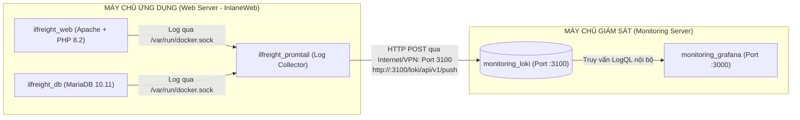

# HƯỚNG DẪN TRIỂN KHAI MÁY CHỦ GIÁM SÁT TẬP TRUNG (MONITORING SERVER)

Tài liệu này hướng dẫn chi tiết từng bước thiết lập cụm giám sát độc lập (**Grafana 11.0 + Loki 3.0**) trên **Máy chủ Giám sát chuyên dụng (Monitoring Server)**, tách rời hoàn toàn với Máy chủ Ứng dụng Web (Web Server).

---

## 1. MÔ HÌNH HẠ TẦNG PHÂN TÁCH



* **Ưu điểm lớn nhất:** 
  * Máy chủ Web được giải phóng 100% tài nguyên CPU & RAM cho ứng dụng nghiệp vụ, chỉ chạy duy nhất Promtail siêu nhẹ (~20MB RAM) để ship log sang Máy chủ Giám sát.
  * Toàn bộ việc lưu trữ dữ liệu log và render biểu đồ được chuyển hẳn sang Máy chủ Giám sát.

---

## 2. NGUYÊN LIỆU ĐÃ CHUẨN BỊ SẴN TRONG THƯ MỤC NÀY

```text
deploy/monitoring-server/
├── docker-compose.yml              # File điều phối khởi chạy Loki 3.0 & Grafana 11.0
├── install.sh                      # Script tự động 1-click cài đặt mọi thứ
├── README.md                       # Hướng dẫn chi tiết này
├── loki/
│   ├── loki-config.yml             # Cấu hình lưu trữ TSDB, retention và chunks
│   └── rules/
│       └── fake/
│           └── alert-rules.yml     # Bộ luật cảnh báo tự động SQLi, XSS, 5xx, Exception
└── grafana/
    └── provisioning/
        ├── datasources/
        │   └── loki-ds.yml         # Tự động kết nối Grafana với Loki cục bộ
        └── dashboards/
            ├── dashboard.yml       # Tự động nạp dashboard & tự reload khi có file mới
            └── inlaneweb-overview.json # Bảng điều khiển 8 Panel giám sát an ninh & lỗi web
```

---

## 3. CÁC BƯỚC TRIỂN KHAI TRÊN MÁY CHỦ GIÁM SÁT

### Bước 1: Sao chép thư mục này sang Máy chủ Giám sát
Bạn có thể dùng một trong các cách sau:

* **Cách A — Dùng lệnh `scp` từ máy của bạn sang server:**
  ```bash
  # Copy cả thư mục
  scp -r deploy/monitoring-server user@<IP_MONITORING_SERVER>:~/monitoring-server

  # Hoặc copy gói nén nhanh
  scp deploy/monitoring-server.tar.gz user@<IP_MONITORING_SERVER>:~/
  ```

* **Cách B — Tải trực tiếp từ Git trên Máy chủ Giám sát:**
  ```bash
  git clone -b namng https://github.com/wtfwhoyouare/PTIT-DevOps-SonarQube.git
  cd PTIT-DevOps-SonarQube/deploy/monitoring-server
  ```

---

### Bước 2: Chạy cài đặt trên Máy chủ Giám sát (Chỉ 1 lệnh duy nhất)

SSH vào Máy chủ Giám sát và chạy script tự động:

```bash
cd ~/monitoring-server
chmod +x install.sh
./install.sh
```

**Script `install.sh` sẽ tự động:**
1. Cài đặt Docker & Docker Compose V2 nếu máy chủ chưa có.
2. Mở cổng Firewall UFW (cổng `3000` cho Grafana, cổng `3100` cho Loki).
3. Khởi chạy 2 container `monitoring_loki` và `monitoring_grafana`.
4. Tự động kiểm tra nhịp tim (healthcheck) cho tới khi dịch vụ sẵn sàng.
5. In ra địa chỉ IP và thông tin đăng nhập.

*(Hoặc nếu bạn muốn chạy thủ công bằng Docker Compose: `docker compose up -d`).*

---

### Bước 3: Mở Grafana trên trình duyệt
* **Địa chỉ truy cập:** `http://<IP_MONITORING_SERVER>:3000`
* **Tài khoản:** `admin`
* **Mật khẩu:** `admin` *(hệ thống sẽ hỏi đổi mật khẩu trong lần đăng nhập đầu tiên)*
* Ngay sau khi đăng nhập, vào mục **Dashboards** ➔ Thư mục **InlaneWeb** ➔ Mở **InlaneWeb Logistics — Centralized Observability & Anomaly Dashboard**.

---

## 4. BƯỚC CUỐI CÙNG: KẾT NỐI MÁY CHỦ WEB SANG MÁY CHỦ GIÁM SÁT

Để máy chủ Web bắt đầu bắn log sang Máy chủ Giám sát:

1. Trên **Máy chủ Web (InlaneWeb Server)**, mở file cấu hình Promtail:
   ```bash
   nano InlaneWeb/monitoring/promtail/promtail-config.yml
   ```
2. Tìm khối `clients:` ở đầu file, thay `http://loki:3100` bằng IP của **Máy chủ Giám sát**:
   ```yaml
   clients:
     - url: http://<IP_MONITORING_SERVER>:3100/loki/api/v1/push
   ```
3. Khởi động lại riêng Promtail trên Máy chủ Web (mất 2 giây, không ảnh hưởng web):
   ```bash
   docker restart ilfreight_promtail
   ```

Ngay lập tức, toàn bộ log truy cập HTTP, log lỗi cơ sở dữ liệu và các dấu hiệu tấn công web trên Máy chủ Web sẽ được Promtail đẩy sang Máy chủ Giám sát và xuất hiện thời gian thực trên Dashboard Grafana!

---

## 5. THAM KHẢO LỆNH VẬN HÀNH THƯỜNG DÙNG

* **Xem trạng thái container:**
  ```bash
  docker compose ps
  ```
* **Xem log hoạt động của Loki:**
  ```bash
  docker logs -f monitoring_loki
  ```
* **Xem log của Grafana:**
  ```bash
  docker logs -f monitoring_grafana
  ```
* **Khởi động lại cụm giám sát:**
  ```bash
  docker compose restart
  ```
* **Dừng cụm giám sát:**
  ```bash
  docker compose down
  ```
