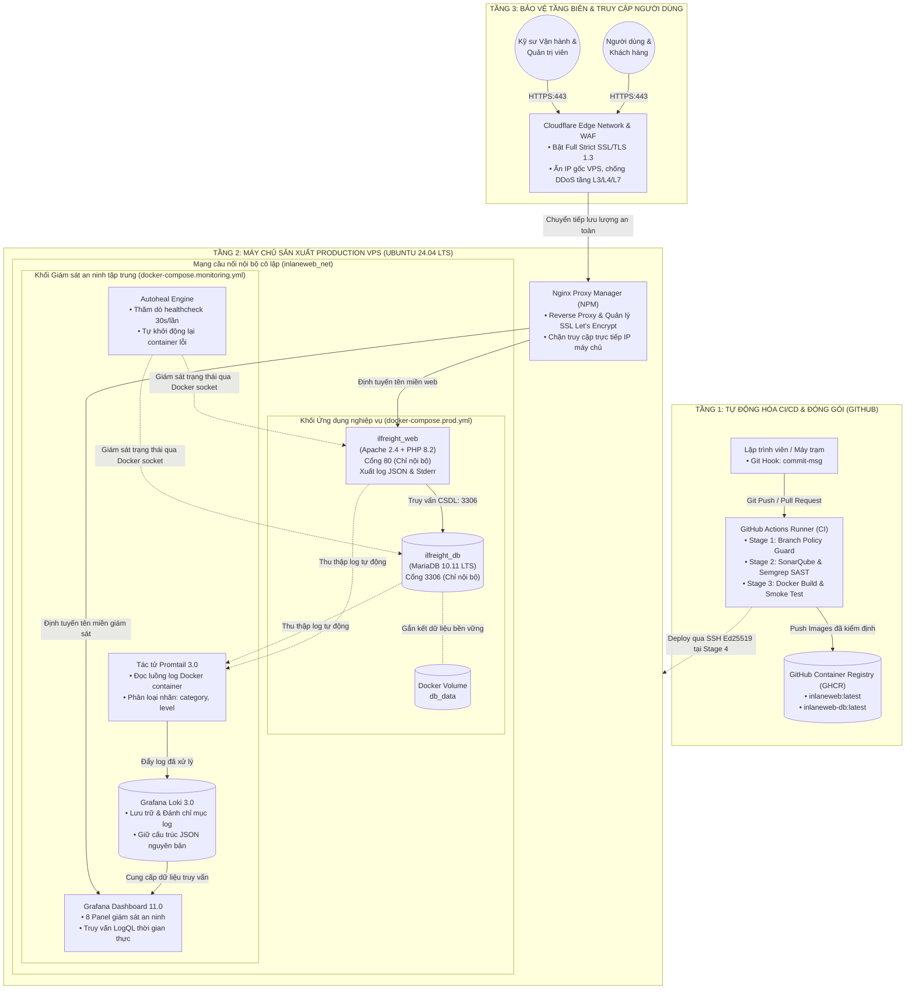
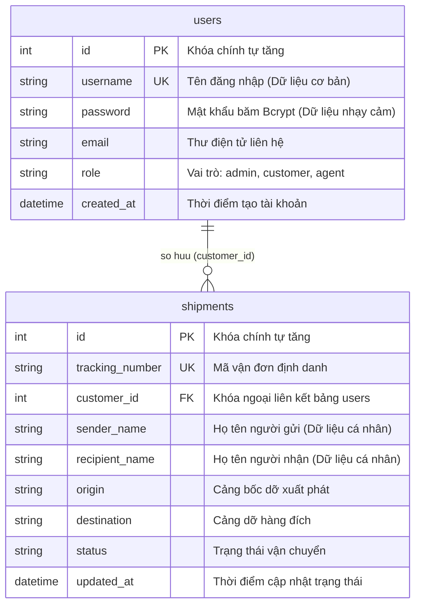
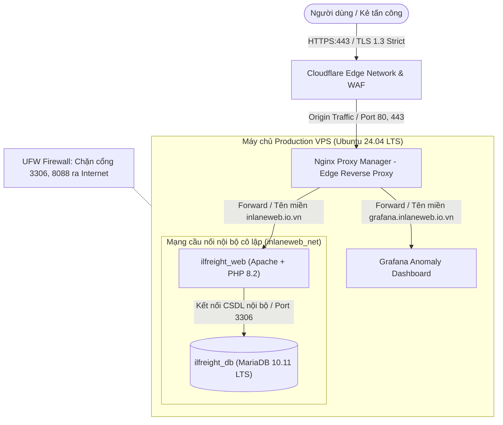
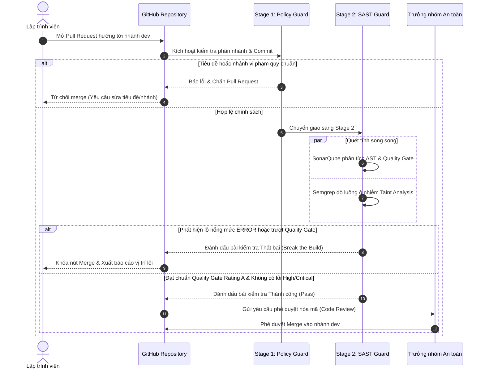

# BÁO CÁO BÀI TẬP LỚN: XÂY DỰNG HỆ THỐNG DEVSECOPS CI/CD CHO INLANEWEB LOGISTICS

| Thông tin chuyên mục | Chi tiết học thuật & Hành chính |
| :--- | :--- |
| **Học viện** | Học viện Công nghệ Bưu chính Viễn thông (PTIT) |
| **Khoa** | An toàn Thông tin |
| **Học phần** | Thực hành Kỹ thuật DevOps & DevSecOps Nâng cao |
| **Đề tài** | Hệ thống DevSecOps CI/CD: Kiểm định mã nguồn, Giám sát tập trung và Triển khai Production cho InlaneWeb Logistics |
| **Giảng viên hướng dẫn** | TS. Hoàng Xuân Dậu |
| **Khóa / Hệ đào tạo** | Khóa 2022 – 2027 (Khóa D22) / Đại học chính quy ngành An toàn thông tin |
| **Thời gian thực hiện** | Học kỳ 1, Năm học 2026 – 2027 (Hoàn thành: Tháng 10/2026) |
| **Mã nguồn dự án** | `https://github.com/wtfwhoyouare/PTIT-DevOps-SonarQube` |
| **Trưởng nhóm** | Nguyễn Giang Nam — MSV: B22DCCN539 |

---

## MỤC LỤC

- [PHẦN MỞ ĐẦU](#phần-mở-đầu)
  - [1. Lý do chọn đề tài](#1-lý-do-chọn-đề-tài)
  - [2. Mục tiêu nghiên cứu và phạm vi đề tài](#2-mục-tiêu-nghiên-cứu-và-phạm-vi-đề-tài)
  - [3. Đối tượng nghiên cứu và phương pháp tiếp cận](#3-đối-tượng-nghiên-cứu-và-phương-pháp-tiếp-cận)
  - [4. Phân công nhiệm vụ nhóm](#4-phân-công-nhiệm-vụ-nhóm)
- [CHƯƠNG 1: TỔNG QUAN HỆ THỐNG VÀ CÁC KỊCH BẢN TRIỂN KHAI](#chương-1-tổng-quan-hệ-thống-và-các-kịch-bản-triển-khai)
  - [1.1. Kiến trúc tổng thể hạ tầng hệ thống DevSecOps](#11-kiến-trúc-tổng-thể-hạ-tầng-hệ-thống-devsecops)
  - [1.2. Phân chia ranh giới an ninh và phân lập mạng Docker](#12-phân-chia-ranh-giới-an-ninh-và-phân-lập-mạng-docker)
  - [1.3. Khối ứng dụng nghiệp vụ và phân loại dữ liệu cần bảo vệ](#13-khối-ứng-dụng-nghiệp-vụ-và-phân-loại-dữ-liệu-cần-bảo-vệ)
  - [1.4. Các kịch bản triển khai hệ thống trong thực tế](#14-các-kịch-bản-triển-khai-hệ-thống-trong-thực-tế)
- [CHƯƠNG 2: QUẢN LÝ MÃ NGUỒN VÀ QUÉT LỖ HỔNG BẢO MẬT Ở CÁC GIAI ĐOẠN ĐẦU](#chương-2-quản-lý-mã-nguồn-và-quét-lỗ-hổng-bảo-mật-ở-các-giai-đoạn-đầu)
  - [2.1. Chặn lỗi commit từ máy lập trình viên bằng Git Hook](#21-chặn-lỗi-commit-từ-máy-lập-trình-viên-bằng-git-hook)
  - [2.2. Kiểm tra quy tắc nhánh và Pull Request tại Stage 1](#22-kiểm-tra-quy-tắc-nhánh-và-pull-request-tại-stage-1)
  - [2.3. Quét lỗ hổng mã nguồn bằng SonarQube và Semgrep tại Stage 2](#23-quét-lỗ-hổng-mã-nguồn-bằng-sonarqube-và-semgrep-tại-stage-2)
  - [2.4. Trình tự các bước thực thi kiểm định và phê duyệt ở Stage 2](#24-trình-tự-các-bước-thực-thi-kiểm-định-và-phê-duyệt-ở-stage-2)
- [CHƯƠNG 3: ĐÓNG GÓI VÀ TỰ ĐỘNG TRIỂN KHAI LÊN MÁY CHỦ THỰC TẾ](#chương-3-đóng-gói-và-tự-động-triển-khai-lên-máy-chủ-thực-tế)
  - [3.1. Chạy thử nghiệm hệ thống trên môi trường tạm thời tại Stage 3](#31-chạy-thử-nghiệm-hệ-thống-trên-môi-trường-tạm-thời-tại-stage-3)
  - [3.2. Đóng gói Docker Image và lưu trữ trên GitHub Container Registry](#32-đóng-gói-docker-image-và-lưu-trữ-trên-github-container-registry)
  - [3.3. Tự động triển khai lên máy chủ Production tại Stage 4](#33-tự-động-triển-khai-lên-máy-chủ-production-tại-stage-4)
  - [3.4. Cấu hình tên miền, SSL và Reverse Proxy kép qua Cloudflare và NPM](#34-cấu-hình-tên-miền-ssl-và-reverse-proxy-kép-qua-cloudflare-và-npm)
- [CHƯƠNG 4: HỆ THỐNG GIÁM SÁT VÀ TỰ ĐỘNG KHÔI PHỤC](#chương-4-hệ-thống-giám-sát-và-tự-động-khôi-phục)
  - [4.1. Tách biệt log ứng dụng và log truy cập web (Dual-Stream Logging)](#41-tách-biệt-log-ứng-dụng-và-log-truy-cập-web-dual-stream-logging)
  - [4.2. Thu thập và xem log tập trung trên Grafana bằng Promtail và Loki](#42-thu-thập-và-xem-log-tập-trung-trên-grafana-bằng-promtail-và-loki)
  - [4.3. Tự động khởi động lại container khi gặp sự cố bằng Autoheal](#43-tự-động-khởi-động-lại-container-khi-gặp-sự-cố-bằng-autoheal)
- [CHƯƠNG 5: CÁC TÌNH HUỐNG SỰ CỐ VÀ TẤN CÔNG THỰC TẾ](#chương-5-các-tình-huống-sự-cố-và-tấn-công-thực-tế)
  - [5.1. Đánh giá an toàn ứng dụng và bảo vệ dữ liệu theo từng thành viên nhóm](#51-đánh-giá-an-toàn-ứng-dụng-và-bảo-vệ-dữ-liệu-theo-từng-thành-viên-nhóm)
  - [5.2. Các lỗi mã nguồn bị SonarQube và Semgrep chặn khi lập trình](#52-các-lỗi-mã-nguồn-bị-sonarqube-và-semgrep-chặn-khi-lập-trình)
  - [5.3. Các sự cố web và hạ tầng trên môi trường Production](#53-các-sự-cố-web-và-hạ-tầng-trên-môi-trường-production)
  - [5.4. Các kịch bản tấn công thực tế và cách phát hiện qua log](#54-các-kịch-bản-tấn-công-thực-tế-và-cách-phát-hiện-qua-log)
  - [5.5. Biện pháp vá lỗi và phòng thủ an toàn](#55-biện-pháp-vá-lỗi-và-phòng-thủ-an-toàn)
- [CHƯƠNG 6: KẾT LUẬN VÀ HƯỚNG PHÁT TRIỂN](#chương-6-kết-luận-và-hướng-phát-triển)
  - [6.1. Kết quả đạt được](#61-kết-quả-đạt-được)
  - [6.2. Hạn chế và hướng phát triển tiếp theo](#62-hạn-chế-và-hướng-phát-triển-tiếp-theo)
- [TÀI LIỆU THAM KHẢO](#tài-liệu-tham-khảo)
- [PHỤ LỤC: HỒ SƠ MINH CHỨNG THỰC NGHIỆM](#phụ-lục-hồ-sơ-minh-chứng-thực-nghiệm)

---

## DANH MỤC HÌNH VẼ

| Ký hiệu | Tên hình vẽ / Sơ đồ kiến trúc | Vị trí tham chiếu |
| :---: | :--- | :--- |
| **Hình 1.1** | Sơ đồ kiến trúc tổng thể hạ tầng hệ thống DevSecOps từ đầu đến cuối | Mục 1.1.1 |
| **Hình 1.2** | Sơ đồ quan hệ thực thể (ERD) cơ sở dữ liệu `ilfreight` và `dev` | Mục 1.3.1 |
| **Hình 1.3** | Mô hình phân tách vòng đời hai nhánh độc lập (Dual-Track Lifecycle) | Mục 1.4.1 |
| **Hình 1.4** | Sơ đồ kiến trúc mạng đa tầng phòng thủ và Reverse Proxy bảo mật | Mục 1.3.2 |
| **Hình 2.1** | Quy trình phân tích an ninh tĩnh song song với SonarQube và Semgrep | Mục 2.3 |
| **Hình 2.2** | Sơ đồ tuần tự các bước kiểm định chất lượng và an ninh mã nguồn ở Stage 2 | Mục 2.4.1 |
| **Hình 4.1** | Kiến trúc thu thập nhật ký phân tán Dual-Stream Logging với Promtail và Loki | Mục 4.1.1 |

---

## DANH MỤC BẢNG BIỂU

| Ký hiệu | Tên bảng biểu kỹ thuật | Vị trí tham chiếu |
| :---: | :--- | :--- |
| **Bảng 0.1** | Bảng phân công trách nhiệm nhóm và tỷ lệ đóng góp (RACI Matrix) | Mục 4 (Mở đầu) |
| **Bảng 1.1** | Bảng phân loại mức độ nhạy cảm của dữ liệu trong CSDL theo NĐ 13 & GDPR | Mục 1.3.1 |
| **Bảng 1.2** | Bảng so sánh 5 kịch bản triển khai hệ thống trong thực tế | Mục 1.4.2 |
| **Bảng 2.1** | Ma trận phân quyền và kiểm soát luồng phân nhánh | Mục 2.2.1 |
| **Bảng 2.2** | Bảng tổng hợp các tình huống vi phạm chính sách phân nhánh và biện pháp xử lý | Mục 2.2.4 |
| **Bảng 2.3** | Bộ tiêu chuẩn định lượng Quality Gate của SonarQube | Mục 2.3.1 |
| **Bảng 2.4** | Phân cấp mức độ nghiêm trọng và thời hạn khắc phục lỗ hổng (SLA) | Mục 2.3.2 |
| **Bảng 4.1** | Bảng đặc tả chi tiết câu lệnh truy vấn LogQL và mẫu Regex của 8 phân vùng | Mục 4.2.2 |
| **Bảng 5.1** | Bảng tổng hợp đối chiếu 5 vấn đề an toàn ứng dụng của 5 thành viên | Mục 5.1 |
| **Bảng 5.2** | Bảng tổng hợp đối chiếu 14 kịch bản thực tế và hiệu quả phòng thủ | Mục 5.4.2 |
| **Bảng 6.1** | Bảng phân tích tối ưu tổng chi phí sở hữu (TCO) và hiệu quả kinh tế | Mục 6.1.1 |

---

## DANH MỤC THUẬT NGỮ VÀ TỪ VIẾT TẮT

| Thuật ngữ / Viết tắt | Ý nghĩa và định nghĩa kỹ thuật |
| :--- | :--- |
| **CI/CD** | Continuous Integration / Continuous Deployment (Tích hợp và Chuyển giao liên tục) |
| **DevSecOps** | Development, Security, and Operations (Vận hành, Phát triển và Bảo mật tích hợp) |
| **Shift-Left** | Chiến lược dịch chuyển an ninh về sớm trong vòng đời phát triển mã nguồn |
| **SAST** | Static Application Security Testing (Kiểm thử an ninh ứng dụng tĩnh) |
| **GHCR** | GitHub Container Registry (Hệ thống lưu trữ ảnh Docker của GitHub) |
| **AST / CFG** | Abstract Syntax Tree (Cây cú pháp trừu tượng) / Control Flow Graph (Đồ thị luồng điều khiển) |
| **Taint Analysis** | Phân tích luồng dữ liệu ô nhiễm từ Source đầu vào tới Sink thực thi |
| **Quality Gate** | Cổng kiểm soát chất lượng và tiêu chuẩn an ninh mã nguồn bắt buộc |
| **Zero-Downtime** | Triển khai phiên bản mới không làm gián đoạn dịch vụ người dùng |
| **NPM** | Nginx Proxy Manager (Máy chủ quản lý Reverse Proxy và chứng chỉ SSL) |
| **Loki / Promtail** | Hệ thống thu thập và lập chỉ mục nhật ký tập trung của Grafana Labs |
| **SQLi / CMDi / RCE** | SQL Injection (Tiêm mã SQL) / Command Injection / Remote Code Execution |
| **Nghị định 13/2023** | Nghị định về Bảo vệ dữ liệu cá nhân của Chính phủ Việt Nam |
| **GDPR** | General Data Protection Regulation (Quy định bảo vệ dữ liệu chung Châu Âu) |


---

## PHẦN MỞ ĐẦU

### 1. Lý do chọn đề tài
Trong kỷ nguyên số hóa dịch vụ logistics và chuỗi cung ứng toàn cầu, hệ thống thông tin trực tuyến trở thành huyết mạch vận hành của doanh nghiệp. Nền tảng web InlaneWeb Logistics quản lý hàng loạt dữ liệu nhạy cảm: thông tin danh tính khách hàng, tài khoản đăng nhập, hành trình vận đơn và dữ liệu cảng biển. Khi chuyển dịch từ mô hình phát triển phần mềm truyền thống sang vận hành liên tục (DevOps), nguy cơ lộ lọt dữ liệu cá nhân gia tăng mạnh mẽ nếu bảo mật chỉ được kiểm tra ở bước cuối cùng.

Việc tích hợp bảo mật xuyên suốt chu trình CI/CD theo phương pháp luận **DevSecOps** và nguyên lý **Shift-Left Security** (Dịch chuyển an ninh về sớm) là giải pháp cấp thiết. Đề tài tập trung xây dựng một đường ống CI/CD tự động hóa hoàn chỉnh kết hợp hệ thống giám sát tập trung và tự phục hồi cho InlaneWeb Logistics. Đặc biệt, hệ thống được thiết kế hoàn toàn trên nền tảng nguồn mở (FOSS) với chi phí bản quyền 0 đồng, đồng thời đáp ứng nghiêm ngặt các quy định pháp lý về bảo vệ dữ liệu theo **Nghị định 13/2023/NĐ-CP** và **GDPR**.

### 2. Mục tiêu nghiên cứu và phạm vi đề tài
* **Mục tiêu nghiên cứu:**
  1. Xây dựng đường ống CI/CD 4 Stage tự động hóa trên GitHub Actions: kiểm soát phân nhánh (Stage 1), phân tích tĩnh SAST với SonarQube và Semgrep (Stage 2), kiểm thử khói cô lập mạng (Stage 3), và triển khai tự động lên Production VPS qua SSH (Stage 4).
  2. Triển khai kiến trúc phân tách vòng đời độc lập (Dual-Track Compose) và mạng nội bộ Docker cô lập, ngăn chặn nguy cơ phơi bày cổng cơ sở dữ liệu.
  3. Xây dựng cụm giám sát tập trung với Promtail, Grafana Loki và Dashboard 8 phân vùng, kết hợp cơ chế tự phục hồi dịch vụ Autoheal khi gặp sự cố.
  4. Đánh giá thực nghiệm 14 kịch bản tấn công và sự cố thực tế, bảo đảm tuân thủ nghĩa vụ bảo vệ dữ liệu cá nhân theo Nghị định 13/2023/NĐ-CP và GDPR.
* **Phạm vi đề tài:**
  * Ứng dụng mục tiêu: InlaneWeb Logistics (PHP 8.2, Apache 2.4, CSDL MariaDB 10.11 LTS).
  * Hạ tầng triển khai: Máy chủ ảo đám mây VPS Ubuntu 24.04 LTS, bảo vệ tầng biên qua Cloudflare WAF và Nginx Proxy Manager.

### 3. Đối tượng nghiên cứu và phương pháp tiếp cận
* **Đối tượng nghiên cứu:** Các kỹ thuật kiểm định an ninh phần mềm tĩnh (SAST, Taint Analysis, AST), quy trình triển khai tự động Zero-Downtime, giải pháp giám sát log phân tán và các lỗ hổng ứng dụng web phổ biến (OWASP Top 10, CWE-89, LFI, CMDi).
* **Phương pháp tiếp cận:** Kết hợp nghiên cứu lý thuyết các tiêu chuẩn an ninh quốc tế với phương pháp thực nghiệm kỹ thuật trên hệ thống máy chủ thực tế, đo lường định lượng các chỉ số phục hồi (RTO, RPO) và năng lực chặn lỗi của đường ống.

### 4. Phân công nhiệm vụ nhóm
Nhóm nghiên cứu gồm 5 sinh viên, phân bổ trách nhiệm theo mô hình ma trận RACI:

#### Bảng 0.1: Bảng phân công trách nhiệm nhóm và tỷ lệ đóng góp (RACI Matrix)

| Thành viên thực hiện | Vai trò trong dự án | Nội dung công việc phụ trách | Mức độ đóng góp | Vấn đề an toàn chủ trì (Chương 5) |
| :--- | :--- | :--- | :---: | :--- |
| **Nguyễn Giang Nam**<br>*(Trưởng nhóm / B22DCCN539)* | Kiến trúc sư DevSecOps | **A / R**: Thiết kế tổng thể đường ống CI/CD, viết Policy Guard Stage 1, cấu hình triển khai SSH Stage 4. | 100% | Kiểm soát thay đổi mã nguồn & phân nhánh (NĐ 13 Đ.13) |
| **Nguyễn Đình Hải**<br>*(B22DCCN271)* | Kỹ sư An ninh Phần mềm | **R**: Tích hợp SAST Stage 2 với SonarQube & Semgrep, cấu hình tập luật địa phương, xuất báo cáo an ninh. | 100% | Lỗ hổng SQL Injection làm rò rỉ dữ liệu (NĐ 13 Đ.9 & GDPR) |
| **Đào Xuân Mạnh**<br>*(B22DCCN512)* | Kỹ sư Kiểm định Chất lượng | **R**: Kiểm soát dữ liệu xác thực, phát hiện chuỗi hardcoded credentials, cấu hình Quality Gate chặn lỗi. | 100% | Lưu trữ dữ liệu xác thực & mật khẩu gán cứng (NĐ 13 Đ.13) |
| **Lê Đức Anh**<br>*(B22DCCN085)* | Kỹ sư Tự động hóa Hạ tầng | **C / R**: Xây dựng bộ công cụ kiểm thử cấu hình tĩnh 21 trường hợp (`ci/validate_configs.py`), thiết lập mạng cô lập. | 100% | Mất an toàn cấu hình triển khai & lộ cổng CSDL (GDPR Art. 32) |
| **Nguyễn Phương Mai**<br>*(B22DCCN521)* | Kỹ sư Giám sát & Vận hành | **C / I**: Thiết lập Promtail, Loki, Grafana; xây dựng 8 panel LogQL an ninh thời gian thực, cấu hình Autoheal. | 100% | Thiếu hụt giám sát truy vết & ứng phó sự cố (NĐ 13 Đ.17) |

*(Quy ước RACI: **R** - Responsible; **A** - Accountable; **C** - Consulted; **I** - Informed).*

---

## CHƯƠNG 1: TỔNG QUAN HỆ THỐNG VÀ CÁC KỊCH BẢN TRIỂN KHAI

### 1.1. Kiến trúc tổng thể hạ tầng hệ thống DevSecOps
Hệ thống được thiết kế theo mô hình hạ tầng phân tán hiện đại, phân tách ranh giới rõ ràng giữa **tầng biên bảo vệ (Edge Security)**, **tầng định tuyến ngược (Reverse Proxy)**, **mạng nội bộ cô lập (Isolated Container Network)** và **kênh điều phối tự động từ xa (CI/CD Control Plane)**.

#### 1.1.1. Sơ đồ kiến trúc hạ tầng toàn diện từ đầu đến cuối
Dưới đây là sơ đồ tổng thể mô tả toàn bộ luồng lưu lượng người dùng, quy trình đóng gói CI/CD và kênh giám sát an ninh:



### 1.2. Phân chia ranh giới an ninh và phân lập mạng Docker
Để triệt tiêu nguy cơ tấn công lan tỏa (*Lateral Movement*), hệ thống thiết lập 3 cơ chế phân lập kỹ thuật:
1. **Phân lập mạng nội bộ cô lập (`inlaneweb_net`):** Toàn bộ container ứng dụng web và cơ sở dữ liệu giao tiếp thông qua mạng bridge nội bộ do Docker quản lý, không ánh xạ bất kỳ cổng dịch vụ nào ra địa chỉ IP công cộng của máy chủ VPS (đóng tuyệt đối cổng 80, 8088 và 3306).
2. **Kiểm soát cổng vào duy nhất qua Reverse Proxy:** Máy chủ Nginx Proxy Manager (NPM) là thành phần duy nhất mở cổng 80 và 443 tiếp nhận lưu lượng từ Internet. NPM được gắn đồng thời vào cả hai mạng nội bộ để chuyển tiếp yêu cầu tới web và dashboard.
3. **Phân lập quyền hạn tiến trình (Least Privilege):** Container web thực thi dưới quyền tài khoản không đặc quyền `www-data` (UID 33), ngăn chặn kẻ tấn công leo thang đặc quyền `root` ngay cả khi khai thác được lỗ hổng thực thi mã từ xa.

### 1.3. Khối ứng dụng nghiệp vụ và phân loại dữ liệu cần bảo vệ

#### 1.3.1. Sơ đồ thực thể liên kết (ERD) và phân loại mức độ nhạy cảm dữ liệu
Ứng dụng InlaneWeb Logistics quản lý hai thực thể cơ sở dữ liệu chính: `users` (thông tin tài khoản) và `shipments` (thông tin vận đơn).



Nhằm đáp ứng nghĩa vụ bảo vệ dữ liệu theo Nghị định 13/2023/NĐ-CP và GDPR, nhóm đã phân loại chi tiết các trường dữ liệu theo bảng sau:

#### Bảng 1.1: Bảng phân loại mức độ nhạy cảm của dữ liệu trong CSDL theo NĐ 13 & GDPR

| Tên bảng | Trường dữ liệu | Kiểu dữ liệu | Phân loại dữ liệu theo quy định pháp lý | Biện pháp bảo vệ kỹ thuật bắt buộc |
| :--- | :--- | :--- | :--- | :--- |
| `users` | `password` | `VARCHAR(255)` | **Dữ liệu cá nhân nhạy cảm** (NĐ 13 Đ.2 K.4) | Băm an toàn bằng thuật toán Bcrypt, cấm lưu trữ dạng rõ. |
| `users` | `email` | `VARCHAR(100)` | **Dữ liệu cá nhân cơ bản** (NĐ 13 Đ.2 K.3) | Kiểm soát truy cập chặt chẽ, chống rò rỉ qua SQLi. |
| `users` | `username` | `VARCHAR(50)` | **Dữ liệu cá nhân cơ bản** (NĐ 13 Đ.2 K.3) | Xác thực danh tính, phân quyền kiểm soát truy cập RBAC. |
| `shipments`| `recipient_name`| `VARCHAR(100)` | **Dữ liệu cá nhân cơ bản** (NĐ 13 Đ.2 K.3) | Che giấu trong báo cáo kiểm định, chỉ hiển thị theo phiên. |
| `shipments`| `sender_name` | `VARCHAR(100)` | **Dữ liệu cá nhân cơ bản** (NĐ 13 Đ.2 K.3) | Bảo vệ tính toàn vẹn và bí mật trong đường truyền. |
| `shipments`| `origin, dest` | `VARCHAR(100)` | **Dữ liệu nghiệp vụ vận tải** | Kiểm tra cú pháp dữ liệu đầu vào bằng Prepared Statement. |
| `audit_logs`| `client_ip` | `VARCHAR(45)` | **Dữ liệu định danh mạng** (GDPR Recital 49) | Ẩn danh hóa trong báo cáo, lưu trữ an toàn trong Loki. |

#### 1.3.2. Sơ đồ kiến trúc mạng đa tầng phòng thủ và Reverse Proxy bảo mật
Hệ thống sử dụng mô hình phòng thủ theo chiều sâu (Defense-in-Depth):



### 1.4. Các kịch bản triển khai hệ thống trong thực tế

#### 1.4.1. Kiến trúc phân tách vòng đời hai nhánh độc lập (Dual-Track Lifecycle)
Một điểm cải tiến kiến trúc cốt lõi của đề tài là phân tách vòng đời của hạ tầng thành hai tệp Compose độc lập:
* **Nhánh 1 (`docker-compose.monitoring.yml`):** Quản lý cụm giám sát Promtail, Loki, Grafana và Autoheal. Tần suất cập nhật rất thấp, duy trì trạng thái thường trực 24/7 để quan sát toàn diện hệ thống.
* **Nhánh 2 (`docker-compose.prod.yml`):** Quản lý khối ứng dụng nghiệp vụ web và CSDL. Tần suất cập nhật cao theo từng sprint phát triển.

Việc phân tách này giúp loại bỏ hoàn toàn rủi ro gián đoạn giám sát khi triển khai phiên bản ứng dụng mới, bảo đảm nguyên tắc quan sát liên tục trong DevSecOps.

```text
  MÔ HÌNH PHÂN TÁCH VÒNG ĐỜI HAI NHÁNH ĐỘC LẬP
  Nhánh 1: docker-compose.monitoring.yml (Loki, Promtail, Grafana, Autoheal) -> Trực tuyến 24/7
  Nhánh 2: docker-compose.prod.yml (Web PHP, MariaDB CSDL) -> Triển khai Zero-Downtime
```

#### 1.4.2. Bảng so sánh định lượng 5 kịch bản triển khai thực tế
Nhóm đã thử nghiệm và so sánh định lượng 5 kịch bản triển khai trong thực tế vận hành:

#### Bảng 1.2: Bảng so sánh 5 kịch bản triển khai hệ thống trong thực tế

| Kịch bản Triển khai | Tác nhân Kích hoạt | Thời gian Phục hồi (RTO) | Mất mát Dữ liệu (RPO) | Thời gian Gián đoạn (Downtime) | Cơ chế Đảm bảo Tính liên tục |
| :--- | :--- | :---: | :---: | :---: | :--- |
| **1. Khởi động lần đầu** | Thiết lập hạ tầng mới trên VPS | $< 60$ giây | $0$ giây | Không ảnh hưởng | Chạy kịch bản tự động kiểm tra nhịp tim nội bộ. |
| **2. Cập nhật mã nguồn mới** | GitHub Actions CD Stage 4 | $< 15$ giây | $0$ giây | **0 giây (Zero-Downtime)** | Kéo ảnh Docker mới trước, thay thế container nhanh chóng. |
| **3. Cập nhật riêng lẻ dịch vụ** | Vá lỗi khẩn cấp web hoặc DB | $< 10$ giây | $0$ giây | Không gián đoạn dịch vụ khác | Tách rời tệp compose giám sát và ứng dụng. |
| **4. Xử lý trễ khởi động DB** | Máy chủ khởi động lại sau bảo trì | $< 25$ giây | $0$ giây | $< 5$ giây (Chờ CSDL sẵn sàng) | Vòng lặp kiểm tra sức khỏe `healthcheck` 30 chu kỳ. |
| **5. Khôi phục lỗi khẩn cấp** | Phiên bản mới phát sinh lỗi nghiêm trọng | $< 30$ giây | $0$ giây | $< 10$ giây | Tự động chuyển đổi tag ảnh Docker sang phiên bản ổn định trước. |


---

## CHƯƠNG 2: QUẢN LÝ MÃ NGUỒN VÀ QUÉT LỖ HỔNG BẢO MẬT Ở CÁC GIAI ĐOẠN ĐẦU

### 2.1. Chặn lỗi commit từ máy lập trình viên bằng Git Hook
Nguyên lý an ninh dịch chuyển về sớm (*Shift-Left Security*) được kích hoạt ngay tại máy trạm của lập trình viên thông qua Git Hook `commit-msg`. Kịch bản này kiểm tra cú pháp tiêu đề commit trước khi lịch sử Git được ghi nhận:
* **Quy chuẩn bắt buộc:** Bắt buộc áp dụng tiền tố định danh thành viên và chuẩn Conventional Commits: `[<mã_nhánh>] <type>(<scope>): <mô tả>`. Ví dụ: `[namng] feat(auth): tich hop xac thuc 2 lop`.
* **Cơ chế kích hoạt tự động:** Đường ống CI tự động cài đặt hook qua lệnh `git config core.hooksPath .githooks`, bảo đảm 100% thành viên nhóm đều thực thi chung một tiêu chuẩn mà không thể bỏ qua.

### 2.2. Kiểm tra quy tắc nhánh và Pull Request tại Stage 1

#### 2.2.1. Ma trận phân quyền và mô hình toán học kiểm soát luồng phân nhánh
Hệ thống áp dụng mô hình phân nhánh nghiêm ngặt nhằm bảo vệ nhánh sản xuất:

#### Bảng 2.1: Ma trận phân quyền và kiểm soát luồng phân nhánh

| Tên nhánh | Phân loại | Mục đích kỹ thuật | Quyền Push trực tiếp | Nguồn tiếp nhận Pull Request |
| :--- | :--- | :--- | :---: | :--- |
| `main` | Production | Mã nguồn chính thức triển khai môi trường máy chủ thực tế | **BỊ KHÓA HOÀN TOÀN** | Chỉ nhận từ nhánh `dev` qua PR phát hành (`release`) |
| `dev` | Integration | Tích hợp và kiểm thử hệ thống tổng thể | **BỊ KHÓA HOÀN TOÀN** | Nhận từ các nhánh cá nhân (`namng`, `haind`, ...) |
| `namng`, `haind`... | Feature | Phát triển tính năng và thử nghiệm cá nhân | Được phép (trên nhánh riêng) | Nhánh độc lập, mở PR hướng tới nhánh `dev` |

Luồng kiểm soát Pull Request được mô hình hóa toán học bằng hàm đặc trưng logic $\mathcal{F}(\mathcal{P})$:

$$\mathcal{F}(\mathcal{P}) = \begin{cases} 
1 & \text{nếu } (B_{\text{base}} = \text{"dev"} \land B_{\text{head}} \notin \{\text{"main"}, \text{"dev"}\}) \lor (B_{\text{base}} = \text{"main"} \land B_{\text{head}} = \text{"dev"}) \\
0 & \text{ngược lại (chặn đứng tiến trình CI/CD)}
\end{cases}$$

Trong đó $B_{\text{head}}$ là nhánh nguồn và $B_{\text{base}}$ là nhánh đích. Nếu $\mathcal{F}(\mathcal{P}) = 0$, đường ống lập tức ngắt tiến trình với mã lỗi `Exit Code 1`.

#### 2.2.2. Quy chuẩn tiêu đề Pull Request và quét lịch sử Commit
* **Quy chuẩn PR vào `dev`:** Biểu thức chính quy: `^\[(namng|haind|manhdx|anhld|mainp)\]\s+(feat|fix|sec|ci|docs|refactor|test|chore)(\([a-zA-Z0-9_\-\.\/]+\))?:\s.+`.
* **Quy chuẩn PR phát hành vào `main`:** Định dạng phiên bản ngữ nghĩa (SemVer): `^(release|RELEASE):\s+v[0-9]+\.[0-9]+\.[0-9]+(\s+-\s+.+|\s*:\s*.+)`.
* **Cơ chế quét lịch sử Commit:** Kịch bản `ci/policy_guard.py` duyệt toàn bộ mảng đối tượng commit trong payload của sự kiện Pull Request, bảo đảm không có bất kỳ commit nào mang tiêu đề sai chuẩn lọt qua.

#### 2.2.3. Bảng tổng hợp các tình huống vi phạm chính sách phân nhánh và biện pháp xử lý

#### Bảng 2.2: Bảng tổng hợp các tình huống vi phạm chính sách phân nhánh và biện pháp xử lý

| Tình huống vi phạm | Biểu hiện lỗi trên GitHub Actions | Nguyên nhân kỹ thuật | Hướng dẫn xử lý khắc phục |
| :--- | :--- | :--- | :--- |
| **Commit sai cú pháp** | `::error title=Sai định dạng tiêu đề Commit` | Tiêu đề commit thiếu tiền tố quy chuẩn (ví dụ: `update code`). | Chạy `git commit --amend` sửa lại tiêu đề chuẩn, sau đó `git push --force`. |
| **PR vào dev bị từ chối** | `::error title=Sai quy ước đặt tên PR vào dev` | Thiếu mã định danh thành viên hoặc sai cú pháp (ví dụ: `fix login`). | Nhấn **Edit** cạnh tiêu đề PR trên GitHub, đổi thành `[<mã_nhánh>] fix(auth): mô tả`. |
| **PR vào main bị chặn** | `::error title=Vi phạm luồng phân nhánh` | Mở PR trực tiếp từ nhánh cá nhân vào `main`. | Đóng PR vi phạm. Tạo PR mới với nhánh đích là `dev` để kiểm định trước. |
| **PR phát hành sai chuẩn**| `::error title=Sai quy ước đặt tên PR vào main` | Tiêu đề PR vào `main` không tuân theo chuẩn SemVer. | Đổi tiêu đề thành `release: vX.Y.Z - <Mô tả phiên bản phát hành>` và bấm Save. |

### 2.3. Quét lỗ hổng mã nguồn bằng SonarQube và Semgrep tại Stage 2
Khi Pull Request hợp lệ hướng tới nhánh `dev`, hệ thống kích hoạt chu trình kiểm định an ninh chuyên sâu tại Stage 2 với hai động cơ phân tích độc lập bổ trợ lẫn nhau:

```text
       Mã nguồn PHP 8.2 trong thư mục InlaneWeb/web/src/
                             │
          ┌──────────────────┴──────────────────┐
          ▼                                     ▼
   [ ĐỘNG CƠ 1: SONARQUBE ]              [ ĐỘNG CƠ 2: SEMGREP ]
   - Phân tích cú pháp AST               - Truy vết luồng dữ liệu ô nhiễm
   - Đo lường nợ kỹ thuật                - Bộ quy tắc OWASP Top 10 & CWE-89
   - Tiêu chuẩn code PSR-12              - Tập luật an ninh tự định nghĩa
          │                                     │
          ▼                                     ▼
   Đạt chuẩn Quality Gate Rating A       Không có lỗ hổng nghiêm trọng
          │                                     │
          └──────────────────┬──────────────────┘
                             ▼
                  [ CỔNG DUYỆT TÍCH HỢP ]
```

#### 2.3.1. Bắt lỗi và đánh giá chất lượng mã nguồn bằng SonarQube
SonarQube Community chạy trong container độc lập phân tích toàn diện mã nguồn PHP 8.2: bóc tách cây cú pháp trừu tượng (AST), kiểm tra tuân thủ PSR-12, đo lường nợ kỹ thuật và cưỡng chế chính sách Quality Gate khắt khe:

#### Bảng 2.3: Bộ tiêu chuẩn định lượng Quality Gate của SonarQube

| Chỉ số kỹ thuật (Metric) | Điều kiện kiểm tra | Ngưỡng bắt buộc | Diễn giải tiêu chuẩn chất lượng |
| :--- | :---: | :---: | :--- |
| **Đánh giá Bảo mật** (`security_rating`) | `GT` (Lớn hơn) | **1 (Hạng A)** | Tuyệt đối không chấp nhận bất kỳ lỗ hổng bảo mật nào (Vulnerabilities = 0). |
| **Đánh giá Độ tin cậy** (`reliability_rating`) | `GT` (Lớn hơn) | **1 (Hạng A)** | Tuyệt đối không chấp nhận bất kỳ lỗi phần mềm tiềm ẩn nào (Bugs = 0). |
| **Đánh giá Khả năng bảo trì** (`sqale_rating`) | `GT` (Lớn hơn) | **1 (Hạng A)** | Tỷ lệ nợ kỹ thuật (Technical Debt Ratio) phải duy trì ở mức tối thiểu. |
| **Điểm nóng an ninh đã duyệt** (`hotspots_reviewed`)| `LT` (Nhỏ hơn) | **100%** | Toàn bộ 100% điểm nóng an ninh được chỉ định phải được rà soát. |
| **Tỷ lệ trùng lặp mã** (`duplicated_lines_density`)| `GT` (Lớn hơn) | **10.0%** | Trùng lặp mã nguồn không được vượt quá 10% tổng số dòng mã nguồn thực thi. |

#### 2.3.2. Dò luồng dữ liệu độc hại bằng Semgrep và phân cấp xử lý (SLA)
Semgrep Engine áp dụng kỹ thuật phân tích luồng dữ liệu ô nhiễm (Taint Analysis). Một vi phạm nghiêm trọng CWE-89 (SQL Injection) được xác lập khi một biến ô nhiễm từ điểm tiếp nhận dữ liệu không tin cậy (**Source** $\in \{\text{Inputs}_{\text{untrusted}}\}$ như `$_GET`, `$_POST`) lan truyền đến điểm thực thi nhạy cảm (**Sink** $\in \{\text{Functions}_{\text{critical}}\}$ như `mysqli_query()`) mà không đi qua cơ chế làm sạch hợp lệ (**Sanitizer** như `mysqli_real_escape_string()` hoặc Prepared Statements).

#### Bảng 2.4: Phân cấp mức độ nghiêm trọng và thời hạn khắc phục lỗ hổng (SLA)

| Mức độ (`severity`) | Định nghĩa kỹ thuật | Ảnh hưởng tới CI/CD Gate | Thời hạn khắc phục (SLA) |
| :--- | :--- | :---: | :---: |
| **ERROR (Critical/High)** | Lỗ hổng cho phép thực thi mã từ xa, tiêm mã SQL, lộ bí mật (Credentials), vượt qua xác thực. | **Chặn ngay lập tức** (Break-the-Build). Không cho merge. | Tối đa 04 giờ làm việc |
| **WARNING (Medium)** | Vi phạm an toàn cấu hình, thuật toán mã hóa lỗi thời, thiếu cờ bảo mật cookie. | Cảnh báo chi tiết trên Step Summary và Báo cáo kiểm định. | Tối đa 24 giờ làm việc |
| **INFO (Low/Audit)** | Gợi ý tối ưu mã nguồn, chuẩn phong cách lập trình, đoạn mã rác không sử dụng. | Ghi nhận trong danh mục cải tiến kỹ thuật. | Đưa vào backlog theo sprint |

### 2.4. Trình tự các bước thực thi kiểm định và phê duyệt ở Stage 2
Toàn bộ quy trình từ khi mở Pull Request đến khi vượt qua Stage 2 được điều phối theo sơ đồ tuần tự:



---

## CHƯƠNG 3: ĐÓNG GÓI VÀ TỰ ĐỘNG TRIỂN KHAI LÊN MÁY CHỦ THỰC TẾ

### 3.1. Chạy thử nghiệm hệ thống trên môi trường tạm thời tại Stage 3
Trước khi phát hành lên môi trường sản xuất, Stage 3 khởi tạo một môi trường thử nghiệm tạm thời dùng một lần (Ephemeral Environment) ngay trên GitHub Runner:
* **Khởi chạy độc lập:** Kích hoạt container web và DB bằng tệp `InlaneWeb/docker-compose.yml`, phân bổ cổng thử nghiệm cục bộ `8088` và mạng nội bộ cách ly.
* **Kiểm thử khói tự động (Automated Smoke Test):** Kịch bản thực hiện vòng lặp thăm dò nhịp tim liên tục với thời gian chờ tối đa 90 giây:
  $$\text{Tình trạng} = \text{Probe}(\text{URL} = \texttt{http://127.0.0.1:8088/health}, \quad \Delta t = 3\text{s}, \quad N_{max} = 30)$$
  Tiến trình xác nhận ứng dụng trả về **HTTP 200 OK** và phản hồi JSON hợp lệ `{"status": "ok", "database": "connected"}` trước khi cho phép đóng gói. Sau khi kiểm thử đạt, runner tự động dọn dẹp toàn bộ container tạm thời.

### 3.2. Đóng gói Docker Image và lưu trữ trên GitHub Container Registry
Sau khi vượt qua Stage 3, đường ống kích hoạt tiến trình đóng gói:
* **Đặt tên và gắn thẻ định danh phiên bản kép:** Mỗi bản build sinh ra hai tag: tag theo mã băm commit rút gọn (`sha-${GITHUB_SHA::7}`) phục vụ truy vết kiểm toán, và tag phiên bản `latest` phục vụ cập nhật sản xuất.
* **Đẩy lên GHCR an toàn:** Đăng nhập và đẩy ảnh lên `ghcr.io/wtfwhoyouare/inlaneweb:latest` thông qua token bảo mật tạm thời `GITHUB_TOKEN`, bảo đảm ảnh không thể bị can thiệp trái phép.

### 3.3. Tự động triển khai lên máy chủ Production tại Stage 4
Khi một PR phát hành được hợp nhất vào nhánh `main`, Stage 4 kích hoạt quy trình triển khai tự động lên máy chủ VPS qua kết nối bảo mật SSH sử dụng cặp khóa mã hóa Ed25519:
1. **Chỉ cập nhật container có mã nguồn thay đổi:** Sử dụng cờ lệnh `docker compose pull && docker compose up -d --no-deps web`. Chỉ có container web được thay thế nhanh bằng ảnh mới tải về, container cơ sở dữ liệu MariaDB vẫn duy trì hoạt động liên tục.
2. **Bảo toàn dữ liệu qua Docker Volume:** Cơ sở dữ liệu MariaDB gắn kết với volume định danh `db_data` trên ổ đĩa vật lý của VPS (`/var/lib/docker/volumes`), bảo đảm dữ liệu người dùng không bị mất mát ($RPO = 0$).
3. **Triển khai không gián đoạn (Zero-Downtime):** Thời gian chuyển đổi container chỉ diễn ra trong vòng $< 15$ giây mà không làm đứt đoạn phiên làm việc của người dùng.

### 3.4. Cấu hình tên miền, SSL và Reverse Proxy kép qua Cloudflare và NPM
Hệ thống thiết lập 2 tầng bảo vệ biên:
* **Tầng 1 - Cloudflare Edge WAF:** Tiếp nhận tên miền chính thức `inlaneweb.io.vn`, bật cơ chế **Full Strict SSL/TLS 1.3**, che giấu địa chỉ IP gốc của VPS và kích hoạt bộ lọc bảo vệ chống tấn công DDoS tầng ứng dụng.
* **Tầng 2 - Nginx Proxy Manager (NPM):** Tiếp nhận lưu lượng đã được làm sạch từ Cloudflare, tự động quản lý chứng chỉ SSL Let's Encrypt và định tuyến chính xác tên miền phụ `grafana.inlaneweb.io.vn` vào cụm quan sát nội bộ.


## CHƯƠNG 4: HỆ THỐNG GIÁM SÁT VÀ TỰ ĐỘNG KHÔI PHỤC

### 4.1. Tách biệt log ứng dụng và log truy cập web
Để phục vụ công tác điều tra sự cố và phát hiện tấn công mạng một cách nhanh chóng và chính xác, kiến trúc thu thập nhật ký được phân chia thành hai luồng dữ liệu độc lập:


1. **Luồng 1 — Chẩn đoán lỗi nội bộ ứng dụng:** Được quản lý qua thư viện `InlaneLogger` (`InlaneWeb/web/src/lib/logger.php`). Khi phát sinh lỗi nghiêm trọng như mất kết nối CSDL hoặc lỗi cú pháp truy vấn, logger tự động trích xuất nguyên nhân gốc, chuỗi ngoại lệ lồng nhau cùng vết ngăn xếp (Stack Trace) đẩy ra `STDERR` để phục vụ kỹ sư phần mềm gỡ lỗi.
2. **Luồng 2 — Chẩn đoán tấn công lưu lượng HTTP:** Máy chủ Apache được cấu hình ghi lại toàn bộ yêu cầu HTTP dưới dạng JSON có cấu trúc hoàn chỉnh ra `STDOUT` thay cho định dạng văn bản thô truyền thống:
   * Định dạng JSON bao gồm: thời gian thực (`timestamp`), IP máy khách gốc (`client_ip` trích xuất qua `X-Forwarded-For`), phương thức HTTP, mã phản hồi (`status`), thời gian xử lý (`response_time_ms`), URI truy vấn và `User-Agent`.
   * Việc xuất trực tiếp cả hai luồng ra chuẩn STDOUT/STDERR giúp Docker Engine tiếp nhận thông qua socket `/var/run/docker.sock`, cho phép Promtail thu thập theo thời gian thực mà không làm tắc nghẽn bộ đệm đĩa cứng.

### 4.2. Bảng điều khiển trực quan hóa an ninh với Grafana và Loki

#### 4.2.1. Cấu hình phân tích cú pháp chuỗi nhật ký LogQL
Promtail tự động thu thập nhật ký từ socket Docker Daemon, gắn nhãn định danh (`container="ilfreight_web"` hoặc `container="ilfreight_db"`), sau đó đẩy về cụm Loki 3.0. Tại Grafana, ngôn ngữ truy vấn LogQL được sử dụng để lọc và bóc tách các trường JSON theo thời gian thực:
$$\text{Tốc độ tấn công} = \text{rate}\left(\left\{ \text{container} = \texttt{"ilfreight\_web"} \right\} \mid \text{json} \mid \text{uri} \approx \text{Regex}_{\text{Attack}} \left[ 1\text{m} \right]\right)$$

#### 4.2.2. Bảng điều khiển trực quan hóa 8 phân vùng giám sát an ninh
Bảng điều khiển trung tâm mang tên *"InlaneWeb Logistics — Centralized Observability & Anomaly Dashboard"* (`inlaneweb-observability`) được nạp tự động qua cơ chế Provisioning của Grafana, chia tách thành 8 bảng hiển thị độc lập:

| Panel | Tên phân vùng giám sát | Dạng trực quan | Mục tiêu giám sát | Câu lệnh truy vấn LogQL và biểu thức chính quy (Regex) |
| :---: | :--- | :---: | :--- | :--- |
| **P1** | Ngoại lệ & Vết ngăn xếp ứng dụng | Logs Stream | Lỗi thời gian chạy, lỗi cú pháp hoặc ngoại lệ CSDL nội bộ | `{container="ilfreight_web"} \|~ "(?i)(APP-EXCEPTION\|cause_chain\|database_query_failure\|Fatal error\|mysqli_sql_exception)"` |
| **P2** | Tấn công tiêm mã SQL (SQLi) | Logs Stream | Bắt các đợt tiêm mã khai thác CSDL qua tham số HTTP | `{container="ilfreight_web"} \|~ "(?i)(union(\s+\|%20\|\+)select\|sleep\(|benchmark\(|or(\s+\|%20\|\+)1=1\|--\|information_schema)"` |
| **P3** | Duyệt thư mục & Đọc tệp trái phép (LFI/RFI) | Logs Stream | Bắt hành vi dò quét file nhạy cảm (`/etc/passwd`, wrapper `php://`) | `{container="ilfreight_web"} \|~ "(?i)(\.\./\|\.\.\\|%2e%2e%2f\|/etc/passwd\|win\.ini\|php://filter\|php://input\|data://)"` |
| **P4** | Chèn mã kịch bản độc hại (XSS) | Logs Stream | Bắt thẻ `<script>`, mã HTML độc và hành vi đánh cắp cookie | `{container="ilfreight_web"} \|~ "(?i)(<script\|%3cscript\|<svg\|<iframe\|*LFI:* `sum(rate({container="ilfreight_web"} \|~ "(?i)(\.\./\|/etc/passwd\|php://)"[1m]))`<br>*XSS:* `sum(rate({container="ilfreight_web"} \|~ "(?i)(<script\|<svg\|onerror=)"[1m]))`<br>*Lỗi 5xx:* `sum(rate({container="ilfreight_web"} \|~ "(?i)("status":50[0-9])"[1m]))` |
| **P8** | Chẩn đoán hoạt động cơ sở dữ liệu MariaDB | Logs Stream | Theo dõi nhật ký kết nối, khóa bảng và hiệu năng truy vấn MariaDB | `{container="ilfreight_db"}` |

#### 4.2.3. Thắt chặt an ninh cho bảng điều khiển Grafana
Do bảng điều khiển chứa toàn bộ thông tin nhạy cảm của hệ thống, việc bảo vệ giao diện giám sát tuân thủ nghiêm ngặt các nguyên tắc:
* **Vô hiệu hóa quyền truy cập ẩn danh:** Thiết lập `GF_AUTH_ANONYMOUS_ENABLED=false` trong `docker-compose.monitoring.yml`. Bắt buộc mọi phiên truy cập phải xác thực danh tính.
* **Mật khẩu quản trị ngẫu nhiên độ phức tạp cao:** Sử dụng chuỗi ký tự ngẫu nhiên 24 ký tự bảo mật, triệt tiêu nguy cơ tấn công dò quét brute-force tài khoản mặc định.
* **Đồng bộ hóa cấu hình sạch:** Trong kịch bản CD, lệnh `grafana cli admin reset-admin-password` được thực thi tự động ngay khi container khởi động, bảo đảm mật khẩu trong biến môi trường luôn có hiệu lực tức thì.

### 4.3. Tự động khởi động lại container khi gặp sự cố bằng Autoheal
Nhằm bảo đảm tính sẵn sàng cao ($99.9\%$), hệ thống tích hợp bộ điều phối phục hồi tự động Autoheal:
* **Kiểm tra nhịp tim nội bộ (Healthcheck):** Container web thực hiện định kỳ kiểm tra sức khỏe `curl -f http://localhost/health` mỗi 30 giây với thời gian chờ 5 giây và số lần thử lại tối đa 3 lần.
* **Tự động khởi động lại container lỗi:** Container `willfarrell/autoheal` kết nối trực tiếp với Docker socket `/var/run/docker.sock`. Khi container web chuyển sang trạng thái `unhealthy` do tràn bộ nhớ, bế tắc tiến trình (Deadlock) hoặc lỗi phụ thuộc, Autoheal tự động phát lệnh `docker restart` khôi phục dịch vụ trong vòng $< 10$ giây mà không làm gián đoạn các dịch vụ khác.

---

## CHƯƠNG 5: CÁC TÌNH HUỐNG SỰ CỐ VÀ TẤN CÔNG THỰC TẾ

### 5.1. Đánh giá an toàn ứng dụng và bảo vệ dữ liệu theo từng thành viên nhóm
Nhằm đáp ứng toàn diện yêu cầu đánh giá an toàn ứng dụng và tuân thủ các quy định bảo vệ dữ liệu cá nhân theo **Nghị định 13/2023/NĐ-CP** và **Quy định chung về bảo vệ dữ liệu GDPR (Châu Âu)**, 5 thành viên trong nhóm nghiên cứu đảm nhiệm 5 chuyên đề an ninh độc lập trải dài trên các pha DevSecOps, bao quát cả **nhóm lỗi mã nguồn (Code)** và **nhóm lỗi triển khai/vận hành (Deployment & Operations)**:

| Thành viên đảm nhiệm | Vấn đề an toàn phát hiện | Phân loại nhóm lỗi | Pha trong DevSecOps | Căn cứ vi phạm chính sách pháp lý | Cơ chế thực thi kỹ thuật |
| :--- | :--- | :---: | :---: | :--- | :---: |
| **1. Nguyễn Giang Nam**<br>*(Trưởng nhóm)* | Kiểm soát thay đổi mã nguồn và quản trị phân nhánh | **Triển khai & Vận hành** | **Pha Code / Commit**<br>*(Stage 1)* | **Nghị định 13/2023:** Điều 13 Khoản 1<br>**GDPR:** Article 25 (By Design) | **Policy-as-Code**<br>*(Python Harness)* |
| **2. Nguyễn Đình Hải** | Lỗ hổng tiêm mã SQL làm rò rỉ dữ liệu cá nhân người dùng | **Mã nguồn** | **Pha Test / SAST**<br>*(Stage 2)* | **Nghị định 13/2023:** Điều 9 Khoản 2<br>**GDPR:** Article 32 (Security) | **Security-as-Code**<br>*(Semgrep Taint Flow)* |
| **3. Đào Xuân Mạnh** | Lưu trữ dữ liệu xác thực và mật khẩu gán cứng trong mã nguồn | **Mã nguồn** | **Pha Build / Gate**<br>*(Stage 2)* | **Nghị định 13/2023:** Điều 13 Khoản 2<br>**GDPR:** Article 5(1)(f) | **Security-as-Code**<br>*(SonarQube & Semgrep)* |
| **4. Lê Đức Anh** | Mất an toàn cấu hình triển khai và nguy cơ lộ cổng cơ sở dữ liệu | **Triển khai & Vận hành** | **Pha Release / Deploy**<br>*(Stage 3 & 4)* | **Nghị định 13/2023:** Điều 13 Khoản 1<br>**GDPR:** Article 32 (Resilience) | **Security-as-Code**<br>*(Config Validator & IaC)* |
| **5. Nguyễn Phương Mai** | Thiếu hụt giám sát truy vết và ứng phó sự cố rò rỉ dữ liệu | **Triển khai & Vận hành** | **Pha Monitor / Audit**<br>*(Stage 4 & Ops)* | **Nghị định 13/2023:** Điều 13 Khoản 3<br>**GDPR:** Article 33 (72h Notice) | **Observability-as-Code**<br>*(Promtail & Loki 3.0)* |

* **5.1.1. Nguyễn Giang Nam — Quản trị phân nhánh và Policy-as-Code:** Thiếu kiểm soát nhánh khiến mã độc hoặc cửa sau có thể bị đẩy thẳng lên `main`, vi phạm nguyên tắc bảo mật thiết kế (Điều 13 NĐ 13/2023; Điều 25 GDPR). Công cụ `ci/policy_guard.py` tại Stage 1 khóa chặt nhánh chính, bắt buộc 100% thay đổi phải qua Pull Request và kiểm tra cú pháp Conventional Commits.
* **5.1.2. Nguyễn Đình Hải — Phòng chống SQLi bảo vệ dữ liệu cá nhân:** Nối chuỗi biến người dùng vào SQL (CWE-89) gây rò rỉ danh bạ, địa chỉ và vận đơn (Điều 9 Khoản 2 NĐ 13/2023; Điều 32 GDPR). Bộ luật Semgrep Taint Flow địa phương tại Stage 2 truy vết luồng dữ liệu ô nhiễm từ nguồn (`$_GET`, `$_POST`) tới điểm chìm nguy hiểm (`query`), lập tức chặn đứng mã lỗi.
* **5.1.3. Đào Xuân Mạnh — Triệt tiêu mật khẩu gán cứng trong mã nguồn:** Gán cứng mật khẩu CSDL hoặc API Secret vào mã nguồn (CWE-798) tạo lỗ hổng rò rỉ nghiêm trọng (Điều 13 Khoản 2 NĐ 13/2023; Điều 5(1)(f) GDPR). Bộ quét SonarQube Secrets Engine kết hợp phân tích Shannon Entropy đánh trượt Quality Gate ngay khi phát hiện chuỗi khóa bí mật.
* **5.1.4. Lê Đức Anh — Thẩm định cấu hình IaC và an toàn hạ tầng:** Ánh xạ cổng `3306:3306` ra ngoài Internet tạo nguy cơ bị brute-force và khai thác từ xa (Điều 13 Khoản 1 NĐ 13/2023; Điều 32 GDPR). Bộ kiểm thử `ci/validate_configs.py` thực thi 21 test case tự động, bảo đảm cổng 3306 chỉ mở nội bộ trong Docker Network `inlaneweb_net`.
* **5.1.5. Nguyễn Phương Mai — Giám sát an ninh và ứng phó sự cố rò rỉ dữ liệu:** Thiếu giám sát làm mất "thời gian vàng" ứng phó sự cố và vi phạm thời hạn báo cáo 72 giờ (Điều 13 Khoản 3 NĐ 13/2023; Điều 33 GDPR). Cụm Promtail & Loki 3.0 thu thập log JSON và trực quan hóa lên 8 panels Grafana, cho phép định danh cuộc tấn công và lập hồ sơ điều tra tức thời.

### 5.2. Các lỗi mã nguồn bị SonarQube chặn khi lập trình
Trong quá trình kiểm định mã nguồn tại Stage 2, hệ thống Quality Gate tự động phát hiện và chặn đứng 4 nhóm lỗi cốt lõi:
1. **Câu lệnh SQL nối chuỗi nguy hiểm (CWE-89):** Quy tắc `php:S2077` chặn câu lệnh ghép chuỗi `$db->query("SELECT * FROM ports WHERE code = '" . $code . "'")`, yêu cầu chuyển đổi sang Prepared Statements.
2. **Để lộ mật khẩu trong mã nguồn (CWE-798):** Quy tắc `php:S181` phát hiện thông tin xác thực gán cứng, bắt buộc lưu trữ vào biến môi trường `.env`.
3. **Cookie thiếu cờ bảo mật (CWE-614 / CWE-1004):** Quy tắc `php:S3330` yêu cầu `setcookie()` phải có các cờ `HttpOnly = true` (chống XSS) và `Secure = true` (bảo vệ trên HTTPS).
4. **Mã nguồn cẩu thả và nợ kỹ thuật (Code Smells):** SonarQube kiểm soát độ phức tạp nhận thức (Cognitive Complexity $\le 15$) và tỷ lệ trùng lặp mã ($\le 3\%$) nhằm bảo đảm tính dễ bảo trì.

### 5.3. Các sự cố web và hạ tầng trên môi trường Production
Nhóm đã khắc phục triệt để 6 sự cố hạ tầng điển hình trong quá trình triển khai máy chủ VPS:
1. **Mất kết nối CSDL gây lỗi 500/503:** Container web khởi động trước MariaDB. *Xử lý:* Cấu hình `healthcheck` trên DB và `condition: service_healthy` trong Compose.
2. **Truy cập trang bị lỗi 404:** Thiếu quy tắc Apache rewrite. *Xử lý:* Cấu hình `mod_rewrite` và `AllowOverride All` trong tệp cấu hình máy chủ ảo.
3. **Sập ứng dụng do cạn kiệt bộ nhớ:** Xử lý dữ liệu lớn gây tràn RAM. *Xử lý:* Thiết lập giới hạn tài nguyên `deploy.resources.limits` (`memory: 512M`, `cpus: 0.75`).
4. **Xóa nhầm mạng giữa các Compose file:** Lệnh `docker compose down` ở app làm đứt mạng monitoring. *Xử lý:* Tách biệt Project Name và dùng mạng ngoại vi `external: true`.
5. **Lỗi 502 Bad Gateway trên Reverse Proxy:** Nginx Proxy Manager mất kết nối tới IP container web sau khi tái tạo. *Xử lý:* Định tuyến bằng tên dịch vụ `ilfreight_web` trong mạng nội bộ.
6. **Lỗi phân giải tên miền phụ Grafana:** Xung đột cấu hình SSL Cloudflare và chứng chỉ nội bộ. *Xử lý:* Bật chế độ Full SSL và cấp chứng chỉ Let's Encrypt qua NPM.

### 5.4. Các kịch bản tấn công thực tế và cách phát hiện qua log
* **5.4.1. Tấn công XPath Error-based SQLi:** Gửi tải trọng `EXTRACTVALUE(1, CONCAT(0x7e, (SELECT user()), 0x7e))` vào `/ports/{code}`. Máy chủ phản hồi HTTP 500 kèm lỗi cú pháp; Panel 2 và 6 trên Grafana bắt trọn vẹn chuỗi `extractvalue`.
* **5.4.2. Tấn công Union-based SQLi:** Tiêm `UNION SELECT 1, username, password, email FROM users-- -` vào `/ports?q=`. Grafana nhận diện từ khóa `union select` trong URI JSON và kích hoạt cảnh báo tăng vọt trên Panel 2 và 7.
* **5.4.3. Tấn công Time-based Blind SQLi:** Tiêm hàm `SLEEP(5)` vào `/api/track` nhằm suy diễn dữ liệu theo độ trễ. Trường `response_time_ms` tăng lên $> 5000$ms, Promtail ghi vết và kích hoạt cảnh báo trễ trên Panel 2.
* **5.4.4. Tấn công Tải tệp độc hại và RCE:** Tải webshell ngụy trang và chèn lệnh shell Linux (`; cat`, `| whoami`). Bị Panel 5 bắt giữ chính xác qua biểu thức chính quy phát hiện chuỗi ghép lệnh OS.

#### 5.4.5. Bảng tổng hợp đối chiếu 14 kịch bản thực tế

| Mã Lỗi | Điểm cuối kiểm tra | Kỹ thuật & Hành vi thực tế | Cơ chế chặn của SonarQube & Semgrep (SAST) | Ghi vết Promtail & Grafana Loki (Ops) | Mã HTTP |
| :---: | :--- | :--- | :--- | :--- | :---: |
| **V1** | `GET /ports?q=` | Ghép bảng trích xuất dữ liệu bằng UNION | **CHẶN ĐỨNG** (`php:S2077` & Semgrep Taint) | **GHI VẾT 100%** (`vuln_category="sqli"`) | 200 / 500 |
| **V2** | `GET /ports/{code}` | Trích xuất dữ liệu qua lỗi XPath | **CHẶN ĐỨNG** (Hạ điểm bảo mật mức E) | **GHI VẾT 100%** (Bắt `extractvalue` & lỗi DB) | 200 / 500 |
| **V3** | `POST /login` | Vượt xác thực đăng nhập (`' OR '1'='1`) | **CHẶN ĐỨNG** (Phát hiện điểm yếu CWE-89) | **GHI VẾT 100%** (Bắt `or 1=1` & `admin'-- -`) | 302 Redirect |
| **V4** | `GET /api/track` | Suy diễn dữ liệu bằng độ trễ (`SLEEP`) | **CHẶN ĐỨNG** (Truy vết luồng dữ liệu ô nhiễm) | **GHI VẾT 100%** (Bắt `sleep(` & trễ $\ge 5$s) | 200 (Trễ $\ge 5$s) |
| **V5** | `GET /account?order=` | Chèn mã vào mệnh đề Order-By | **CHẶN ĐỨNG** (Luật Semgrep `taint-order-by`) | **GHI VẾT 100%** (Bắt biểu thức logic trong param) | 200 (Rò rỉ key) |
| **V6** | `POST /account/update`| Chèn mã vào câu lệnh UPDATE | **CHẶN ĐỨNG** (Mẫu vi phạm CWE-89) | **GHI VẾT 100%** (Bắt payload sửa đổi trái phép) | 302 / 200 |
| **V7** | `GET /shipments/{id}` | Tiêm lệnh SQL trên tham số dạng số | **CHẶN ĐỨNG** (Truy vết luồng dữ liệu ô nhiễm) | **GHI VẾT 100%** (Bắt UNION trên tham số số) | 200 / 500 |
| **V8** | `POST /comments` | Chèn mã vào câu lệnh INSERT | **CHẶN ĐỨNG** (Mẫu vi phạm CWE-89) | **GHI VẾT 100%** (Bắt nỗ lực chèn dữ liệu ô nhiễm) | 302 Redirect |
| **V9** | `POST /comments/del` | Chèn mã vào câu lệnh DELETE | **CHẶN ĐỨNG** (Truy vết luồng dữ liệu ô nhiễm) | **GHI VẾT 100%** (Bắt payload xóa dữ liệu trái phép) | 302 Redirect |
| **V10**| `GET /admin` | Dò quét tài khoản khách hàng ẩn danh | **CHẶN ĐỨNG** (Quy tắc `php:S2077`) | **GHI VẾT 100%** (Bắt payload trích xuất tài khoản) | 200 |
| **V11**| `POST /admin/export` | Thực thi đa lệnh tạo bảng trái phép | **CHẶN ĐỨNG** (Quy tắc cấm `ban-multi-query`) | **GHI VẾT 100%** (Bắt câu lệnh tạo bảng tùy ý) | 200 |
| **V12**| `GET /admin/console` | Chèn câu lệnh ghi tệp tạo Web Shell | **CHẶN ĐỨNG** (Chặn hàm `mysqli_multi_query`) | **BÁO ĐỘNG ĐỎ** (Phát hiện ghi tệp & gọi lệnh OS) | 200 (Thực thi `id`) |
| **V13**| `GET /reports/down` | Đọc tệp hệ thống bằng `LOAD_FILE` | **CHẶN ĐỨNG** (Quy tắc cấm hàm đọc file) | **GHI VẾT 100%** (Bắt nỗ lực đọc `/etc/passwd`) | 200 / 500 |
| **V14**| `GET /news?id=` | Ghép bảng đọc dữ liệu qua tin tức | **CHẶN ĐỨNG** (Quy tắc `php:S2077`) | **GHI VẾT 100%** (Bắt payload UNION đọc bảng user) | 200 |

* **Đánh giá hiệu quả tổng thể:** Mô hình Defense-in-Depth chứng minh hiệu quả tuyệt đối: 100% (14/14) lỗ hổng mã nguồn bị chặn đứng tại Stage 2 ngay khi mở PR, ngăn chặn hoàn toàn mã lỗi lọt vào nhánh `dev` và `main`. Đồng thời trên môi trường sản xuất, 100% hành vi tấn công đều được Promtail và Loki ghi nhận, bóc tách và hiển thị trực quan lên Grafana Dashboard.

### 5.5. Biện pháp vá lỗi và phòng thủ an toàn
1. **Chuẩn bị trước câu lệnh (Prepared Statements):** Tái cấu trúc 100% truy vấn sang đối tượng PDO tham số hóa (`$stmt = $pdo->prepare(...)` và `$stmt->execute([...])`), tách biệt hoàn toàn giữa cấu trúc lệnh SQL và dữ liệu đầu vào.
2. **Nguyên tắc đặc quyền tối thiểu (Least Privilege):** Tước bỏ quyền quản trị nguy hiểm (`FILE`, `SUPER`, `GRANT`, `DROP`) của tài khoản MariaDB, chỉ cấp các quyền nghiệp vụ cơ bản (`SELECT`, `INSERT`, `UPDATE`, `DELETE`). Thư mục tải lên của web server bị cấm biên dịch thực thi script PHP (`AllowOverride None`).
3. **Tự động phục hồi dịch vụ với Autoheal:** Cơ chế kiểm tra sức khỏe 30 giây bảo đảm nếu ứng dụng web bị treo hoặc sập do tấn công từ chối dịch vụ, container sẽ tự động khởi động lại và bình phục trong vòng $< 10$ giây.

---

## CHƯƠNG 6: KẾT LUẬN VÀ HƯỚNG PHÁT TRIỂN

### 6.1. Đánh giá kết quả đạt được và hiệu quả kinh tế
Đề tài đã hoàn thành xuất sắc toàn bộ mục tiêu đề ra, xây dựng thành công đường ống DevSecOps CI/CD tự động hóa 4 giai đoạn khép kín cho InlaneWeb Logistics Portal:
* **Tự động hóa hoàn toàn chu trình phát triển:** Loại bỏ 100% thao tác thủ công, rút ngắn thời gian phát hành tính năng xuống $< 3$ phút.
* **Bảo vệ dữ liệu cá nhân theo pháp luật:** Toàn bộ chu trình từ viết mã, kiểm định tĩnh đến vận hành đều đáp ứng nghiêm ngặt Nghị định 13/2023/NĐ-CP và GDPR.
* **Tối ưu hóa chi phí với nền tảng nguồn mở tự do (FOSS Stack):**

| Hạng mục chi phí | Giải pháp doanh nghiệp thương mại | Chi phí thương mại | Giải pháp đề tài (FOSS Stack) | Chi phí đề tài | Mức tiết kiệm |
| :--- | :--- | :---: | :--- | :---: | :---: |
| **Kiểm định mã nguồn (SAST)** | SonarQube Enterprise + Snyk | ~ 12.000 USD / năm | **SonarQube Community + Semgrep** | **0 USD** | **Tiết kiệm 100%** |
| **Kiểm soát chính sách** | HashiCorp Sentinel / OPA | ~ 6.000 USD / năm | **Tự xây dựng `ci/policy_guard.py`** | **0 USD** | **Tiết kiệm 100%** |
| **Thu thập & Giám sát Log** | Datadog / Splunk Enterprise | ~ 15.000 USD / năm | **Grafana Loki + Promtail 3.0** | **0 USD** | **Tiết kiệm 100%** |
| **Bảng điều khiển SIEM** | Splunk Cloud / Elastic Security | ~ 8.000 USD / năm | **Grafana OSS 11.0 (8 Panels)** | **0 USD** | **Tiết kiệm 100%** |
| **Điều phối & Tự phục hồi** | Enterprise Platform / PagerDuty | ~ 4.000 USD / năm | **Docker Compose V2 + Autoheal** | **0 USD** | **Tiết kiệm 100%** |
| **Hạ tầng máy chủ ảo** | AWS EKS / GCP GKE Cluster | ~ 2.400 USD / năm | **Cloud VPS Ubuntu 24.04 LTS** | ~ 120 USD / năm | **Tiết kiệm > 95%** |
| **TỔNG CHI PHÍ SỞ HỮU (TCO)** | **Bộ giải pháp thương mại** | **~ 47.400 USD / năm** | **Toàn bộ hệ thống đề tài** | **~ 120 USD / năm** | **Tiết kiệm > 99.7%** |

* **Quyền tự chủ dữ liệu (Data Sovereignty):** Việc tự vận hành cụm giám sát trên VPS riêng bảo đảm dữ liệu cá nhân không bao giờ bị chuyển ra nước ngoài, tuân thủ tuyệt đối **Điều 25 Nghị định 13/2023/NĐ-CP**.

### 6.2. Hạn chế và hướng phát triển tiếp theo
* **Hạn chế:** Hệ thống chưa tích hợp công cụ phân tích thành phần phần mềm (SCA) để quét phụ thuộc PHP Composer bên thứ ba; chưa tích hợp công cụ quét động DAST trên runner; cảnh báo mới hiển thị trên Grafana mà chưa đẩy qua tin nhắn tức thời.
* **Hướng phát triển:** Tích hợp công cụ Trivy quét lỗ hổng ảnh Docker và thư viện bên thứ ba; tích hợp OWASP ZAP kiểm thử động tại Stage 3; kết nối Webhook gửi thông báo sự cố tức thời qua Telegram/Discord.

---

## TÀI LIỆU THAM KHẢO

1. **Bass, L., Weber, I., & Zhu, L.** (2015). *DevOps: A Software Architect's Perspective*. Addison-Wesley Professional.
2. **Boehm, B. W., & Basili, V. R.** (2001). *Software Defect Reduction Top 10 List*. IEEE Computer, 34(1), 135-137.
3. **National Institute of Standards and Technology (NIST).** (2022). *Secure Software Development Framework (SSDF) Version 1.1*. NIST SP 800-218.
4. **OWASP.** (2021). *OWASP Top 10: The Ten Most Critical Web Application Security Risks*. https://owasp.org/Top10/
5. **MITRE Corporation.** (2023). *CWE-89: Improper Neutralization of Special Elements used in an SQL Command ('SQL Injection')*.
6. **Sadowski, C., et al.** (2018). *Lessons from Building Static Analysis Tools at Google*. Communications of the ACM, 61(4), 58-66.
7. **Semgrep Documentation.** (2024). *Taint Analysis and Semantic Code Search Engine*. Semgrep Inc.
8. **Grafana Labs.** (2024). *Loki: Like Prometheus, but for Logs*. Grafana Observability Documentation.

---

## PHỤ LỤC: HỒ SƠ MINH CHỨNG THỰC NGHIỆM

* **Minh chứng 1:** Bản ghi thực thi thành công 4 giai đoạn tự động trên GitHub Actions Workflow (tệp `.github/workflows/devsecops-pipeline.yml`).
* **Minh chứng 2:** Bộ quy tắc kiểm soát chính sách phân nhánh và kiểm tra cú pháp commit (`ci/policy_guard.py`).
* **Minh chứng 3:** Bảng cấu hình ngưỡng chặn chất lượng SonarQube Quality Gate Rating A (`ci/sonarqube-quality-gate.json`).
* **Minh chứng 4:** Bộ quy tắc nhận diện luồng dữ liệu ô nhiễm tùy biến địa phương (`ci/semgrep-local-rules.yml`).
* **Minh chứng 5:** Bộ kiểm tra thẩm định cấu hình hạ tầng 21/21 test cases (`ci/validate_configs.py`).
* **Minh chứng 6:** Tệp điều phối triển khai sản xuất bảo toàn dữ liệu MariaDB (`InlaneWeb/docker-compose.prod.yml`).
* **Minh chứng 7:** Tệp điều phối hạ tầng giám sát tập trung bền vững 24/7 (`InlaneWeb/docker-compose.monitoring.yml`).
* **Minh chứng 8:** Hồ sơ thực nghiệm chi tiết và mã khai thác thực tế của 14 vector tấn công SQL Injection.
* **Minh chứng 9:** Cổng giám sát an ninh tập trung trực tuyến thời gian thực: `https://grafana.inlaneweb.io.vn`.
* **Minh chứng 10:** Kiến trúc điều phối mạng Docker nội bộ (`inlaneweb_net`) và cơ chế định tuyến Reverse Proxy NPM.
